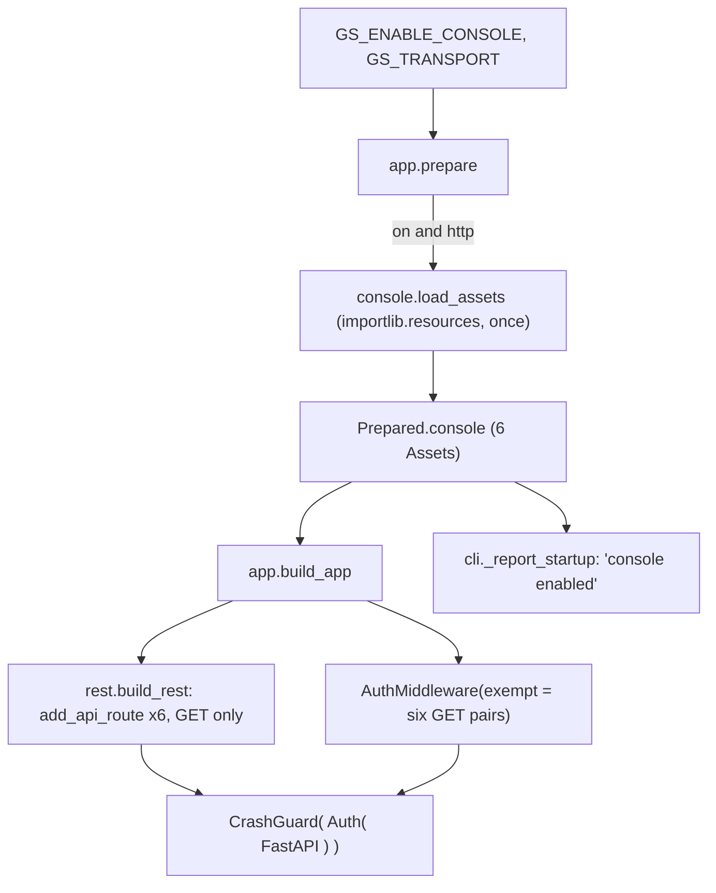
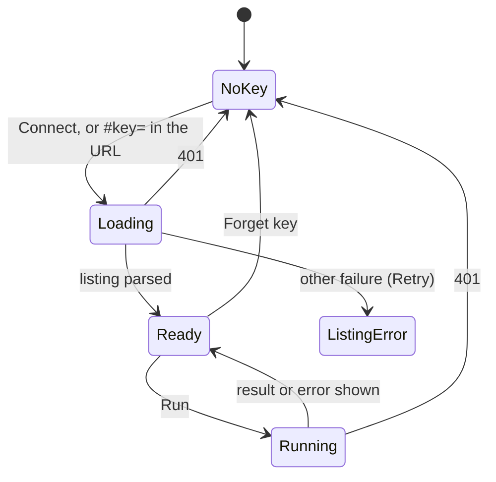

# Design Document

## Overview

The console is six static files served by the existing Publisher in HTTP mode, plus a small amount of wiring. A hackathon judge opens `/`, enters the API key, sees the published Flows from `/openapi.json`, runs one through the existing `POST /flows/{name}`, and reads outputs, elapsed time, the audit trail, a plain-words error, a `curl` command and an MCP client config. The page adds no execution path.

The server side has four parts and nothing else:

1. A switch: `GS_ENABLE_CONSOLE`, parsed like `GS_ENABLE_DOCS`.
2. A loader: `greenscreen/publisher/console/__init__.py` reads the six files from the installed package once, at startup, from an explicit allow-list.
3. Route registration and headers: six exact `GET` routes in `build_rest`, each returning the packaged bytes with fixed security headers.
4. One narrow exemption in `AuthMiddleware`: a frozenset of exact `(method, path)` pairs, empty by default.

The page side is plain HTML, CSS and ES modules. No framework, no build step, no template engine, no new dependency.

### What changes and what does not

| File | Change |
|---|---|
| `greenscreen/publisher/config.py` | `Settings.enable_console: bool = False` (last field, default keeps every existing construction valid); one `_bool` call in `load_settings`. |
| `greenscreen/publisher/console/__init__.py` | New. Route table, header constants, `Asset`, `load_assets`, `ConsoleAssetError`. Standard library only. |
| `greenscreen/publisher/console/{index.html,console.css,console.js,snippets.js,codes.json,favicon.svg}` | New static files. |
| `greenscreen/publisher/auth.py` | `AuthMiddleware.__init__` gains `exempt: frozenset[tuple[str, str]] = frozenset()`; `_allowed` checks it. |
| `greenscreen/publisher/rest.py` | `build_rest(..., console: Sequence[Asset] = ())` registers the routes. `_NoStore` is not changed. |
| `greenscreen/publisher/app.py` | `prepare` loads the assets when the console is on; `Prepared.console: tuple[Asset, ...] = ()`; `build_app` passes the exempt pairs and the assets. |
| `greenscreen/publisher/cli.py` | The startup report moves into `_report_startup(prepared)`: the existing record unchanged, then the fixed `console enabled` record when the console is on. |
| `pyproject.toml` | One `package-data` key. |
| `.env.example` | One commented `GS_ENABLE_CONSOLE=` line with a one-line comment. |

Not changed: the Flow runtime, Connector, recognizer, `calls.py`, `mcp_server.py`, `registry.py`, `vault.py`, any response body, `.kiro/steering`, any existing test body.

### Conventions for the executor

- DO NOT COMMIT. Leave every change in the working tree. The reviewer commits.
- Stop and report any production defect outside the files named above. Print no secret. Add no dependency.
- The final report gives test counts before and after, lists every test file added, states that no existing test file was edited, and lists everything not verified (including the manual checklist, which the executor does not run).

### Decisions

The fifteen decisions of the requirements are carried over unchanged. This design adds the following.

| # | Decision | Why |
|---|---|---|
| D1 | Assets are read once at startup into `bytes`; a request touches no file. | Fails fast on a broken wheel (Requirement 2.3), no per-request I/O, no path ever derived from a request. Files are immutable inside an installed package, so per-request reading buys nothing. About 40 KB of memory. |
| D2 | Routes are registered with `app.add_api_route(path, handler, methods=["GET"], include_in_schema=False, response_model=None)`, not with a Starlette `Route`. | A Starlette `Route` with `GET` silently adds `HEAD` (checked in source and by run). `APIRoute` does not, so the six routes are GET only, as Requirement 2.1 says. |
| D3 | The console check in `prepare` runs last. | Existing startup error precedence (settings, Flows, publish list, bindings) is unchanged. |
| D4 | Both switch conditions (`enable_console` and `transport == "http"`) are evaluated once, in `prepare`. `Prepared.console` is empty when off. | `build_app`, `cli` and tests read one value. |
| D5 | The Claude Code `.mcp.json` shape needs `"type": "http"`, so the page shows a third block, a `claude mcp add` command, instead of widening the generic JSON. | Primary documentation (see the table below). Requirements 9.5 and 14.5 are extended by one function, `buildClaudeCodeCommand`. |
| D6 | The page sends a request body built by the same `bodyText` function that builds the `curl` text. | The snippet then shows what the page sent. It also keeps large integers exact: digits are written into the JSON as typed, not through `Number`. |
| D7 | `codes.json` entries may carry `"show_message": true` (only `input_invalid` does). | Requirement 8.4 shows the server message for `input_invalid` only, and Requirement 8.8 forbids code-name literals in `console.js`. The flag moves the rule into data. |
| D8 | The `#key=` fragment is parsed by prefix and `decodeURIComponent`, not with `URLSearchParams`. | `URLSearchParams` turns `+` into a space, which corrupts a key that contains `+`. |
| D9 | Property 3 starts one short-lived `node` process per Hypothesis example. | Simple, no process lifecycle in the test. Measured at about 110 ms per spawn on the author's machine, so about 11 s for 100 examples. |

### What was checked while writing this design

Run on 2026-11-18 on Windows with Python 3.11.9, FastAPI 0.163.2, Starlette 1.6.0, uvicorn 0.38.0, Node v24.19.0. Throwaway scripts lived in the system temp directory and were deleted. The repository working tree has no code changes from this work.

- **Console off, today's behaviour** (real `prepare` and `build_app`, `httpx2` over `ASGITransport`): see "Recorded responses".
- **Console on, prototype.** The real stack with two prototype routes added in a throwaway wrapper and a subclass of `AuthMiddleware` that exempts the two pairs. Both registration styles (Starlette `Route` and `add_api_route`) were run. The results are in "Recorded responses".
- **`_NoStore` finding.** `_NoStore.wrapped` appends `Cache-Control: no-store` only when the response has no `Cache-Control` header. A console response that sets `no-store, no-transform` itself therefore passes through unchanged (observed: `no-store, no-transform`, one header). No change to `_NoStore` is needed. Every other route sets no `Cache-Control` of its own, so its header stays `no-store` (observed for `/health` and `/openapi.json`; the 401 body of `AuthMiddleware` sets `no-store` itself).
- **Snippet quoting under Node.** A 14-line prototype of `shellQuote` and `buildCurl` was run through the exact Node invocation of this design on eight cases (a quote, a double quote, a backslash, a newline, `$(x)`, a backtick, a Unicode line separator, an integer with a secret). `shlex.split` and `json.loads` returned the original values in all eight, and the secret text appeared in none of the outputs.
- **Contrast.** The ratios in "Data Models" were computed with the WCAG 2.2 formula.
- **Node.** `node --version` gives `v24.19.0` on the author's machine. CI machines may not have it, so every Node test skips with a fixed reason.

### Library documentation checks

All pages checked on 2026-11-18. "Installed" means the version in the project environment.

| Library / API | Page | Version | Conclusion |
|---|---|---|---|
| Starlette routing, `Route`, HEAD | https://starlette.dev/routing/ | installed 1.6.0 | The page does not mention HEAD. `Route.__init__` in the installed source adds `HEAD` whenever `GET` is listed (`self.methods.add("HEAD")`), and FastAPI's `routing.py` has no `HEAD` (searched). Run confirmed: `Route` gives `HEAD / 200` with a key, `add_api_route` gives `HEAD / 400`. Decision D2. |
| FastAPI, returning a `Response` directly | https://fastapi.tiangolo.com/advanced/response-directly/ | installed 0.163.2 | A returned `Response` is passed on without conversion or validation, so the handler owns the media type and headers. `add_api_route` is not on this page; its behaviour was confirmed by the run. |
| Starlette `Response` | https://starlette.dev/responses/ | installed 1.6.0 | `Content-Length` is added automatically. A charset is appended to text media types unless the media type already has one. The design passes `text/html; charset=utf-8`, `text/css; charset=utf-8` and `text/javascript; charset=utf-8` in full, and `application/json` and `image/svg+xml` without a charset. |
| Starlette pure ASGI middleware | https://starlette.dev/middleware/ | installed 1.6.0 | Pure ASGI classes with `__call__(scope, receive, send)` are the supported low-level style and avoid `BaseHTTPMiddleware` limits. `AuthMiddleware` and `_NoStore` already follow it; the change adds one constructor keyword and one membership test. |
| `importlib.resources.files` | https://docs.python.org/3/library/importlib.resources.html | Python 3.11.9 local; page covers 3.9 to 3.15 | `files(anchor)` exists since 3.9. The `package` keyword was renamed `anchor` in 3.12 and removed in 3.15, so the loader passes the anchor positionally (`files("greenscreen.publisher.console")`). The page warns that arguments are trusted like `open()`; the loader passes only constants from the allow-list. Works for packages inside a zip as well. |
| Node `--input-type=module` | https://nodejs.org/api/cli.html | local v24.19.0 | Valid values include `module`; the flag applies to `--eval` and stdin input. The run used `node --input-type=module -e <script>`. |
| `history.replaceState` | https://developer.mozilla.org/en-US/docs/Web/API/History/replaceState | living standard | Takes `(state, unused, url)`; the URL must be same-origin; it throws `SecurityError` if called too often. The page calls it once, with `location.pathname + location.search`. |
| `Clipboard.writeText` | https://developer.mozilla.org/en-US/docs/Web/API/Clipboard/writeText | living standard | Secure contexts only; throws `NotAllowedError` if refused. The page catches every failure and falls back to selecting the text. That `localhost` counts as a secure context is not on the fetched page and is not relied on. |
| CSP, `form-action` | https://developer.mozilla.org/en-US/docs/Web/HTTP/Reference/Headers/Content-Security-Policy/form-action | living standard | `form-action` does not fall back to `default-src`. The guide at https://developer.mozilla.org/en-US/docs/Web/HTTP/Guides/CSP describes `frame-ancestors 'none'` as the clickjacking control and lists inline handlers, `javascript:` URLs and `eval()` as blocked by a script policy. That `base-uri` and `frame-ancestors` also do not fall back is from the CSP specification, not from a fetched page. |
| `Cache-Control: no-transform` | https://developer.mozilla.org/en-US/docs/Web/HTTP/Reference/Headers/Cache-Control | living standard | Says no intermediary should transform the body. It is a request to intermediaries, not an enforcement. See "Risks". |
| `prefers-reduced-motion` | https://developer.mozilla.org/en-US/docs/Web/CSS/Reference/At-rules/@media/prefers-reduced-motion | Baseline since 2020 | `reduce` is the value to honour. |
| `<meta name="referrer">` | https://developer.mozilla.org/en-US/docs/Web/HTML/Reference/Elements/meta/name | living standard | Listed as a standard metadata name that controls the `Referer` header. |
| JavaScript modules | https://developer.mozilla.org/en-US/docs/Web/JavaScript/Guide/Modules | living standard | A module runs in its own scope; its top-level variables are not on `window`. The key variable is therefore not reachable from other scripts or from the developer console. Whether `script-src 'self'` covers a module and its static `import` in each browser is not on the fetched page; it is a manual checklist step. |
| WCAG 2.2 contrast ratio | https://www.w3.org/TR/WCAG22/#dfn-contrast-ratio | WCAG 2.2 | `(L1 + 0.05) / (L2 + 0.05)` with the sRGB relative-luminance formula (threshold 0.04045). Used by the contrast test and by the numbers below. |
| Kiro MCP configuration | https://kiro.dev/docs/mcp/configuration/ | page unversioned; mentions Kiro CLI 3.4.0 and 3.5.0 options | A remote server is `{"mcpServers": {"<name>": {"url": "...", "headers": {...}}}}`, with `${VAR}` expansion. The generic shape of Requirement 9.5 is correct for Kiro. The page lists no `type` member for remote servers. |
| Claude Code MCP | https://code.claude.com/docs/en/mcp | page unversioned | Remote HTTP: `claude mcp add --transport http <name> <url> --header "Name: value"`. In JSON, an entry with a `url` and no `type` is a configuration error; `type` accepts `http` (alias `streamable-http`). SSE is deprecated. The generic shape of Requirement 9.5 is **not** valid for Claude Code without `"type": "http"` (Decision D5). |
| Claude Desktop | secondary sources only: https://dev.to/quinn_854b15f517d8632ed4f/remote-mcp-servers-with-api-keys-what-works-in-6-clients-2026-4o2l (2026-09-30), https://designrevision.com/blog/claude-desktop-mcp-config | not stated | Both say `claude_desktop_config.json` takes local (stdio) servers, that the Connectors screen is OAuth-oriented with no field for a static header, and that `mcp-remote` bridges a header. No Anthropic page was fetched, so the page does not state this as fact. |
| Cursor, VS Code | same dev.to article (secondary) | not stated | The article says both take a `headers` object. Not checked on the vendors' pages. |
| `fetch`, `URLSearchParams`, `AbortController`, `sessionStorage` | the MDN `fetch` page was requested; the phrase search returned nothing | n/a | Not verified from documentation here. The design uses `fetch` only in its basic form (method, headers, body, `await`), does not use `URLSearchParams` (D8) or `AbortController`, and forbids `sessionStorage`. |

Dated lines appended by task 1.1 (2026-11-18). Nothing in this list changes a decision above.

- Checked 2026-11-18: https://developer.mozilla.org/en-US/docs/Web/API/Window/fetch, living standard, `fetch(resource, options)` takes an `options` object with `headers` as a `Headers` object or an object literal; a rejected promise means a network-level failure, not an HTTP error status. The page's own example tests `response.ok` before reading the body. Fills the `fetch` gap of the table above.
- Checked 2026-11-18: https://developer.mozilla.org/en-US/docs/Web/API/Response/ok, Baseline widely available since March 2017, `ok` is true for status 200 to 299.
- Checked 2026-11-18: https://developer.mozilla.org/en-US/docs/Web/API/Response/text, Baseline widely available since March 2017, `text()` returns a promise for a string, always decoded as UTF-8, and rejects with `TypeError` if the body is already used or cannot be decoded. The page therefore reads the body once, inside a `try`.
- Checked 2026-11-18: https://developer.mozilla.org/en-US/docs/Web/API/Headers/get, Baseline widely available since March 2017, `get(name)` is case-insensitive and returns `null` when the header is absent. `Retry-After` handling must treat `null` as absent.
- Checked 2026-11-18: https://fastapi.tiangolo.com/reference/fastapi/, installed 0.163.2, the page has no text for `add_api_route`, so it gives no documentation evidence. Evidence is the run below.
- Checked 2026-11-18: throwaway script outside the repo (deleted afterwards), FastAPI 0.163.2, Starlette 1.6.0, `httpx2` 2.16.2 over `ASGITransport`. A route added with `add_api_route("/a", handler, methods=["GET"], include_in_schema=False, response_model=None)` whose handler returns `Response(b"x", media_type="text/css; charset=utf-8", headers={"Cache-Control": "no-store, no-transform"})` gave `GET` 200 with `content-type: text/css; charset=utf-8`, `cache-control: no-store, no-transform` and `content-length: 1`. The route's `methods` set was `['GET']`, so no `HEAD` is registered (Decision D2 holds). Without the repository's replaced exception handler, `HEAD` and `OPTIONS` on that route answered 405 here; with it the recorded responses table shows 400 for a valid key, so the 400 comes from the repository's handler, not from the route.
- Checked 2026-11-18: https://docs.python.org/3/library/importlib.resources.html, Python 3.11.9 local, run of `importlib.resources.files("json").joinpath("tool.py").read_bytes()` returned the file's bytes (first bytes `b'r"""Command-'`). The loader's call shape works on 3.11.9 with the anchor passed positionally. This run used a standard library package, not the console package, which does not exist yet.
- Checked 2026-11-18: https://nodejs.org/api/cli.html, local Node v24.19.0, `node --version` printed `v24.19.0`. `node --input-type=module -e <script>` ran a module that imported a `data:text/javascript;base64,...` URL and printed `2` for a one-line export `f(x) = x + 1`. Nothing secret was printed. The design table's Node row holds on this machine.
- Checked 2026-11-18: https://docs.python.org/3/library/shlex.html, Python 3.11.9 local, `shlex.split(s, comments=False, posix=True)` runs in POSIX mode by default and does not strip comments by default, as the tests need. Run: `shlex.split("curl -d '{\"a\":\"it'\\''s\"}'")` gave `['curl', '-d', '{"a":"it\'s"}']`, so the `'\''` form of `shellQuote` round-trips. Python 3.12 changed only the handling of `None` as the argument (not relevant here). The page warns that `shlex` models Unix shells only, which matches the stated scope of Requirement 14 (POSIX shells).
- Checked 2026-11-18: https://developer.mozilla.org/en-US/docs/Web/API/History/replaceState, living standard, signature `replaceState(state, unused, url)`; `url` must be same origin; `SecurityError` when called too frequently or with an invalid URL. No version note beyond the table row; the page calls it once.
- Checked 2026-11-18: https://developer.mozilla.org/en-US/docs/Web/API/Clipboard/writeText, Baseline widely available since March 2020, secure contexts only, `NotAllowedError` when refused. The table row stands; the page still catches every failure.
- Checked 2026-11-18: https://developer.mozilla.org/en-US/docs/Web/CSS/Reference/At-rules/@media/prefers-reduced-motion, Baseline since 2020, not re-fetched in this task; the table row of the same day is the evidence and it stands.
- Checked 2026-11-18: https://hypothesis.readthedocs.io/en/latest/changelog.html, installed 6.170.15 (released 2026-11-06, the latest entry on the page), no library change is needed for a `@given` test that starts one `subprocess` per example. This is a note only. The page was not searched for subprocess guidance, and the per-example cost stays the measured figure of Decision D9.
- Installed versions on 2026-11-18 from `python -m pip list`: `fastapi` 0.163.2, `starlette` 1.6.0, `uvicorn` 0.38.0, `httpx2` 2.16.2 (the repository's HTTP test client; `httpx` 0.28.1 is also installed), `hypothesis` 6.170.15, `pytest` 9.1.1, `anyio` 4.16.0, `setuptools` 69.5.1; `node --version` v24.19.0; Python 3.11.9. Every version equals the one recorded in "What was checked while writing this design"; no version differs.

## Architecture

### Server wiring



The stack order is unchanged: `CrashGuard` outermost, then `AuthMiddleware`, then FastAPI with `_NoStore`. A console request passes the same three layers as any other request; `CrashGuard` therefore wraps the console routes (Requirement 13.3).

### Recorded responses (Requirement 2.9, Finding 5)

Real stack, key present or absent as shown, `Host: test`, `GS_AUTH_DISABLED` unset unless noted. `unauth` is the fixed `unauthorized` body (78 bytes), `invalid` is the fixed `request_invalid` body (74 bytes). No `Allow` header appeared in any response.

| Request | Console off | Console on, routes by `add_api_route` (chosen) | Console on, routes by `Route` (rejected, D2) |
|---|---|---|---|
| `GET /`, no key | 401 `unauth` | 200 `text/html; charset=utf-8`, `no-store, no-transform`, CSP present | 200, same |
| `GET /`, key | 400 `invalid` | 200, same as above | 200, same |
| `HEAD /`, no key | 401, empty body | 401, empty body | 401, empty body |
| `HEAD /`, key | 400, empty body | 400, empty body | **200**, empty body, console headers |
| `OPTIONS /`, no key | 401 `unauth` | 401 `unauth` | 401 `unauth` |
| `OPTIONS /`, key | 400 `invalid` | 400 `invalid` | 400 `invalid` |
| `POST /`, key | 400 `invalid` | 400 `invalid` | 400 `invalid` |
| `GET /console/console.css`, no key | 401 `unauth` | 200 `text/css; charset=utf-8`, `no-store, no-transform`, CSP present | 200, same |
| `HEAD /console/console.css`, no key | 401 | 401 | 401 |
| `GET /console/console.css/`, no key | 401 | 401 (not an exempt pair) | 401 |
| `GET /console/x`, key | 400 `invalid` | 400 `invalid` | 400 `invalid` |
| `GET /health`, no key | 200, `no-store` | 200, `no-store` | 200, `no-store` |
| `GET /openapi.json`, key | 200, `no-store`, 4240 bytes | 200, `no-store`, 4240 bytes | 200, `no-store`, 4240 bytes |
| `GET /`, `GS_AUTH_DISABLED=true`, `Host: 127.0.0.1` | 400 `invalid` | not run (see below) | not run |

Findings:

- **Console off** matches Finding 5 exactly: 401 without a key, 400 with a key, 400 with auth disabled on a loopback Host. `HEAD` and `OPTIONS` get the same status as `GET`.
- **`HEAD` and `OPTIONS` are never exempt.** `AuthMiddleware` sees the pair `("HEAD", "/")` first, which is not in the set, so a probe without a key gets 401. With a key, the chosen registration answers 400 (the replaced `StarletteHTTPException` handler maps the framework's 405 to `request_invalid`). The replaced handler also drops the `Allow` header. Nothing is added for them (Decision 14 of the requirements).
- A tunnel or monitor that probes with `HEAD /` will see 401. Open item 3.
- The console-on and auth-disabled combination was not run. By reading `_allowed`, the disabled branch returns before the exempt check, so the loopback Host rule covers the console routes (Requirement 3.4), and the new code does not change that branch.
- Status codes were taken from `httpx2.ASGITransport`, not from a real uvicorn socket. `HEAD` over a real socket was not run.

## Components and Interfaces

### 1. Configuration (`config.py`)

```python
enable_console = _bool(environ, "GS_ENABLE_CONSOLE")   # next to enable_docs
```

`_bool` is the parser of `GS_ENABLE_DOCS`: empty or unset is false, `true` and `false` are the only other accepted texts, anything else raises `StartupError("GS_ENABLE_CONSOLE: not_a_boolean (true or false)")`. The error never holds the value. `Settings` gains `enable_console: bool = False` after `publish_flows`. Its custom `__repr__` is untouched, so the repr shows no new setting (Requirement 1.3). The variable is parsed for both transports; stdio ignores it (Requirement 1.5) because `prepare` only loads assets for `http`.

### 2. The loader (`console/__init__.py`)

```python
ROUTES = (   # the explicit allow-list: (route path, file name, media type)
    ("/",                     "index.html",  "text/html; charset=utf-8"),
    ("/console/console.css",  "console.css", "text/css; charset=utf-8"),
    ("/console/console.js",   "console.js",  "text/javascript; charset=utf-8"),
    ("/console/snippets.js",  "snippets.js", "text/javascript; charset=utf-8"),
    ("/console/codes.json",   "codes.json",  "application/json"),
    ("/console/favicon.svg",  "favicon.svg", "image/svg+xml"),
)
PAIRS = frozenset(("GET", path) for path, _, _ in ROUTES)
HEADERS = {   # exactly these four on every console response, no other route
    "Content-Security-Policy": "default-src 'self'; script-src 'self'; style-src 'self'; "
        "img-src 'self'; font-src 'none'; connect-src 'self'; object-src 'none'; "
        "base-uri 'none'; form-action 'none'; frame-ancestors 'none'",
    "X-Content-Type-Options": "nosniff",
    "Referrer-Policy": "no-referrer",
    "Cache-Control": "no-store, no-transform",
}

@dataclass(frozen=True, slots=True)
class Asset: path: str; file: str; media_type: str; body: bytes

def load_assets() -> tuple[Asset, ...]   # raises ConsoleAssetError(file) on any failure
```

`load_assets` reads each file with `importlib.resources.files("greenscreen.publisher.console").joinpath(file).read_bytes()`. The file names come only from `ROUTES`; no request value ever reaches it, so there is no path traversal and no directory listing (nothing lists the package). `FileNotFoundError`, `ModuleNotFoundError` and `OSError` become `ConsoleAssetError(file)`; its message is the file name only. `prepare` turns it into `StartupError("console: missing_asset (<file>)")`, so the CLI exits 2 and prints no machine path (Requirement 2.3). The module imports only the standard library (Requirement 12.5).

### 3. Route registration (`rest.py`)

```python
for asset in console:
    app.add_api_route(asset.path, _serve(asset), methods=["GET"],
                      include_in_schema=False, response_model=None)

def _serve(asset):
    async def serve() -> Response:
        return Response(asset.body, media_type=asset.media_type, headers=HEADERS)
    return serve
```

Six exact paths, `GET` only, no wildcard, no path parameter, no mount, no static-files handler. The response is built per request from the cached bytes. The handler takes no `Request`, reads nothing from it, logs nothing and writes no `Call_Log_Record` (Requirement 10.2). `include_in_schema=False` and the fact that `/openapi.json` comes from `build_openapi(registry)` mean the OpenAPI document cannot change (Requirement 4.5).

**Headers and `_NoStore`.** `_NoStore` keeps a `Cache-Control` the response already has (see "What was checked"). The console handler sets `no-store, no-transform` itself, so `_NoStore` needs no change, and no other route can pick up `no-transform` because no other code sets it. This is what Requirement 15.4 asked the design to record.

### 4. Authentication exemption (`auth.py`)

```python
def __init__(self, app, *, api_key, disabled, exempt: frozenset[tuple[str, str]] = frozenset()): ...

def _allowed(self, scope) -> bool:
    headers = scope.get("headers") or []
    if self._disabled:
        return _host_is_loopback(headers)            # unchanged, covers the console routes too
    pair = (scope.get("method"), scope.get("path"))
    if pair in self._exempt or pair == ("GET", _HEALTH_PATH):
        return True
    ...                                               # unchanged key check
```

The test is exact tuple equality on the two strings ASGI delivers (`method` as sent, `path` already percent-decoded). `/console/console.css/`, `/console/`, `//`, a different case, `HEAD`, `OPTIONS` and a `..` segment are not members and fall through to the key check. Nothing about the headers is read on the exempt path (Requirement 3.5). With the empty default the method is byte-identical in behaviour to today's.

`app.build_app` passes `console.PAIRS` when `prepared.console` is non-empty and nothing otherwise. A fail-closed note: if a server sets `root_path`, `scope["path"]` and the router could differ, which can only make an exempt request return 401, never open a route. The Publisher sets no `root_path`.

### 5. Application wiring (`app.py`)

`prepare` ends with:

```python
console = ()
if settings.enable_console and settings.transport == "http":
    try: console = load_assets()
    except ConsoleAssetError as exc: raise StartupError(f"console: missing_asset ({exc.file})") from None
return Prepared(settings, registry, bound, signatures, len(loaded), console)
```

`Prepared` gains `console: tuple[Asset, ...] = ()` as its last field. Existing tests that use `dataclasses.replace(prepared, ...)` keep working. `build_app` passes `console=prepared.console` to `build_rest` and `exempt=PAIRS if prepared.console else frozenset()` to `AuthMiddleware`. In stdio mode neither is built (the existing code builds no auth layer there) and `prepared.console` is empty.

### 6. Startup report (`cli.py`)

```python
def _report_startup(prepared) -> None:
    _LOG.info("publishing %d of %d flows over %s", len(prepared.registry), prepared.loaded_count, prepared.settings.transport)
    if prepared.console:
        _LOG.info("console enabled")
```

The first record is the existing one with the same arguments, so `tests/unit/test_publisher_cli.py` (which waits for `publishing 1 of 3`) is unaffected. The second record has a fixed text and no field. With the console off, no record mentions it (Requirement 1.7). `main` calls this function where it now logs the first record.

### 7. Packaging (`pyproject.toml`, `.env.example`)

```toml
"greenscreen.publisher.console" = ["*.html", "*.css", "*.js", "*.json", "*.svg"]
```

`[tool.setuptools.packages.find]` already includes `greenscreen*`, and the new directory has an `__init__.py`. `.env.example` gets, after `GS_ENABLE_DOCS=`: a comment `# true serves the web console at / (HTTP transport only, default false).` and the line `GS_ENABLE_CONSOLE=`.

### 8. The page: files and modules

| File | Role |
|---|---|
| `index.html` | Static skeleton: title, tagline, key panel, status line, flow list container, result container. One `<script type="module" src="/console/console.js">`. No inline script or style, no `<form>`. |
| `console.css` | Theme tokens on `:root`, layout, focus rings, motion rules. |
| `console.js` | Module: key intake and memory, `fetch` of the three data sources, DOM building, run and render. Imports `./snippets.js`. |
| `snippets.js` | Pure functions, no import, no DOM, no globals. |
| `codes.json` | Error code table (see "Data Models"). |
| `favicon.svg` | Small icon. The only absolute URL in any asset is its `xmlns` attribute. |

The head of `index.html` carries `<meta charset="utf-8">`, the viewport meta, `<meta name="referrer" content="no-referrer">`, a `<title>`, `<link rel="icon" href="/console/favicon.svg">` and `<link rel="stylesheet" href="/console/console.css">`. `<html lang="en">`. The module script has `src`, so it is allowed by `script-src 'self'`, and `import "./snippets.js"` resolves to `/console/snippets.js`, another exact route.

### 9. `console.js`

**State** (module scope, nothing on `window`, no web storage):

```js
let apiKey = null;        // the only holder of the key
let keyHeld = false;      // UI flag, so no other code reads apiKey
let codes = null;         // parsed codes.json
let flows = [];           // parsed listing
let running = false;
```

**Order of the file** (a static test relies on it): the fragment function and its call come first, then `apiFetch`, then everything else.

1. `takeKeyFromFragment()`: if `location.hash` starts with `#key=`, take the rest of the string, `decodeURIComponent` it (on failure use the raw text), assign it to `apiKey`, set `keyHeld`, and call `history.replaceState(null, "", location.pathname + location.search)`. It runs before any other action. A fragment without `key=` is left alone.
2. `apiFetch(path, init)`: **the one function that reads `apiKey`** and the only place the text `X-API-Key` appears. It adds the header to a copy of `init.headers` and calls `fetch(path, ...)` (same origin, relative URL). Allowed paths are `/openapi.json` and `/flows/<name>`. A `401` response calls `forgetKey()` before the caller sees it.
3. `loadCodes()`: plain `fetch("/console/codes.json")` with no key.
4. `forgetKey()`: assigns `apiKey = null`, `keyHeld = false`, clears the flow list and result, shows the key panel.
5. `parseListing(document)`: pure. For each `[path, item]` of `Object.entries(doc.paths)` where the path matches `^/flows/([^/]+)$` and `item.post` exists, read `summary` and the request schema at `requestBody.content["application/json"].schema`. For each property: `name`, `type` (`"integer"` or anything else treated as text), `description`, `maxLength` when it is a number, `secret = (writeOnly === true)`, `required` from the schema's `required` array. Nothing else is read.
6. DOM helpers: `el(tag, attrs, ...children)`. Text goes in with `textContent` or `createTextNode`. `attrs` is limited to a fixed set of names (`id`, `class`, `type`, `for`, `name`, `value`, `autocomplete`, `inputmode`, `maxlength`, `disabled`, `role`, `aria-live`, `aria-label`, `hidden`); a name outside the set throws during development. Never `innerHTML`, never `style`, never `on*`.
7. `renderFlows()`, `renderResult()`, `renderSnippets()`, `copy()`, `run()`, event wiring, then `start()`.

**Key intake.** The key panel has a labelled password input (`autocomplete="off"`) and a Connect button. A `keydown` listener on the input treats `Enter` as a click (no `<form>`). On Connect the handler reads the input's `.value` into `apiKey`, then clears the input, so the key sits only in the module variable. The panel shows one line of help: a key in the address bar is removed from the bar but may remain in browser history (Requirement 5.12). A "Forget key" button calls `forgetKey()`.

**Listing.** After a key is held, `apiFetch("/openapi.json")`. The document already omits Bound_Inputs (`build_schemas` filters `bound_names` before it builds the `properties` and `required` members), so the page cannot show them and has no other source of Input names. Secret detection is `writeOnly === true`, which `_input_property` sets for every secret Input of either type. An `integer` property carries `minimum` and `maximum` but **no `maxLength`**, so the page shows `maxLength` only when present and gives integer fields `inputmode="numeric"` with no length limit. A `401` shows the `unauthorized` text from the table and the key panel; any other failure shows the matching text and a Retry button; zero Flows shows `No flows are published.`.

**Run.** `run(flow)` does nothing if `running` is true. It sets `running`, disables every Run button, shows `Calling the mainframe…` in the polite status region, builds the body with `bodyText(flow.inputs, false)`, records `performance.now()`, and calls `apiFetch("/flows/" + encodeURIComponent(name), {method: "POST", headers: {"Content-Type": "application/json"}, body})`. The elapsed time is taken when `fetch` resolves (headers received), then the body is read as text and parsed in a `try`. In a `finally` it clears every Secret_Input field, clears `running` and re-enables the buttons.

**Result classification** (no code name appears in the file):

| Condition | Rendered as |
|---|---|
| `fetch` rejects | table entry `no_response` |
| body not JSON, or JSON that is neither a success body nor an error body | table entry `unreadable_reply` with `resp.status`; the body is not shown |
| `resp.ok` and `typeof body.flow === "string"` and `body.outputs` is an object | success view |
| `body.error.code` is a key of the table | that entry |
| `body.error.code` is a string not in the table | table entry `unknown_code` |

For an error entry the page shows the code text from the body (only when it is a key of the table, so no server string is invented), `resp.status`, the entry's `text`, and `body.error.message` when the entry has `show_message`. For `resp.status === 429` it also shows `Retry-After` when it is a short run of digits. When `body.error.audit` is an array it shows the audit list above the error, and `step_index`, `kind` and `expected` (a list of strings, joined with commas) when present. `summary` is never read.

**Audit list.** An `<ol>` in array order. The code reads exactly these members, from a constant array: `step_index`, `kind`, `phase`, `iteration`, `signature`, `status`, `duration_seconds`. Each item reads, for example, `step 3 · expect · screen tk5-logon · OK · 0.40 s`, with ` · finally` when `phase` is `finally`, ` · pass N` when `iteration` is not null, and the words `OK`, `SKIPPED` or `FAILED` for `status`. Values are coerced (`String`, `Number.isFinite`) before display. Failure and skip are shown with words, and the stylesheet adds a second cue, so colour is never the only signal.

**Snippets.** `renderSnippets(flow)` runs on render and on every `input` event of that flow's fields. It calls the three pure builders with `location.origin` and the current values. Each block has a `<pre>` (focusable with `tabindex="0"`) and a Copy button. `copy()` tries `navigator.clipboard.writeText(text)` inside `try`; if `navigator.clipboard` is missing or the promise rejects, it selects the `<pre>` content with a `Range` and writes `Press Ctrl+C to copy.` to the status region. The MCP area also shows the line `Tool name: <flow name>` (page text, not part of the copied JSON) and one note: "MCP clients differ in how they name these settings. The first block is the shape Kiro reads; the second is the Claude Code command."

**Focus and keyboard.** Every control is a native `<button>`, `<input>` or `<a>`. DOM order is: key panel, then per Flow its inputs, Run, three Copy buttons, then the result region. No `tabindex` above 0. After load, focus goes to the key input when no key is held, otherwise to the first Run button. Each input has a `<label for>`; Secret and integer inputs are labelled in text ("secret", "number"). Status and result containers are `aria-live="polite"`.



### 10. `snippets.js`

No `import`. No reference to `document`, `window`, `globalThis`, `self`, `location`, `navigator`, `fetch`, `localStorage`, `sessionStorage` or `console`. No parameter named like a key.

```js
export const PLACEHOLDER_KEY = "<YOUR_API_KEY>";
export const SECRET_TEXT = "<SECRET>";
export function shellQuote(text)                    // ' -> '\''  inside single quotes
export function bodyText(inputs, maskSecrets)       // the JSON object text
export function buildCurl(origin, flowName, inputs)
export function buildMcpConfig(origin)              // JSON text, parses with JSON.parse
export function buildClaudeCodeCommand(origin)      // shell text
```

`inputs` is a list of `{name, type, secret, required, value}` where `value` is the typed text.

- `bodyText` walks the inputs in order. An empty `value` on a non-required input is omitted. A secret becomes `"<SECRET>"` when `maskSecrets`, otherwise a JSON string. An `integer` whose text matches `^-?(0|[1-9][0-9]*)$` is written as those digits (an exact JSON number, no `Number()` round trip); any other text is written as a JSON string and the server rejects it with its own rule. Everything else is `JSON.stringify(value)`. Names go through `JSON.stringify`. The result is joined by hand as `{"a":...,"b":...}`.
- `buildCurl` returns `curl -sS -X POST '<origin>/flows/<name>' -H 'Content-Type: application/json' -H 'X-API-Key: <YOUR_API_KEY>' -d '<json>'`, where the URL and the JSON are passed through `shellQuote` and the JSON is `bodyText(inputs, true)`. The flow name goes through `encodeURIComponent`, which leaves kebab-case names unchanged.
- `buildMcpConfig` returns `JSON.stringify({mcpServers: {greenscreen: {url: origin + "/mcp", headers: {"X-API-Key": PLACEHOLDER_KEY}}}}, null, 2)`. It takes only the origin: the Flow name and the Inputs do not change the config (the server lists its tools itself), so Requirement 9.1's parameter list is narrowed, not widened.
- `buildClaudeCodeCommand` returns `claude mcp add --transport http greenscreen '<origin>/mcp' --header 'X-API-Key: <YOUR_API_KEY>'`.

The page's request body is `bodyText(flow.inputs, false)` (Decision D6), imported from the same module.

### 11. `codes.json`

Flat object, 25 keys: the 22 Error_Codes and three page-side keys. Each entry is `{"status": int | null, "text": str}` and `input_invalid` also has `"show_message": true`. `status` is the `HTTP_STATUS` value for an Error_Code and `null` for the page-side keys. The texts are the table of Requirement 8.3 verbatim, plus:

| Key | Text |
|---|---|
| `no_response` | The publisher could not be reached. Check the network or the tunnel and try again. |
| `unreadable_reply` | The reply did not come from the publisher (for example a proxy error page). |
| `unknown_code` | The publisher returned an error that this page does not know. |

The 429 text (`busy`) stays: "The mainframe is busy with another call. Wait a moment and try again."

### 12. Look and theme (`console.css`)

The look is CSS only: near-black green background, phosphor-green text with a soft `text-shadow` glow, a monospace stack of system fonts (`ui-monospace, "Cascadia Mono", Consolas, Menlo, "DejaVu Sans Mono", monospace`), panels with a thin green border, and a faint scanline made by a `repeating-linear-gradient` between `--bg-void` and `--bg-scan`. The seance is in the copy and two slow effects: a barely visible flicker on the title and a blinking block cursor after the tagline (`Seance for dead mainframe screens.`, five words). Neither effect hides any control or adds an interaction step. Both are inside `@media (prefers-reduced-motion: no-preference)`-equivalent structure: the animation rules are written normally and a single `@media (prefers-reduced-motion: reduce)` block sets `animation: none` and `transition: none` on `*`, `*::before` and `*::after`. The cursor blinks once per second (two luminance changes per second), under the limit of three flashes per second.

Every colour is a six-digit hex token on `:root`. Elsewhere the file uses only `var(--fg-…)`, `var(--bg-…)` and `var(--ui-…)`, `transparent` and `currentColor`. Focus: `:focus-visible { outline: 3px solid var(--ui-focus); outline-offset: 2px; }`. There is no `@font-face`, `@import` or `url(`.

## Data Models

### Assets

| Route | File | Media type | Written by |
|---|---|---|---|
| `GET /` | `index.html` | `text/html; charset=utf-8` | this spec |
| `GET /console/console.css` | `console.css` | `text/css; charset=utf-8` | this spec |
| `GET /console/console.js` | `console.js` | `text/javascript; charset=utf-8` | this spec |
| `GET /console/snippets.js` | `snippets.js` | `text/javascript; charset=utf-8` | this spec |
| `GET /console/codes.json` | `codes.json` | `application/json` | this spec |
| `GET /console/favicon.svg` | `favicon.svg` | `image/svg+xml` | this spec |

### Palette and contrast (computed 2026-11-18, WCAG 2.2 formula)

Background tokens: `--bg-void #030805`, `--bg-panel #0a170d`, `--bg-field #0f2214`, `--bg-scan #06100a`.

| Token | Value | on void | on panel | on field | on scan | Required |
|---|---|---|---|---|---|---|
| `--fg-main` | `#5dff8a` | 15.50 | 14.14 | 12.81 | 14.86 | 4.5 |
| `--fg-dim` | `#46d46f` | 10.48 | 9.56 | 8.66 | 10.04 | 4.5 |
| `--fg-bright` | `#d4ffe0` | 18.43 | 16.81 | 15.23 | 17.66 | 4.5 |
| `--fg-warn` | `#ffcc66` | 13.53 | 12.34 | 11.18 | 12.96 | 4.5 |
| `--fg-bad` | `#ff8f87` | 9.16 | 8.35 | 7.57 | 8.77 | 4.5 |
| `--ui-line` | `#2f9e50` | 5.89 | 5.37 | 4.87 | 5.64 | 3.0 |
| `--ui-focus` | `#ffe28a` | 15.85 | 14.46 | 13.10 | 15.19 | 3.0 |
| `--ui-glow` | `#33ff77` | 15.10 | 13.77 | 12.48 | 14.46 | 3.0 |

The lowest text ratio is 7.57 and the lowest non-text ratio is 4.87. The contrast test recomputes these from the file, so a later palette change is checked.

### Listing model (what `parseListing` returns)

```
Flow  = { name, summary, inputs: [Input] }
Input = { name, type: "integer" | "string", required, description?, maxLength?, secret }
```

Only these members are read. `summary` is the Flow description or `Run flow <name>.` (from `build_openapi`).

## Correctness Properties

*A property is a characteristic or behavior that should hold true across all valid executions of a system-essentially, a formal statement about what the system should do. Properties serve as the bridge between human-readable specifications and machine-verifiable correctness guarantees.*

Randomised testing applies to three places only: the exact-match auth exemption, the equality of existing responses with the console on and off, and the pure snippet builders. Everything else is serving fixed bytes, static scanning, or browser behaviour, and gets example tests, static scans and the manual checklist. The requirements name exactly these three properties; no others are added.

**Property reflection.** Requirements 3.3 and 3.7 are the same statement, as are 6.7 and 13.1/13.2 (folded into Property 2 together with 4.5 and 15.2). Requirements 9.2 to 9.5 and 14.5 are one family, tested by Property 3 only. No property implies another.

### Property 1: Only the six console routes are open without a key

*For any* HTTP method string, path string and header set that carries no valid API key, a request through the real ASGI stack with the console on gets a response other than `unauthorized` if and only if the `(method, path)` pair is one of the six `GET` console pairs or `GET /health`.

**Validates: Requirements 3.3, 3.6, 3.7**

### Property 2: The console changes no existing response

*For any* published Flow, any valid or invalid Input values, and any Fake_Host behaviour, the same request sent to two applications built from the same environment except `GS_ENABLE_CONSOLE` gets an equal status, equal response headers and an equal body, for `POST /flows/{name}`, `GET /openapi.json`, `GET /health` and a `POST /mcp` `tools/list`.

**Validates: Requirements 4.5, 6.6, 6.7, 13.1, 13.2, 15.2**

### Property 3: Snippets survive a POSIX shell

*For any* origin, Flow name and list of Caller_Inputs (strings that contain quotes, newlines, `$(…)`, backticks, backslashes and Unicode; integers; Secret_Inputs), the text of `buildCurl` split with `shlex.split` yields the fixed argument list whose `-d` argument decodes as JSON to exactly the expected values with each Secret_Input as `<SECRET>`; the text of `buildMcpConfig` parses as JSON and holds the placeholder key and `<origin>/mcp`; the text of `buildClaudeCodeCommand` splits into the fixed argument list; and the typed text of a Secret_Input appears in none of the three outputs.

**Validates: Requirements 9.1, 9.2, 9.3, 9.4, 9.5, 14.5, 14.6**

## Error Handling

| Situation | Handling |
|---|---|
| `GS_ENABLE_CONSOLE` is not `true`, `false` or empty | `StartupError("GS_ENABLE_CONSOLE: not_a_boolean (true or false)")`, exit 2, no value in the message. |
| An asset is missing from the installed package | `StartupError("console: missing_asset (<file>)")`, exit 2, no machine path. |
| Console off | The six paths answer as unknown paths (401 without a key, 400 with a key); see "Recorded responses". No console record in the log. |
| Console on with stdio transport | Setting ignored, no HTTP server, no console record. |
| A console path with another method (`POST`, `PUT`, …), `HEAD`, `OPTIONS` | Not exempt: 401 without a key; with a key, 400 `request_invalid` (the framework 405 is replaced). |
| An unexpected exception in a console handler | Handled by the existing replaced `Exception` handler and `CrashGuard` (500 `internal_error`, fixed log text). The handler reads no input, so none is expected. |
| Page: 401 on any call | Discard the key, show the `unauthorized` text and the key panel. |
| Page: 429 | Show the `busy` text, the status and `Retry-After` when present. |
| Page: network failure, tunnel down | Table entry `no_response`. |
| Page: HTML error page from a proxy, any non-JSON reply | Table entry `unreadable_reply` with the HTTP status; the body is not shown. |
| Page: error code not in the table | Table entry `unknown_code`. |
| Page: `codes.json` fails to load | The page shows the fixed text `Could not load the error table.`, and still shows the HTTP status of any failure. |
| Page: listing fails | Text for the status and a Retry button; no Flow list. |
| Page: clipboard refused or missing | Select the text and show `Press Ctrl+C to copy.` |
| Page: malformed `#key=` percent-encoding | The raw text after `#key=` is used as the key; the address bar is cleaned either way. |

## Testing Strategy

Property tests use Hypothesis (already in `dev`), one `@given` test per property, `@settings(max_examples=100, deadline=None)`, first line `# Feature: console, Property N: <title>`. Nothing is hand-rolled. All new tests are in new files; no existing test body changes. No test needs the live host: the Fake_Host (`tests/publisher_support.py`) and static files are enough. No test prints a key or a Bound_Value; keys are generated per test.

**Shared helpers** in a new `tests/console_support.py`: the path of the packaged assets, `build_console_app(env, console)` (cached `prepare`, `build_app` with `FakeHost`), a raw-scope driver (`call_scope(asgi, method, path, headers)`), and the Node runner (section below).

### Requirement-to-test map

| Requirement | New test file and what it checks |
|---|---|
| 1 | `tests/unit/test_console_config.py`: `GS_ENABLE_CONSOLE` unset, empty, `true`, `false`, invalid (message names the variable and rule, not the value); `Settings` repr unchanged; stdio ignores it; `.env.example` has exactly one new commented name line. `tests/unit/test_console_cli.py`: `_report_startup` with caplog (existing record unchanged, one `console enabled` record with no extra fields, none when off); one subprocess smoke test through `tests/publisher_cli_entry.py`, started the way `test_graceful_stop_after_a_call_exits_0_and_closes_the_session` starts it, that fetches `GET /` and sees the CSP header. |
| 2.1 to 2.5, 2.10 | `tests/unit/test_console_routes.py`: parametrized over the six routes: status 200, media type, exact CSP string, `nosniff`, `no-referrer`, `Cache-Control` exactly `no-store, no-transform` and body equal to the packaged file; no `Content-Security-Policy` on `/health`, `/openapi.json`, a Flow call, `/mcp` and an unknown path; each exempt route answers without a key. |
| 2.2, 2.3 | Same file: `load_assets()` returns the six assets from the package; with the package reader made to fail for one file, `prepare` raises `StartupError` naming only the file. This is the one place a library function is patched, to simulate a broken wheel. |
| 2.6 to 2.8 | `tests/unit/test_console_assets.py`: scans the six files for inline script and style, `style=` and `on*=` attributes, `<form>`, `<style>`, absolute URLs (only the SVG `xmlns` allowed), and checks the exact icon link. |
| 2.9 | `test_console_routes.py`: pins the recorded `HEAD /` and `OPTIONS /` statuses with the console on and off. |
| 3.1 to 3.6 | `tests/unit/test_console_auth.py`: default empty set behaves as today; six pairs passed when on; disabled auth applies the Host rule to the console routes; Flow routes, `/openapi.json`, `/docs`, `/mcp` still `unauthorized` with the console on; the exact-comparison cases (`/console/console.css/`, `/console/`, `//`, a query string in the path). |
| 3.7 (Property 1) | `tests/property/test_console_auth.py`. Strategy: methods from `GET`, `HEAD`, `OPTIONS`, `POST`, `PUT`, `DELETE`, `PATCH`, lower-case and random tokens; paths built from the six exact paths, mutations of them (trailing slash, case change, `%` sequences, `//`, `..` segments, a prefix or suffix) and arbitrary text; header sets from `key_headers(api_key)` in `_publisher_strategies.py` limited to its invalid cases. The test calls the ASGI stack with a hand-built scope, not an HTTP client, so that the path reaches the middleware as generated (a client may normalise dot segments). Oracle: set membership of the pair. |
| 4 to 7, 9.6 to 9.8 | Static: `test_console_assets.py` (below). Browser: the manual checklist. Server side of 4.5: Property 2. |
| 5.10, 7.9 (last part), 10.3 to 10.7, 14.2 | `test_console_assets.py`: scans of `console.js` and `snippets.js`, with file, line and name in the failure message. Forbidden: `localStorage`, `sessionStorage`, `document.cookie`, `console.` (any use), `innerHTML`, `outerHTML`, `insertAdjacentHTML`, `document.write`, `eval(`, `new Function`, `javascript:`, string-argument `setTimeout`/`setInterval`, `setAttribute` of `style` or `on*`. Rules: `history.replaceState` appears before the first `fetch(`; every occurrence of `apiKey` that is not an assignment lies inside the body of `apiFetch`; `X-API-Key` appears exactly once in `console.js`; `snippets.js` has no `import`, none of the names of Requirement 14.1, no parameter named like a key, and contains `<YOUR_API_KEY>` and `<SECRET>`, no `http://` or `https://` literal; `console.js` contains the seven audit member names, never `summary`. |
| 8.1 to 8.3, 8.7 | `test_console_assets.py`: loads `codes.json` from the package; the set of keys minus the three page-side keys equals `ERROR_CODES` (imported from `greenscreen.publisher.calls`); each `status` equals `HTTP_STATUS[code]`; each `text` is a non-empty string of at most 200 characters; `busy` text holds `busy` and `try again`, `unauthorized` text holds `key`; no key `cancelled`; `show_message` is true for `input_invalid` only. |
| 8.8 | Same file: none of the 22 code names appears in `console.js`. |
| 9.1 to 9.5, 14.5, 14.6 (Property 3) | `tests/property/test_console_snippets.py`, see "Node test". |
| 10.1, 10.2, 10.8 | `test_console_routes.py`: app with a generated API key and Bound_Values; each console route with and without a key; the existing `LogCapture` and `leak_forms` helpers show no Leak_Form in any body, header or log record; no `Call_Log_Record` is written. |
| 11.2, 11.3, 11.6, 11.8, 11.9 | `test_console_assets.py` over `index.html` and `console.css` (no `@font-face`, `@import`, `url(`; labelled static input; no `tabindex` above 0; `lang`, title, viewport, charset; no paragraph over 40 words; every `animation`/`transition`/`@keyframes` accompanied by a `prefers-reduced-motion: reduce` block that sets both to `none`). |
| 11.5 | Same file: parses the `:root` block, computes WCAG ratios, fails below 4.5 for `--fg-*` against every `--bg-*` and below 3 for `--ui-*` against every `--bg-*`, and fails on any colour literal outside `:root`. |
| 12 | `tests/unit/test_console_packaging.py`: the `package-data` key equals the list above; the wheel test (below); a subprocess check that `import greenscreen.publisher.console` loads none of `mcp`, `fastapi`, `starlette`, `uvicorn`. |
| 13.7 | `tests/unit/test_console_config.py` (console off): each console path answers `unauthorized` without a key and `request_invalid` with a key, and the startup log has no console record. |
| 15.3 | `test_console_routes.py`: for `/health`, `/openapi.json`, a Flow call (success and error), `/mcp`, an unknown path and an unauthorized request, `Cache-Control` with the console on equals the value with the console absent. This is the "CDN, no-transform" test: it proves `no-transform` is on the six routes only. |
| 6.7 (Property 2) | `tests/property/test_console_parity.py`. Two `prepare` results cached per console setting (the repository's `lru_cache` pattern), two apps over `FakeHost` with the same plan and a `FakeClock`. Strategies reused: `fake_host_plans`, `probes`, `bad_requests` from `_publisher_strategies.py`, the `MINI` Flow and `mini_states` from `publisher_support.py`. Compared: status, all headers, body, for the four request kinds. |
| 16, 17 | Not testable: the checklist is run by the reviewer; the task order is checked when `tasks.md` is reviewed. |

### Node test (Requirement 14)

`tests/console_support.py` holds `NODE = shutil.which("node")`, the marker `needs_node = pytest.mark.skipif(NODE is None, reason="node is not on PATH; the Snippets_Module was not executed")`, and `run_snippets(cases) -> list[dict]`.

`run_snippets` runs one process and passes everything through standard input, so no file is written:

```python
RUNNER = ("let s='';process.stdin.setEncoding('utf8');process.stdin.on('data',c=>s+=c);"
          "process.stdin.on('end',async()=>{const p=JSON.parse(s);"
          "const m=await import('data:text/javascript;base64,'+Buffer.from(p.source,'utf8').toString('base64'));"
          "process.stdout.write(JSON.stringify(p.cases.map(c=>({curl:m.buildCurl(c.origin,c.name,c.inputs),"
          "mcp:m.buildMcpConfig(c.origin),claude:m.buildClaudeCodeCommand(c.origin)}))));});")
subprocess.run([NODE, "--input-type=module", "-e", RUNNER],
               input=json.dumps({"source": snippets_text, "cases": cases}),
               capture_output=True, text=True, encoding="utf-8", timeout=30)
```

The module is loaded from a `data:` URL built from its own source text. This works because `snippets.js` has no `import` (Requirement 14.1), needs no temporary file, and does not depend on whether Node treats a `.js` file without a `package.json` as an ES module. The same invocation, run on 2026-11-18 on Node v24.19.0, gave exit code 0, empty stderr and correct output for eight cases. Cases, generated values and the module source cross the process boundary as JSON; results come back on standard output. Python then applies `shlex.split` (POSIX mode) to the `curl` and Claude texts.

**Property or examples.** Both. The shell-quoting rule has an unbounded input space (any string), so Property 3 uses Hypothesis with strings drawn from an alphabet that includes `'`, `"`, `\`, `\n`, `$`, `(`, `)`, a backtick, spaces and arbitrary Unicode without surrogates, plus integers (digit strings and non-numeric junk) and secrets generated as `SECRET-` plus hex. A list of up to 20 cases is one Hypothesis example and goes to one `node` process. At about 110 ms per spawn, 100 examples take about 11 s; the first run in the tasks stage measures it. The Python oracle is a separate model of the rules: omit empty non-required values, mask secrets, write matching digit strings as integers and everything else as strings. A few example-based tests cover the literal shapes of Requirement 9 (no inputs gives `-d '{}'`) and Requirement 14.5. Failure messages name the case index and the rule, never a value (Requirement 14.7). The whole Node test file and the property test skip when `NODE` is `None`.

### Wheel test (Requirement 12.3)

`tests/unit/test_console_packaging.py` imports `_wheel_workspace` and `REPO` from `tests.unit.test_flow_packaging` (the repository already imports helpers across test modules, for example `_password_forms`) and repeats the build command of `test_wheel_contains_exactly_the_three_flow_yaml_files`. It asserts that the wheel holds exactly the seven files `greenscreen/publisher/console/__init__.py`, `index.html`, `console.css`, `console.js`, `snippets.js`, `codes.json`, `favicon.svg`, and fails with the build output if the build fails. It adds one wheel build to the suite; the first run in the tasks stage measures it.

## Manual browser checklist

For the reviewer. The executor does not run it and reports it as not run. Use a real browser with the developer tools open (Console and Network tabs). Start the Publisher with `GS_ENABLE_CONSOLE=true`, a key of at least 16 characters, and `GS_PUBLISH_FLOWS=tk5-system-info`, with the live host reachable.

1. Open `/`. Expected: the page loads with the phosphor theme, the key input has focus, and the Console shows no CSP violation and no error.
2. Type a wrong key and press Enter. Expected: the `unauthorized` text appears, the key input is shown again and is empty.
3. Type the right key and press Enter. Expected: the Flow list appears with `tk5-system-info`, its description, and no field for the bound password; focus moves to the Run button.
4. Press Run. Expected: `Calling the mainframe…` shows, the buttons are disabled, then the outputs (`USERID`, `SYSTEMID`, `RELEASE`, `TERMINAL`), an elapsed time labelled as seen by this browser, and an audit list with words for each status. Network tab: exactly one `POST /flows/tk5-system-info`.
5. Reload, then open `/#key=<key>`. Expected: the address bar shows `/` with no fragment immediately, the Flow list loads without typing, and the key does not appear in any request URL or in the page.
6. Look at the history entries and the page source. Expected: the key is not in the page text, the title, any link, or `Application > Storage` (no local storage, no session storage, no cookie).
7. Open two tabs, press Run in both within a second. Expected: one finishes with outputs; the other shows the `busy` text, `429`, and a retry-after value.
8. Use only the keyboard: Tab through the whole page, press Enter on the key field, on Run and on each Copy button. Expected: the order is key panel, inputs, Run, three Copy buttons, result; every control shows a visible 3-pixel ring; no keyboard trap.
9. Turn on reduced motion in the operating system and reload. Expected: no flicker on the title and no blinking cursor.
10. Press each of the three Copy buttons and paste into a terminal or editor. Expected: the pasted text is the `curl` command, the MCP JSON and the `claude mcp add` command, each with `<YOUR_API_KEY>` and the page origin. On a plain `http://` non-localhost address, expected: `Press Ctrl+C to copy.` appears and the text is selected.
11. Stop the Publisher and press Run. Expected: the `no_response` text.
12. Check that the Console (developer tools) has no CSP violation and no error after steps 1 to 11.
13. **Deploy time, tunnel.** Open only these paths in the tunnel: `GET /`, `GET /console/console.css`, `/console/console.js`, `/console/snippets.js`, `/console/codes.json`, `/console/favicon.svg`, `GET /openapi.json`, `POST /flows/tk5-system-info`, `/mcp`, `/health`. Keep `/docs` closed. Expected: the page works through the public host name and `location.origin` in the snippets is the public name.
14. **Deploy time, CDN or edge injection.** View the page source through the public name and compare it with the packaged `index.html`; check the Console for CSP violations. Expected: no added script, no rewritten file, `Cache-Control: no-store, no-transform` still present on the six routes. If the edge injects anything (scripts, analytics, minification), the page breaks under the CSP; turn the injecting feature off for these paths.

## Risks, open items and what was not verified

**Risks**

- **Edge injection.** `no-transform` is a request to intermediaries, not an enforcement. A CDN that injects a script or rewrites a file breaks the page under the strict CSP. Not checked; the reviewer checks it at deploy (checklist step 14).
- **A key in the URL.** `#key=` is removed from the address bar by script, but the browser may already have stored it in history or a screenshot. The page says so in one line (Requirement 5.12).
- **`summary` and `USERID`.** Unchanged and accepted (decisions 7 and 8 of the requirements): the page does not read `summary`, but the server still sends it to every REST client, and the demo account's user id appears as an output.
- **Integer inputs.** The schema gives integers no `maxLength`, so the page cannot limit the length; the server's validator decides.

**Open items**

1. **Requirements 9.5 and 14.5 are extended.** Decision D5 adds `buildClaudeCodeCommand` and a third copy block, and narrows `buildMcpConfig` to take only the origin. The reviewer should confirm the wording before `tasks.md`.
2. **`codes.json` gains an optional `show_message` member** (D7). Requirement 8.1 names `status` and `text` only. The tests accept the extra member.
3. **`HEAD /` from a tunnel or monitor returns 401 without a key.** To allow it, the console routes would have to be `Route`s (which add `HEAD`) and `("HEAD", "/")` would have to join the exempt pairs. Not done (decision 14 of the requirements).
4. **Claude Desktop** is described only through secondary sources. The page does not mention it; the note in the MCP area names only Kiro and Claude Code.

**Not verified**

- Nothing in a browser: `history.replaceState`, the CSP with a module script and its static `import`, focus order, `Clipboard.writeText`, `prefers-reduced-motion`, screen readers.
- `HEAD` and `OPTIONS` over a real uvicorn socket, and the console-on with auth-disabled combination (read, not run).
- The Claude Desktop, Cursor and VS Code configuration shapes against vendor pages; the Kiro and Claude Code shapes were read from the vendors' pages but not run in those products.
- `fetch` details beyond basic use, from documentation.
- CDN or tunnel behaviour: injected scripts, header rewriting, caching, `Host` changes.
- Wheel build time and the time of Property 3; both are measured in the tasks stage.
- Node on other versions. Only v24.19.0 was run; the `data:` URL import and `--input-type=module` are documented for older supported versions but were not run there.

**Task order input (Requirement 17.2).** Server first, then a checkpoint, then the page: (1) setting and `.env.example`; (2) loader, route registration, headers, `Prepared.console`; (3) auth exemption and `build_app` wiring; (4) startup record; (5) packaging key; (6) their tests and Properties 1 and 2; checkpoint: whole suite green; (7) `snippets.js`, `codes.json` and their tests (Property 3); (8) `index.html`, `console.css`, `console.js`, `favicon.svg` and the static tests; (9) manual checklist handed to the reviewer.
