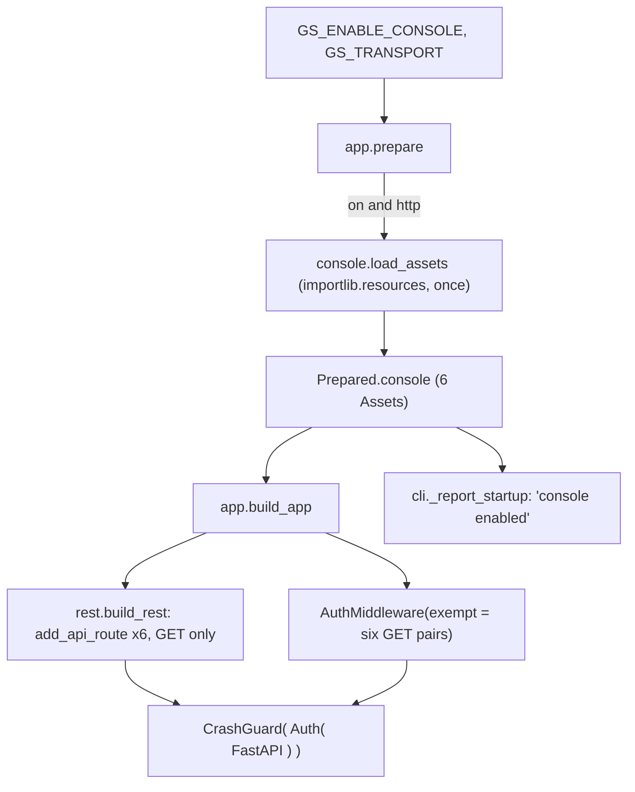
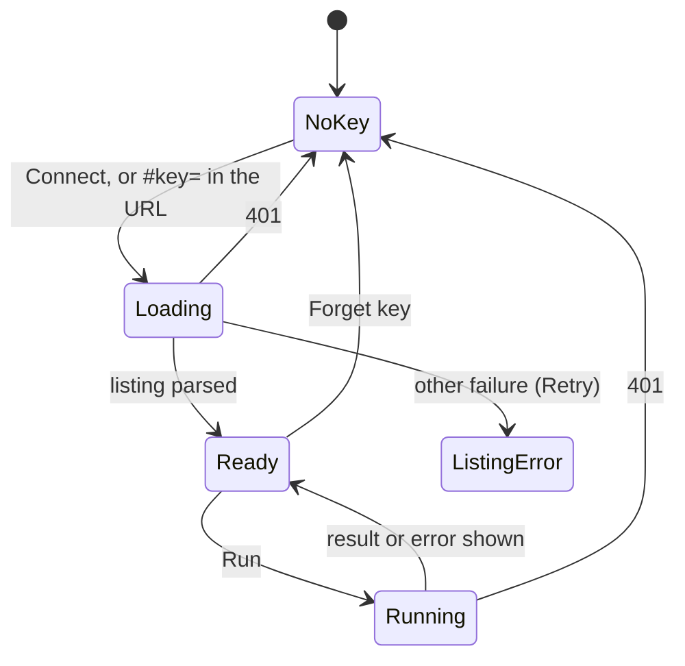
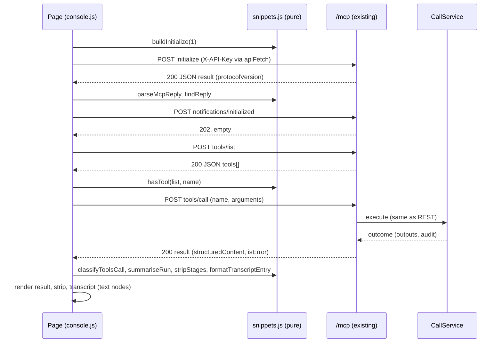
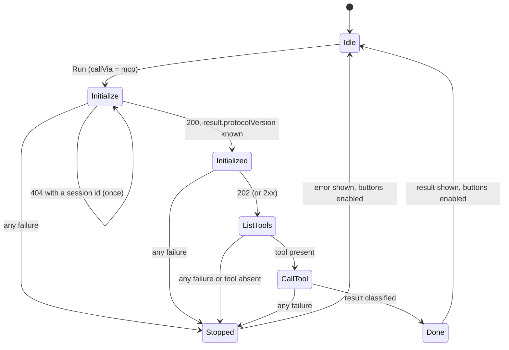

# Design Document

## Overview

The console is six static files served by the existing Publisher in HTTP mode, plus a small amount of wiring. A hackathon judge opens `/`, enters the API key, sees the published Flows from `/openapi.json`, runs one through the existing `POST /flows/{name}`, and reads outputs, elapsed time, the audit trail, a plain-words error, a `curl` command and an MCP client config. The page adds no execution path.

The server side has four parts and nothing else:

1. A switch: `GS_ENABLE_CONSOLE`, parsed like `GS_ENABLE_DOCS`.
2. A loader: `greenscreen/publisher/console/__init__.py` reads the six files from the installed package once, at startup, from an explicit allow-list.
3. Route registration and headers: six exact `GET` routes in `build_rest`, each returning the packaged bytes with fixed security headers.
4. One narrow exemption in `AuthMiddleware`: a frozenset of exact `(method, path)` pairs, empty by default.

The page side is plain HTML, CSS and ES modules. No framework, no build step, no template engine, no new dependency.

### What changes and what does not

| File | Change |
|---|---|
| `greenscreen/publisher/config.py` | `Settings.enable_console: bool = False` (last field, default keeps every existing construction valid); one `_bool` call in `load_settings`. |
| `greenscreen/publisher/console/__init__.py` | New. Route table, header constants, `Asset`, `load_assets`, `ConsoleAssetError`. Standard library only. |
| `greenscreen/publisher/console/{index.html,console.css,console.js,snippets.js,codes.json,favicon.svg}` | New static files. |
| `greenscreen/publisher/auth.py` | `AuthMiddleware.__init__` gains `exempt: frozenset[tuple[str, str]] = frozenset()`; `_allowed` checks it. |
| `greenscreen/publisher/rest.py` | `build_rest(..., console: Sequence[Asset] = ())` registers the routes. `_NoStore` is not changed. |
| `greenscreen/publisher/app.py` | `prepare` loads the assets when the console is on; `Prepared.console: tuple[Asset, ...] = ()`; `build_app` passes the exempt pairs and the assets. |
| `greenscreen/publisher/cli.py` | The startup report moves into `_report_startup(prepared)`: the existing record unchanged, then the fixed `console enabled` record when the console is on. |
| `pyproject.toml` | One `package-data` key. |
| `.env.example` | One commented `GS_ENABLE_CONSOLE=` line with a one-line comment. |

Task 7 (the seance art) later adds static markup to `index.html` and rules to `console.css` only; see "Seance art (task 7)". Task 8 (MCP-visible Run, Requirement 18) changes the four page files `index.html`, `console.css`, `console.js` and `snippets.js` and adds tests; it changes no server file, no route, no header and no setting. See "Recorded /mcp behaviour" and "MCP-visible Run (task 8)".

Not changed: the Flow runtime, Connector, recognizer, `calls.py`, `mcp_server.py`, `registry.py`, `vault.py`, any response body, `.kiro/steering`, any existing test body.

### Conventions for the executor

- DO NOT COMMIT. Leave every change in the working tree. The reviewer commits.
- Stop and report any production defect outside the files named above. Print no secret. Add no dependency.
- The final report gives test counts before and after, lists every test file added, states that no existing test file was edited, and lists everything not verified (including the manual checklist, which the executor does not run).

### Decisions

The fifteen decisions of the requirements are carried over unchanged. This design adds the following.

| # | Decision | Why |
|---|---|---|
| D1 | Assets are read once at startup into `bytes`; a request touches no file. | Fails fast on a broken wheel (Requirement 2.3), no per-request I/O, no path ever derived from a request. Files are immutable inside an installed package, so per-request reading buys nothing. About 40 KB of memory. |
| D2 | Routes are registered with `app.add_api_route(path, handler, methods=["GET"], include_in_schema=False, response_model=None)`, not with a Starlette `Route`. | A Starlette `Route` with `GET` silently adds `HEAD` (checked in source and by run). `APIRoute` does not, so the six routes are GET only, as Requirement 2.1 says. |
| D3 | The console check in `prepare` runs last. | Existing startup error precedence (settings, Flows, publish list, bindings) is unchanged. |
| D4 | Both switch conditions (`enable_console` and `transport == "http"`) are evaluated once, in `prepare`. `Prepared.console` is empty when off. | `build_app`, `cli` and tests read one value. |
| D5 | The Claude Code `.mcp.json` shape needs `"type": "http"`, so the page shows a third block, a `claude mcp add` command, instead of widening the generic JSON. | Primary documentation (see the table below). Requirements 9.5 and 14.5 are extended by one function, `buildClaudeCodeCommand`. |
| D6 | The page sends a request body built by the same `bodyText` function that builds the `curl` text. | The snippet then shows what the page sent. It also keeps large integers exact: digits are written into the JSON as typed, not through `Number`. |
| D7 | `codes.json` entries may carry `"show_message": true` (only `input_invalid` does). | Requirement 8.4 shows the server message for `input_invalid` only, and Requirement 8.8 forbids code-name literals in `console.js`. The flag moves the rule into data. |
| D8 | The `#key=` fragment is parsed by prefix and `decodeURIComponent`, not with `URLSearchParams`. | `URLSearchParams` turns `+` into a space, which corrupts a key that contains `+`. |
| D9 | Property 3 starts one short-lived `node` process per Hypothesis example. | Simple, no process lifecycle in the test. Measured at about 110 ms per spawn on the author's machine, so about 11 s for 100 examples. |
| D10 | The audit-line and `Retry-After` text builders (`auditLine`, `retryAfterText`) live in `snippets.js`, not in a new `audit.js`. | `console.js` runs `start()` and touches `document` and `location` at import, so Node cannot load it. `snippets.js` is already the one Node-testable module. A new asset would add a route, a tunnel entry, a loader row, a CSP-checked file and packaging test changes for two small pure functions. No new asset, route or package-data change. |
| D11 | The result region is focused with `focus({ preventScroll: true })`. | The default focus scrolls the element into view and pushed the masthead off screen in the reviewer's run. |
| D12 | The scan for the error-body `summary` is a remove-the-allowed-forms scan, not a list of forbidden receivers. | A list of receiver names misses a new variable name. Removing the three allowed forms and failing on any remaining `summary` is closed by default. |
| D13 | The Seance_Art is named by `role="img"` and `aria-label` on a wrapper `<div>`, and the `<pre>` inside it carries `aria-hidden="true"`. Not "`aria-hidden` plus a visually hidden label". | `role="img"` makes the children presentational by definition, but browse-mode support for descendants such as a `<pre>` is uneven, and some screen readers still read the text. `aria-hidden` on the `<pre>` closes that gap, and `aria-label` on a `role="img"` `<div>` is a plain, well-supported name. Putting `role="img"` on the `<pre>` itself would drop its text from the accessibility tree but give the spans no safe place. The alternative needs a new visually-hidden CSS class and a second element; this one needs neither. |
| D14 | The art is coloured by static `<span class="seance-ball">` and `<span class="seance-dim">` elements, one per run of non-space characters, with the spaces between runs outside the spans. | Classes only: no `style` attribute, no script-built markup, and the colour comes from existing Theme_Tokens. Spans add no padding, margin, border or font-weight, so a monospace row keeps its columns. |
| D15 | Run goes through `/mcp` by default; the page is a real, small MCP client. The `fetch` call that sends a JSON-RPC message goes through `apiFetch`, so the key is still read in one function and `X-API-Key` still appears once in `console.js`. | Owner feedback: the page must show the MCP layer with real traffic. Reusing `apiFetch` keeps the existing key rules and their static scans. |
| D16 | JSON-RPC builders, the reply parser (JSON and SSE), the projection and formatting of the transcript, the counts of the strip and the classification of a `tools/call` result all live in `snippets.js`. `console.js` only moves bytes and builds DOM. | `console.js` runs `start()` at import and cannot be loaded by Node; `snippets.js` can (D10). Every rule that decides what is shown becomes testable with Node and Property 4. |
| D17 | The transcript projects received messages through an allow-list (names listed, everything else dropped), and says what it left out. It never shows `summary`, the duplicate `content` text, a JSON-RPC `message` or `data`, or any header. | Same secrecy as REST (Requirements 7.7, 10). A drop list would miss a member the server adds later; an allow-list is closed by default (the reasoning of D12). |
| D18 | Sent messages are re-indented from their text (`prettyJson`), received messages are re-printed from the parsed object. | A sent integer of any length must appear as typed (D6); a received number comes from the server and is small. The cost is that a received `0.0` shows as `0`, which the transcript says once in its note. |
| D19 | The MCP handshake is repeated on every Run, even though the recorded server is stateless and needs none. | The viewer should see the whole exchange each time. It costs three small requests (a few milliseconds each on the Fake_Host; not measured on the live host). |
| D20 | Call_Via is two buttons with `aria-pressed`, not radio inputs. | No new `<input>` and no new label rule; buttons are natively keyboard operable (Enter, Space) and `aria-pressed` states the selection. A selected button also gets a dot mark and bold text from CSS, so colour is not the only cue. |
| D21 | The transcript sits inside the result region, between the outputs and the audit trail, and every message is a one-line `<details>` (D22 to D24). The Run_Strip is the first child of the result region, above the result title. | The result region already has the polite live region, the no-scroll focus rule and the `has-result` layout. Placing it beside the result would have cut the two-column audit of Requirement 7.12 to one column at 1280x720. |
| D22 | A transcript entry is one line by default: direction, method and one short fact (Requirement 18, criterion 24). The line is the text of the `<summary>` element, so a native `<details>` makes it keyboard operable and expands it to the pretty-printed JSON. The line is built in `snippets.js` from allow-listed members only. | The owner wants the transcript readable at a glance; eight collapsed lines fit where eight open `<pre>` blocks do not. Building lines in the pure module puts them under the Node tests and Property 4. |
| D23 | The expansion state is decided in `console.js` after render by measuring (`settleTranscript`, below), with the comparison in a pure function `fitsInFirstScreen`. Everything starts closed when layout cannot be measured. | A guess from content size would be a browser-only assumption. Measuring text-only DOM after render is the one reliable test, and the fallback is the safe state. |
| D24 | The Expand_Control swaps its label (`Expand all` / `Collapse all`) and has no `aria-pressed`. | A pressed state plus a label that already names the action would be announced twice and could contradict itself. |

### Review record (before the polish of task 6)

The reviewer ran manual browser checklist steps 1 to 12 in headless Chrome 157 at 1280x720 against the live host: pass, no CSP violation, no script error. The Linux suite gave 2416 passed, 0 failed, with 15 Node tests skipped because that machine has no Node. Steps 13 and 14 (tunnel, CDN) were not part of that run. Four polish items followed from it: no scroll on focus (D11), denser audit lines (D10, "Audit line width"), `1 second` in the singular, and a `summary` scan that uses the plain name (D12, "Summary scan").

### What was checked while writing this design

Run on 2026-11-18 on Windows with Python 3.11.9, FastAPI 0.163.2, Starlette 1.6.0, uvicorn 0.38.0, Node v24.19.0. Throwaway scripts lived in the system temp directory and were deleted. The repository working tree has no code changes from this work.

- **Console off, today's behaviour** (real `prepare` and `build_app`, `httpx2` over `ASGITransport`): see "Recorded responses".
- **Console on, prototype.** The real stack with two prototype routes added in a throwaway wrapper and a subclass of `AuthMiddleware` that exempts the two pairs. Both registration styles (Starlette `Route` and `add_api_route`) were run. The results are in "Recorded responses".
- **`_NoStore` finding.** `_NoStore.wrapped` appends `Cache-Control: no-store` only when the response has no `Cache-Control` header. A console response that sets `no-store, no-transform` itself therefore passes through unchanged (observed: `no-store, no-transform`, one header). No change to `_NoStore` is needed. Every other route sets no `Cache-Control` of its own, so its header stays `no-store` (observed for `/health` and `/openapi.json`; the 401 body of `AuthMiddleware` sets `no-store` itself).
- **Snippet quoting under Node.** A 14-line prototype of `shellQuote` and `buildCurl` was run through the exact Node invocation of this design on eight cases (a quote, a double quote, a backslash, a newline, `$(x)`, a backtick, a Unicode line separator, an integer with a secret). `shlex.split` and `json.loads` returned the original values in all eight, and the secret text appeared in none of the outputs.
- **Contrast.** The ratios in "Data Models" were computed with the WCAG 2.2 formula.
- **Node.** `node --version` gives `v24.19.0` on the author's machine. CI machines may not have it, so every Node test skips with a fixed reason.

### Library documentation checks

All pages checked on 2026-11-18. "Installed" means the version in the project environment.

| Library / API | Page | Version | Conclusion |
|---|---|---|---|
| Starlette routing, `Route`, HEAD | https://starlette.dev/routing/ | installed 1.6.0 | The page does not mention HEAD. `Route.__init__` in the installed source adds `HEAD` whenever `GET` is listed (`self.methods.add("HEAD")`), and FastAPI's `routing.py` has no `HEAD` (searched). Run confirmed: `Route` gives `HEAD / 200` with a key, `add_api_route` gives `HEAD / 400`. Decision D2. |
| FastAPI, returning a `Response` directly | https://fastapi.tiangolo.com/advanced/response-directly/ | installed 0.163.2 | A returned `Response` is passed on without conversion or validation, so the handler owns the media type and headers. `add_api_route` is not on this page; its behaviour was confirmed by the run. |
| Starlette `Response` | https://starlette.dev/responses/ | installed 1.6.0 | `Content-Length` is added automatically. A charset is appended to text media types unless the media type already has one. The design passes `text/html; charset=utf-8`, `text/css; charset=utf-8` and `text/javascript; charset=utf-8` in full, and `application/json` and `image/svg+xml` without a charset. |
| Starlette pure ASGI middleware | https://starlette.dev/middleware/ | installed 1.6.0 | Pure ASGI classes with `__call__(scope, receive, send)` are the supported low-level style and avoid `BaseHTTPMiddleware` limits. `AuthMiddleware` and `_NoStore` already follow it; the change adds one constructor keyword and one membership test. |
| `importlib.resources.files` | https://docs.python.org/3/library/importlib.resources.html | Python 3.11.9 local; page covers 3.9 to 3.15 | `files(anchor)` exists since 3.9. The `package` keyword was renamed `anchor` in 3.12 and removed in 3.15, so the loader passes the anchor positionally (`files("greenscreen.publisher.console")`). The page warns that arguments are trusted like `open()`; the loader passes only constants from the allow-list. Works for packages inside a zip as well. |
| Node `--input-type=module` | https://nodejs.org/api/cli.html | local v24.19.0 | Valid values include `module`; the flag applies to `--eval` and stdin input. The run used `node --input-type=module -e <script>`. |
| `history.replaceState` | https://developer.mozilla.org/en-US/docs/Web/API/History/replaceState | living standard | Takes `(state, unused, url)`; the URL must be same-origin; it throws `SecurityError` if called too often. The page calls it once, with `location.pathname + location.search`. |
| `Clipboard.writeText` | https://developer.mozilla.org/en-US/docs/Web/API/Clipboard/writeText | living standard | Secure contexts only; throws `NotAllowedError` if refused. The page catches every failure and falls back to selecting the text. That `localhost` counts as a secure context is not on the fetched page and is not relied on. |
| CSP, `form-action` | https://developer.mozilla.org/en-US/docs/Web/HTTP/Reference/Headers/Content-Security-Policy/form-action | living standard | `form-action` does not fall back to `default-src`. The guide at https://developer.mozilla.org/en-US/docs/Web/HTTP/Guides/CSP describes `frame-ancestors 'none'` as the clickjacking control and lists inline handlers, `javascript:` URLs and `eval()` as blocked by a script policy. That `base-uri` and `frame-ancestors` also do not fall back is from the CSP specification, not from a fetched page. |
| `Cache-Control: no-transform` | https://developer.mozilla.org/en-US/docs/Web/HTTP/Reference/Headers/Cache-Control | living standard | Says no intermediary should transform the body. It is a request to intermediaries, not an enforcement. See "Risks". |
| `prefers-reduced-motion` | https://developer.mozilla.org/en-US/docs/Web/CSS/Reference/At-rules/@media/prefers-reduced-motion | Baseline since 2020 | `reduce` is the value to honour. |
| `<meta name="referrer">` | https://developer.mozilla.org/en-US/docs/Web/HTML/Reference/Elements/meta/name | living standard | Listed as a standard metadata name that controls the `Referer` header. |
| JavaScript modules | https://developer.mozilla.org/en-US/docs/Web/JavaScript/Guide/Modules | living standard | A module runs in its own scope; its top-level variables are not on `window`. The key variable is therefore not reachable from other scripts or from the developer console. Whether `script-src 'self'` covers a module and its static `import` in each browser is not on the fetched page; it is a manual checklist step. |
| WCAG 2.2 contrast ratio | https://www.w3.org/TR/WCAG22/#dfn-contrast-ratio | WCAG 2.2 | `(L1 + 0.05) / (L2 + 0.05)` with the sRGB relative-luminance formula (threshold 0.04045). Used by the contrast test and by the numbers below. |
| Kiro MCP configuration | https://kiro.dev/docs/mcp/configuration/ | page unversioned; mentions Kiro CLI 3.4.0 and 3.5.0 options | A remote server is `{"mcpServers": {"<name>": {"url": "...", "headers": {...}}}}`, with `${VAR}` expansion. The generic shape of Requirement 9.5 is correct for Kiro. The page lists no `type` member for remote servers. |
| Claude Code MCP | https://code.claude.com/docs/en/mcp | page unversioned | Remote HTTP: `claude mcp add --transport http <name> <url> --header "Name: value"`. In JSON, an entry with a `url` and no `type` is a configuration error; `type` accepts `http` (alias `streamable-http`). SSE is deprecated. The generic shape of Requirement 9.5 is **not** valid for Claude Code without `"type": "http"` (Decision D5). |
| Claude Desktop | secondary sources only: https://dev.to/quinn_854b15f517d8632ed4f/remote-mcp-servers-with-api-keys-what-works-in-6-clients-2026-4o2l (2026-09-30), https://designrevision.com/blog/claude-desktop-mcp-config | not stated | Both say `claude_desktop_config.json` takes local (stdio) servers, that the Connectors screen is OAuth-oriented with no field for a static header, and that `mcp-remote` bridges a header. No Anthropic page was fetched, so the page does not state this as fact. |
| Cursor, VS Code | same dev.to article (secondary) | not stated | The article says both take a `headers` object. Not checked on the vendors' pages. |
| `fetch`, `URLSearchParams`, `AbortController`, `sessionStorage` | the MDN `fetch` page was requested; the phrase search returned nothing | n/a | Not verified from documentation here. The design uses `fetch` only in its basic form (method, headers, body, `await`), does not use `URLSearchParams` (D8) or `AbortController`, and forbids `sessionStorage`. |

Dated lines appended by task 1.1 (2026-11-18). Nothing in this list changes a decision above.

- Checked 2026-11-18: https://developer.mozilla.org/en-US/docs/Web/API/Window/fetch, living standard, `fetch(resource, options)` takes an `options` object with `headers` as a `Headers` object or an object literal; a rejected promise means a network-level failure, not an HTTP error status. The page's own example tests `response.ok` before reading the body. Fills the `fetch` gap of the table above.
- Checked 2026-11-18: https://developer.mozilla.org/en-US/docs/Web/API/Response/ok, Baseline widely available since March 2017, `ok` is true for status 200 to 299.
- Checked 2026-11-18: https://developer.mozilla.org/en-US/docs/Web/API/Response/text, Baseline widely available since March 2017, `text()` returns a promise for a string, always decoded as UTF-8, and rejects with `TypeError` if the body is already used or cannot be decoded. The page therefore reads the body once, inside a `try`.
- Checked 2026-11-18: https://developer.mozilla.org/en-US/docs/Web/API/Headers/get, Baseline widely available since March 2017, `get(name)` is case-insensitive and returns `null` when the header is absent. `Retry-After` handling must treat `null` as absent.
- Checked 2026-11-18: https://fastapi.tiangolo.com/reference/fastapi/, installed 0.163.2, the page has no text for `add_api_route`, so it gives no documentation evidence. Evidence is the run below.
- Checked 2026-11-18: throwaway script outside the repo (deleted afterwards), FastAPI 0.163.2, Starlette 1.6.0, `httpx2` 2.16.2 over `ASGITransport`. A route added with `add_api_route("/a", handler, methods=["GET"], include_in_schema=False, response_model=None)` whose handler returns `Response(b"x", media_type="text/css; charset=utf-8", headers={"Cache-Control": "no-store, no-transform"})` gave `GET` 200 with `content-type: text/css; charset=utf-8`, `cache-control: no-store, no-transform` and `content-length: 1`. The route's `methods` set was `['GET']`, so no `HEAD` is registered (Decision D2 holds). Without the repository's replaced exception handler, `HEAD` and `OPTIONS` on that route answered 405 here; with it the recorded responses table shows 400 for a valid key, so the 400 comes from the repository's handler, not from the route.
- Checked 2026-11-18: https://docs.python.org/3/library/importlib.resources.html, Python 3.11.9 local, run of `importlib.resources.files("json").joinpath("tool.py").read_bytes()` returned the file's bytes (first bytes `b'r"""Command-'`). The loader's call shape works on 3.11.9 with the anchor passed positionally. This run used a standard library package, not the console package, which does not exist yet.
- Checked 2026-11-18: https://nodejs.org/api/cli.html, local Node v24.19.0, `node --version` printed `v24.19.0`. `node --input-type=module -e <script>` ran a module that imported a `data:text/javascript;base64,...` URL and printed `2` for a one-line export `f(x) = x + 1`. Nothing secret was printed. The design table's Node row holds on this machine.
- Checked 2026-11-18: https://docs.python.org/3/library/shlex.html, Python 3.11.9 local, `shlex.split(s, comments=False, posix=True)` runs in POSIX mode by default and does not strip comments by default, as the tests need. Run: `shlex.split("curl -d '{\"a\":\"it'\\''s\"}'")` gave `['curl', '-d', '{"a":"it\'s"}']`, so the `'\''` form of `shellQuote` round-trips. Python 3.12 changed only the handling of `None` as the argument (not relevant here). The page warns that `shlex` models Unix shells only, which matches the stated scope of Requirement 14 (POSIX shells).
- Checked 2026-11-18: https://developer.mozilla.org/en-US/docs/Web/API/History/replaceState, living standard, signature `replaceState(state, unused, url)`; `url` must be same origin; `SecurityError` when called too frequently or with an invalid URL. No version note beyond the table row; the page calls it once.
- Checked 2026-11-18: https://developer.mozilla.org/en-US/docs/Web/API/Clipboard/writeText, Baseline widely available since March 2020, secure contexts only, `NotAllowedError` when refused. The table row stands; the page still catches every failure.
- Checked 2026-11-18: https://developer.mozilla.org/en-US/docs/Web/CSS/Reference/At-rules/@media/prefers-reduced-motion, Baseline since 2020, not re-fetched in this task; the table row of the same day is the evidence and it stands.
- Checked 2026-11-18: https://hypothesis.readthedocs.io/en/latest/changelog.html, installed 6.170.15 (released 2026-11-06, the latest entry on the page), no library change is needed for a `@given` test that starts one `subprocess` per example. This is a note only. The page was not searched for subprocess guidance, and the per-example cost stays the measured figure of Decision D9.
- Checked 2026-11-18 in task 6.1 (date from the system clock, page re-fetched): https://developer.mozilla.org/en-US/docs/Web/API/HTMLElement/focus, living standard (the fetched page states no version and cites the HTML Standard `dom-focus-dev`). `focus(options)` takes an optional object; `preventScroll` is a boolean, the default `false` scrolls the document to bring the element into view, and `true` means no scrolling. The page's own example focuses an off-screen button with `{ preventScroll: true }`. The page also lists `focusVisible`, which this design does not use. The result region already has `tabindex="-1"` in `index.html` (line 32), so it is focusable by script; `index.html` is not changed.
- Installed versions on 2026-11-18 from `python -m pip list`: `fastapi` 0.163.2, `starlette` 1.6.0, `uvicorn` 0.38.0, `httpx2` 2.16.2 (the repository's HTTP test client; `httpx` 0.28.1 is also installed), `hypothesis` 6.170.15, `pytest` 9.1.1, `anyio` 4.16.0, `setuptools` 69.5.1; `node --version` v24.19.0; Python 3.11.9. Every version equals the one recorded in "What was checked while writing this design"; no version differs.
- Checked 2026-11-18 in task 7.1: https://developer.mozilla.org/en-US/docs/Web/Accessibility/ARIA/Reference/Roles/img_role, living standard (page states no version; cites WAI-ARIA `#img`). `role="img"` marks content to be read as one image and an accessible name is required: `aria-label` when no visible label exists. Descendants become presentational. The page's own examples put `aria-label` on a `div` or `span` holding text such as ASCII art (the "Table flip" example), which matches D13. The page warns that some browser and screen reader pairs read the label twice; the `aria-hidden="true"` on the `<pre>` is kept as decided. The wrapper stays exposed.
- Checked 2026-11-18 (task 8 design stage): https://modelcontextprotocol.io/specification/2025-06-18/basic/transports, MCP specification revision 2025-06-18, Streamable HTTP section. The client MUST POST each JSON-RPC message as its own request and MUST send an `Accept` header that lists both `application/json` and `text/event-stream`. For a notification or response the server MUST answer HTTP 202 with no body. For a request the server answers either `Content-Type: application/json` (one object) or `text/event-stream`, and the client MUST support both. A server MAY issue `Mcp-Session-Id` in the `initialize` reply; if it does, the client MUST send it on every later request. The client MUST send `MCP-Protocol-Version` on all later requests, the server SHOULD assume `2025-03-26` when it is absent, and an invalid or unsupported value MUST get HTTP 400. HTTP 404 for a request that carries a session id means the client MUST start a new session. Servers MUST validate `Origin`. The spec says an SSE stream SHOULD close after the response is sent.
- Checked 2026-11-18: https://modelcontextprotocol.io/specification/2025-11-25/basic/transports, revision 2025-11-25 (selective fetch of the header sections). The same rules, with the example header spelled `MCP-Session-Id` and `MCP-Protocol-Version: 2025-11-25`, and the backwards-compatibility fallback widened to 400, 404 and 405. HTTP header names are case-insensitive, so `Mcp-Session-Id` and `MCP-Session-Id` are the same header and `Headers.get` finds either. The page offers `2025-11-25`; this conflicts with nothing on the 2025-06-18 page.
- Checked 2026-11-18, installed code and behaviour, not a documentation page: `mcp` 2.3.0 and `mcp-types` 2.3.0 (`pip list`), Starlette 1.6.0, `greenscreen/publisher/mcp_server.py` (`stateless=True`, `json_response=True`). The SDK accepts the four protocol versions listed in "Recorded /mcp behaviour" and negotiates anything else up to `2025-11-25`; an unknown version in the `MCP-Protocol-Version` header gets HTTP 400 and the JSON-RPC error `-32602` (requests) or `-32022` (notifications, with `supported: ["2026-07-28"]` in `data`). The `2026-07-28` value is a newer revision that the SDK handles by a different envelope; the page does not offer it.
- Not checked in task 8's design stage (task 8.1 checks them and appends dated lines here): MDN `AbortController` and `AbortSignal` (use with `fetch`), MDN `Response.headers` and `Headers.get` readability of `Mcp-Session-Id` on a same-origin reply, MDN `<details>` (`open` attribute) and `aria-pressed` on a `<button>` (ARIA toggle button pattern), the WHATWG server-sent events line-parsing rules that `parseMcpReply` implements (https://html.spec.whatwg.org/multipage/server-sent-events.html#event-stream-interpretation), `setTimeout` with a function argument, `Element.getBoundingClientRect`, `window.innerHeight`, the `toggle` event and `open` property of `<details>`, and scroll anchoring after a layout change. Until then the design states these from general knowledge and flags them.

Dated lines appended by task 8.1 (2026-11-18, date from the system clock; the pages were fetched in this task). They resolve the "Not checked in task 8's design stage" item above.

- Checked 2026-11-18: https://developer.mozilla.org/en-US/docs/Web/API/AbortController, Baseline widely available since March 2019. `new AbortController()` gives `.signal`; `.abort()` aborts fetch requests and the consumption of response bodies. Conclusion: the design's use stands.
- Checked 2026-11-18: https://developer.mozilla.org/en-US/docs/Web/API/AbortSignal, living standard. A signal passed as `{ signal }` in the `fetch` options aborts the request; `fetch` then rejects with a `DOMException` named `AbortError`. If the abort comes after the headers arrived but before the body is read, reading the body rejects with `AbortError` too. A signal is single use. The page therefore makes one controller per request and treats any rejection of `fetch` or of `response.text()` as a stop, as the design says. Note for task 8.4: Requirement 18, criterion 11 words the limit as "not returned their response headers", while the design clears the timer after `response.text()` returns, so a stalled body is also cut at 15 seconds. Both end in the same stop; the design wording is the stricter and stays.
- Checked 2026-11-18: https://developer.mozilla.org/en-US/docs/Web/API/Response/headers, Baseline widely available since March 2017, and https://developer.mozilla.org/en-US/docs/Web/API/Headers/get (already recorded above): `response.headers` is a `Headers` object and `get(name)` is case-insensitive and gives `null` when the header is absent. The fetched `Response.headers` page does not say which headers a script may read. The fetched glossary page names only `Set-Cookie` as a forbidden response header name. That every header of a same-origin reply is readable, including `Mcp-Session-Id`, is general knowledge of the fetch standard (not on the fetched pages) and is not relied on: the recorded server issues no session id, and a `null` is handled as "no session".
- Checked 2026-11-18: https://developer.mozilla.org/en-US/docs/Web/HTML/Reference/Elements/details, living standard. `open` is a Boolean attribute: present means the contents are shown, and `open="false"` still opens it, so the page sets and removes the property or attribute, never a string value. `<details>` accepts one `<summary>` first, then flow content; the `<summary>` is the always-visible label, which matches D22 (the Transcript_Line is the summary text). The implicit ARIA role is `group`. The `name` attribute (exclusive groups) is not used: the transcript entries must open independently.
- Checked 2026-11-18: https://developer.mozilla.org/en-US/docs/Web/API/HTMLDetailsElement/open, Baseline widely available since January 2020. `open` is a boolean property that reflects the attribute. The page sets `details.open = true` or `false` (design "settleTranscript").
- Checked 2026-11-18: https://developer.mozilla.org/en-US/docs/Web/API/HTMLDetailsElement/toggle_event, Baseline widely available since January 2020 (some parts vary). The `toggle` event fires after the state changed, is not cancelable, and several changes before the event loop turns are coalesced into one event. The design does not listen to `toggle` for the open-state decision (decided once per run, not repeated on a toggle); if task 8.4 listens to it to refresh the Expand_Control text, it must recompute `allOpen` from the entries and must not count events.
- Checked 2026-11-18: https://developer.mozilla.org/en-US/docs/Web/Accessibility/ARIA/Reference/Attributes/aria-pressed, WAI-ARIA `aria-pressed`. On a `button` it makes a toggle button with the values `true`, `false` and `mixed`; the label must NOT change with the state, and a button whose label changes should not use `aria-pressed`. This supports both decisions already taken: the Call_Via buttons `MCP` and `REST` keep fixed labels and carry `aria-pressed` (task 8.3), and the Expand_Control swaps its label and has no `aria-pressed` (D24).
- Checked 2026-11-18: https://html.spec.whatwg.org/multipage/server-sent-events.html (section 9.2.6, "Interpreting an event stream"), HTML Living Standard. Lines end with CRLF, LF or CR; one leading BOM is stripped; a blank line dispatches; a line starting with `:` is ignored; a line with a colon splits at the first colon and one leading space of the value is dropped; a line without a colon is a field with an empty value; `data` values are appended with a trailing LF that is removed on dispatch (so they join with LF); `event`, `id` and `retry` do not matter here; an event whose data buffer is empty is not dispatched; pending data at end of stream is discarded. Compared with `parseMcpReply`: the line splitting, comment, colon, space and join rules agree. Three differences were found. (1) The page did not drop a leading BOM. (2) It skipped an event only when it had no `data` line, so `data:` with an empty value would have reached `JSON.parse("")` and given `bad_sse`; the specification skips it. (3) The page dispatches an unterminated final event, which the specification discards. Changed in the design text of "snippets.js additions", `parseMcpReply`: a leading BOM is dropped, an event whose joined data is empty is skipped, and difference (3) is kept on purpose and now says so.
- Checked 2026-11-18: https://developer.mozilla.org/en-US/docs/Web/API/Window/setTimeout, living standard. `setTimeout(func, delay)` takes a function; the string form (`code`) is "strongly discouraged" like `eval()` and throws `TypeError` under Trusted Types without a default policy, which the string-argument scan already forbids. The return value is a positive integer for `clearTimeout`. `delay` is in milliseconds and may run longer than asked. `setTimeout(() => controller.abort(), 15000)` is the supported form.
- Checked 2026-11-18: https://developer.mozilla.org/en-US/docs/Web/API/Element/getBoundingClientRect, CSSOM View Module. The returned `DOMRect` is relative to the viewport and changes with scrolling, and an element whose border boxes are all empty gives width and height 0. This confirms the design's way of reading `list.getBoundingClientRect().bottom - document.documentElement.getBoundingClientRect().top` (document coordinates, no scroll offset read) and the guard `listRect.height > 0`.
- Checked 2026-11-18: https://developer.mozilla.org/en-US/docs/Web/API/Window/innerHeight, CSSOM View Module. `innerHeight` is an integer, the height in pixels of the layout viewport; the page does not say what a script gets before layout. The design's guard (use it only when finite and above 0, else 720) stands.
- Checked 2026-11-18: https://developer.mozilla.org/en-US/docs/Web/CSS/Guides/Scroll_anchoring/Overview, CSS Scroll Anchoring Module Level 1. Scroll anchoring is on by default and moves the scroll position to keep the anchor node in view when content outside the viewport changes; `overflow-anchor: none` opts out. It is suppressed by changes to `top`, `left`, `right`, `bottom`, margin, padding, size properties or `transform` on the anchor node or an ancestor, and by position changes inside the scroll container. This supports the design's remark that scroll anchoring may still adjust the offset of an already-scrolled document and that the page itself calls no scroll function. The design does not set `overflow-anchor`; no change.
- Checked 2026-11-18, `/mcp` probe re-run in task 8.1 (throwaway script in the system temp directory, `build_console_app` and `call_scope`, `app.lifespan()`, in-process ASGI; the script and its output were deleted; no key or bound value was printed). Rows reproduced: 1, 3, 4, 6, 7, 11 (with `Accept: application/json` and with `MCP-Protocol-Version`), 12, 14, 17, 19, 20, 21. Statuses, media types, JSON-RPC codes, body shapes and sizes agree with the table (row 20: 11 491 bytes; row 21: 21 900 bytes with 12 audit entries and `text` equal to `structuredContent`; no reply carried `Mcp-Session-Id`). One difference: in row 20 the member `isError` is present with the value `false`, not absent. Requirement "Recorded behaviour" (requirements.md, `tools/call`, success) already says "false or absent", and `classifyToolsCall` tests `isError` is not `true`, so no requirement of 18 becomes false and nothing stops. Row 20's audit held 38 entries for this Flow and script. The row texts of the table were left as recorded.
- Installed versions on 2026-11-18 from `python -m pip list` in task 8.1: `mcp` 2.3.0, `mcp-types` 2.3.0, `starlette` 1.6.0, `fastapi` 0.163.2, `uvicorn` 0.38.0, `hypothesis` 6.170.15, `pytest` 9.1.1, `httpx2` 2.16.2; `node --version` v24.19.0 with `C:\Program Files\nodejs` first on PATH. Every version equals the one recorded before; none differs.

## Architecture

### Server wiring



The stack order is unchanged: `CrashGuard` outermost, then `AuthMiddleware`, then FastAPI with `_NoStore`. A console request passes the same three layers as any other request; `CrashGuard` therefore wraps the console routes (Requirement 13.3).

### Recorded responses (Requirement 2.9, Finding 5)

Real stack, key present or absent as shown, `Host: test`, `GS_AUTH_DISABLED` unset unless noted. `unauth` is the fixed `unauthorized` body (78 bytes), `invalid` is the fixed `request_invalid` body (74 bytes). No `Allow` header appeared in any response.

| Request | Console off | Console on, routes by `add_api_route` (chosen) | Console on, routes by `Route` (rejected, D2) |
|---|---|---|---|
| `GET /`, no key | 401 `unauth` | 200 `text/html; charset=utf-8`, `no-store, no-transform`, CSP present | 200, same |
| `GET /`, key | 400 `invalid` | 200, same as above | 200, same |
| `HEAD /`, no key | 401, empty body | 401, empty body | 401, empty body |
| `HEAD /`, key | 400, empty body | 400, empty body | **200**, empty body, console headers |
| `OPTIONS /`, no key | 401 `unauth` | 401 `unauth` | 401 `unauth` |
| `OPTIONS /`, key | 400 `invalid` | 400 `invalid` | 400 `invalid` |
| `POST /`, key | 400 `invalid` | 400 `invalid` | 400 `invalid` |
| `GET /console/console.css`, no key | 401 `unauth` | 200 `text/css; charset=utf-8`, `no-store, no-transform`, CSP present | 200, same |
| `HEAD /console/console.css`, no key | 401 | 401 | 401 |
| `GET /console/console.css/`, no key | 401 | 401 (not an exempt pair) | 401 |
| `GET /console/x`, key | 400 `invalid` | 400 `invalid` | 400 `invalid` |
| `GET /health`, no key | 200, `no-store` | 200, `no-store` | 200, `no-store` |
| `GET /openapi.json`, key | 200, `no-store`, 4240 bytes | 200, `no-store`, 4240 bytes | 200, `no-store`, 4240 bytes |
| `GET /`, `GS_AUTH_DISABLED=true`, `Host: 127.0.0.1` | 400 `invalid` | not run (see below) | not run |

Findings:

- **Console off** matches Finding 5 exactly: 401 without a key, 400 with a key, 400 with auth disabled on a loopback Host. `HEAD` and `OPTIONS` get the same status as `GET`.
- **`HEAD` and `OPTIONS` are never exempt.** `AuthMiddleware` sees the pair `("HEAD", "/")` first, which is not in the set, so a probe without a key gets 401. With a key, the chosen registration answers 400 (the replaced `StarletteHTTPException` handler maps the framework's 405 to `request_invalid`). The replaced handler also drops the `Allow` header. Nothing is added for them (Decision 14 of the requirements).
- A tunnel or monitor that probes with `HEAD /` will see 401. Open item 3.
- The console-on and auth-disabled combination was not run. By reading `_allowed`, the disabled branch returns before the exempt check, so the loopback Host rule covers the console routes (Requirement 3.4), and the new code does not change that branch.
- Status codes were taken from `httpx2.ASGITransport`, not from a real uvicorn socket. `HEAD` over a real socket was not run.

## Components and Interfaces

### 1. Configuration (`config.py`)

```python
enable_console = _bool(environ, "GS_ENABLE_CONSOLE")   # next to enable_docs
```

`_bool` is the parser of `GS_ENABLE_DOCS`: empty or unset is false, `true` and `false` are the only other accepted texts, anything else raises `StartupError("GS_ENABLE_CONSOLE: not_a_boolean (true or false)")`. The error never holds the value. `Settings` gains `enable_console: bool = False` after `publish_flows`. Its custom `__repr__` is untouched, so the repr shows no new setting (Requirement 1.3). The variable is parsed for both transports; stdio ignores it (Requirement 1.5) because `prepare` only loads assets for `http`.

### 2. The loader (`console/__init__.py`)

```python
ROUTES = (   # the explicit allow-list: (route path, file name, media type)
    ("/",                     "index.html",  "text/html; charset=utf-8"),
    ("/console/console.css",  "console.css", "text/css; charset=utf-8"),
    ("/console/console.js",   "console.js",  "text/javascript; charset=utf-8"),
    ("/console/snippets.js",  "snippets.js", "text/javascript; charset=utf-8"),
    ("/console/codes.json",   "codes.json",  "application/json"),
    ("/console/favicon.svg",  "favicon.svg", "image/svg+xml"),
)
PAIRS = frozenset(("GET", path) for path, _, _ in ROUTES)
HEADERS = {   # exactly these four on every console response, no other route
    "Content-Security-Policy": "default-src 'self'; script-src 'self'; style-src 'self'; "
        "img-src 'self'; font-src 'none'; connect-src 'self'; object-src 'none'; "
        "base-uri 'none'; form-action 'none'; frame-ancestors 'none'",
    "X-Content-Type-Options": "nosniff",
    "Referrer-Policy": "no-referrer",
    "Cache-Control": "no-store, no-transform",
}

@dataclass(frozen=True, slots=True)
class Asset: path: str; file: str; media_type: str; body: bytes

def load_assets() -> tuple[Asset, ...]   # raises ConsoleAssetError(file) on any failure
```

`load_assets` reads each file with `importlib.resources.files("greenscreen.publisher.console").joinpath(file).read_bytes()`. The file names come only from `ROUTES`; no request value ever reaches it, so there is no path traversal and no directory listing (nothing lists the package). `FileNotFoundError`, `ModuleNotFoundError` and `OSError` become `ConsoleAssetError(file)`; its message is the file name only. `prepare` turns it into `StartupError("console: missing_asset (<file>)")`, so the CLI exits 2 and prints no machine path (Requirement 2.3). The module imports only the standard library (Requirement 12.5).

### 3. Route registration (`rest.py`)

```python
for asset in console:
    app.add_api_route(asset.path, _serve(asset), methods=["GET"],
                      include_in_schema=False, response_model=None)

def _serve(asset):
    async def serve() -> Response:
        return Response(asset.body, media_type=asset.media_type, headers=HEADERS)
    return serve
```

Six exact paths, `GET` only, no wildcard, no path parameter, no mount, no static-files handler. The response is built per request from the cached bytes. The handler takes no `Request`, reads nothing from it, logs nothing and writes no `Call_Log_Record` (Requirement 10.2). `include_in_schema=False` and the fact that `/openapi.json` comes from `build_openapi(registry)` mean the OpenAPI document cannot change (Requirement 4.5).

**Headers and `_NoStore`.** `_NoStore` keeps a `Cache-Control` the response already has (see "What was checked"). The console handler sets `no-store, no-transform` itself, so `_NoStore` needs no change, and no other route can pick up `no-transform` because no other code sets it. This is what Requirement 15.4 asked the design to record.

### 4. Authentication exemption (`auth.py`)

```python
def __init__(self, app, *, api_key, disabled, exempt: frozenset[tuple[str, str]] = frozenset()): ...

def _allowed(self, scope) -> bool:
    headers = scope.get("headers") or []
    if self._disabled:
        return _host_is_loopback(headers)            # unchanged, covers the console routes too
    pair = (scope.get("method"), scope.get("path"))
    if pair in self._exempt or pair == ("GET", _HEALTH_PATH):
        return True
    ...                                               # unchanged key check
```

The test is exact tuple equality on the two strings ASGI delivers (`method` as sent, `path` already percent-decoded). `/console/console.css/`, `/console/`, `//`, a different case, `HEAD`, `OPTIONS` and a `..` segment are not members and fall through to the key check. Nothing about the headers is read on the exempt path (Requirement 3.5). With the empty default the method is byte-identical in behaviour to today's.

`app.build_app` passes `console.PAIRS` when `prepared.console` is non-empty and nothing otherwise. A fail-closed note: if a server sets `root_path`, `scope["path"]` and the router could differ, which can only make an exempt request return 401, never open a route. The Publisher sets no `root_path`.

### 5. Application wiring (`app.py`)

`prepare` ends with:

```python
console = ()
if settings.enable_console and settings.transport == "http":
    try: console = load_assets()
    except ConsoleAssetError as exc: raise StartupError(f"console: missing_asset ({exc.file})") from None
return Prepared(settings, registry, bound, signatures, len(loaded), console)
```

`Prepared` gains `console: tuple[Asset, ...] = ()` as its last field. Existing tests that use `dataclasses.replace(prepared, ...)` keep working. `build_app` passes `console=prepared.console` to `build_rest` and `exempt=PAIRS if prepared.console else frozenset()` to `AuthMiddleware`. In stdio mode neither is built (the existing code builds no auth layer there) and `prepared.console` is empty.

### 6. Startup report (`cli.py`)

```python
def _report_startup(prepared) -> None:
    _LOG.info("publishing %d of %d flows over %s", len(prepared.registry), prepared.loaded_count, prepared.settings.transport)
    if prepared.console:
        _LOG.info("console enabled")
```

The first record is the existing one with the same arguments, so `tests/unit/test_publisher_cli.py` (which waits for `publishing 1 of 8`) is unaffected. The second record has a fixed text and no field. With the console off, no record mentions it (Requirement 1.7). `main` calls this function where it now logs the first record.

### 7. Packaging (`pyproject.toml`, `.env.example`)

```toml
"greenscreen.publisher.console" = ["*.html", "*.css", "*.js", "*.json", "*.svg"]
```

`[tool.setuptools.packages.find]` already includes `greenscreen*`, and the new directory has an `__init__.py`. `.env.example` gets, after `GS_ENABLE_DOCS=`: a comment `# true serves the web console at / (HTTP transport only, default false).` and the line `GS_ENABLE_CONSOLE=`.

### 8. The page: files and modules

| File | Role |
|---|---|
| `index.html` | Static skeleton: title, tagline, key panel, status line, flow list container, result container. One `<script type="module" src="/console/console.js">`. No inline script or style, no `<form>`. |
| `console.css` | Theme tokens on `:root`, layout, focus rings, motion rules. |
| `console.js` | Module: key intake and memory, `fetch` of the three data sources, DOM building, run and render. Imports `./snippets.js`. |
| `snippets.js` | Pure functions, no import, no DOM, no globals. |
| `codes.json` | Error code table (see "Data Models"). |
| `favicon.svg` | Small icon. The only absolute URL in any asset is its `xmlns` attribute. |

The head of `index.html` carries `<meta charset="utf-8">`, the viewport meta, `<meta name="referrer" content="no-referrer">`, a `<title>`, `<link rel="icon" href="/console/favicon.svg">` and `<link rel="stylesheet" href="/console/console.css">`. `<html lang="en">`. The module script has `src`, so it is allowed by `script-src 'self'`, and `import "./snippets.js"` resolves to `/console/snippets.js`, another exact route.

### 9. `console.js`

**State** (module scope, nothing on `window`, no web storage):

```js
let apiKey = null;        // the only holder of the key
let keyHeld = false;      // UI flag, so no other code reads apiKey
let codes = null;         // parsed codes.json
let flows = [];           // parsed listing
let running = false;
```

**Order of the file** (a static test relies on it): the fragment function and its call come first, then `apiFetch`, then everything else.

1. `takeKeyFromFragment()`: if `location.hash` starts with `#key=`, take the rest of the string, `decodeURIComponent` it (on failure use the raw text), assign it to `apiKey`, set `keyHeld`, and call `history.replaceState(null, "", location.pathname + location.search)`. It runs before any other action. A fragment without `key=` is left alone.
2. `apiFetch(path, init)`: **the one function that reads `apiKey`** and the only place the text `X-API-Key` appears. It adds the header to a copy of `init.headers` and calls `fetch(path, ...)` (same origin, relative URL). Allowed paths are `/openapi.json`, `/flows/<name>` and, since task 8, `/mcp`. A `401` response calls `forgetKey()` before the caller sees it.
3. `loadCodes()`: plain `fetch("/console/codes.json")` with no key.
4. `forgetKey()`: assigns `apiKey = null`, `keyHeld = false`, clears the flow list and result, shows the key panel.
5. `parseListing(document)`: pure. For each `[path, item]` of `Object.entries(doc.paths)` where the path matches `^/flows/([^/]+)$` and `item.post` exists, read `operation.summary` (the OpenAPI operation object, held in a variable named exactly `operation`) and the request schema at `requestBody.content["application/json"].schema`. For each property: `name`, `type` (`"integer"` or anything else treated as text), `description`, `maxLength` when it is a number, `secret = (writeOnly === true)`, `required` from the schema's `required` array. Nothing else is read.
6. DOM helpers: `el(tag, attrs, ...children)`. Text goes in with `textContent` or `createTextNode`. `attrs` is limited to a fixed set of names (`id`, `class`, `type`, `for`, `name`, `value`, `autocomplete`, `inputmode`, `maxlength`, `disabled`, `role`, `aria-live`, `aria-label`, `hidden`); a name outside the set throws during development. Never `innerHTML`, never `style`, never `on*`.
7. `renderFlows()`, `renderResult()`, `renderSnippets()`, `copy()`, `run()`, event wiring, then `start()`.

**Key intake.** The key panel has a labelled password input (`autocomplete="off"`) and a Connect button. A `keydown` listener on the input treats `Enter` as a click (no `<form>`). On Connect the handler reads the input's `.value` into `apiKey`, then clears the input, so the key sits only in the module variable. The panel shows one line of help: a key in the address bar is removed from the bar but may remain in browser history (Requirement 5.12). A "Forget key" button calls `forgetKey()`.

**Listing.** After a key is held, `apiFetch("/openapi.json")`. The document already omits Bound_Inputs (`build_schemas` filters `bound_names` before it builds the `properties` and `required` members), so the page cannot show them and has no other source of Input names. Secret detection is `writeOnly === true`, which `_input_property` sets for every secret Input of either type. An `integer` property carries `minimum` and `maximum` but **no `maxLength`**, so the page shows `maxLength` only when present and gives integer fields `inputmode="numeric"` with no length limit. A `401` shows the `unauthorized` text from the table and the key panel; any other failure shows the matching text and a Retry button; zero Flows shows `No flows are published.`.

**Run.** `run(flow)` does nothing if `running` is true. It sets `running`, disables every Run button, shows `Calling the mainframe…` in the polite status region, builds the body with `bodyText(flow.inputs, false)`, records `performance.now()`, and calls `apiFetch("/flows/" + encodeURIComponent(name), {method: "POST", headers: {"Content-Type": "application/json"}, body})`. The elapsed time is taken when `fetch` resolves (headers received), then the body is read as text and parsed in a `try`. In a `finally` it clears every Secret_Input field, clears `running` and re-enables the buttons.

**Result classification** (no code name appears in the file):

| Condition | Rendered as |
|---|---|
| `fetch` rejects | table entry `no_response` |
| body not JSON, or JSON that is neither a success body nor an error body | table entry `unreadable_reply` with `resp.status`; the body is not shown |
| `resp.ok` and `typeof body.flow === "string"` and `body.outputs` is an object | success view |
| `body.error.code` is a key of the table | that entry |
| `body.error.code` is a string not in the table | table entry `unknown_code` |

For an error entry the page shows the code text from the body (only when it is a key of the table, so no server string is invented), `resp.status`, the entry's `text`, and `body.error.message` when the entry has `show_message`. For `resp.status === 429` it also shows the line from `retryAfterText(response.headers.get("Retry-After"))` when that is not `null`: `Retry after: 1 second` for 1, `Retry after: N seconds` for any other run of 1 to 6 digits (`0` gives `0 seconds`, `007` gives `7 seconds`), and no line for anything else (absent, empty, date, sign, decimal, more than 6 digits). The function is `retryAfterText(value) { if (typeof value !== "string" || !/^[0-9]{1,6}$/.test(value)) return null; const n = Number(value); return "Retry after: " + n + (n === 1 ? " second" : " seconds"); }`. When `body.error.audit` is an array it shows the audit list above the error, and `step_index`, `kind` and `expected` (a list of strings, joined with commas) when present. `summary` is never read.

**Focus after a call.** `finishResult()` adds `has-result` to the layout and then calls `refs.result.focus({ preventScroll: true })`. No `scrollIntoView`, `scrollTo`, `scrollBy`, `window.scroll` or `location.hash` assignment appears in the file. The scroll position is therefore unchanged by the focus move, and a page at the top stays at the top.

**Audit list.** An `<ol>` in array order, one `<li>` per entry, none dropped. `console.js` copies exactly the seven members of the constant `AUDIT_KEYS` (`step_index`, `kind`, `phase`, `iteration`, `signature`, `status`, `duration_seconds`) from each entry into a plain row, and calls `auditLine(row)` from `snippets.js`; it reads nothing else from an entry. The function returns the words joined by single spaces, in this order: `step_index`; `kind`; `signature` when not null; the status word (`OK`, `SKIPPED`, `FAILED`, or `UNKNOWN` for any other value); `duration_seconds` as `N.NNs` only when it is a finite number and `Number(value.toFixed(2)) > 0`; `finally` only when `phase` is `finally`; `pass N` only when `iteration` is not null. Example: `12 expect tso-password-prompt OK`; with time, `12 expect tso-password-prompt OK 0.40s`. Displayed always: index, kind, status. Displayed conditionally: signature, duration, phase, iteration. Read always: all seven. Coercion: `step_index` and `iteration` display only as a safe integer (else `?`), `kind` is cut to 40 characters and `signature` to 80. The `<li>` class (`audit-ok`, `audit-skipped`, `audit-failed`) is chosen in `console.js` from `row.status`; the stylesheet adds a mark (check, dash, cross) and bold for failed, so colour is never the only cue, and the word is in the text.

**Summary scan.** `console.js` uses the plain word `summary` in exactly three places: `el("summary", ...)` for the `<details>` heading, `operation.summary` in `parseListing`, and the class string `"flow-summary"` (the stylesheet already styles `.flow-summary`). The constants `DETAILS_HEAD_TAG` and `FLOW_TEXT_KEY` (`"sum" + "mary"`) are removed, and `post[FLOW_TEXT_KEY]` becomes `operation.summary`. The scan (a pure function `summary_violations(text) -> list[(line_number, text)]` in `tests/unit/test_console_assets.py`) works in this order: (1) find every `"sum"` or `'sum'` literal followed by `+` and report it; (2) remove the allowed forms with these patterns: `\bel\(\s*"summary"`, `\bcreateElement\(\s*"summary"`, `(?<![\w$.?])operation\.summary\b` and the literal `"flow-summary"`; (3) report every remaining match of `summary` (case-insensitive) with its line. It does not strip comments, so a comment that says `summary` fails too (the same rule as `sessionStorage`). The real file must give an empty list. The self-check fixture is a parametrized list run against the same function:

| Source line | Expected |
|---|---|
| `el("summary", null, "Use this flow")` | pass |
| `document.createElement("summary")` | pass |
| `const t = typeof operation.summary === "string" ? operation.summary : "";` | pass |
| `el("p", { class: "flow-summary" }, t)` | pass |
| `error.summary`, `err?.summary`, `body.summary`, `info.error.summary` | fail |
| `body["summary"]`, `body['summary']`, `` body[`summary`] `` | fail |
| `const { summary } = error;`, `const { error: { summary } } = body;` | fail |
| `const summary = 1;`, `function f(summary) {}` | fail |
| `x.operation.summary`, `operation2.summary`, `operation?.summary` | fail |
| `"sum" + "mary"`, `'sum' + 'mary'` | fail |
| `// reads the summary` | fail |
| `el("summary", null, x); body.summary` (one line, one good and one bad use) | fail |

`operation?.summary` fails because the allowed form is the literal `operation.summary`, which it does not match. A scan that returned an empty list for everything would fail every "fail" row, so the self-check cannot pass vacuously.

**Snippets.** `renderSnippets(flow)` runs on render and on every `input` event of that flow's fields. It calls the three pure builders with `location.origin` and the current values. Each block has a `<pre>` (focusable with `tabindex="0"`) and a Copy button. `copy()` tries `navigator.clipboard.writeText(text)` inside `try`; if `navigator.clipboard` is missing or the promise rejects, it selects the `<pre>` content with a `Range` and writes `Press Ctrl+C to copy.` to the status region. The MCP area also shows the line `Tool name: <flow name>` (page text, not part of the copied JSON) and one note: "MCP clients differ in how they name these settings. The first block is the shape Kiro reads; the second is the Claude Code command."

**Focus and keyboard.** Every control is a native `<button>`, `<input>` or `<a>`. DOM order is: key panel, then per Flow its inputs, Run, three Copy buttons, then the result region. No `tabindex` above 0. After load, focus goes to the key input when no key is held, otherwise to the first Run button. Each input has a `<label for>`; Secret and integer inputs are labelled in text ("secret", "number"). Status and result containers are `aria-live="polite"`.



### 10. `snippets.js`

No `import`. No reference to `document`, `window`, `globalThis`, `self`, `location`, `navigator`, `fetch`, `localStorage`, `sessionStorage` or `console` (the browser object: the name in code outside comments and string literals; the string `greenscreen-console` is allowed). No parameter named like a key.

```js
export const PLACEHOLDER_KEY = "<YOUR_API_KEY>";
export const SECRET_TEXT = "<SECRET>";
export function shellQuote(text)                    // ' -> '\''  inside single quotes
export function bodyText(inputs, maskSecrets)       // the JSON object text
export function buildCurl(origin, flowName, inputs)
export function buildMcpConfig(origin)              // JSON text, parses with JSON.parse
export function buildClaudeCodeCommand(origin)      // shell text
export function auditLine(row)                      // one audit line, see "Audit list"
export function retryAfterText(value)               // "Retry after: 1 second" | "... N seconds" | null
```

`inputs` is a list of `{name, type, secret, required, value}` where `value` is the typed text.

- `bodyText` walks the inputs in order. An empty `value` on a non-required input is omitted. A secret becomes `"<SECRET>"` when `maskSecrets`, otherwise a JSON string. An `integer` whose text matches `^-?(0|[1-9][0-9]*)$` is written as those digits (an exact JSON number, no `Number()` round trip); any other text is written as a JSON string and the server rejects it with its own rule. Everything else is `JSON.stringify(value)`. Names go through `JSON.stringify`. The result is joined by hand as `{"a":...,"b":...}`.
- `buildCurl` returns `curl -sS -X POST '<origin>/flows/<name>' -H 'Content-Type: application/json' -H 'X-API-Key: <YOUR_API_KEY>' -d '<json>'`, where the URL and the JSON are passed through `shellQuote` and the JSON is `bodyText(inputs, true)`. The flow name goes through `encodeURIComponent`, which leaves kebab-case names unchanged.
- `buildMcpConfig` returns `JSON.stringify({mcpServers: {greenscreen: {url: origin + "/mcp", headers: {"X-API-Key": PLACEHOLDER_KEY}}}}, null, 2)`. It takes only the origin: the Flow name and the Inputs do not change the config (the server lists its tools itself), so Requirement 9.1's parameter list is narrowed, not widened.
- `buildClaudeCodeCommand` returns `claude mcp add --transport http greenscreen '<origin>/mcp' --header 'X-API-Key: <YOUR_API_KEY>'`.

The page's request body is `bodyText(flow.inputs, false)` (Decision D6), imported from the same module.

`auditLine` and `retryAfterText` are pure text functions (Decision D10). They obey the same rules as the rest of the file: no `import`, none of the forbidden global names (the name `console` must not appear in code, and `console` followed by a dot must not appear anywhere, even in a comment; the string `greenscreen-console` is allowed), no parameter named like a key. `auditLine` takes the plain row of seven members and never the raw entry. Neither function touches the DOM.

### 11. `codes.json`

Flat object, 25 keys: the 22 Error_Codes and three page-side keys. Each entry is `{"status": int | null, "text": str}` and `input_invalid` also has `"show_message": true`. `status` is the `HTTP_STATUS` value for an Error_Code and `null` for the page-side keys. The texts are the table of Requirement 8.3 verbatim, plus:

| Key | Text |
|---|---|
| `no_response` | The publisher could not be reached. Check the network or the tunnel and try again. |
| `unreadable_reply` | The reply did not come from the publisher (for example a proxy error page). |
| `unknown_code` | The publisher returned an error that this page does not know. |

The 429 text (`busy`) stays: "The mainframe is busy with another call. Wait a moment and try again."

### 12. Look and theme (`console.css`)

The look is CSS only: near-black green background, phosphor-green text with a soft `text-shadow` glow, a monospace stack of system fonts (`ui-monospace, "Cascadia Mono", Consolas, Menlo, "DejaVu Sans Mono", monospace`), panels with a thin green border, and a faint scanline made by a `repeating-linear-gradient` between `--bg-void` and `--bg-scan`. The seance is in the copy and two slow effects: a barely visible flicker on the title and a blinking block cursor after the tagline (`Seance for dead mainframe screens.`, five words). Neither effect hides any control or adds an interaction step. Both are inside `@media (prefers-reduced-motion: no-preference)`-equivalent structure: the animation rules are written normally and a single `@media (prefers-reduced-motion: reduce)` block sets `animation: none` and `transition: none` on `*`, `*::before` and `*::after`. The cursor blinks once per second (two luminance changes per second), under the limit of three flashes per second.

Every colour is a six-digit hex token on `:root`. Elsewhere the file uses only `var(--fg-…)`, `var(--bg-…)` and `var(--ui-…)`, `transparent` and `currentColor`. Focus: `:focus-visible { outline: 3px solid var(--ui-focus); outline-offset: 2px; }`. There is no `@font-face`, `@import` or `url(`.

### Audit line width (task 6.2)

Estimated from the stylesheet and font metrics. Not measured in a browser; checklist step 16 measures it.

Inputs. Body text is 1rem = 16px. The monospace stack renders at about 0.55em (Consolas) to 0.602em (DejaVu Sans Mono, Menlo); the worst case 0.602em gives `1ch` = 9.63px. Layout at 1280px wide: padding 1.25rem on each side (40px), side column 17rem (272px, `has-result`), gap 1.25rem (20px), so the stage is 948px; the result panel has 2px borders and 1.25rem padding (44px), so the column box is 904px (889px if a 15px scrollbar is present).

Styles set by task 6.2: `.audit { column-width: 26rem; column-gap: 1.5rem; }` and `.audit > li { padding: 0.125rem 0 0.125rem 1.25rem; }` (the mark sits in that left padding). At 904px the browser makes two columns (three would need 3 × 416 + 2 × 24 = 1296px) and each is (904 − 24) / 2 = 440px wide, so a line has 440 − 20 = 420px = 43.6ch. With a scrollbar: (889 − 24) / 2 = 432.5px, a line has 412.5px = 42.8ch.

Longest line. Format `NN kind signature STATUS`, duration omitted when it rounds to 0.00. Kinds are `expect`, `type`, `key`, `extract`, `handle` (longest 7 characters, `extract`, which carries no signature). Signatures in `tk5-system-info`: the longest used by a `handle` step is `tso-input-not-recognized` (24 characters); `tso-reconnect-password-prompt` (29) is used by an `expect` step in the recovery path.

| Line | Length in ch | Fits in 42.8ch? |
|---|---|---|
| `12 expect tso-password-prompt OK` | 32 | yes |
| `12 expect tso-password-prompt OK 0.40s` | 38 | yes |
| `38 handle ispf-primary-menu OK finally` | 38 | yes |
| `12 handle tso-input-not-recognized SKIPPED` (longest of the normal run, if a skipped handle keeps its signature) | 2 + 1 + 6 + 1 + 24 + 1 + 7 = 42 | yes, with 0.8ch to spare (1.6ch at 1280px with no scrollbar) |
| `12 expect tso-reconnect-password-prompt FAILED` (recovery path stopped) | 2 + 1 + 6 + 1 + 29 + 1 + 6 = 46 | no, wraps once (`overflow-wrap: anywhere` keeps it inside the column) |

So the normal 39-step run is expected to show no wrapped line at 1280x720; a stopped recovery run may wrap one line. The old format (`step 3 · expect · screen tk5-logon · OK · 0.40 s` and longer) was about 55 to 75ch and wrapped in the 26rem column. Height: 39 lines in two columns is 20 lines × (1.45 × 16px + 4px) ≈ 544px.

## Data Models

### Assets

| Route | File | Media type | Written by |
|---|---|---|---|
| `GET /` | `index.html` | `text/html; charset=utf-8` | this spec |
| `GET /console/console.css` | `console.css` | `text/css; charset=utf-8` | this spec |
| `GET /console/console.js` | `console.js` | `text/javascript; charset=utf-8` | this spec |
| `GET /console/snippets.js` | `snippets.js` | `text/javascript; charset=utf-8` | this spec |
| `GET /console/codes.json` | `codes.json` | `application/json` | this spec |
| `GET /console/favicon.svg` | `favicon.svg` | `image/svg+xml` | this spec |

### Palette and contrast (computed 2026-11-18, WCAG 2.2 formula)

Background tokens: `--bg-void #030805`, `--bg-panel #0a170d`, `--bg-field #0f2214`, `--bg-scan #06100a`.

| Token | Value | on void | on panel | on field | on scan | Required |
|---|---|---|---|---|---|---|
| `--fg-main` | `#5dff8a` | 15.50 | 14.14 | 12.81 | 14.86 | 4.5 |
| `--fg-dim` | `#46d46f` | 10.48 | 9.56 | 8.66 | 10.04 | 4.5 |
| `--fg-bright` | `#d4ffe0` | 18.43 | 16.81 | 15.23 | 17.66 | 4.5 |
| `--fg-warn` | `#ffcc66` | 13.53 | 12.34 | 11.18 | 12.96 | 4.5 |
| `--fg-bad` | `#ff8f87` | 9.16 | 8.35 | 7.57 | 8.77 | 4.5 |
| `--ui-line` | `#2f9e50` | 5.89 | 5.37 | 4.87 | 5.64 | 3.0 |
| `--ui-focus` | `#ffe28a` | 15.85 | 14.46 | 13.10 | 15.19 | 3.0 |
| `--ui-glow` | `#33ff77` | 15.10 | 13.77 | 12.48 | 14.46 | 3.0 |

The lowest text ratio is 7.57 and the lowest non-text ratio is 4.87. The contrast test recomputes these from the file, so a later palette change is checked.

### Listing model (what `parseListing` returns)

```
Flow  = { name, summary, inputs: [Input] }
Input = { name, type: "integer" | "string", required, description?, maxLength?, secret }
```

Only these members are read. `summary` is the Flow description or `Run flow <name>.` (from `build_openapi`).

## Correctness Properties

*A property is a characteristic or behavior that should hold true across all valid executions of a system-essentially, a formal statement about what the system should do. Properties serve as the bridge between human-readable specifications and machine-verifiable correctness guarantees.*

Randomised testing applies to four places only: the exact-match auth exemption, the equality of existing responses with the console on and off, the pure snippet builders, and (task 8) the secrecy of the wire transcript. Everything else is serving fixed bytes, static scanning, or browser behaviour, and gets example tests, static scans and the manual checklist. The requirements name exactly these three properties; no others are added.

**Property reflection.** Requirements 3.3 and 3.7 are the same statement, as are 6.7 and 13.1/13.2 (folded into Property 2 together with 4.5 and 15.2). Requirements 9.2 to 9.5 and 14.5 are one family, tested by Property 3 only. No property implies another.

### Property 1: Only the six console routes are open without a key

*For any* HTTP method string, path string and header set that carries no valid API key, a request through the real ASGI stack with the console on gets a response other than `unauthorized` if and only if the `(method, path)` pair is one of the six `GET` console pairs or `GET /health`.

**Validates: Requirements 3.3, 3.6, 3.7**

### Property 2: The console changes no existing response

*For any* published Flow, any valid or invalid Input values, and any Fake_Host behaviour, the same request sent to two applications built from the same environment except `GS_ENABLE_CONSOLE` gets an equal status, equal response headers and an equal body, for `POST /flows/{name}`, `GET /openapi.json`, `GET /health` and a `POST /mcp` `tools/list`.

**Validates: Requirements 4.5, 6.6, 6.7, 13.1, 13.2, 15.2**

### Property 3: Snippets survive a POSIX shell

*For any* origin, Flow name and list of Caller_Inputs (strings that contain quotes, newlines, `$(…)`, backticks, backslashes and Unicode; integers; Secret_Inputs), the text of `buildCurl` split with `shlex.split` yields the fixed argument list whose `-d` argument decodes as JSON to exactly the expected values with each Secret_Input as `<SECRET>`; the text of `buildMcpConfig` parses as JSON and holds the placeholder key and `<origin>/mcp`; the text of `buildClaudeCodeCommand` splits into the fixed argument list; and the typed text of a Secret_Input appears in none of the three outputs.

**Validates: Requirements 9.1, 9.2, 9.3, 9.4, 9.5, 14.5, 14.6**

### Property 4: The wire transcript never holds the key or a typed secret

*For any* API key string, any Secret_Input values, any non-secret Caller_Input values, any Flow name and any received JSON-RPC message that carries the key and the Secret_Input values in members outside the transcript allow-lists, every output of the MCP builders, `mcpRequestHeaders`, the reply parser, the classifier, the transcript formatter, the run counter and the strip builder holds neither the key (in plain, JSON-escaped or percent-encoded form) nor any Secret_Input value, the masked `tools/call` text shows each Secret_Input as `<SECRET>`, and every planted member outside the allow-lists is absent from the displayed text and named in the list of left-out members, and every Transcript_Line (the one-line text of each entry) contains neither the key nor a Secret_Input value, is at most 100 characters long, holds no line feed or carriage return, and uses printable ASCII only.

**Validates: Requirements 18.3, 18.13, 18.14, 18.15, 18.18, 18.19, 18.24**

Randomised testing for Requirement 18 applies here only. The reply parser, the projection, the counts and the classifier get example tests under Node (see "Tests" under "MCP-visible Run (task 8)"); their input spaces are small enough for named cases.

## Error Handling

| Situation | Handling |
|---|---|
| `GS_ENABLE_CONSOLE` is not `true`, `false` or empty | `StartupError("GS_ENABLE_CONSOLE: not_a_boolean (true or false)")`, exit 2, no value in the message. |
| An asset is missing from the installed package | `StartupError("console: missing_asset (<file>)")`, exit 2, no machine path. |
| Console off | The six paths answer as unknown paths (401 without a key, 400 with a key); see "Recorded responses". No console record in the log. |
| Console on with stdio transport | Setting ignored, no HTTP server, no console record. |
| A console path with another method (`POST`, `PUT`, …), `HEAD`, `OPTIONS` | Not exempt: 401 without a key; with a key, 400 `request_invalid` (the framework 405 is replaced). |
| An unexpected exception in a console handler | Handled by the existing replaced `Exception` handler and `CrashGuard` (500 `internal_error`, fixed log text). The handler reads no input, so none is expected. |
| Page: 401 on any call | Discard the key, show the `unauthorized` text and the key panel. |
| Page: 429 | Show the `busy` text, the status and `Retry-After` when present. |
| Page: network failure, tunnel down | Table entry `no_response`. |
| Page: HTML error page from a proxy, any non-JSON reply | Table entry `unreadable_reply` with the HTTP status; the body is not shown. |
| Page: error code not in the table | Table entry `unknown_code`. |
| Page: `codes.json` fails to load | The page shows the fixed text `Could not load the error table.`, and still shows the HTTP status of any failure. |
| Page: listing fails | Text for the status and a Retry button; no Flow list. |
| Page: clipboard refused or missing | Select the text and show `Press Ctrl+C to copy.` |
| Page: malformed `#key=` percent-encoding | The raw text after `#key=` is used as the key; the address bar is cleaned either way. |

## Testing Strategy

Property tests use Hypothesis (already in `dev`), one `@given` test per property, `@settings(max_examples=100, deadline=None)`, first line `# Feature: console, Property N: <title>`. Nothing is hand-rolled. All new tests are in new files; no existing test body changes. No test needs the live host: the Fake_Host (`tests/publisher_support.py`) and static files are enough. No test prints a key or a Bound_Value; keys are generated per test.

**Shared helpers** in a new `tests/console_support.py`: the path of the packaged assets, `build_console_app(env, console)` (cached `prepare`, `build_app` with `FakeHost`), a raw-scope driver (`call_scope(asgi, method, path, headers)`), and the Node runner (section below).

### Requirement-to-test map

| Requirement | New test file and what it checks |
|---|---|
| 1 | `tests/unit/test_console_config.py`: `GS_ENABLE_CONSOLE` unset, empty, `true`, `false`, invalid (message names the variable and rule, not the value); `Settings` repr unchanged; stdio ignores it; `.env.example` has exactly one new commented name line. `tests/unit/test_console_cli.py`: `_report_startup` with caplog (existing record unchanged, one `console enabled` record with no extra fields, none when off); one subprocess smoke test through `tests/publisher_cli_entry.py`, started the way `test_graceful_stop_after_a_call_exits_0_and_closes_the_session` starts it, that fetches `GET /` and sees the CSP header. |
| 2.1 to 2.5, 2.10 | `tests/unit/test_console_routes.py`: parametrized over the six routes: status 200, media type, exact CSP string, `nosniff`, `no-referrer`, `Cache-Control` exactly `no-store, no-transform` and body equal to the packaged file; no `Content-Security-Policy` on `/health`, `/openapi.json`, a Flow call, `/mcp` and an unknown path; each exempt route answers without a key. |
| 2.2, 2.3 | Same file: `load_assets()` returns the six assets from the package; with the package reader made to fail for one file, `prepare` raises `StartupError` naming only the file. This is the one place a library function is patched, to simulate a broken wheel. |
| 2.6 to 2.8 | `tests/unit/test_console_assets.py`: scans the six files for inline script and style, `style=` and `on*=` attributes, `<form>`, `<style>`, absolute URLs (only the SVG `xmlns` allowed), and checks the exact icon link. |
| 2.9 | `test_console_routes.py`: pins the recorded `HEAD /` and `OPTIONS /` statuses with the console on and off. |
| 3.1 to 3.6 | `tests/unit/test_console_auth.py`: default empty set behaves as today; six pairs passed when on; disabled auth applies the Host rule to the console routes; Flow routes, `/openapi.json`, `/docs`, `/mcp` still `unauthorized` with the console on; the exact-comparison cases (`/console/console.css/`, `/console/`, `//`, a query string in the path). |
| 3.7 (Property 1) | `tests/property/test_console_auth.py`. Strategy: methods from `GET`, `HEAD`, `OPTIONS`, `POST`, `PUT`, `DELETE`, `PATCH`, lower-case and random tokens; paths built from the six exact paths, mutations of them (trailing slash, case change, `%` sequences, `//`, `..` segments, a prefix or suffix) and arbitrary text; header sets from `key_headers(api_key)` in `_publisher_strategies.py` limited to its invalid cases. The test calls the ASGI stack with a hand-built scope, not an HTTP client, so that the path reaches the middleware as generated (a client may normalise dot segments). Oracle: set membership of the pair. |
| 4 to 7, 9.6 to 9.8 | Static: `test_console_assets.py` (below). Browser: the manual checklist. Server side of 4.5: Property 2. |
| 5.10, 7.9 (last part), 10.3 to 10.7, 14.2 | `test_console_assets.py`: scans of `console.js` and `snippets.js`, with file, line and name in the failure message. Forbidden: `localStorage`, `sessionStorage`, `document.cookie`, `console.` (any use), `innerHTML`, `outerHTML`, `insertAdjacentHTML`, `document.write`, `eval(`, `new Function`, `javascript:`, string-argument `setTimeout`/`setInterval`, `setAttribute` of `style` or `on*`. Rules: `history.replaceState` appears before the first `fetch(`; every occurrence of `apiKey` that is not an assignment lies inside the body of `apiFetch`; `X-API-Key` appears exactly once in `console.js`; `snippets.js` has no `import`, none of the names of Requirement 14.1, no parameter named like a key, and contains `<YOUR_API_KEY>` and `<SECRET>`, no `http://` or `https://` literal; `console.js` contains the seven audit member names and passes `summary_violations` (see "Summary scan"); every `.focus(` on `refs.result` passes `{ preventScroll: true }` and none of `scrollIntoView`, `scrollTo(`, `scrollBy(`, `window.scroll`, `location.hash =` appears. |
| 8.1 to 8.3, 8.7 | `test_console_assets.py`: loads `codes.json` from the package; the set of keys minus the three page-side keys equals `ERROR_CODES` (imported from `greenscreen.publisher.calls`); each `status` equals `HTTP_STATUS[code]`; each `text` is a non-empty string of at most 200 characters; `busy` text holds `busy` and `try again`, `unauthorized` text holds `key`; no key `cancelled`; `show_message` is true for `input_invalid` only. |
| 8.8 | Same file: none of the 22 code names appears in `console.js`. |
| 7.3, 7.11, 8.4, 14.8 | `tests/unit/test_console_assets.py` (the scan test and the self-check of `summary_violations`, edited in place; this is the one existing test file this spec edits). `tests/unit/test_console_format.py` (new, `needs_node`): runs `auditLine` and `retryAfterText` in one `node` process and compares with a small Python reference: `12 expect tso-password-prompt OK`; `0` and `0.004` and `-0.5` omit the duration, `0.006` gives `0.01s`, `1.234` gives `1.23s`; `phase` `finally` and `iteration` 3 append `finally` and `pass 3`; null signature is left out; `status` `weird` gives `UNKNOWN`; `step_index` `"x"` gives `?`; a 500-character `kind` is cut to 40; `Retry after: 1 second` for `1` and `01`, `0 seconds` for `0`, `7 seconds` for `007`, `Retry after: 120 seconds` for `120`; `null` for `null`, empty, `1.5`, `-1`, `Wed, 21 Oct 2026 07:28:00 GMT`, ` 3`, `1234567`. Skips without `node`. |
| 12 (layout) | `tests/unit/test_console_audit_layout.py` (new, no browser): `console.css` has `.audit` with `column-width` between 22rem and 28rem, `column-gap` of at most 1.5rem, `list-style: none`, and `.audit > li` with a left padding of at most 1.25rem. These pin the numbers of "Audit line width"; the fit itself is checklist step 16. |
| 9.1 to 9.5, 14.5, 14.6 (Property 3) | `tests/property/test_console_snippets.py`, see "Node test". |
| 10.1, 10.2, 10.8 | `test_console_routes.py`: app with a generated API key and Bound_Values; each console route with and without a key; the existing `LogCapture` and `leak_forms` helpers show no Leak_Form in any body, header or log record; no `Call_Log_Record` is written. |
| 11.2, 11.3, 11.6, 11.8, 11.9 | `test_console_assets.py` over `index.html` and `console.css` (no `@font-face`, `@import`, `url(`; labelled static input; no `tabindex` above 0; `lang`, title, viewport, charset; no paragraph over 40 words; every `animation`/`transition`/`@keyframes` accompanied by a `prefers-reduced-motion: reduce` block that sets both to `none`). |
| 11.5 | Same file: parses the `:root` block, computes WCAG ratios, fails below 4.5 for `--fg-*` against every `--bg-*` and below 3 for `--ui-*` against every `--bg-*`, and fails on any colour literal outside `:root`. |
| 12 | `tests/unit/test_console_packaging.py`: the `package-data` key equals the list above; the wheel test (below); a subprocess check that `import greenscreen.publisher.console` loads none of `mcp`, `fastapi`, `starlette`, `uvicorn`. |
| 13.7 | `tests/unit/test_console_config.py` (console off): each console path answers `unauthorized` without a key and `request_invalid` with a key, and the startup log has no console record. |
| 15.3 | `test_console_routes.py`: for `/health`, `/openapi.json`, a Flow call (success and error), `/mcp`, an unknown path and an unauthorized request, `Cache-Control` with the console on equals the value with the console absent. This is the "CDN, no-transform" test: it proves `no-transform` is on the six routes only. |
| 6.7 (Property 2) | `tests/property/test_console_parity.py`. Two `prepare` results cached per console setting (the repository's `lru_cache` pattern), two apps over `FakeHost` with the same plan and a `FakeClock`. Strategies reused: `fake_host_plans`, `probes`, `bad_requests` from `_publisher_strategies.py`, the `MINI` Flow and `mini_states` from `publisher_support.py`. Compared: status, all headers, body, for the four request kinds. |
| 16, 17 | Not testable: the checklist is run by the reviewer; the task order is checked when `tasks.md` is reviewed. |

### Node test (Requirement 14)

`tests/console_support.py` holds `NODE = shutil.which("node")`, the marker `needs_node = pytest.mark.skipif(NODE is None, reason="node is not on PATH; the Snippets_Module was not executed")`, and `run_snippets(cases) -> list[dict]`.

`run_snippets` runs one process and passes everything through standard input, so no file is written:

```python
RUNNER = ("let s='';process.stdin.setEncoding('utf8');process.stdin.on('data',c=>s+=c);"
          "process.stdin.on('end',async()=>{const p=JSON.parse(s);"
          "const m=await import('data:text/javascript;base64,'+Buffer.from(p.source,'utf8').toString('base64'));"
          "process.stdout.write(JSON.stringify(p.cases.map(c=>({curl:m.buildCurl(c.origin,c.name,c.inputs),"
          "mcp:m.buildMcpConfig(c.origin),claude:m.buildClaudeCodeCommand(c.origin)}))));});")
subprocess.run([NODE, "--input-type=module", "-e", RUNNER],
               input=json.dumps({"source": snippets_text, "cases": cases}),
               capture_output=True, text=True, encoding="utf-8", timeout=30)
```

The module is loaded from a `data:` URL built from its own source text. This works because `snippets.js` has no `import` (Requirement 14.1), needs no temporary file, and does not depend on whether Node treats a `.js` file without a `package.json` as an ES module. The same invocation, run on 2026-11-18 on Node v24.19.0, gave exit code 0, empty stderr and correct output for eight cases. Cases, generated values and the module source cross the process boundary as JSON; results come back on standard output. Python then applies `shlex.split` (POSIX mode) to the `curl` and Claude texts.

**Property or examples.** Both. The shell-quoting rule has an unbounded input space (any string), so Property 3 uses Hypothesis with strings drawn from an alphabet that includes `'`, `"`, `\`, `\n`, `$`, `(`, `)`, a backtick, spaces and arbitrary Unicode without surrogates, plus integers (digit strings and non-numeric junk) and secrets generated as `SECRET-` plus hex. A list of up to 20 cases is one Hypothesis example and goes to one `node` process. At about 110 ms per spawn, 100 examples take about 11 s; the first run in the tasks stage measures it. The Python oracle is a separate model of the rules: omit empty non-required values, mask secrets, write matching digit strings as integers and everything else as strings. A few example-based tests cover the literal shapes of Requirement 9 (no inputs gives `-d '{}'`) and Requirement 14.5. Failure messages name the case index and the rule, never a value (Requirement 14.7). The whole Node test file and the property test skip when `NODE` is `None`.

### Wheel test (Requirement 12.3)

`tests/unit/test_console_packaging.py` imports `_wheel_workspace` and `REPO` from `tests.unit.test_flow_packaging` (the repository already imports helpers across test modules, for example `_password_forms`) and repeats the build command of `test_wheel_contains_exactly_the_eight_flow_yaml_files`. It asserts that the wheel holds exactly the seven files `greenscreen/publisher/console/__init__.py`, `index.html`, `console.css`, `console.js`, `snippets.js`, `codes.json`, `favicon.svg`, and fails with the build output if the build fails. It adds one wheel build to the suite; the first run in the tasks stage measures it.

## Manual browser checklist

For the reviewer. The executor does not run it and reports it as not run. Use a real browser with the developer tools open (Console and Network tabs). Start the Publisher with `GS_ENABLE_CONSOLE=true`, a key of at least 16 characters, and `GS_PUBLISH_FLOWS=tk5-system-info`, with the live host reachable.

1. Open `/`. Expected: the page loads with the phosphor theme, the key input has focus, and the Console shows no CSP violation and no error.
2. Type a wrong key and press Enter. Expected: the `unauthorized` text appears, the key input is shown again and is empty.
3. Type the right key and press Enter. Expected: the Flow list appears with `tk5-system-info`, its description, and no field for the bound password; focus moves to the Run button.
4. Press Run. Expected: `Calling the mainframe…` shows, the buttons are disabled, then the outputs (`USERID`, `SYSTEMID`, `RELEASE`, `TERMINAL`), an elapsed time labelled as seen by this browser, and an audit list with words for each status. Network tab: exactly one `POST /flows/tk5-system-info`.
5. Reload, then open `/#key=<key>`. Expected: the address bar shows `/` with no fragment immediately, the Flow list loads without typing, and the key does not appear in any request URL or in the page.
6. Look at the history entries and the page source. Expected: the key is not in the page text, the title, any link, or `Application > Storage` (no local storage, no session storage, no cookie).
7. Open two tabs, press Run in both within a second. Expected: one finishes with outputs; the other shows the `busy` text, `429`, and a retry-after value.
8. Use only the keyboard: Tab through the whole page, press Enter on the key field, on Run and on each Copy button. Expected: the order is key panel, inputs, Run, three Copy buttons, result; every control shows a visible 3-pixel ring; no keyboard trap.
9. Turn on reduced motion in the operating system and reload. Expected: no flicker on the title and no blinking cursor.
10. Press each of the three Copy buttons and paste into a terminal or editor. Expected: the pasted text is the `curl` command, the MCP JSON and the `claude mcp add` command, each with `<YOUR_API_KEY>` and the page origin. On a plain `http://` non-localhost address, expected: `Press Ctrl+C to copy.` appears and the text is selected.
11. Stop the Publisher and press Run. Expected: the `no_response` text.
12. Check that the Console (developer tools) has no CSP violation and no error after steps 1 to 11.
13. **Deploy time, tunnel.** Open only these paths in the tunnel: `GET /`, `GET /console/console.css`, `/console/console.js`, `/console/snippets.js`, `/console/codes.json`, `/console/favicon.svg`, `GET /openapi.json`, `POST /flows/tk5-system-info`, `/mcp`, `/health`. Keep `/docs` closed. Expected: the page works through the public host name and `location.origin` in the snippets is the public name.
14. **Deploy time, CDN or edge injection.** View the page source through the public name and compare it with the packaged `index.html`; check the Console for CSP violations. Expected: no added script, no rewritten file, `Cache-Control: no-store, no-transform` still present on the six routes. If the edge injects anything (scripts, analytics, minification), the page breaks under the CSP; turn the injecting feature off for these paths.
15. **Scroll position (polish).** At 1280x720, with the page at the top, read `window.scrollY` in the developer tools, press Run, wait for the result, read it again. Expected: both are 0 (the same value), the masthead is still on screen, and focus is on the result region (`document.activeElement.id` is `result`).
16. **Audit density (polish).** Run the demo Flow so that the trail has 39 entries at 1280x720. Expected: the trail is in two columns, every line is one text line (no wrapped line), each line reads like `12 expect tso-password-prompt OK`, no duration is shown for entries under 0.005 s, and each failed or skipped entry shows its word. If a line wraps, report its text and the measured column width.
17. **Retry after (polish).** Reproduce a 429 as in step 7. Expected: `Retry after: 1 second` when the header is 1 and `Retry after: N seconds` otherwise; no line if the header is absent or not digits.

Review record: steps 1 to 12 passed in headless Chrome 157 at 1280x720 against the live host (no CSP violation, no script error). Steps 13 and 14 were not run. Steps 15 to 17 are new.

## Risks, open items and what was not verified

**Risks**

- **Edge injection.** `no-transform` is a request to intermediaries, not an enforcement. A CDN that injects a script or rewrites a file breaks the page under the strict CSP. Not checked; the reviewer checks it at deploy (checklist step 14).
- **A key in the URL.** `#key=` is removed from the address bar by script, but the browser may already have stored it in history or a screenshot. The page says so in one line (Requirement 5.12).
- **`summary` and `USERID`.** Unchanged and accepted (decisions 7 and 8 of the requirements): the page does not read `summary`, but the server still sends it to every REST client, and the demo account's user id appears as an output.
- **Integer inputs.** The schema gives integers no `maxLength`, so the page cannot limit the length; the server's validator decides.

**Open items**

1. **Requirements 9.5 and 14.5 are extended.** Decision D5 adds `buildClaudeCodeCommand` and a third copy block, and narrows `buildMcpConfig` to take only the origin. The reviewer should confirm the wording before `tasks.md`.
2. **`codes.json` gains an optional `show_message` member** (D7). Requirement 8.1 names `status` and `text` only. The tests accept the extra member.
3. **`HEAD /` from a tunnel or monitor returns 401 without a key.** To allow it, the console routes would have to be `Route`s (which add `HEAD`) and `("HEAD", "/")` would have to join the exempt pairs. Not done (decision 14 of the requirements).
4. **Claude Desktop** is described only through secondary sources. The page does not mention it; the note in the MCP area names only Kiro and Claude Code.

**Not verified**

- Checklist steps 1 to 12 were run by the reviewer in headless Chrome 157 and passed (see "Review record"). Not run: steps 13 to 17, other browsers, a headed browser, screen readers. The audit line widths of "Audit line width" are an estimate until step 16.
- `HEAD` and `OPTIONS` over a real uvicorn socket, and the console-on with auth-disabled combination (read, not run).
- The Claude Desktop, Cursor and VS Code configuration shapes against vendor pages; the Kiro and Claude Code shapes were read from the vendors' pages but not run in those products.
- `fetch` details beyond basic use, from documentation.
- CDN or tunnel behaviour: injected scripts, header rewriting, caching, `Host` changes.
- Wheel build time and the time of Property 3; both are measured in the tasks stage.
- Node on other versions. Only v24.19.0 was run; the `data:` URL import and `--input-type=module` are documented for older supported versions but were not run there.

**Task order input (Requirement 17.2).** Server first, then a checkpoint, then the page: (1) setting and `.env.example`; (2) loader, route registration, headers, `Prepared.console`; (3) auth exemption and `build_app` wiring; (4) startup record; (5) packaging key; (6) their tests and Properties 1 and 2; checkpoint: whole suite green; (7) `snippets.js`, `codes.json` and their tests (Property 3); (8) `index.html`, `console.css`, `console.js`, `favicon.svg` and the static tests; (9) manual checklist handed to the reviewer.

## Seance art (task 7)

A static picture for the screen a visitor sees before any Flow has run. It touches `index.html` and `console.css` only. `console.js` needs no change: `finishResult` already adds `has-result` to `div.layout` and `clearResult` (called by Forget key) already removes it, so the art disappears after the first result and returns after Forget key by CSS alone. Library documentation for the ARIA choice: not fetched in this design stage (no web access used). The WAI-ARIA `img` role (children presentational) and `aria-label` naming are stated here from the specification as the author knows it; task 7.1 records the page, version and date it reads before writing the markup, as the Conventions require.

### Accessibility decision (D13)

One wrapper `<div class="seance-art-wrap" role="img" aria-label="A crystal ball on a seance table">` containing `<pre class="seance-art" aria-hidden="true">`. Assistive technology meets one image with a short name and skips the characters. `role="img"` alone is not trusted to hide the `<pre>` text in every browse mode, so `aria-hidden` is added on the `<pre>`; the wrapper itself stays exposed because it carries the name. No visually hidden class and no new CSS for it. No `tabindex`, link, button or input is inside, so the keyboard order (key panel, inputs, Run, Copy buttons, result) is unchanged. When `display: none` applies, the wrapper leaves the accessibility tree too.

### The art (verbatim, 17 rows, 56 columns, ASCII 0x20 to 0x7E)

Columns are numbered from 0. The picture is symmetric about column 29. The ball is rows 1 to 7, the stand rows 8 to 10, the candles at columns 10 to 13 and 45 to 48 (rows 8 to 12), the table top row 11, the cloth rows 12 to 14 and the legs rows 15 and 16. It contains no `&`, `<`, `>` or tab. The backslash, double quote and apostrophe need no escaping in text content.

```
                    .        *        .
               *        _.-"""""-._        .
                     .-' .  *    . '-.
          .         /  *    .-.    .  \         *
                   |  .   ( o o )   *  |
                   |   *   \ ~ /  .    |
                    \ .     '-'     * /
                      '-._  .  * _.-'
           (           _.'-.....-'._           )
           )\         /_____________\         /(
          (__)       '==============='       (__)
           ||    .-----------------------.    ||
     ______||__/                           \__||______
    /                                                 \
   /___________________________________________________\
       ||                                         ||
       ||                                         ||
```

Row widths (columns used): 39, 44, 38, 49, 40, 40, 39, 37, 48, 48, 49, 48, 54, 55, 56, 52, 52. The widest row is 56 columns (limit 60); there are 17 rows (limit 20) and none is blank.

### Span structure (D14)

Each row is plain leading spaces, then one span per run of non-space characters. The spaces between two runs on the same row are outside the spans; spaces inside a run are inside its span. No span is nested, none has an attribute other than `class`, and every non-space character is inside a span. `seance-ball` covers rows 1 to 7 (the ball, with its inner sparkles and the little face). `seance-dim` covers everything else: the sparkles outside the ball, the stand, the candles, the table. Rows 1 and 3 have a dim run on each side of the ball run (three spans); rows 2 and 4 to 7 have one ball span; rows 0 and 8 to 16 have one dim span each.

The markup that task 7.1 writes into `main.stage`, after the result section. The `<pre>` start tag is followed at once by the first row (a line feed right after `<pre>` would be dropped by the parser, so none is written), and the last row is followed at once by `</pre>`:

```
<div class="seance-art-wrap" role="img" aria-label="A crystal ball on a seance table">
<pre class="seance-art" aria-hidden="true">                    <span class="seance-dim">.        *        .</span>
               <span class="seance-dim">*</span>        <span class="seance-ball">_.-"""""-._</span>        <span class="seance-dim">.</span>
                     <span class="seance-ball">.-' .  *    . '-.</span>
          <span class="seance-dim">.</span>         <span class="seance-ball">/  *    .-.    .  \</span>         <span class="seance-dim">*</span>
                   <span class="seance-ball">|  .   ( o o )   *  |</span>
                   <span class="seance-ball">|   *   \ ~ /  .    |</span>
                    <span class="seance-ball">\ .     '-'     * /</span>
                      <span class="seance-ball">'-._  .  * _.-'</span>
           <span class="seance-dim">(           _.'-.....-'._           )</span>
           <span class="seance-dim">)\         /_____________\         /(</span>
          <span class="seance-dim">(__)       '==============='       (__)</span>
           <span class="seance-dim">||    .-----------------------.    ||</span>
     <span class="seance-dim">______||__/                           \__||______</span>
    <span class="seance-dim">/                                                 \</span>
   <span class="seance-dim">/___________________________________________________\</span>
       <span class="seance-dim">||                                         ||</span>
       <span class="seance-dim">||                                         ||</span></pre>
</div>
```

With the tags removed the text of the `<pre>` is exactly the art above, so the spans cannot move a column.

### CSS (task 7.2)

```css
.seance-art-wrap {
  display: flex;
  justify-content: center;
  padding: 0.5rem 0;
  color: var(--fg-dim);
  text-shadow: none;
}
.seance-art {
  margin: 0;
  font-family: inherit;
  font-size: 1rem;
  line-height: 1.2;
  white-space: pre;
}
.seance-dim  { color: var(--fg-dim); text-shadow: none; }
.seance-ball { color: var(--fg-bright); text-shadow: 0 0 4px var(--ui-glow);
               animation: gs-pulse 6s ease-in-out infinite; }
@keyframes gs-pulse {
  0%, 100% { text-shadow: 0 0 4px var(--ui-glow); }
  50%      { text-shadow: 0 0 9px var(--ui-glow); }
}
.has-result .seance-art-wrap { display: none; }
@media (max-width: 68rem) { .seance-art-wrap { display: none; } }
```

The block goes before the "Motion" comment, except `@keyframes gs-pulse`, which goes with the other keyframes. Nothing is added to the reduced-motion block: its `*, *::before, *::after { animation: none !important }` rule already covers `.seance-ball`, and the existing test still finds exactly one `prefers-reduced-motion` block. `font-family: inherit` replaces the browser's default `<pre>` font (13px monospace); `font-size: 1rem` keeps the project's 16px floor. No `font-weight` and no `letter-spacing` on any seance rule, so spans cannot change glyph widths. The names `gs-pulse` and the rule `animation` do not contain `blink`, so the blink-period test does not see them.

### Glow pulse: why it is safe

The pulse changes only the blur radius of `text-shadow` on the ball, from 4px to 9px and back, over 6 s (about 0.17 Hz, against the limit of three flashes per second in WCAG 2.3.1). The glyph colour and opacity never change, so there is no luminance flash; the extra glow is a halo of the same green. Under `prefers-reduced-motion: reduce` it is off and the ball keeps the static 4px glow. The test requires a period of at least 4 s and a blur amplitude of at most 8px.

### Layout and size at 1280x720

- The art lives in `main.stage` (grid column 2). The key panel and the Run buttons live in `aside.side` (column 1). The grid has `align-items: start`, so nothing in the side column moves when the stage content grows.
- Height of the art: 17 rows x (16px font x 1.2 line-height = 19.2px) = 326.4px, plus 0.5rem padding top and bottom (16px) = 342.4px. The test bound is 400px.
- Position: masthead = 12px + 33.6px (title, 1.75rem x 1.2) + 12px + 1px border = 58.6px (82px if the tagline wraps to a second row); layout top padding 16px; status line 24px + 12px margin. So the art starts at 110.6px (about 134px worst case) and ends at 453px (about 476px worst case). The viewport is 720px, so at least 244px stay free below the art, and the key panel starts at 74.6px, untouched.
- Width: the stage at 1280px is 1280 - 40 (layout padding) - 416 (side column 26rem) - 20 (gap) = 804px. 56 columns at the widest assumed monospace advance (0.602em = 9.63px) need 539px, at Consolas (0.55em) 493px. Narrower windows: the stage is `v - 476`px wide, so 539px is reached at v = 1015px (1030px with a 15px scrollbar). The rule hides the art at `max-width: 68rem` (1088px), which leaves at least 58px of margin and also covers the one-column breakpoint of 56rem. This is wider than the "one-column breakpoint only" the brief named, and the reason is this computation: between 896px and about 1015px the art would otherwise overflow the stage. The fits are estimates from font metrics, not a browser measurement (checklist step 18).
- The art is centred with `justify-content: center` on the wrapper, and the `<pre>` is its own flex item, so it never wraps (`white-space: pre`) and never needs a scrollbar at 1089px and wider.

### Contrast

The art is decorative and hidden from assistive technology, so WCAG 1.4.3 does not require a ratio for it. The design applies the stricter text bound anyway: `--fg-dim` against `--bg-void` is 10.48 and against `--bg-scan` 10.04; `--fg-bright` against them is 18.43 and 17.66 (table "Palette and contrast"); `--ui-glow` (a non-text halo) is 15.10 and 14.46 against the same backgrounds, and the 3:1 non-text bound applies to it. The new test recomputes these two backdrops, which are the ones behind the stage, from `console.css`.

### Tests (task 7.3)

A new file, `tests/unit/test_console_seance.py`, reads `index.html` and `console.css` from the installed package and imports the CSS helpers (`_contrast`, `_tokens`, `_split_root`, `_declarations`, `_reduce_block`) from `tests.unit.test_console_css` without editing it. No existing test file is edited. Checks:

| Check | What the test asserts |
|---|---|
| Label | The text `A crystal ball on a seance table` occurs exactly once in `index.html`, as the `aria-label` of a `<div class="seance-art-wrap" role="img">`. |
| Placement | That div is a descendant of `<main class="stage">`, and there is exactly one `<pre class="seance-art">`, a direct child of the div. |
| Attributes | The `<pre>` has exactly the attributes `class` and `aria-hidden="true"`. No `style` attribute anywhere in the wrapper. |
| Spans | The `<pre>` holds only `<span>` elements, none nested, each with exactly one attribute `class` equal to `seance-ball` or `seance-dim`. Both classes occur. |
| Coverage | Every non-space character of the `<pre>` text lies inside a span (text outside spans is spaces and line feeds only). |
| ASCII | Every character of the `<pre>` text is 0x20 to 0x7E or a line feed; no tab. The raw source of the `<pre>` is also ASCII. |
| Size | After removing at most one trailing line feed: at most 20 rows, at most 60 columns, no blank row, no row ending in a space, 17 rows and a widest row of 56 (the pinned art). |
| Subject | The art holds the ball (`( o o )`), exactly two `(__)` candle holders and the table top (`.-----`). |
| No focus | No `tabindex`, `<a`, `<button` or `<input` between the wrapper's start and end tags. |
| Hidden after a result | `console.css` has a rule whose selector is `.has-result .seance-art-wrap` with `display: none`. |
| Hidden when narrow | A `@media (max-width: Nrem)` block with N at least 56 holds a `.seance-art-wrap` rule with `display: none`. |
| No wrap, size | `.seance-art` has `white-space: pre`, a font size of at least 1rem, and rows x font-size x line-height + wrapper padding is at most 400px (computed). |
| Colour | Every colour-bearing declaration in the `.seance-*` rules is `var(--fg-dim)`, `var(--fg-bright)`, `var(--ui-glow)` or `none`; `.seance-dim` uses `--fg-dim` and `.seance-ball` uses `--fg-bright`. The existing colour-literal scan still passes. |
| Contrast | `--fg-dim` and `--fg-bright` are at least 4.5 against `--bg-void` and `--bg-scan`, and `--ui-glow` at least 3, computed from the tokens. |
| Motion | `animation` appears only in the `.seance-ball` rule; its period is at least 4 s; `@keyframes gs-pulse` holds only `text-shadow` declarations whose blur radii differ by at most 8px; the single reduced-motion block still sets `animation: none` and `transition: none` on `*`, `*::before`, `*::after`. |

The existing scans of `index.html` (no inline style, no `on*`, no `<form>`, no absolute URL, paragraph length, labelled inputs, polite regions) run over the new markup unchanged. The existing blink, contrast and reduced-motion tests are not edited and must still pass.

### Checklist steps (reviewer)

18. At 1280x720, load `/` before any run. Expected: the art shows centred in the stage with no horizontal scrollbar, the key panel and the Run button are in view, and `window.scrollY` is 0.
19. Run a Flow, then press Forget key. Expected: the art disappears when the result appears and is back after Forget key. Resize the window below 1088px wide: the art is hidden, with no horizontal scrollbar at any width.
20. With a screen reader, move through the page before any run. Expected: one image announced as "A crystal ball on a seance table", the characters are not read, and Tab never lands on the art.

## CSS hooks (added by task 4.3)

`console.css` styles by class and element only (no id selectors, so the colour-literal scan never meets a `#`). Tasks 4.4 (`index.html`) and 4.5 (`console.js`) use these names. An id may still be added for `label for` or `getElementById`; the stylesheet ignores ids. Text sizes are never below 1rem (16px).

- **Page**: `header.masthead` holds `h1.title` and `p.tagline` (the blinking cursor is `.tagline::after`, nothing to add). `div.layout` (grid) holds `aside.side` and `main.stage`. JS toggles the class `has-result` on `.layout` after the first run finishes (success or error). That class shrinks and dims the side column and gives the stage the room.
- **Side column** (secondary): `section.key-panel` with `.panel-title`, a label, `.key-row` (wraps the password input, Connect button and Forget key button), `p.help`. `div.flows` holds one `article.flow` per Flow: `h2.flow-name`, `p.flow-summary`, `div.flow-inputs` with one `div.field` per input (`label`, `input`, optional `span.tag` for the text `secret` or `number`, optional `p.field-desc`), then `button.run`. Snippets: `details.snippets` (closed by default) with a `summary` and three `div.snippet`, each holding a label line, `pre` and `button.quiet` (Copy). `p.hint` is for the `Tool name:` line and the clients note. `p.empty-note` is for `No flows are published.`.
- **Stage** (visual centre): `p.status` (the polite live region; add class `is-busy` while a call runs), then `section.result` (the polite result region; it is hidden by `:empty`, so JS must leave it with no child nodes, and no whitespace-only text, until a result exists).
- **Success result**: `section.result` gets the class `result-success` and contains `h2.result-title`, `dl.outputs` (one `div` per output with `dt` name and `dd` value), `p.elapsed`, `h3.audit-title`, `ol.audit`. Each `li` gets one of `audit-ok`, `audit-skipped` or `audit-failed`. The stylesheet adds a mark (check, dash or cross) and, for failed, bold text, so colour is never the only cue.
- **Error result**: `section.result` gets the class `result-error` and contains `h2.result-title`, `p.error-code`, `p.error-text`, zero or more `p.error-detail` (status, `Retry-After`, step, expected, server message), the optional audit (`h3.audit-title`, `ol.audit`) and, for a listing error, `button.quiet` (Retry). The cross before `.result-error .result-title` comes from CSS.
- **Generic**: `button.run` is the primary action, `button.quiet` is a secondary one. The attribute `hidden` hides any element. Use `.panel` and `.panel-title` for any extra boxed block.
- **Seance art (task 7)**: `main.stage` ends with `div.seance-art-wrap` (`role="img"`, `aria-label`) holding `pre.seance-art` (`aria-hidden="true"`), which holds static `span.seance-ball` and `span.seance-dim` only (see "Seance art"). The wrapper is hidden by `.has-result .seance-art-wrap` and by `@media (max-width: 68rem)`. The ball glow animation is `gs-pulse`. No JS hook: `console.js` neither reads nor writes these classes.
- **Reading order at 1280x720**: with a typical 4-output, 20-step result the stage is about 950px wide, outputs sit in one row at 2rem, and `ol.audit` flows into two columns of about 440px (see "Audit line width"). This was estimated from the sizes in the stylesheet, not measured in a browser.

## Recorded /mcp behaviour

Recorded 2026-11-18, Python 3.11.9, `mcp` 2.3.0, Starlette 1.6.0, FastAPI 0.163.2. Method: a throwaway script in the system temp directory (deleted afterwards, nothing in the repository changed) built the real application with `build_console_app` over the Fake_Host (one published Flow, `tk5-system-info`, one Bound_Input), entered its lifespan and drove the stack with `call_scope`, the raw ASGI driver of `tests/console_support.py`. The API key was generated for the run and never printed. This is in-process ASGI, not a socket and not a browser. Request headers not named were: `Content-Type: application/json`, `Accept: application/json, text/event-stream`, `X-API-Key` valid.

The mount: `rest.py` appends `Route("/mcp", _Asgi(mcp_asgi))` (all methods) to a FastAPI app whose stack is `CrashGuard(AuthMiddleware(app))`. `mcp_server.build_manager` creates `StreamableHTTPSessionManager(server, json_response=True, stateless=True, security_settings=None, max_request_body_size=GS_MAX_BODY_BYTES)`. `_NoStore` adds `Cache-Control: no-store` to the responses.

### Requests and replies

| # | Request | HTTP | `Content-Type` of the reply | Body (shortened) |
|---|---|---|---|---|
| 1 | `initialize` (protocol `2025-06-18`), no `MCP-Protocol-Version`, no session | 200 | `application/json` | `{"jsonrpc":"2.0","id":1,"result":{"capabilities":{"tools":{"listChanged":false}},"protocolVersion":"2025-06-18","serverInfo":{"name":"greenscreen-publisher","version":"0.1.0"}}}`. No `Mcp-Session-Id` header. |
| 2 | `initialize`, no `X-API-Key` | 401 | `application/json` | The fixed `unauthorized` body (not JSON-RPC), with `WWW-Authenticate: Bearer`. |
| 3 | `initialize`, `Accept: application/json` | 200 | `application/json` | As row 1. |
| 4 | `initialize`, `Accept: text/event-stream` | 406 | `application/json` | `{"jsonrpc":"2.0","id":null,"error":{"code":-32600,"message":"Not Acceptable: Client must accept application/json"}}` |
| 5 | `initialize`, `Accept: */*` | 200 | `application/json` | As row 1. |
| 6 | `initialize`, no `Accept` | 406 | `application/json` | As row 4. |
| 7 | `initialize`, no `Content-Type` | 400 | none | Plain text `Invalid Content-Type header`. |
| 8 | `initialize` with `protocolVersion` `2024-11-05`, `2025-03-26`, `2025-06-18`, `2025-11-25` | 200 | `application/json` | `protocolVersion` in the result equals the one sent. |
| 9 | `initialize` with `1999-01-01` or `2026-01-01` | 200 | `application/json` | `protocolVersion` in the result is `2025-11-25`. |
| 10 | `initialize` with a foreign `Origin` header | 200 | `application/json` | As row 1 (no Origin check; the Publisher's own key and Host rule apply). |
| 11 | `notifications/initialized`, with or without `MCP-Protocol-Version`, with `Accept: application/json` or both | 202 | `application/json` | Empty (`content-length: 0`). |
| 12 | `tools/list`, no initialize before, no headers | 200 | `application/json` | The tool list (below). |
| 13 | `tools/list` with `MCP-Protocol-Version` `2024-11-05`, `2025-03-26`, `2025-06-18`, `2025-11-25` | 200 | `application/json` | The tool list. |
| 14 | `tools/list` with `MCP-Protocol-Version: 1999-01-01` | 400 | `application/json` | JSON-RPC error `-32602`, `params._meta must be an object carrying the required 'io.modelcontextprotocol/protocolVersion' and ...` |
| 15 | `notifications/initialized` with `MCP-Protocol-Version: 2026-01-01` | 400 | `application/json` | JSON-RPC error `-32022` `Unsupported protocol version`, `data.supported` `["2026-07-28"]`. |
| 16 | `tools/list` with `Mcp-Session-Id: abc` | 200 | `application/json` | The tool list (the header is ignored). |
| 17 | `tools/list`, no key | 401 | `application/json` | The fixed `unauthorized` body. |
| 18 | `tools/call`, unknown tool name | 200 | `application/json` | `result.isError` true, `structuredContent` `{"error":{"code":"unknown_flow","message":"No such flow is published."}}`, one `text` block with the same JSON. |
| 19 | `tools/call`, arguments `{"bogus":1}` | 200 | `application/json` | `isError` true, `error.code` `input_invalid`, a message that names the input and the rule. |
| 20 | `tools/call`, valid arguments, whole run on the Fake_Host | 200 | `application/json` | `isError` absent, `structuredContent` `{"flow","outputs","audit"}` and one `text` block with the same JSON. The audit has one entry per step (seven members each), including `skipped` entries whose `signature` is null. Size 11.5 KB for the bundled Flow. |
| 21 | `tools/call`, the host shows a wrong first screen | 200 | `application/json` | `isError` true, `error` with `code` `unexpected_screen`, `message`, `step_index`, `kind`, `expected`, `audit` (12 entries) and `summary` (the redacted screen summary; reply size 21.9 KB). The `text` block parsed equals `structuredContent`. REST returns the same body with HTTP 502. |
| 22 | unknown method | 200 | `application/json` | JSON-RPC `error` `-32601` `Method not found` with `data` holding the method name. |
| 23 | unparseable JSON body | 400 | `application/json` | JSON-RPC `error` `-32700` whose `message` quotes the parser's text. |
| 24 | `GET /mcp`, `Accept: text/event-stream` | 200 | `text/event-stream` | No events. `Cache-Control: no-cache, no-transform`. Not used by the page. |
| 25 | `DELETE /mcp` | 405 | `application/json` | JSON-RPC error `-32600` `Session termination not supported`. Not used by the page. |

`tools/list` result, for the one published Flow: `{"tools":[{"name":"tk5-system-info","description":"<Flow description>","inputSchema":{"type":"object","properties":{"userid":{...}},"required":["userid"],"additionalProperties":false},"outputSchema":{"type":"object","properties":{"flow":...,"outputs":...,"audit":{"type":"array","items":{<seven members>}}},"required":["flow","outputs","audit"],"additionalProperties":false}}]}`. The tool entry has exactly the members `name`, `description`, `inputSchema` and `outputSchema`. No `annotations`, no `title`. The bound `password` is absent from `inputSchema`.

### Conclusions the page relies on

- **Stateless, JSON.** No session id is issued; no reply was `text/event-stream`. The page still handles both, because the spec says a client MUST (Library documentation checks, 2026-11-18), and still keeps a session id if one ever arrives.
- **Headers the page must send:** `Content-Type: application/json` (else 400), `Accept` with `application/json` (else 406; the spec form `application/json, text/event-stream` works), `X-API-Key` (else 401). `MCP-Protocol-Version` is not required by this server, but the spec requires it and the page sends it after `initialize`.
- **Notification reply:** HTTP 202, empty body, `Content-Type: application/json` and `content-length: 0`. The page must not try to parse that empty body.
- **Errors come in three forms:** an HTTP-level Error_Body from the Publisher (401, 413, 500: `{"error":{"code",...}}`, not JSON-RPC); a JSON-RPC `error` object with HTTP 200 or 4xx (rows 4, 14, 15, 22, 23, 25); and a tool error result (HTTP 200, `isError` true, rows 18, 19, 21). The page must classify all three.
- **No HTTP status and no `Retry-After` for a tool error.** A `busy` outcome is `isError` true with `code` `busy` at HTTP 200. That was read from `calls.py` (`CallOutcome("busy", ...)` goes through `_result`), not run; the REST header `Retry-After: 1` is added only by the REST route.
- **The audit trail is in the `tools/call` result** (row 20, 21), as `structuredContent.audit` or `structuredContent.error.audit`. No server change is needed. `summary` arrives too (row 21) and the page must drop it (D17).
- **Message size.** A success result is about 11.5 KB, an error result about 22 KB. Both are shown only in part: the transcript drops the duplicate `text` block and `summary`.
- **Not run:** `busy` over MCP, a `text/event-stream` reply from this server (none occurs), any browser, any socket, the live host.

## MCP-visible Run (task 8)

### Design in one view



`console.js` owns the four `fetch` calls (through `apiFetch`), the timers, the DOM and the state. `snippets.js` owns every decision about text: message bytes, header names and values (not the key), reply parsing, classification, projection, counts. No `snippets.js` function takes the API key, a `Headers` object or a `Response`.

### The MCP client state machine in `console.js`

Module state added: `callVia` (`"mcp"` or `"rest"`, initial `"mcp"`), `sessionId` (string or `null`, reset at the start of each MCP_Run), `protocolVersion` (string or `null`, reset at the start of each run), `wire` (the formatted transcript entries of the last run, or `null`). None is stored anywhere else and none is shown except as described.



Each state, in code order. `post(message, extraHeaders, timeoutMs)` is one function that builds the headers with `mcpRequestHeaders(protocolVersion, sessionId)`, calls `apiFetch("/mcp", { method: "POST", headers, body, signal })`, reads `await response.text()`, calls `parseMcpReply(contentType, text)`, records the transcript entries and returns `{ response, messages, problem }`. It is the only place the four requests are sent. It takes no key.

| Step | Sent (id) | Pass condition | On failure |
|---|---|---|---|
| 1 Initialize | `buildInitialize(1)` | HTTP 200; a message with `id` 1 and `result`; `result.protocolVersion` is in `MCP_KNOWN_VERSIONS`. Then `protocolVersion` is set, and `sessionId` is set from the `Mcp-Session-Id` reply header when it is 1 or more visible ASCII characters. | See "Failure mapping". A `protocolVersion` outside the list: `unreadable_reply` with the HTTP status. |
| 2 Initialized | `buildInitialized()` (no id) | HTTP 202. Any other 2xx is accepted and noted in the transcript label. The body is not parsed when it is empty. | Same mapping, but a 2xx with a parseable body is not an error. |
| 3 List tools | `buildToolsList(2)` | HTTP 200; a message with `id` 2 and `result.tools` an array; `hasTool(message, flow.name)` true. | Absent tool: `unknown_flow` (no request 4). |
| 4 Call tool | `buildToolsCall(3, flow.name, inputs, false)` | HTTP 200; a message with `id` 3; `classifyToolsCall` gives `success` or `tool_error`. | Same mapping; `rpc_error` and `unreadable` give `unreadable_reply`. |

**Failure mapping** (one function, `mcpFailure(step, outcome)`, using the Codes_Table only through the same `hasEntry`, `isServerCode` and `keyForStatus` of the REST path):

| Situation | Result shown |
|---|---|
| `fetch` rejects, or the timer aborts the request | `no_response`, `final` as for REST. The transcript keeps the entries so far; the unanswered request is listed with `received nothing readable`. |
| HTTP 401 | `apiFetch` already called `forgetKey()`. The page shows the `unauthorized` text in the status line and focuses the key input, as the REST path does. |
| HTTP 404 and a session id is held | Drop `sessionId` and `protocolVersion`, repeat steps 1 to 4 once. A second 404 is `unreadable_reply`. Never happens with this server (no session id). |
| non-2xx with a body that parses as a publisher Error_Body whose `error.code` is a server code in the table (401 is handled above; 413 and 500 are the real cases) | That entry, with the HTTP status. |
| any other non-2xx | `unreadable_reply` with the HTTP status; when the body is a JSON-RPC `error` object, one extra line `MCP error <number>: <fixed text>` from `jsonRpcErrorText`. The server's `message` and `data` are not shown. |
| 2xx but `problem` is set, or no message with the expected `id` | `unreadable_reply` with the HTTP status. |
| 2xx and the matching message holds `error` (JSON-RPC) | `unreadable_reply`, with the `MCP error` line. |
| a tool error result (step 4) | The table entry of `structuredContent.error.code`, `unknown_code` when it is not in the table. HTTP status not shown (none applies); the line `Reported by the MCP tool as an error result.` is shown. For `busy` that is the table's busy text; no `Retry-After` line, because none is sent over MCP. |

**Timeouts and abort.** Steps 1 to 3 each get an `AbortController` and `setTimeout(() => controller.abort(), 15000)` (function argument, so the string-argument scan stays satisfied); the timer is cleared in a `finally` once `response.text()` returns, so a stalled body also counts. Step 4 gets no timer: its length is bounded by the Publisher (`GS_CALL_TIMEOUT`, reported as `call_timeout`) and the REST path has none either. `abort()` on an in-flight `fetch` rejects it with an `AbortError`, which falls into the `no_response` row. No request is cancelled on the server, so a stalled step 4 on the Publisher side still runs to its own limit (the same as REST).

**Protocol negotiation.** The page offers `MCP_OFFERED_VERSION` (`2025-11-25`) in `initialize`. It accepts any `MCP_KNOWN_VERSIONS` value (`2025-11-25`, `2025-06-18`, `2025-03-26`, `2024-11-05`) in the result and sends that one as `MCP-Protocol-Version` on steps 2, 3 and 4. Anything else stops the run. The recorded server answers `2025-11-25` for an offer of `2025-11-25` and for an unknown offer.

**Run and REST.** `run(flow)` keeps its guard (`if (running) return`), its `setRunning(true)`/`finally` and its Secret_Input clearing, and then branches: `callVia === "rest"` calls the existing code path unchanged (`runRest(flow)` is the old body moved into a function; its statements do not change), `callVia === "mcp"` calls `runMcp(flow)`. Both end in `showSuccess` or `showError`. The strip is built by `renderStrip(via, flow.name, audit)` in both.

**Reply bodies.** The page reads each reply with `await response.text()` once. It does not use `response.json()`, `response.body`, a reader or `EventSource`.

### `snippets.js` additions

All functions are pure, take no key, use no forbidden global (design 10) and avoid the word `summary` (Decision D17: the allow-lists never name it).

```js
export const MCP_OFFERED_VERSION = "2025-11-25";
export const MCP_KNOWN_VERSIONS = ["2025-11-25", "2025-06-18", "2025-03-26", "2024-11-05"];
export function buildInitialize(id)            // wire text
export function buildInitialized()             // wire text, no id
export function buildToolsList(id)             // wire text
export function buildToolsCall(id, name, inputs, maskSecrets) // wire text; arguments = bodyText(inputs, maskSecrets)
export function mcpRequestHeaders(protocolVersion, sessionId)  // header object, no key
export function parseMcpReply(mediaType, text) // { messages, problem }
export function findReply(messages, id)        // the response or error message with that id, or null
export function hasTool(listMessage, name)     // boolean
export function classifyToolsCall(message)     // see below
export function prettyJson(text)               // re-indent without parsing numbers
export function formatTranscriptEntry(entry)   // { line, text, omitted }  (line = Transcript_Line)
export function toggleAllLabel(allOpen)        // "Collapse all" | "Expand all"
export function fitsInFirstScreen(bottom, limit) // boolean
export function summariseRun(audit)            // { steps, screens }
export function stripStages(via, toolName, counts) // three strings
export function jsonRpcErrorText(code)         // fixed text
```

**Builders.** Wire text has no spaces: `{"jsonrpc":"2.0","id":1,"method":"initialize","params":{"protocolVersion":"2025-11-25","capabilities":{},"clientInfo":{"name":"greenscreen-console","version":"1"}}}`; `buildInitialized` is `{"jsonrpc":"2.0","method":"notifications/initialized"}`; `buildToolsList` is `{"jsonrpc":"2.0","id":2,"method":"tools/list","params":{}}`; `buildToolsCall` is `{"jsonrpc":"2.0","id":3,"method":"tools/call","params":{"name":<JSON string of name>,"arguments":<bodyText(inputs, maskSecrets)>}}`. An `id` that is not a safe integer throws. The unmasked text is what goes on the wire; `buildToolsCall(id, name, inputs, true)` is what the transcript shows.

**`mcpRequestHeaders(protocolVersion, sessionId)`** returns a new object: `Content-Type: application/json`, `Accept: application/json, text/event-stream`, plus `MCP-Protocol-Version` when `protocolVersion` is a non-empty string and `Mcp-Session-Id` when `sessionId` is a non-empty string of characters 0x21 to 0x7E. No other member. The caller adds nothing but the key, inside `apiFetch`.

**`parseMcpReply(mediaType, text)`** (`mediaType` is the reply's `Content-Type` string or `null`; the page reads it only to choose the parser and never shows it):

| Input | Result |
|---|---|
| `text` is empty or only whitespace | `{ messages: [], problem: null }` (the 202 case) |
| media type, before any `;`, lower-cased and trimmed, is `text/event-stream` | Split `text` on `\r\n`, `\r` or `\n`. A blank line ends an event. A line starting with `:` is a comment. A line is `field` or `field:value`; one leading space of the value is dropped. A single leading U+FEFF (byte order mark) of `text` is dropped first. Only `data` is used: its values join with `\n`. `event`, `id`, `retry` and other fields are ignored. At the end of text, a pending event with data is also dispatched (lenient on purpose: the specification discards an event that is not closed by a blank line, but a server that closes without a final blank line is read here). Each event's data is parsed with `JSON.parse`; an event whose joined data is the empty string (no `data` line, or only `data` lines with an empty value) is skipped, as in the specification. A parse failure gives `{ messages: [], problem: "bad_sse" }`. Only objects are kept; others give `bad_sse`. |
| `application/json`, any `+json`, or no media type | `JSON.parse(text)`. An object gives one message; an array gives its object members (a non-object member gives `bad_json`); anything else gives `{ messages: [], problem: "bad_json" }`. |
| any other media type with a non-empty body | `{ messages: [], problem: "unsupported_type" }` |

**`findReply(messages, id)`** returns the first message that is an object with `id` strictly equal to `id` and a member `result` or `error`, else `null`. Server-initiated requests and notifications in the same reply are listed in the transcript but never answered (the page advertises `capabilities: {}`).

**`classifyToolsCall(message)`** returns one of:

- `{ kind: "success", body }`: `message.result` is an object, `isError` is not `true`, and `structuredContent` is an object with a string `flow` and an object `outputs` that is not an array. `body` is `structuredContent`.
- `{ kind: "tool_error", code, error }`: `isError` is `true`, `structuredContent.error` is an object, `error.code` is a string. `error` is the object.
- `{ kind: "rpc_error", rpcCode }`: `message.error` is an object with a number `code`.
- `{ kind: "unreadable" }`: anything else.

It reads nothing else. It never reads `content`.

**`formatTranscriptEntry(entry)`** takes `{ direction, method, status, text, message }` and returns `{ line, text, omitted }`: `line` is the Transcript_Line (grammar below, Requirement 18, criterion 24), `text` is the expanded body, `omitted` the left-out member names.

- Sent: `line` by the grammar; `text` is `prettyJson(entry.text)`; `omitted` is `[]`. The caller passes the masked text of `buildToolsCall(..., true)`, so even the expanded text holds no Secret_Input value; the line itself holds only the tool name.
- Received with no message: `line` is `received notifications/initialized: HTTP 202, no body` when the status is 202 and the text was empty, otherwise `received <method>: nothing readable, HTTP <status>`; `text` is `(no body)` or `(nothing readable)` respectively, so the `<details>` always has a body.
- Received with a message: `line` by the grammar; `text` is `JSON.stringify(projection, null, 2)` plus, when `omitted` is not empty, a blank line and `Left out by this page: <names joined by ", ">`.

**Transcript_Line grammar** (Requirement 18, criterion 24, here with the sources and the worked examples). Helpers inside the module: `clean(text, n)` cuts to `n` characters; `safeCount(x)` gives the digits of a non-negative safe integer or `?`; `finish(line)` cuts the assembled line to 100 characters (97 plus `...`) and replaces every character outside 0x20 to 0x7E by `?`. A line therefore matches `^[ -~]{1,100}$`.

| Entry | Line | Fact read from | Example |
|---|---|---|---|
| sent initialize | `sent initialize: protocol <v>` | `params.protocolVersion`, `?` unless in `MCP_KNOWN_VERSIONS` | `sent initialize: protocol 2025-11-25` |
| sent notifications/initialized | `sent notifications/initialized` | nothing | |
| sent tools/list | `sent tools/list` | nothing | |
| sent tools/call | `sent tools/call: <name>` | `params.name`, cut to 40 | `sent tools/call: tk5-system-info` |
| received initialize | `received initialize: <server>, protocol <v>` | `result.serverInfo.name` (cut to 40, `unknown server` if absent), `result.protocolVersion` | `received initialize: greenscreen-publisher, protocol 2025-11-25` |
| received tools/list | `received tools/list: <n> tool(s)[, <name1>, <name2>, <name3>[, +<k> more]]` | length of `result.tools`, first three `name` values (cut to 40) | `received tools/list: 1 tool, tk5-system-info` |
| received 202 | `received notifications/initialized: HTTP 202, no body` | the status | |
| received tools/call, success | `received result: <n> output(s), <m> audit entry/entries` | `Object.keys(structuredContent.outputs).length`, `structuredContent.audit.length` | `received result: 4 outputs, 39 audit entries` |
| received tools/call, tool error | `received error: <code>` | `structuredContent.error.code` only, if `^[a-z_]{1,40}$`, else `unknown` | `received error: unexpected_screen` |
| received JSON-RPC error | `received error: JSON-RPC <code>[, HTTP <s>]` | `error.code` (number only); status appended unless 200 | `received error: JSON-RPC -32601` |
| received publisher Error_Body | `received error: <code>, HTTP <s>` | `error.code` string by the same rule | `received error: unauthorized, HTTP 401` |
| nothing readable | `received <method>: nothing readable, HTTP <s>` | the answered request's method, the status | `received tools/list: nothing readable, HTTP 502` |
| anything else | `received <method>: unrecognised message` | the message's own string `method`, else the answered method (cut to 40) | |

Recorded values: the recorded `initialize` reply (row 8 of the table above) carries `serverInfo.name` `greenscreen-publisher` and `version` `0.1.0`, and `protocolVersion` equals the version offered. The version stays in the expanded text only. The `4 outputs` of the example are the four declared outputs of `tk5-system-info`; the `39 audit entries` is the live-run count of the polish notes, not a recorded reply (the Fake_Host run in task 8.6 gives the real count). The line never reads `content`, `summary`, a JSON-RPC `message` or `data`, a header, the key or `params.arguments`; Secret_Inputs therefore cannot reach it, which Property 4 checks.

The projection is an allow-list, written as data in the module:

| Message | Kept | Notes |
|---|---|---|
| JSON-RPC `error` object | `jsonrpc`, `id`, `error: { code, text }` where `text` is `jsonRpcErrorText(code)` | `message` and `data` are left out and named. |
| `initialize` result | `result.protocolVersion`, `result.capabilities`, `result.serverInfo.{name, version}` | |
| `tools/list` result | `result.tools[]` with `name`, `description`, `inputSchema`, `outputSchema`, `annotations` | Other tool members (`title`, `_meta`, icons) are named in `omitted`. |
| `tools/call` result | `result.isError`; `result.structuredContent` projected: success `flow`, `outputs`, `audit[]` (seven members each); error `error.{code, message, step_index, kind, expected, audit[]}` | `result.content` is left out and named; so is `structuredContent.error.summary` and any other member. A string `message` is cut to 300 characters. |
| anything else | `jsonrpc`, `id`, `method` | |

`omitted` holds dotted names relative to `result` for the members that the message had and the projection dropped, for example `content`, `structuredContent.error.summary`, `structuredContent.audit[].extra`. Names come from the message's own keys, cut to 60 characters each, at most 12 listed and then `…`. Because the names are member names of the server's JSON, a hostile server could place text in a name; the cut and the count limit bound that, and a name is shown as text.

**`prettyJson(text)`** re-indents a JSON text with two spaces by scanning characters: it tracks string state and escapes, writes each token unchanged, puts a line feed and indentation after `{`, `[` and `,` and before `}` and `]`, a space after `:`, keeps `{}` and `[]` empty, and drops whitespace outside strings. It never parses numbers, so `12345678901234567890` stays as sent. If the brackets do not balance, it returns the text unchanged.

**`summariseRun(audit)`** returns `{ steps: 0, screens: 0 }` unless `audit` is an array. Otherwise `steps` is the number of members that are objects whose `status` is not the string `"skipped"`, and `screens` is the number of distinct values of `signature` that are non-empty strings among those same members. Worked example:

| Entry | status | signature | counts toward steps | counts toward screens |
|---|---|---|---|---|
| 1 expect | ok | `tk5-logon` | yes | `tk5-logon` |
| 2 type | ok | null | yes | no |
| 3 key | ok | `tk5-logon` | yes | already counted |
| 4 handle | skipped | null | no | no |
| 5 expect | ok | `ispf-primary-menu` | yes | `ispf-primary-menu` |
| 6 key | skipped | `ispf-primary-menu` | no | no |

Result: `{ steps: 4, screens: 2 }`, shown as `3270 screens: 4 steps on 2 distinct screens`.

**`stripStages(via, toolName, counts)`** returns `[a, b, c]`: for `"mcp"`, `MCP client (this page)` and `MCP tool <toolName>`; for `"rest"`, `REST client (this page)` and `POST /flows/<toolName>`; `c` is `3270 screens: <n> step(s) on <m> distinct screen(s)` with `1 step` and `1 distinct screen` in the singular. `toolName` is cut to 80 characters. The real tool name comes from the `tools/list` reply for MCP and from the Flow name for REST; the tool exists only if `hasTool` said so.

**`jsonRpcErrorText(code)`**: `-32700` `Parse error`, `-32600` `Invalid request`, `-32601` `Method not found`, `-32602` `Invalid params`, `-32603` `Internal error`, any other value `Unknown error code`. These are JSON-RPC 2.0 standard names, not Error_Codes, and they are the one fixed text table that lives outside `codes.json` (adding keys there would break the test that pins its key set to `ERROR_CODES` plus three).

**`toggleAllLabel(allOpen)`** returns `Collapse all` when `allOpen` is `true` and `Expand all` for any other value.

**`fitsInFirstScreen(bottom, limit)`** returns `true` only when both arguments are finite numbers, `bottom` is greater than 0, `limit` is greater than 0 and `bottom` is less than or equal to `limit`. It is the whole of the page's comparison, so the boundary cases (equal, one pixel over, `NaN`, `Infinity`, zero, negative, strings) are Node-tested. The module holds the word `summary` nowhere (the Transcript_Line is called `line`), and no global name.

### `console.js` additions in rendering

- `renderCallVia()` builds the static group's behaviour: `index.html` holds the two buttons; `console.js` reads them by id, sets `aria-pressed` from `callVia`, wires the clicks, hides the group until a key is held (`hidden` attribute) and disables both while `running`.
- The Flow article, top to bottom: `h2.flow-name`; `p.mcp-line` (`This screen flow is published as an MCP tool: <name>.`); inputs; Run; `section.mcp-clients` (`h3.mcp-clients-title` `Any MCP client can use this same tool`, the Kiro-shape config block and the Claude Code block with their Copy buttons, `Tool name: <name>`, the line about client differences); `details.snippets` (summary `Use this flow with curl`, the curl block).
- `showSuccess(body, elapsed, via)` and `showError(key, info)` build the result region in this order: `appendStrip(via, name, audit)` first, as the first child of `section.result` and so above the result title (only when the `audit` array exists), then the title, the outputs and the elapsed line (or the error view) as before, then `appendWire()` (the transcript, when `wire` is not null), then the audit list as before. After the layout has the class `has-result`, and before the focus call, `settleTranscript()` runs (below). `clearResult()` sets `wire = null`. The REST run sets `wire = null` at its start.
- The Run_Strip is `ol.strip` with three `li.strip-stage`. The arrows between stages are CSS (`content` on `::before`), so the list reads as three items to a screen reader.
- The transcript is `section.wire` with `div.wire-head` (holding `h3.wire-title` (`MCP wire transcript`) and the Expand_Control `button.wire-toggle`), `p.wire-note` and `ol.wire-list` of `li.wire-entry`, each holding `details.wire-msg` with `summary` and `pre.wire-json` (`tabindex="0"`). The `summary` element's text is the `line` of `formatTranscriptEntry`; the `<pre>` text is its `text`. The note is fixed text: `JSON-RPC messages this page sent to /mcp and received from it. Headers and the API key are not shown. Secret inputs show as <SECRET>. Numbers in received messages are shown as JavaScript prints them.` Every entry is built closed. The Expand_Control's text is `toggleAllLabel(allOpen)`; `setAllWire(open)` sets the `open` property of every `details.wire-msg`, and one `toggle` listener per `details` recomputes `allOpen` (every `details` open) and rewrites the button text. The button has no `aria-pressed`. The page adds nothing to a line but the list numbering of the `<ol>`. `open` is added to the allowed attribute names of `el` only if a builder needs the attribute; the property is set otherwise.
- `el("summary", ...)` is an allowed form of the `summary` scan; no other use of the word is added to `console.js`.

### Transcript expansion (`settleTranscript`, task 8.4)

Requirement 18, criteria 25 and 26. All entries are built closed, so any failure leaves the safe state. `settleTranscript()` runs once per run, from `showSuccess` and `showError`, after the layout has `has-result` (the Seance_Art is hidden and the side column has shrunk, so the stage has its final width) and before `refs.result.focus({ preventScroll: true })`:

1. Return when `wire` is null, or when the run held no `tools/call` pair (a run that stopped earlier), or when the transcript list is not in the document.
2. In a `try`: set `open = true` on the `tools/call` sent entry and its received entry (the entries flagged when `appendWire` built them).
3. Read `list.getBoundingClientRect()` and `document.documentElement.getBoundingClientRect()`. `bottom = listRect.bottom - rootRect.top` is the bottom of the list in document coordinates, so no scroll offset is read and the text `window.scroll` (also as a prefix of a scroll-position name) never appears in `console.js`.
4. `limit = window.innerHeight` when it is a finite number greater than 0 and less than 720, otherwise 720 (the Fit_Limit).
5. Keep the two entries open if `listRect.height > 0` and `fitsInFirstScreen(bottom, limit)`; otherwise set `open = false` on both again. The `catch` of step 2 does the same and so does any non-function `getBoundingClientRect`.
6. Recompute `allOpen` and rewrite the Expand_Control text.

The comparison uses the bottom of the transcript list, not of the result region, because the audit list follows the transcript and would make every run fail the test. The strip, outputs and elapsed line above the list are inside that bottom edge. Steps 2 to 5 run synchronously, so the browser lays out once for the read and paints only the final state (browser behaviour, not verified). Setting `open` neither focuses nor scrolls, and no scroll function is called; if the document was already scrolled, scroll anchoring may still adjust the offset, which is why the page sits at the top (no scroll call, `preventScroll` focus) and why checklist step 29 reads the scroll position. The decision is not repeated on resize, on a toggle, on Call via changes or on a later run (each run builds a new transcript and decides again).

If layout cannot be measured (a missing function, a thrown error, a zero-height list, a non-finite number), every entry stays closed. Nothing in the unit and property tests can run this code: Node has no layout. They cover `fitsInFirstScreen` and `toggleAllLabel`, and static tests pin the shape of the code (the calls named above exist, there is no `window.scroll` text, the `tools/call` flag exists). The behaviour itself is checklist steps 29 and 30.

### Secrecy decisions

1. **The sent `tools/call`.** The wire carries the typed values (the server needs them). The transcript shows the same message with Secret_Inputs as `<SECRET>`, from `buildToolsCall(..., true)`. Non-secret values appear as typed, like the `curl` snippet. Bound_Inputs never appear: the page never has their names (Requirement 4, criterion 4).
2. **The received `tools/call`.** It is the same Success_Body or Error_Body that REST sends (row 20, 21 of the recorded table; `_result` in `mcp_server.py` wraps `outcome.body`), so it can hold only what REST can: declared outputs, the seven-member audit, and for a Flow stop `step_index`, `kind`, `expected`, `message` and `summary`. The publisher spec guarantees no hidden-field value, Bound_Value or API key in any of these except outputs the Flow declares (publisher Requirement 7; Properties 3 and 8). The `summary` can echo non-hidden typed text (Finding 3), so it is dropped. The transcript therefore shows no more than the REST result view plus the unchanged output values.
3. **Received `tools/list`.** Server-declared Flow names, descriptions and schemas. Bound_Inputs are already omitted by the server (row 12 of the table). Shown whole through the allow-list.
4. **JSON-RPC errors** show a number and a fixed text; their `message` and `data` are not shown, because protocol-level messages can quote request content (row 23 quotes the parser's text).
5. **Headers.** No header value is displayed anywhere. The page reads three response headers: `Content-Type` (to choose the parser), `Mcp-Session-Id` (to hold a session id) and, in the REST path only, `Retry-After`. The session id is never shown or logged and is not a credential for anything except this endpoint's session, but it stays out of the page like a header value.
6. **The key.** It is read in `apiFetch` only. `X-API-Key` still appears once in `console.js`. `snippets.js` has no key parameter. Property 4 covers the builders and the formatter.
7. **A hostile or confused server.** The transcript and strip are built with text nodes; a member name or value never becomes markup or an attribute (`el` allow-list). The `<pre>` limits (cuts and the maximum height) bound the size of what is shown.

### Layout and CSS hooks (task 8.3)

New elements and classes. `console.css` styles them by class and element only; colours only through `var(--fg-*)`, `var(--bg-*)` and `var(--ui-*)`; no new token, animation, transition, `font-weight` on a seance rule or font size below 1rem.

| Element | Class or selector | Notes |
|---|---|---|
| `div[role=group]` with two `button` | `.call-via`, `.call-via button[aria-pressed="true"]` | Static in `index.html`, in `aside.side` between the key panel and `div.flows`. A selected button is bold and gets a leading dot (`::before` content) and the `--ui-focus` border; an unselected one is the quiet style. |
| `p` | `.mcp-line` | Under the Flow name. It stays visible after a run (one short line). |
| `section` | `.mcp-clients`, `.mcp-clients-title` | Not collapsed. `.snippet pre` inside it uses `white-space: pre-wrap; overflow-wrap: anywhere` so that the 17rem side column shows the whole text without a horizontal scroll. |
| `ol`, `li` | `.strip`, `.strip-stage` | First child of `section.result`, before `h2.result-title`. `display: flex; flex-wrap: wrap; gap: 0.5rem`; each stage a bordered box; an arrow before the second and third (`.strip-stage + .strip-stage::before`, `content: "\2192"`, not announced as text by the list semantics). |
| `section` | `.wire`, `.wire-title`, `.wire-note`, `.wire-list` | Inside `#result`, after `dl.outputs` and `p.elapsed`, before `h3.audit-title`. |
| `div`, `button` | `.wire-head`, `.wire-toggle` | `.wire-head` is a flex row with the title and the Expand_Control at the end. `.wire-toggle` is the quiet button style with a visible focus ring. It is the first focus stop of the transcript. |
| `li`, `details`, `summary` | `.wire-entry`, `.wire-msg`, `.wire-msg > summary` | The summary is the Transcript_Line: `cursor: pointer`, `list-style: none`, a `::before` marker (`+ ` closed, `- ` when `details[open]`, plain ASCII), `overflow-wrap: anywhere` and no `nowrap`, so a line of up to 100 characters wraps instead of being clipped. The line starts with `sent` or `received`, so direction is in the text. `.wire-sent` and `.wire-received` classes only change the border colour token. |
| `pre` | `.wire-json` | `max-height: 10rem; overflow: auto; white-space: pre-wrap; overflow-wrap: anywhere; tabindex="0"`. Every opened entry uses the same limit. |
| `p` | `.wire-omitted` | Not used; the omitted line is the last line of the `<pre>` text. |

Estimates at 1280x720 (the same method as "Layout and size at 1280x720": font metrics and the stylesheet, not a browser): masthead 58.6px, layout top padding 16px, status line 36px, result panel padding 20px, title about 48px, strip one or two rows (the three stage texts are about 24, 28 and 45 characters, about 930px at 9.63px per character against 904px of inner width, so two rows, about 80px), outputs about 60px, elapsed about 30px. That puts the transcript heading row at about 350px (the strip now sits above the title, the same total height) and the first of its eight one-line entries at about 390px; at about 28px each, the closed list ends at about 615px, inside the 720px limit. Opening the two `tools/call` entries adds up to 160px each (`max-height: 10rem`), so the list would end at about 935px, outside it. By this estimate a typical run starts with every entry closed and all eight lines visible, and the two `tools/call` entries start open only for a short run (for example a Flow with no outputs, or a tall window). This is an estimate; checklist steps 26, 29 and 30 measure it. The two-column audit of Requirement 7.12 is unchanged (the transcript is not beside it), and `has-result` still hides the Seance_Art.

### Tests

**New files.**

- `tests/console_node_mcp.py`: `run_calls(calls)` runs one `node --input-type=module -e` process for a list of `{fn, args}` calls against `snippets.js` (source read with `snippets_source()` from `tests/console_node.py`, passed as JSON on standard input, `data:` URL import, `timeout=30`, no file written) and returns the results. It imports `NODE` and `needs_node` from `tests/console_node.py` and edits nothing there.
- `tests/unit/test_console_mcp_snippets.py` (`needs_node`): builders (the exact texts, the id check, a Secret_Input masked or not, an integer as digits, a name with quote and backslash round-trips through `JSON.parse`); `mcpRequestHeaders` (members, session id with a space or non-ASCII omitted, no key member); `parseMcpReply` (JSON object, JSON array, empty text, `+json` type, no type, SSE with one event, several events, CRLF and bare CR separators, comments, `event:` and `id:` lines, multi-line `data:`, a final event without a blank line, an event with no data, malformed JSON in SSE and in JSON, an unsupported type); `findReply`; `hasTool`; `classifyToolsCall` for the success, tool error, JSON-RPC error and four unreadable shapes; `prettyJson` (an integer of 30 digits stays exact, nested empties, strings with `{`, `,`, `\"` and `\\`, unbalanced input returned unchanged, `JSON.parse` of the output equals the input's); `formatTranscriptEntry` for each projection row, including the recorded success and error shapes with a `summary` member and a `content` block (neither appears in `text` or in `line`, both are named in `omitted`); the `line` of every row of the Transcript_Line grammar (all thirteen rows, with the singular forms `1 tool`, `1 output`, `1 audit entry`, the three-names-plus-`+k more` form, `0 tools`, a tool error code that fails the pattern giving `unknown`, a JSON-RPC error whose `message` and `data` are hostile and are not shown, an unknown shape, the 202 line, the nothing-readable line), the 100-character cut with `...`, the replacement of non-ASCII and control characters by `?`, and the absence of any line feed; `toggleAllLabel` for `true`, `false` and non-boolean input; `fitsInFirstScreen` for equal, one over, `NaN`, `Infinity`, zero, negative and string arguments; `summariseRun` for the worked example, empty array, non-array, entries that are not objects, an unknown status word (counts as a step) and 1-step and 1-screen text; `stripStages` for both kinds; `jsonRpcErrorText`.
- `tests/property/test_console_mcp_snippets.py`: **Property 4: The wire transcript never holds the key or a typed secret.** One `@given` test, `@settings(max_examples=100, deadline=None)`, first line `# Feature: console, Property 4: The wire transcript never holds the key or a typed secret`, marked `needs_node`. One Hypothesis example is a batch of up to 15 cases run by one `node` process (the same pattern as Property 3). A case holds: an API key string (16 to 64 characters from letters, digits, `-`, `_`, `.`, `+`, `/`, `=`, `'`, `"`, `\`, a space and Unicode without surrogates, so that JSON escaping and shell characters occur); Secret_Input values (`SECRET-` plus hex, at least 8 characters, distinct from the key); non-secret input values drawn so that they do not contain the key or a secret value; a Flow name; and a received message of each kind in which the key and every secret value are planted in members outside the allow-lists (`summary`, a `content` text block, a JSON-RPC `message` and `data`, an unknown top-level member, an unknown member of a tool, an audit entry's extra member, a member name). The Python test then asserts, with an oracle written separately, for every output of `buildInitialize`, `buildInitialized`, `buildToolsList`, `buildToolsCall` (masked and the unmasked wire form), `mcpRequestHeaders`, `parseMcpReply` of the planted reply, `classifyToolsCall`, `formatTranscriptEntry` (sent and received), `summariseRun` and `stripStages`: the key does not occur in the serialised output in plain, JSON-escaped or percent-encoded form; no Secret_Input value occurs in any masked or received output; the masked `buildToolsCall` shows `<SECRET>` for each Secret_Input and the unmasked form shows the typed value only in `arguments`; and every planted member name that is outside the allow-lists is in `omitted` or absent; and every Transcript_Line (`line` of `formatTranscriptEntry`, sent and received, for every message kind of the grammar) matches `^[\x20-\x7E]{1,100}$` (one line, at most the cap, printable ASCII), contains neither the key (plain, JSON-escaped or percent-encoded) nor any Secret_Input value. The fact fields on the allow-lists (server name, tool names, error code) are generated free of the key and the secrets, so that a failure points at the formatter and not at the generator; hostile Unicode and control characters are generated in them to exercise the character rule. Failure messages name the case index and the rule, never a value. The duration of 100 examples is recorded in the report.
- `tests/unit/test_console_mcp_assets.py` (static, no Node): `console.js` calls `apiFetch("/mcp"` only as a literal first argument and never `fetch("/mcp"`; `X-API-Key` still once; no `getReader`, `ReadableStream`, `.body` read, `EventSource`, `response.json()` in `console.js`; the only `headers.get(` names are `Content-Type`, `Mcp-Session-Id` and `Retry-After`; `console.js` imports the new functions and contains no copy of the wire texts (`"jsonrpc"`, `"tools/call"`, `"notifications/initialized"` do not occur as literals); `setTimeout(` is called with a function argument; `console.js` holds no word `summary` outside the allowed forms (the existing scan) and `snippets.js` holds no `summary` at all (new scan, same remove-nothing rule: any occurrence fails); `snippets.js` still has no import, no forbidden global and no key-like parameter (existing scans, run again over the new code); `index.html` holds one `div role="group" aria-label="Call via"` with exactly two `<button type="button">` in the order `MCP`, `REST` with `aria-pressed` `true` then `false` and no `<input>` added; `console.js` writes the heading text `Any MCP client can use this same tool` and the line text `This screen flow is published as an MCP tool`; `console.js` imports and calls `toggleAllLabel` and `fitsInFirstScreen`, defines `settleTranscript` and `setAllWire`, calls `getBoundingClientRect`, holds no literal `Expand all` or `Collapse all` (the texts come from the pure module), never writes the text `window.scroll` (so no `window.scrollY`), builds the strip before the result title in both `showSuccess` and `showError` (order of the calls in each function body), and builds each wire entry with `el("details"` and `el("summary"` (the existing `summary` scan allows the tag form); `console.css` has the hook classes, the `[aria-pressed="true"]` rule with a `::before` content mark, `.wire-json` with `max-height` and `overflow`, and no colour literal outside `:root` (the existing contrast and literal scans cover the rest).

**Existing tests that change (flagged; the minimum).**

| Test | Change | Why |
|---|---|---|
| `tests/unit/test_console_assets.py::test_requests_stay_on_allowed_paths` | The tuple `allowed = ("/openapi.json", "/flows/", "/console/codes.json")` gains `"/mcp"`. Nothing else in the test changes: the regex that checks `path === "/openapi.json" \|\| /^\/flows\/` still matches because the new clause is appended after it (`... \|\| path === "/mcp"`), and `literal_calls >= 3` still holds. | `console.js` now calls `apiFetch("/mcp", ...)`, a literal not in the old list. |

Existing tests and scans that stay valid and that task 8 must keep green (the code must be written to pass them): the no-`console.`-text scan (do not write the word `console` followed by a dot in any comment or string of `console.js` or `snippets.js`), the `summary` scan on `console.js`, `X-API-Key` once, `apiKey` read only in `apiFetch`, `history.replaceState` before the first `fetch(`, `refs.result.focus({ preventScroll: true })` and no scroll call, the seven audit names as quoted strings, `test_snippets_has_no_parameter_named_like_a_key` (no parameter name that contains `key`), `test_snippets_has_no_host_or_url_literal` (no text that ends in `.com`, `.io`, `.app`, `.dev`, `.local` and so on), `test_no_paragraph_over_40_words`, `test_no_tabindex_above_zero`, the CSS contrast, colour-literal, reduced-motion and blink tests, the Seance_Art tests, `test_console_audit_layout.py`, `test_console_routes.py` (including its `/mcp` rows), `tests/unit/test_console_packaging.py` (the seven files; no file is added) and Properties 1 to 3. No existing scan asserts an exact number of `fetch` calls (the one in `test_requests_stay_on_allowed_paths` asserts at least three literal calls), so none changes for that reason.

### File-by-file change list (task 8)

| File | Change |
|---|---|
| `greenscreen/publisher/console/snippets.js` | Add the exports above and the two constants. No import. Existing exports unchanged. |
| `greenscreen/publisher/console/index.html` | Add the Call_Via group (hidden, two buttons) in `aside.side` before `div.flows`. No other change; the `<pre>` art, ids and the one module script stay. |
| `greenscreen/publisher/console/console.css` | Add the hook rules above. No change to existing rules, except that a Flow's `.snippet pre` rule may gain the wrapping lines inside `.mcp-clients`. |
| `greenscreen/publisher/console/console.js` | `apiFetch` allow-list gains `/mcp` (the existing text stays in front). Add `callVia`, `sessionId`, `protocolVersion`, `wire`, `post`, `runMcp`, `mcpFailure`, `renderCallVia`, `appendStrip`, `appendWire`, `setAllWire`, `settleTranscript`; build the strip first in the result region; move the old body of `run` into `runRest`; split `renderSnippets` into the always-visible MCP block and the collapsed curl block; add `open` and `aria-pressed` to the allowed attribute names. |
| `tests/unit/test_console_assets.py` | One list edit (the allowed path prefixes). |
| New | `tests/console_node_mcp.py`, `tests/unit/test_console_mcp_snippets.py`, `tests/property/test_console_mcp_snippets.py`, `tests/unit/test_console_mcp_assets.py`. |
| Not changed | Every `greenscreen/publisher/*.py`, `codes.json`, `favicon.svg`, `pyproject.toml`, `.env.example`, the other test files, `.kiro/steering`. |

### Not verifiable here

Nothing below has run in a browser, and the tasks stage cannot run it either:

- `fetch` to a same-origin `/mcp` with `Content-Type: application/json`, `Accept: application/json, text/event-stream`, `MCP-Protocol-Version` and the key header, as Chrome and Firefox send it (a custom header makes the request non-simple, but it is same-origin, so no preflight is expected; not run).
- `response.text()` on a JSON reply, on a 202 with an empty body, and on a `text/event-stream` reply (the recorded server sends no SSE, so the SSE parsing is tested under Node with synthetic texts only, and how a browser delivers a streamed body to `text()` is not tested).
- Whether `Mcp-Session-Id` is readable with `response.headers.get` on a same-origin reply (it should be; this server sends none).
- `Accept` negotiation by the browser (the page sets it itself; whether any extension or proxy rewrites it is unknown).
- `AbortController` with `fetch` and the 15-second timer, including a stalled body.
- The focus order and screen-reader announcement of Call_Via (`aria-pressed`), the new `<details>` entries and the scrollable `<pre>` blocks.
- Layout at 1280x720: the strip wrapping, the transcript height, the side column with the MCP blocks in 17rem, no horizontal scrollbar. All widths and heights above are estimates from font metrics.
- The clipboard on the MCP blocks that are now always visible (the fallback text is unchanged).
- A tunnel or CDN in front of `POST /mcp` (header rewriting, buffering of a reply, a timeout on a long `tools/call`).
- `busy` over MCP, and any MCP error path other than those probed in-process.
- The initial open state of the two `tools/call` entries: `getBoundingClientRect` after render, `window.innerHeight`, and whether the one synchronous open-measure-close shows a flash; none of it can be run without a browser. Only `fitsInFirstScreen` is tested (under Node).
- The `toggle` event updating the Expand_Control text, and `Expand all` and `Collapse all` opening native `<details>` in Chrome and Firefox; scroll anchoring after an expansion; the wrapping of a 100-character line at 1280x720.
- The live host: every statement about the audit of a real run is from the Fake_Host.

### Manual browser checklist, steps 21 to 30 (reviewer)

They continue the numbering above. Start as for step 1, with the console on, `GS_PUBLISH_FLOWS=tk5-system-info` and the live host reachable.

21. Network tab. Connect, leave Call via on `MCP` (the default), press Run. Expected: four `POST /mcp` requests in this order (`initialize`, `notifications/initialized`, `tools/list`, `tools/call`), no `POST /flows/...`, statuses 200, 202, 200, 200. The `X-API-Key` request header is on each; the key is in no URL, no request body and no response.
22. Result. Expected: the strip `MCP client (this page)`, `MCP tool tk5-system-info`, `3270 screens: <n> steps on <m> distinct screens` as the first thing in the result region (above the result title and the outputs), with `n` and `m` equal to what you count by hand in the audit list (entries not marked skipped; distinct screen names among them).
23. Transcript. Expected: below the outputs, eight one-line entries in order (for the demo Flow: `sent initialize: protocol 2025-11-25`, `received initialize: greenscreen-publisher, protocol 2025-11-25`, `sent notifications/initialized`, `received notifications/initialized: HTTP 202, no body`, `sent tools/list`, `received tools/list: 1 tool, tk5-system-info`, `sent tools/call: tk5-system-info`, `received result: 4 outputs, <m> audit entries`), each a single line at 1280x720, and no header, no key and no `summary` in any line or expanded entry. Open each entry with Enter or Space on its line: `tools/list` shows the tool name, description, input schema and output schema. In the `tools/call` pair: the sent arguments show what you typed; with a Secret_Input present it shows `<SECRET>`; the received entry ends with `Left out by this page: content, ...`.
24. Switch to `REST` with the buttons (Tab to the group, press Space or Enter on `REST`), press Run. Expected: one `POST /flows/tk5-system-info`, the same result panel, the strip with `REST client (this page)` and `POST /flows/tk5-system-info`, and no transcript. `aria-pressed` of `REST` is true and of `MCP` false; the pressed button has a dot and bold text; with a screen reader the state is announced.
25. Failure. Stop the Publisher and press Run in `MCP` mode: the `no_response` text and, where the first request failed, a transcript with the unanswered request. Start the Publisher, use a wrong key: the `unauthorized` text and the key input. With a Flow stop (for example a host that shows a wrong screen), the error view shows the table text, `Reported by the MCP tool as an error result.`, the audit list and a strip whose numbers match it.
26. Layout at 1280x720. After a run: the masthead is on screen and `window.scrollY` is 0, the Seance_Art is gone, the strip, outputs and all eight transcript lines are visible without scrolling, the MCP blocks in the side column read without a horizontal scrollbar, and the audit still shows in two columns. Report the visible height of the transcript, any wrapped strip stage, and whether the two `tools/call` entries started open or closed.
27. MCP clients. Expected: after connecting, the heading `Any MCP client can use this same tool` with the config block and the Claude Code block visible without opening anything, each with a working Copy button; the `curl` block is inside a collapsed section. Paste the Claude Code command into a shell with the `claude` CLI if you have one, with your own key, and list the tools.
28. Keyboard. Tab order: key panel, Call via (two stops), the inputs, Run, the MCP Copy buttons, the curl section, then the result region (the Expand all button, then each transcript line). Every stop shows the 3-pixel ring. The transcript `<pre>` blocks scroll with the arrow keys after Tab. If a test server that answers with `text/event-stream` is available, run once against it and confirm the transcript and result are the same as with JSON.
29. Expand and collapse. After a run, press `Expand all` (Tab to it, Enter or Space). Expected: every entry opens, the button text becomes `Collapse all`, focus stays on the button, `window.scrollY` is unchanged and the masthead stays on screen. Press it again: every entry closes and the text is `Expand all`. Open one entry by hand while the others are closed: the text stays `Expand all`; open the rest by hand: it becomes `Collapse all`.
30. Initial state. Run the demo Flow at 1280x720. Expected: if the closed list ends inside the first 720 pixels but the list with the two `tools/call` entries open would not, all entries start closed (the estimate for the demo Flow). Report the bottom of the list in pixels (`getBoundingClientRect().bottom` of `ol.wire-list` with all closed and with the two `tools/call` entries open) and whether the page started open or closed, and check the decision matches the rule of Requirement 18, criterion 26. Repeat in a tall window (for example 1280x1200): the two `tools/call` entries start open. Repeat with the developer tools open to shrink the viewport: the decision follows `window.innerHeight`. Check that no scroll happens and the focus is on the result region.
