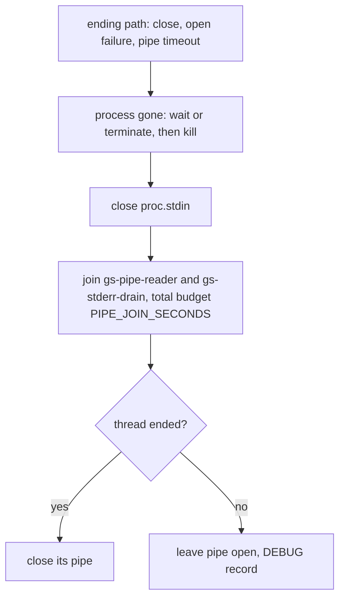

# Design Document

## Overview

Four Linux defects are fixed without changing Windows behaviour. The design was written after reading the code and after three Windows experiments, whose results are in "Evidence".

1. **FakeS3270 leak (Requirement 1).** `FakeS3270` gets a `close()`. `wait()` and the pipe release in `Connector.close()` let the fake free its descriptors without the caller doing anything.
2. **Connector pipes (Requirement 4).** `Connector` closes `proc.stdin`, `proc.stdout` and `proc.stderr` on all three session-ending paths, in an order that never closes a pipe under a blocked reader.
3. **setuptools (Requirement 3).** One line in the `dev` extra, and the three tests that pin it.
4. **SIGTERM on stdio (Requirement 2).** The reviewer's diagnostic on Linux (Python 3.14.4) confirmed H1: a non-daemon anyio worker thread blocked on stdin keeps the process alive. The fix is a daemon-thread stdin copier in `cli.py` only (see "Requirement 2: SIGTERM root cause confirmed, fix chosen").

Production files touched: `greenscreen/connector/testing/fake.py`, `greenscreen/connector/connector.py`, `pyproject.toml`, and `greenscreen/publisher/cli.py` (Requirement 2 fix). Nothing else under `greenscreen/` changes.

### Conventions for the executor

- DO NOT COMMIT. Leave every change in the working tree. `.kiro/steering` is not edited. No dependency is added except `setuptools>=70.1` in `dev`.
- No secret, user id or host address is printed or written. The diagnostics below use `unused.invalid` and a throwaway host.
- A defect found in production code outside the named files (for example in `_io.py`) is reported, not fixed. See Open item 1.
- A requirement with a Reviewer_Check is reported as "implemented, awaiting Reviewer_Check". Requirement 2 is reported as "stopped, awaiting diagnostic".

## Evidence (Windows, 2026-11-18, Python 3.11.9, before any change)

### Windows baseline (the "before" numbers)

`python -m pytest -m "not integration" -p no:cacheprovider` at HEAD `7b9cd6c`, working tree clean apart from `.kiro/specs/linux-readiness/`:

| Passed | Skipped | Failed | Deselected | pytest time | Wall time |
|---|---|---|---|---|---|
| 2096 | 7 | 0 | 7 (integration) | 329.87 s | 334.9 s |

The 7 skips: `test_fixtures.py:98` (2, `TK5_*` unset), `test_flow_captures.py:142` (`TK5_PASSWORD`), `test_flow_strategy_cost.py:51` and `test_publisher_perf.py:22` (opt-in perf), `test_publisher_cli.py:652` (POSIX only, the Stdio_SIGTERM_Test), `test_recognizer_bundled.py:126` (`TK5_*`, `GS_HOST`). The passed count equals the reviewer's Linux count (2096), so the two Linux failures map to the Stdio_SIGTERM_Test (skipped here) and the Wheel_Test (passes here because setuptools 69.5.1 and wheel 0.43.0 are installed). The Windows time (330 s) is three times the Linux 109 s; the two are not comparable and no bound applies to Windows.

### Local_Pythons (`py -0`)

```
-V:3.12 *        Python 3.12 (64-bit)
-V:3.11          Python 3.11 (64-bit)
```

`python` on PATH is 3.11.9 (anyio 4.16.0, mcp 2.3.0, uvicorn 0.38.0). It has every dependency, so every Windows test run here uses 3.11. Python 3.12.3 has pip only: it has no `mcp`, `anyio` or `hypothesis`, and the executor does not install them. **Only the reviewer can run 3.12 (with dependencies), 3.13 and 3.14 (3.14.4 is the reviewer's box).**

### Finding 1: the leak mechanism is confirmed (platform independent)

Script (outside the repo): create a `FakeS3270`, run `Connector.open()` and `close()`, `del` both, `gc.collect()`, then list threads and the `closed` flag of the five Fake_Descriptors. Three cycles:

```
cycle 0: threads=['gs-fake-s3270', 'gs-pipe-reader']        all five .closed == False
cycle 1: threads=[2 x gs-fake-s3270, 2 x gs-pipe-reader]    all five .closed == False
cycle 2: threads=[3 x gs-fake-s3270, 3 x gs-pipe-reader]    all five .closed == False
```

Two threads per fake outlive `Connector.close()` and garbage collection. `gs-fake-s3270` blocks on `_stdin_read` until the write end `stdin` closes, and `gs-pipe-reader` blocks on `stdout` until `_stdout_write` closes. Both stay referenced by their threads, so the fake is never collected. The code reading in the requirements ("five descriptors, no `close()`, GC cannot free them") is therefore correct, and the thread reference is the reason (Requirement 1.8). `FakeS3270.wait()` returns 0 at once and closes nothing, and `Connector.close()` never calls `terminate()` on the normal path.

This also settles Resolved question 2: with a real `Popen`, s3270 exits after `Quit()`, the reader and drain threads see EOF and end, and nothing references the pipe objects, so collection frees them. The measured "flat at 7" is that collection. The fake has no such exit, so the same collection never happens.

### Finding 3: the failure is reproduced on Windows (3.12)

A fresh `py -3.12 -m venv` (offline, no network install) contains only `pip 24.0`. In a temporary copy of the repo, `pip wheel .\repo --no-deps --no-build-isolation --no-index` fails with exit 2 and `ModuleNotFoundError: No module named 'setuptools'`. This is the Backend_Missing_Error premise. Python 3.11's `ensurepip` bundles setuptools and Python 3.12 does not, which is why the reviewer's 3.14.4 box fails. The fixed outcome (which setuptools version pip resolves from `.[dev]`) needs a network install, so criterion 3.8 is **not run** here and is a Reviewer_Check.

### Finding 2: the hang mechanism is reproduced on Windows, the Linux cause is not confirmed

The Stdio_SIGTERM_Test is skipped on Windows and a Windows child cannot receive a POSIX SIGTERM. The experiment therefore delivers SIGTERM to the process itself: a throwaway harness (outside the repo, in `%TEMP%\gs-sigterm\`) imports `tests.publisher_cli_entry`, waits until `signal.getsignal(SIGTERM)` is `cli._on_sigterm`, waits 1 s, then calls `signal.raise_signal(SIGTERM)` from a timer thread. The parent holds stdin open and idle, as the test does. `faulthandler.dump_traceback_later` dumps stacks after the signal.

Result (run 1, dump after 8 s):

```
publishing 1 of 8 flows over stdio
[harness +5.78s] raising SIGTERM
[harness +5.80s] run() returned 0; live threads: [('MainThread', False), ('AnyIO worker thread', False)]
Timeout (0:00:08)!   <- process still alive 8 s later
  Thread (AnyIO worker thread): anyio/_backends/_asyncio.py line 1124 in run  (blocked)
  Thread (MainThread):          threading.py line 1590 in _shutdown
```

Result (run 2, parent closes the child's stdin 12 s after the start, 6.8 s after the signal): the child exits with code 0 at once, `report.json` holds `rc 0`, and `atexit` runs only after that. So on Windows/3.11: `main()` returns 0 within 20 ms of the signal, the drain ran, and the process then waits in `threading._shutdown` for the non-daemon `AnyIO worker thread` that is blocked reading the idle stdin pipe. Stdin EOF releases it.

What this proves and what it does not:

| Hypothesis | Windows result | Status |
|---|---|---|
| **H1** blocked stdin reader thread keeps the process alive | Reproduced. The reader is `anyio.wrap_file` worker thread, `daemon=False`, and `threading._shutdown` waits for it. | Mechanism confirmed on Windows (emulated delivery). **Linux cause not confirmed.** |
| **H2** `KeyboardInterrupt` from `_on_sigterm` is swallowed or breaks the `finally` | Not seen: `anyio.run` unwound, the drain ran, `run()` returned 0. | Not confirmed on Windows. Selector-loop (Linux) delivery, and Python 3.12 to 3.14 asyncio, are untested. |
| **H3** signal arrives before the handler is installed | Not testable (the harness waits for the handler). Static reading: the handler is installed after `_stdio_streams()`; `mcp` is already imported by `_check_modules()`, so the window is a few milliseconds. The reviewer's symptom is a timeout, and H3 would end the process with exit -15, not hang. | Disfavoured by the symptom. Check the exit code. |

Differences between the emulation and the real test: the signal is raised by `raise_signal` from a thread, not delivered by the kernel; Windows uses the proactor loop and Linux the selector loop; anyio worker-thread behaviour was seen on 3.11 only. This is why the task stops here (Requirement 2.1, 2.10).

## Architecture

### Decisions

| Decision | Choice | Why |
|---|---|---|
| How the fake releases its descriptors | A `close()` plus two protocol side effects: `wait()` closes the stdout write end, and the handler thread closes `_stdin_read` when its loop ends | `wait()` is `Popen.wait()`: when it returns, the process has exited and the OS has closed the process's pipe ends. `Connector` then needs no `isinstance` check and no fake-specific call. |
| Who releases the pipes | `Connector`, through one helper called from every ending path | One place, identical for `Popen`, the fake and the test stand-ins. |
| Order in the helper | process gone, close `stdin`, bounded join of reader and drain, close each of `stdout`/`stderr` only if its thread ended | A buffered `stdout`/`stderr` object holds a lock while a thread reads from it. `close()` from another thread waits for that lock on POSIX and can deadlock on Windows (the existing comment in `test_pf_pa_boundary.py` records the Windows case). |
| A reader that does not end | Leave that pipe open, log at DEBUG, return | A close under a blocked reader can hang `close()` forever. An open pipe is freed at collection, which is today's behaviour. |
| SIGTERM | No code change; diagnostic first | The Linux cause is open. |

### Connector end-of-session order



Step B already exists on every path: `close()` waits up to 5 s and then terminates, `open()` failure calls `_terminate_proc()`, and the pipe-timeout branch calls `_terminate_proc()`. After the process is gone the OS closes its write ends, so both reader loops reach EOF and end. Closing `stdin` first costs nothing (no thread reads it), tells a still-living process to stop, and wakes the fake's handler thread.

## Components and Interfaces

### 1. `greenscreen/connector/testing/fake.py`

Attribute names stay as they are: `tests/property/test_string_redaction.py` reads `_thread`, `_stdin_read`, `stdin`, `stdout`, `stderr`.

| Change | Detail |
|---|---|
| Handler thread | `_handle_loop` gets a `finally` that closes `_stdin_read` (via `_close_quietly`). The thread ends when `stdin` (the write end) is closed, by `Connector`, by `close()` or by a test. |
| `wait(timeout=None)` | Still returns `0` at once and does not change `poll()`. New: it also closes `_stdout_write` (`_close_stdout_write`, idempotent), because a process whose `wait()` returned has exited. Readers then see EOF after the data already in the pipe. |
| `terminate()`, `kill()`, `poll()` | Unchanged. |
| `close()` | New, idempotent, never raises, safe after `terminate`, `kill`, `wait` and `Connector.close()`. Steps: set `_terminated`; close `_stdout_write`; close `stdin`; `self._thread.join(timeout=5)`; close `_stdin_read` only if the thread has ended; close `stdout` and `stderr`. A second call returns at once (`_closed` flag, guarded by a lock). |
| `_close_quietly(f)` | `try: f.close() except Exception: pass`. |

Exact Fake_Descriptors closed: `stdin` (write), `stdout` (read), `stderr` (read), `_stdin_read` and `_stdout_write`. The sixth end, `stderr_write_fd`, is already closed in `__init__`.

Handler release: the thread leaves `for raw_line in self._stdin_read` when `stdin` closes (EOF). No sentinel is needed. Join bound: 5 s. `close()` is called from the test thread, never from the handler thread.

Documented caller rule (docstring): close the fake after any `PipeReader` on `fake.stdout` has ended. `Connector` obeys this (it joins first). Test fixtures obey it (section 4).

How `Connector` "knows": it does not. After `proc.wait()` or `proc.terminate()` it closes `proc.stdin/stdout/stderr` for every process object, and `FakeS3270.wait()/terminate()` already behave like the real process by ending the stdout stream. The test doubles `ScriptedProc` (BytesIO pipes) need nothing: closing a `BytesIO` is valid.

Behaviour kept (Requirement 1.4): scripts, `failure`, `raise_if_failed()`, `_dispatch`, `terminate`, `kill`, `poll`, and `wait()` returning `0` immediately. The only observable change is that output already written stays readable and then ends in EOF after `wait()`. The Connector calls `wait()` only after `Quit()` was answered, or on a path where the process is already gone.

### 2. `greenscreen/connector/connector.py`

New state in `__init__`: `self._drain: threading.Thread | None = None`, `self._pipes_released = False`. New class constant `PIPE_JOIN_SECONDS: float = 2.0` (total budget for both joins, shared; a class attribute so a test can shorten it).

`open()`: `self._drain = start_stderr_drain(proc.stderr)` (the thread was returned and discarded before).

New private method `_release_session()`:

```python
def _release_session(self) -> None:
    """Close the three session pipes once the process is gone. Idempotent, never raises."""
    proc = self._proc
    if proc is None or self._pipes_released:
        return
    self._pipes_released = True
    self._close_pipe(proc.stdin, "stdin")                       # nobody reads it
    deadline = time.monotonic() + self.PIPE_JOIN_SECONDS
    for name, thread in (("stdout", getattr(self._reader, "_thread", None)),
                         ("stderr", self._drain)):
        if thread is not None:
            thread.join(max(0.0, deadline - time.monotonic()))
            if thread.is_alive():
                logger.debug("pipe reader still running; leaving %s open", name)
                continue
        self._close_pipe(getattr(proc, name), name)

@staticmethod
def _close_pipe(pipe, name):
    try:
        pipe.close()
    except (OSError, ValueError) as exc:
        logger.debug("closing %s failed: %s", name, type(exc).__name__)
```

`_close_pipe` is a `staticmethod`. The log carries the stream name and the exception class only: no response data, command or secret (Requirement 4.4). Each stream is closed independently, so one failure does not skip the others.

Call sites (the only three ways a session ends):

| Path | Where | Change |
|---|---|---|
| `close()` | `finally:` block, before or after `self._closed = True` | `self._release_session()` after the existing wait/terminate. It also runs when `send()` already tore the session down and `close()` returned early (the `finally` still executes). |
| `open()` failure | `except S3270Error` branch | after `self._terminate_proc()`, call `_release_session()`, then `_closed = True` |
| pipe timeout | `_send_with_deadline`, `except ConnectorTimeoutError` | after `self._terminate_proc()`, call `_release_session()`, then `_closed = True` |

The release step calls no method on `proc`. The existing test `test_close_after_wait_timeout...` pins `proc.calls == ["wait", "terminate", "wait", "kill"]` (`test_connector.py` line 214), so adding a `poll()` or `wait()` here would break it.

Return values, exceptions, log messages and timing of `open()`, `close()` and every action are unchanged on the success path. New on a failure path only: at most `PIPE_JOIN_SECONDS` (2 s) when a reader refuses to end, plus DEBUG records. `close()` twice, `close()` on a never-opened Connector (`_proc is None`) and `close()` after an open failure all return without raising (`_pipes_released` and `_closed` guards).

Thread analysis (Requirement 4.5):

| Case | POSIX | Windows | Result |
|---|---|---|---|
| Process exited, reader blocked in `readline` | EOF arrives when the OS closes the pipe write end, the thread ends in milliseconds | same | join returns at once, pipes closed |
| Process alive after `kill` failed (very rare) | `readline` keeps blocking, `BufferedReader.close()` would wait on the read lock | `close()` under a blocked read can deadlock | join times out after the shared 2 s, pipe left open, DEBUG record |
| Real `Popen` with grandchildren holding the pipe | not applicable to s3270 | same | handled by the same timeout |
| Fake after `wait()`/`terminate()` | `_stdout_write` closed, reader ends | same | pipes closed |

### 3. `pyproject.toml`

Add `"setuptools>=70.1",` as the last line of `dev`. `[build-system]` (`setuptools>=68`, `wheel`), `dependencies` and `publish` are unchanged. The bound is 70.1 because that release brings `bdist_wheel` into setuptools, so no separate `wheel` package is needed with `--no-build-isolation` (pip does not read `[build-system].requires` in that mode). New `dev` list:

```toml
dev = [
    "greenscreen-connector[publish]",
    "hypothesis>=6.170.15",
    "pytest>=8.0",
    "pyyaml>=6.0.3",
    "setuptools>=70.1",
]
```

`tests/unit/test_flow_packaging.py::test_wheel_contains_exactly_the_eight_flow_yaml_files` is not edited. Its flags stay and a real build failure still fails it.

Guard tests (found by searching `tests/` and the repo for `hypothesis>=6.170.15`; no other file pins the list, and `.kiro` documents mention it only as history):

| File | Where | New expected list |
|---|---|---|
| `tests/unit/test_flow_packaging.py` | `EXPECTED_OPTIONAL["dev"]`, lines 31-36, asserted by `test_pyproject_dependencies_are_unchanged` | `["greenscreen-connector[publish]", "hypothesis>=6.170.15", "pytest>=8.0", "pyyaml>=6.0.3", "setuptools>=70.1"]` |
| `tests/unit/test_flow_model.py` | `EXPECTED_OPTIONAL["dev"]`, lines 31-36, asserted by `test_pyproject_dependency_lists_unchanged` | same list |
| `tests/unit/test_recognizer_packaging.py` | literal list in `test_dev_extra_unchanged`, lines 37-42 | same list |
| `tests/unit/test_publisher_packaging.py` | no change: it checks only that `dev` contains `greenscreen-connector[publish]` | |

Only the list changes in each file (Requirement 3.6).

### 4. Test support changes

| File | Change |
|---|---|
| `tests/conftest.py` | `finalize_fakes`: after the terminate loop, call `f.close()` for every fake, then `raise_if_failed()` as before. |
| `tests/unit/test_fake_s3270.py` | `make_fake` teardown: `terminate()`, `stdin.close()` as now, then `close()`. `reader_for` takes `make_fake` as a parameter (so it is torn down first) and, at teardown, calls `fake.terminate()` and joins `reader._thread` (2 s) for each reader it made, so no read end is closed under a live reader (Windows). |
| `tests/unit/test_connector.py` | `make_connector` teardown: `fake.terminate()` then `fake.close()`. |
| `tests/unit/test_connector_redaction.py` | `make_connector` teardown (line 102-103) the same; the direct `RecordingFake` near line 575-585: add `fake.close()` in the `finally`. |
| `tests/property/test_pf_pa_boundary.py` | line 32 construction: in the `finally`, after `conn.close()`, replace `fake.terminate(); fake.stdin.close()` by `fake.terminate(); fake.close()`. The comment about write ends stays true and is kept. |
| `tests/property/test_string_redaction.py`, `test_response_redaction.py` | `_release_fake` already releases; it keeps working because every close is idempotent. Not edited. |
| `tests/property/test_wait_timeout_substitution.py` | `with conn:` calls `Connector.close()`, which now releases the fake. Not edited. |
| `tests/connector_support.py` | `RecordingFake` inherits `close()`. Not edited. |
| `tests/unit/test_publisher_cli.py` | Not edited (Requirement 2.3). |

Constructions of `FakeS3270` or a subclass, all covered above: `tests/conftest.py:47`, `tests/unit/test_fake_s3270.py:22`, `tests/unit/test_connector.py:71` (`RecordingFake`), `tests/unit/test_connector_redaction.py:96, 575`, `tests/property/test_pf_pa_boundary.py:32`, `tests/property/test_wait_timeout_substitution.py:48`, `tests/property/test_string_redaction.py:114-122`, `tests/property/test_response_redaction.py:115`. Constructions of `Connector` over the fake: the same files plus `test_fake_s3270.py:231`. Other `Connector(...)` uses build `ScriptedProc` (BytesIO, nothing to release) or the real s3270 (integration tests).

### 5. New tests

| File | Runs on | What it proves |
|---|---|---|
| `tests/unit/test_fake_s3270_close.py` | all platforms | Requirement 1.1, 1.2, 1.3, 1.7. For a fake closed through `Connector.close()` and for one closed through `Fake.close()`: each of the five Fake_Descriptors has `closed is True` and `_thread.is_alive()` is false. Also `close()` twice, `close()` after `terminate()`, after `kill()`, after `wait()`, and a timing assertion that `close()` returns in under 5 s. |
| `tests/unit/test_fake_s3270_descriptors.py` | POSIX; `pytest.skip("descriptor counting needs /proc/self/fd or /dev/fd; platform win32")` otherwise | Requirement 1.6. `_fd_count()` is `len(os.listdir("/proc/self/fd"))`, falling back to `/dev/fd` (macOS). It runs `gc.collect()`, one warm-up cycle, records the count, runs 200 cycles (even index: `Connector.open()` + `close()` over a fake; odd index: `Fake.close()` directly), runs `gc.collect()` and asserts the count equals the start value. The listing's own descriptor is the same on both sides. |
| `tests/unit/test_connector_close_pipes.py` | all platforms | Requirement 4.1 to 4.4, 4.9, 4.10 (cases below). |

`test_connector_close_pipes.py` cases:

1. Fake session closed by `close()`: `proc.stdin.closed`, `proc.stdout.closed`, `proc.stderr.closed` are true.
2. Same for the open-failure path (script answers `Connect` with `error`) and the pipe-timeout path (silent fake, `_config.default_timeout = 0.05`).
3. `close()` twice, `close()` on a never-opened Connector, `close()` after open failure: no exception, still closed.
4. One stream's `close()` raises `OSError` (stand-in process): the other two are closed, `close()` does not raise, one DEBUG record per failure holds only the stream name and the exception class (checked with `LogCapture`).
5. Blocked-reader stand-in: `proc.stdout` is an object whose iteration blocks on a `threading.Event` and never reaches EOF. The test sets `Connector.PIPE_JOIN_SECONDS = 0.2` (monkeypatch), calls `close()`, and asserts it returns within 2 s, that `stdin` and `stderr` are closed, that `stdout` is **not** closed (left to collection), and that the DEBUG record names `stdout`. The event is set in a `finally` so the thread ends.

Windows can prove: everything in these three files except the descriptor count, the existing suite (no change to assertions), and the Connector order with `FakeS3270`, `BytesIO` and stand-in objects. Windows cannot prove: the 1024-limit failure and its fix, the descriptor count (the test skips), the behaviour of a real `Popen` buffered pipe under a blocked read on Linux, and anything about real s3270.

## Data Models

| Item | Value | Where |
|---|---|---|
| `Connector.PIPE_JOIN_SECONDS` | 2.0 s total for both thread joins | new class constant |
| `Connector._pipes_released` | bool, set once | new instance attribute |
| `Connector._drain` | the `gs-stderr-drain` thread or `None` | new instance attribute |
| `FakeS3270._closed` | bool, guarded by a lock | new instance attribute |
| `close()` bound, fake | thread join 5 s | `FakeS3270.close` |
| `close()` bound, Connector | existing 5 s wait (+5 s terminate wait) + at most 2 s new | `Connector.close` |

## Property-Based Testing Applicability

No Correctness Properties section is written. Every change here is resource lifecycle (close ordering, descriptor counts, thread end) or packaging metadata. There is no function whose output varies with a generated input in a way a fixed example does not cover, so no new property-based test is added. The 200-cycle test is an example test with a loop. The existing property tests (`test_pf_pa_boundary.py`, `test_string_redaction.py` and others) stay as they are and gain the closing described above.

## Error Handling

| Situation | Behaviour |
|---|---|
| `close()` of a pipe raises `OSError` or `ValueError` | DEBUG record (stream name, exception class), the other pipes are still closed, `Connector.close()` does not raise |
| Reader or drain thread still alive after `PIPE_JOIN_SECONDS` | that pipe stays open, DEBUG record, `close()` returns after at most 2 s extra |
| `close()` called twice, or before `open()` | returns at once (`_closed`, `_proc is None`, `_pipes_released`) |
| `FakeS3270.close()` handler thread does not end in 5 s | `_stdin_read` is left open, no exception |
| Fake script failure on the handler thread | unchanged: stored in `failure`, `raise_if_failed()` re-raises |
| Windows behaviour | no new exception and no new log record above DEBUG on any success path |

## Testing Strategy

PBT does not apply (see Property-Based Testing Applicability). Example and integration tests carry the work:

- **Unit:** the three new files in section 5; the existing Connector, fake, redaction, publisher and packaging tests, run unchanged except for the teardown edits and the three dev lists.
- **Windows run after the change:** the same command as the baseline. Report pass, skip and fail counts and wall time against 2096 / 7 / 0 and 329.87 s. Expected: the passed count rises by the new Windows-running tests, the skip count rises by one (the descriptor-count test), failures stay 0.
- **Python versions:** the executor runs everything on 3.11.9 only (the only local interpreter with dependencies). 3.12, 3.13 and 3.14 are reviewer-only.
- **Not run by the executor:** the fresh-venv install (needs the network), any POSIX-only behaviour, the real s3270 check.

## Reviewer_Check (on the Linux box; Windows alone closes none of these)

Replace `<repo>` with the checkout. The environment variable for the s3270 binary is `GS_S3270_BINARY` (not `GS_S3270_PATH`).

### Setup, and Requirement 3 (setuptools, finding 3)

```bash
cd <repo>
python3 -m venv /tmp/gs-fresh && /tmp/gs-fresh/bin/pip install -e ".[dev]"
/tmp/gs-fresh/bin/python -m pip list | grep -i -E "setuptools|wheel"   # setuptools >= 70.1; no wheel needed
/tmp/gs-fresh/bin/pytest tests/unit/test_flow_packaging.py -q -rs      # 3 passed, none skipped
/tmp/gs-fresh/bin/pytest tests/unit/test_flow_model.py tests/unit/test_recognizer_packaging.py tests/unit/test_publisher_packaging.py -q
git diff --stat pyproject.toml                                          # one added line
```

### Requirement 1 (fake descriptors, finding 1) and Requirement 5

```bash
/tmp/gs-fresh/bin/pytest tests/unit/test_fake_s3270_descriptors.py -v -rs     # PASSED, not skipped
( ulimit -n 1024 && ulimit -n && time /tmp/gs-fresh/bin/pytest -m "not integration" -q -rs 2>&1 | tail -25 )
```

`ulimit -n` must print `1024`. The run has no "Too many open files" and no failure. Expected skips are the Windows-only ones plus the `TK5_*`/`GS_HOST`, perf and integration ones. Record the `time` result next to the 109 s observation (a later run over 300 s is a finding, not a failure). Spot check:

```bash
/tmp/gs-fresh/bin/python - <<'EOF'
import os
from greenscreen.connector.config import ConnectorConfig
from greenscreen.connector.connector import Connector
from greenscreen.connector.testing.fake import FakeS3270, ScriptedResponse
n = lambda: len(os.listdir("/proc/self/fd"))
S = "U F U C(h) I 2 24 80 0 0 0x0 0.000"
ok = lambda p: ScriptedResponse(p, [], S, "ok")
def cycle():
    f = FakeS3270([ok(r"Connect\(.*\)"), ok(r"Disconnect\(\)"), ok(r"Quit\(\)")])
    c = Connector(ConnectorConfig(binary="x", host="h", port=3270), process_factory=lambda *a, **k: f)
    c.open(); c.close()
cycle(); before = n()
for _ in range(200): cycle()
print("before", before, "after", n())     # equal
EOF
ls /proc/$$/fd | wc -l   # run before and after the pytest run in the same shell: equal
```

### Requirement 4 (real s3270 pipes, finding 4)

No `TK5_*` variables are needed: the loop never logs on. The first block needs no host (Connect is refused, which exercises the open-failure path). The second needs the demo host.

```bash
cat > /tmp/fdloop.py <<'EOF'
import os, sys
from greenscreen.connector.config import ConnectorConfig
from greenscreen.connector.connector import Connector
from greenscreen.connector.exceptions import ConnectorError
n = lambda: len(os.listdir("/proc/self/fd"))
cfg = ConnectorConfig()                       # GS_S3270_BINARY, GS_HOST, GS_PORT from the environment
start, kept = n(), []
for i in range(40):
    c = Connector(cfg); kept.append(c)        # keep every object alive: no help from collection
    try:
        c.open()
    except ConnectorError:
        pass
    c.close()
print("pid", os.getpid(), "start", start, "after 40 sessions", n())   # equal
sys.stdout.flush(); os.system(f"ls /proc/{os.getpid()}/fd | wc -l")   # external count, same number
EOF
GS_S3270_BINARY=$(command -v s3270) GS_HOST=127.0.0.1 GS_PORT=9 /tmp/gs-fresh/bin/python /tmp/fdloop.py
GS_S3270_BINARY=$(command -v s3270) GS_HOST=<demo host> GS_PORT=3270 /tmp/gs-fresh/bin/python /tmp/fdloop.py
timeout 120 /tmp/gs-fresh/bin/pytest tests/integration -m integration -q    # needs GS_HOST/GS_PORT, TK5_* ; no hang
pytest tests/unit/test_connector_close_pipes.py tests/unit/test_connector.py -q
```

Before the change the second count is higher by up to three descriptors per live object; after it, equal.

### Requirement 2 (stdio SIGTERM, finding 2): diagnostic first

Run before any fix and paste the output into `.kiro/specs/linux-readiness/sigterm-diagnostic.txt`. The server runs the real `cli.main()` on the fake host, with an idle open stdin pipe, as the test does.

```bash
cd <repo> && mkdir -p /tmp/gs-diag && rm -f /tmp/gs-diag/*
python --version; pip list 2>/dev/null | grep -i -E "^(anyio|mcp|uvicorn) "
export GS_S3270_BINARY=unused GS_HOST=unused.invalid GS_TRANSPORT=stdio GS_PUBLISH_FLOWS=tk5-system-info
# D1: does it hang, is the report written, what do the threads do?
sleep 600 | python -X faulthandler -m tests.publisher_cli_entry /tmp/gs-diag/report.json 2>/tmp/gs-diag/err.txt &
PID=$!; SLEEP_PID=$(pgrep -n -x sleep)
until grep -q "publishing 1 of 8" /tmp/gs-diag/err.txt; do sleep 0.1; done; sleep 1
kill -TERM $PID; sleep 5
kill -0 $PID 2>/dev/null && echo "D1: STILL ALIVE after 5 s" || { wait $PID; echo "D1: exited rc=$?"; }
ls -l /tmp/gs-diag/report.json && cat /tmp/gs-diag/report.json     # present => run() returned
ls /proc/$PID/task | while read t; do echo "$t $(cat /proc/$PID/task/$t/comm) $(cat /proc/$PID/task/$t/wchan)"; done
kill -ABRT $PID                                                     # faulthandler dumps all thread stacks to err.txt
sleep 1; cat /tmp/gs-diag/err.txt
# D2: release the reader and watch it exit (run on a fresh server started as above, SIGTERM sent, then:)
kill $SLEEP_PID; wait $PID; echo "D2: rc=$?"
# D3 (optional): strace and py-spy on a fresh hung server
strace -f -tt -p $PID -e trace=read,futex,epoll_wait,rt_sigreturn 2>&1 | head -50
py-spy dump --pid $PID
# D4: same as D1 with -X dev, to show warnings and unraisable exceptions
```

Reading the output (each hypothesis predicts a different D1 result):

| Observation | Means |
|---|---|
| `report.json` exists with `"rc": 0`, process alive, no traceback, main thread in `threading._shutdown`, `AnyIO worker thread` in `read`/`futex`, D2 exits with rc 0 | **H1 confirmed** (same as the Windows emulation) |
| `report.json` missing, main thread inside asyncio/anyio (`select`, `_run_once`, a `Task` wait), `KeyboardInterrupt` or `Task exception was never retrieved` in `err.txt` | **H2** (handler raised at a bad point, or cleanup did not run) |
| `wait` gives rc 143 or -15 and no `handler installed` effect | **H3** (default SIGTERM action ran) |
| `report.json` missing, main thread in `app.service.drain` or `asyncio.run` from `main()` | a hang in the final drain (not one of H1 to H3) |

After the fix (only if the task is later opened): `pytest tests/unit/test_publisher_cli.py -q`, then 20 repeats of the Stdio_SIGTERM_Test (`for i in $(seq 20); do pytest tests/unit/test_publisher_cli.py::test_stdio_sigterm_stops_cleanly -q || break; done`), then `pgrep -fa 's3270|greenscreen-publish'` prints nothing. Per interpreter, for 3.11 to 3.14:

```bash
for v in 3.11 3.12 3.13 3.14; do
  python$v -m venv /tmp/gs-$v && /tmp/gs-$v/bin/pip install -q -e ".[dev]" \
    && /tmp/gs-$v/bin/pytest tests/unit/test_publisher_cli.py -q || echo "FAILED on $v"
done
# or with uv: uv venv --python 3.14 /tmp/gs-314 && uv pip install --python /tmp/gs-314/bin/python -e ".[dev]"
```

Run the D1 block once per interpreter too: the answer may differ by version (Open item 5).

### Final checks

`git status --short` shows no commit, nothing under `.kiro/steering`, and only the files in the change list.

## Requirement 2: SIGTERM root cause confirmed, fix chosen

### Reviewer verification (box, 2026-11, Ubuntu, Python 3.14.4, s3270 4.3, ulimit -n 1024, HEAD 7b9cd6c plus the uncommitted changes)

- `pip install -e ".[dev]"` resolved setuptools 84.2.1. No `wheel` package was installed.
- `pytest -m "not integration"`: 2113 passed, 1 failed, 5 skipped in 109 s. No "Too many open files". `test_fake_s3270_descriptors` ran and passed. The Wheel_Test passed. The one failure is `test_stdio_sigterm_stops_cleanly`.
- Real s3270, 40 open/read/close sessions against the live host: descriptor count 4, 4, 4, 4. Ten refused connections: 4 to 4.
- Status: **Requirements 1, 3, 4 and 5 are verified by the reviewer.** Requirement 2 was open until the fix below was verified; "Reviewer run 2" records that (verified on 3.14.4).

### Diagnostic result (`.kiro/specs/linux-readiness/sigterm-diagnostic.txt`)

Run on Python 3.14.4 only. D1 and D2 were run. D3 (strace, py-spy) and D4 (`-X dev`) were not run.

**H1 is confirmed.** After SIGTERM, `main()` returns 0 and `report.json` is written (`rc: 0`, no live session). The process stays alive: the main thread waits in `futex_do_wait` (`threading._shutdown`) and one `AnyIO worker th` thread is blocked in `anon_pipe_read` on stdin. When the parent closes stdin (D2) the process exits with rc 0. H2 (no traceback, `main()` returned 0 and the drain ran) and H3 (exit code 0, not 143) are ruled out on 3.14.4. This matches the Windows emulation (Finding 2).

Limit: confirmed on 3.14.4 only. The fix must hold on 3.11 to 3.14. 3.11.9 is testable locally on Windows. 3.12 (no dependencies locally), 3.13 and 3.14 are reviewer-only.

### The fix (chosen): a daemon-thread stdin copier in `greenscreen/publisher/cli.py` only

No change to `mcp_server.py`, `_run_http`, `_Server.handle_exit`, `_io.py` or any connector file.

**Cause in one line.** `anyio.wrap_file` runs the blocking read in an anyio worker thread (`daemon=False`) that cannot be woken while the parent holds stdin open. `threading._shutdown` waits for it. The fix makes the blocking read happen in a daemon thread that we own, and gives the SDK a pipe whose write end we can close.

**Where it is created.** In `_stdio_streams()`, after `os.dup(0)`, `os.dup(1)`, `os.dup2(2, 1)` and `sys.stdout = sys.stderr` (so fd 1 already points at stderr when the thread starts):

1. `in_fd = os.dup(0)` as today (the original stdin copy).
2. `feed_r, feed_w = os.pipe()`.
3. Start `threading.Thread(target=_copy_stdin, args=(in_fd, feed_w), name="gs-stdin-copier", daemon=True)`.
4. The SDK stdin is `io.TextIOWrapper(os.fdopen(feed_r, "rb"), encoding="utf-8", errors="replace", newline="\n")` wrapped by `anyio.wrap_file`, exactly the wrapper settings used today, so decoding and line handling are unchanged.

**`_copy_stdin(in_fd, feed_w)`.**

```python
def _copy_stdin(in_fd: int, feed_w: int) -> None:
    try:
        while True:
            chunk = os.read(in_fd, 65536)
            if not chunk:                      # EOF on the real stdin
                break
            view = memoryview(chunk)
            while view:
                view = view[os.write(feed_w, view):]
    except OSError:                            # feed closed by shutdown, or stdin failed
        pass
    finally:
        _close_fd_quietly(feed_w)              # EOF for the SDK reader
```

EOF handling (Requirement 2.5): when the real stdin reaches EOF the copier closes `feed_w`, the SDK reader sees EOF and the server stops with exit code 0 as today. `_close_fd_quietly` ignores `OSError` and is safe to call twice (the second call only runs if the first did not close, guarded by a one-shot flag held with the write fd in a small module-level holder, so a recycled fd number is never closed by mistake).

**How `_run_stdio` reaches the write end.** `_stdio_streams()` keeps its two-value return (executor first searches `tests/` for `_stdio_streams` and keeps every caller working). The write end and its closer are kept in a module-level holder `_StdinFeed` set by `_stdio_streams()` and read by `_run_stdio`. `_run_stdio` gets a `finally` after the existing `try/except KeyboardInterrupt` that calls `_stdin_feed_close()`.

**Cleanup order on a normal exit (SIGTERM, EOF or error).**

1. `anyio.run(run_stdio(...))` returns or `KeyboardInterrupt` is caught. `run_stdio`'s own `finally` (shielded `service.drain`) has already run, so every session is closed before the feed is touched.
2. `_run_stdio`'s `finally` closes `feed_w` (idempotent). The SDK's blocked worker thread sees EOF and ends.
3. `main()` runs its existing exit path and returns 0. `threading._shutdown` finds only daemon threads, so the process exits. The copier stays blocked in `os.read(in_fd)`, which is allowed because it is a daemon.

A copier blocked in `os.write` (the pipe is full because the SDK stopped reading) is also a daemon and is released by the closed read end at exit. Closing `feed_w` while the copier is inside `os.write` makes that write fail with `OSError`, which the copier swallows. The tiny window in which the fd number could be reused before the copier's own `finally` is covered by the one-shot flag above: only one of the two closers closes the fd.

**Stdout purity (Requirement 2.6).** The copier touches only `in_fd` and `feed_w`. It never writes to fd 1, `sys.stdout` or the SDK stdout wrapper, and logs nothing (so no secret and no data can reach any stream). Fd 1 is redirected to stderr before the thread starts. `test_stdio_stdout_holds_only_json_rpc_even_when_a_handler_prints` stays unchanged and must keep passing.

**Windows.** `os.pipe()`, `os.read` and `os.write` on a pipe work on Windows. A daemon thread blocked in `os.read(in_fd)` does not stop the process from exiting. Windows behaviour of `main()` changes only in that stdin is now read through the copier: JSON-RPC bytes arrive unchanged and in order. `_run_http` is untouched.

**Rejected alternatives.** `os._exit()` in `_run_stdio` (skips the final drain in `main()` and the report write in the test entry). Closing fd 0 to wake the reader (does not wake a blocked read on Linux). Changing the anyio worker thread's daemon flag (not our code). Editing `mcp_server.py` to read stdin differently (larger blast radius, same result).

### Portable regression test (Requirement 2.8): new file `tests/unit/test_publisher_stdio_sigterm_portable.py`

`tests/unit/test_publisher_cli.py` is not edited.

- Launch the real stdio server in a subprocess on the fake host, using the sibling entry file `tests/publisher_sigterm_entry.py`. After the handler `cli._on_sigterm` is installed and 1 s has passed, a timer thread delivers SIGTERM to the process. The delivery call depends on the platform (see "Reviewer run 2" below): on POSIX (`os.name == "posix"`) it is `os.kill(os.getpid(), signal.SIGTERM)`; elsewhere it is `signal.raise_signal(signal.SIGTERM)`. `os.kill` with SIGTERM terminates the process on Windows without running the Python handler, so Windows keeps `raise_signal`, which calls the Python handler in-process.
- The parent holds the child's stdin pipe open and idle for the whole test and never closes it before the assertion.
- Assert: the child exits with code 0 within a bound (30 s, matching Requirement 2.2) while stdin is still open, and the report file holds `rc: 0` and no live session. Kill the child in a `finally` if it is still alive.
- Windows evidence for the failure without the fix: the experiment above hung with the main thread in `threading._shutdown` and the `AnyIO worker thread` on stdin. The executor does not need to revert the fix to see the failure; the evidence above stands as the "fails without the fix" proof.

The test is portable in structure (same child, same assertions on every platform), not in the delivery call. What it can prove on Windows (3.11.9): the process no longer waits for the stdin reader thread after the handler runs, the report and drain still happen, and the exit code is 0. On Windows the signal is an in-process `raise_signal`, so it does not prove kernel SIGTERM delivery or the selector event loop used on Linux. On POSIX the same test sends the signal with `os.kill` to the child's own pid, which goes through the kernel and the selector loop, but it is still sent by the child to itself, so it does not prove delivery from another process. Python 3.12 to 3.14 behaviour is not shown by any run on the executor's machine. The Stdio_SIGTERM_Test (an external `kill -TERM` from the parent) on the reviewer's box stays the proof for external delivery.

### Reviewer run 2 (Linux, Python 3.14.4, uncommitted tree, after tasks 6 and 7)

| Check | Result |
|---|---|
| `test_stdio_sigterm_stops_cleanly`, 20 repeats | 20 of 20 passed. The `cli.py` fix works. **Requirement 2 is verified for Python 3.14.4.** Python 3.11 to 3.13 stay reviewer-only. |
| Full suite `-m "not integration"` | 2116 passed, 1 failed, 6 skipped |
| The failure | `tests/unit/test_publisher_stdio_sigterm_portable.py::test_stdio_sigterm_with_idle_open_stdin_exits_0`: the child did not exit within 30 s |

**Confirmed cause (test-only, not a product defect).** `tests/publisher_sigterm_entry.py` delivers the signal with `signal.raise_signal(SIGTERM)` from a timer thread. On Linux the child then stays alive and writes no report. With `os.kill(os.getpid(), signal.SIGTERM)` from the same thread, and with a real external `kill -TERM`, the child exits 0 with a clean report while stdin is still open. The product code (`cli.py`) is correct and stays unchanged. The fix is in the test entry only (task 8.1).

### Test hygiene found on the same run (tasks 8.2 and 8.3)

- **Wheel temp directory.** `/tmp/gs-wheel-*` directories were left behind on Linux. The wheel test in `tests/unit/test_flow_packaging.py` must remove its temp directory on every exit path (success, build failure, timeout, exception, skip). The fix is test-only and does not change what the test asserts. Preferred form: `tempfile.TemporaryDirectory` or pytest `tmp_path`; otherwise `try`/`finally`. A small test proves cleanup on the failure path where it is feasible.
- **Stale wording in publisher Requirement 23.7.** The sentence ends with "(Assumptions: recovery belongs to a follow-up spec)". That is no longer true: the logon-recovery spec is done, the bundled `tk5-logon` and `tk5-system-info` Flows recover an orphan left at the ISPF menu, and the Publisher changed only `_session_clean`. The parenthetical is removed and the requirement keeps its meaning (the Publisher itself does not recover, send `RECONNECT` or retry). The matching sentences in `.kiro/specs/publisher/design.md` (the "Recovery of a locked TSO user id" row near line 20 and the "No recovery logic in the Publisher" bullet near line 470) already say the recovery lives in the Flow, so they are checked and not changed. Any other stale text found there is flagged, not edited.

### Reviewer_Check after the fix

```bash
pytest tests/unit/test_publisher_cli.py tests/unit/test_publisher_stdio_sigterm_portable.py -q
for i in $(seq 20); do pytest tests/unit/test_publisher_cli.py::test_stdio_sigterm_stops_cleanly -q || break; done
pgrep -fa 's3270|greenscreen-publish'     # prints nothing
for v in 3.11 3.12 3.13 3.14; do python$v -m venv /tmp/gs-$v && /tmp/gs-$v/bin/pip install -q -e ".[dev]" \
  && /tmp/gs-$v/bin/pytest tests/unit/test_publisher_cli.py tests/unit/test_publisher_stdio_sigterm_portable.py -q || echo "FAILED on $v"; done
```

Then re-run the D1 block of the earlier diagnostic: the process must be gone within 5 s, rc 0, with stdin still open.

## File-by-file change list

| File | Change | Requirement |
|---|---|---|
| `greenscreen/connector/testing/fake.py` | `close()`, `_close_quietly`, `_closed` + lock, handler `finally`, `wait()` closes the write end | 1 |
| `greenscreen/connector/connector.py` | `_drain`, `_pipes_released`, `PIPE_JOIN_SECONDS`, `_release_session`, `_close_pipe`, three call sites | 4, 1.3 |
| `pyproject.toml` | one line in `dev` | 3 |
| `tests/conftest.py` | `finalize_fakes` calls `close()` | 1.5 |
| `tests/unit/test_fake_s3270.py` | `make_fake` and `reader_for` teardown | 1.5 |
| `tests/unit/test_connector.py`, `tests/unit/test_connector_redaction.py` | fixture teardown, one direct construction | 1.5 |
| `tests/property/test_pf_pa_boundary.py` | `finally` uses `fake.close()` | 1.5 |
| `tests/unit/test_flow_packaging.py`, `test_flow_model.py`, `test_recognizer_packaging.py` | new `dev` list only | 3.6 |
| `tests/unit/test_fake_s3270_close.py` (new) | portable close checks | 1.1, 1.2, 1.7 |
| `tests/unit/test_fake_s3270_descriptors.py` (new) | 200-cycle POSIX count | 1.6 |
| `tests/unit/test_connector_close_pipes.py` (new) | pipe closing and blocked-reader stand-in | 4.1 to 4.4, 4.9, 4.10 |
| `greenscreen/publisher/cli.py` | `_copy_stdin`, feed holder, `_stdio_streams` uses a pipe, `_run_stdio` `finally` closes the feed | 2 |
| `tests/unit/test_publisher_stdio_sigterm_portable.py` (new, plus a child entry in `tests/` if needed) | portable SIGTERM regression test | 2.8 |
| `tests/publisher_sigterm_entry.py` | POSIX delivers with `os.kill(os.getpid(), SIGTERM)`, else `signal.raise_signal`; docstring corrected | 2.8 |
| `tests/unit/test_publisher_stdio_sigterm_portable.py` | docstring and "What this cannot prove" note corrected, no assertion change | 2.8 |
| `tests/unit/test_flow_packaging.py` | wheel test removes its temp directory on every path; small cleanup test; no change to what it asserts | 3 |
| `.kiro/specs/publisher/requirements.md` | Requirement 23.7: stale parenthetical removed | (docs) |
| `greenscreen/publisher/mcp_server.py`, `tests/unit/test_publisher_cli.py` | no change | 2 |
| `.kiro/specs/linux-readiness/sigterm-diagnostic.txt` | created by the reviewer (done) | 2.10 |

Not edited: `.kiro/steering`, `greenscreen/connector/_io.py`, `[build-system]`.

## Risks and open items

1. **`_io.py` is not a named file.** The Connector needs the `gs-pipe-reader` thread to join it. The design reads `self._reader._thread` with `getattr` (same package, private attribute) and keeps the stderr thread it already gets from `start_stderr_drain`. A public `PipeReader.join(timeout)` would be cleaner but edits an unnamed production file. Decision for the reviewer: accept the private access, or approve a small `_io.py` method.
2. **Requirement 4.1 against a stuck reader.** "close() has closed all three pipes" cannot hold when a reader does not end, because closing under it can hang. The design closes every pipe whose reader ended and leaves the other open. The case is a fault (process not gone), not the normal path. Needs the reviewer's agreement.
3. **`FakeS3270.wait()` now ends the output stream.** It matches `Popen.wait()`, and no existing test calls `wait()` and then keeps scripting (checked: only `test_fake_s3270.py` line 118, which does not read afterwards). The executor reruns the Connector and fake tests first after this edit.
4. **Resolved: the Linux SIGTERM cause is confirmed as H1** by the reviewer's D1 and D2 on 3.14.4. The fix is chosen (daemon-thread stdin copier, `cli.py` only).
5. **Python 3.11 to 3.14 (still open for the fix).** The confirmation is on 3.14.4 only. The fix is version-independent in design (it removes the non-daemon reader from the picture), but only 3.11.9 can be run by the executor. 3.12, 3.13 and 3.14 are Reviewer_Checks. D3 and D4 were not run and are not needed for the chosen fix.
10. **Copier fd handling.** The write end is closed by both the copier and `_run_stdio`; a one-shot flag prevents closing a recycled fd number. The executor must test double close and EOF-on-stdin in unit tests of the helpers.
6. **The two Linux failures.** Confirmed by the user as the Stdio_SIGTERM_Test and the Wheel_Test. The Windows pass count (2096) equals the reviewer's pass count, which agrees.
7. **Descriptor-count flake.** Threads from other tests can open or close descriptors during the 200 cycles. The test warms up, calls `gc.collect()` and runs after the fixture fixes; if it still flakes on the box, the reviewer reports it and the test runs it in a subprocess.
8. **Windows cannot show** the 1024-descriptor failure, the POSIX count, a real `Popen` pipe under a blocked read, the fresh-venv resolution of setuptools (needs the network), or SIGTERM delivery by the kernel.
9. **Temporary files.** The experiments left scripts and a 3.12 venv under `%TEMP%\gs-sigterm\` (outside the repo). No repo file was changed; `git status` shows only `.kiro/specs/linux-readiness/`.
