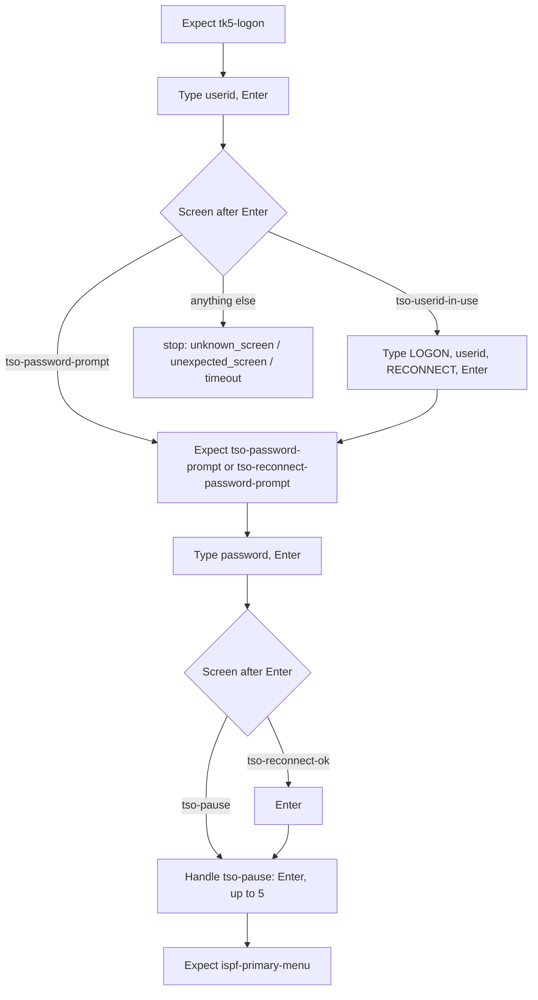

# Design Document

## Overview

The bundled logon steps recover from `IKJ56425I LOGON REJECTED, USERID <id> IN USE` by reconnecting to the orphaned TSO session and continuing to the ISPF primary option menu. The change has four parts:

1. Three new Signatures (`tso-userid-in-use`, `tso-reconnect-password-prompt`, `tso-reconnect-ok`) and the three captures they come from.
2. A new step list for `tk5-logon`. `tk5-system-info` picks it up because it starts with exactly those steps.
3. Tests: scripted recovery tests, a golden call list that proves the normal path is unchanged, one property, two more screens in an existing property, and one live test with a cleanup helper.
4. One small publisher change: `_session_clean` marks every stop for which the runtime skips the `finally` steps, derived from a new public constant in the flow runtime (section 8).
5. Spec amendments in earlier specs, and conditional doc edits that wait for a live pass.

The behaviour of `greenscreen/flow/` does not change. The Python production edits are: `_MANIFEST` and one docstring in `greenscreen/recognizer/bundled.py`; one added line in `greenscreen/flow/runner.py` (the public constant `FINALLY_SKIP_REASONS`); and `_session_clean` plus one import line in `greenscreen/publisher/calls.py`. `pyproject.toml` stays unchanged.

### Conventions for the executor

- DO NOT COMMIT. Leave every change in the working tree. The reviewer commits.
- Stop and report any production defect outside the files named above. Print no secret. Add no dependency.
- No Python file under `greenscreen/publisher/` other than `calls.py` changes, and no recovery, retry or reaper logic is added there (publisher Requirement 23.7).

### What was checked while writing this design

Everything below was run against the repository at HEAD (working tree clean apart from `.kiro/specs/logon-recovery/`) with throwaway scripts outside the repo.

- The three draft Signatures, loaded together with the seven bundled ones, were evaluated against all ten captures (seven in `captures/`, three in `captures/incoming/`). Each capture satisfied exactly one Signature, its own (`tso-pause-2` satisfies `tso-pause`). Cursors, field lists and sizes match Requirement 1.8 exactly (output in "Data Models").
- The new step list passed `check_flow` for `tk5-logon` and `tk5-system-info` against the ten Signatures, and `to_yaml()` produced the YAML shown below.
- The new `tk5-logon` was run through `run_flow` with a `ScriptedSession` (`echo_typing=True`) on five screen scripts: the normal path, the recovery path, `tso-userid-in-use` shown twice, the second IN USE state, and a blank screen after `tso-reconnect-ok`. The call lists and reason codes in "Components and Interfaces" are the observed ones.
- The two prompts do not cross-match: `tso-password-prompt` (hidden field at row 1) and `tso-reconnect-password-prompt` (hidden field at row 3) each reject the other's capture.
- Synthetic builders (`make_screen`) for the in-use screen and the reconnect prompt were recognized as exactly one Signature for user ids `A`, `a@#$`, `ABCDEFGH` and `HERC01`.

## Architecture

### Decisions

| Decision | Choice | Why |
|---|---|---|
| Where recovery lives | In the bundled Flow YAML, using existing step kinds | Requirement 5.10 and the runtime's no-guessing rule. No behaviour change in `greenscreen/flow/`. |
| How the optional screen is expressed | Handle_Step on `tso-userid-in-use` with `max_count` 1, directly after the Key_Step that sends the user id | A Handle_Step with zero iterations sends nothing (`exec_handle` calls `_skip_body`), so the normal path costs no key. |
| Reconnect command | Three Type_Steps (`LOGON `, input `userid`, ` RECONNECT`) and one Key_Step in one Handle body | The format has no interpolation (`${` is rejected). Each Type_Step is a separate `string` call at the cursor. |
| Password prompt | One Expect_Step with both prompt Signatures, then the existing `type input: password` | Same Type_Step for both prompts keeps Requirement 5.5 and the `secret_target` check on both. |
| `tso-reconnect-ok` | Handle_Step with `max_count` 1 and one Enter, placed before the existing `tso-pause` handle | `tso-reconnect-ok` needs one Enter, then the existing pause handle and the final Expect finish the logon. |
| Blank-row matching | `region_regex` `^ *$` on rows 1 and 2 of `tso-userid-in-use` | The unprotected field starts at column `41 + len(userid)`, so no field or cursor matcher can be used. The blank rows are what separates this screen from the reconnect prompt, whose row 0 holds the same message. |
| Recovery limit | One reconnect attempt | A second `tso-userid-in-use` stops with `loop_limit`. No retry loop. |

### Logon step logic



### Why the sequence works (read from `greenscreen/flow/runner.py`)

1. After the Key_Step that sends the user id, `current` is `None` and `pre_key_screen` is the screen with the typed user id. The in-use Handle_Step polls with `accept_any=True`. A screen equal to `pre_key_screen` counts as "no answer yet". The first different recognized screen is accepted whatever its name.
2. Normal path: that screen is `tso-password-prompt`. The name is not the handle's signature, so `count` stays 0, `_skip_body` writes four `skipped` audit records, and no Session call is made. `accept()` reset `pre_key_screen`, so the next Expect_Step reads the same screen again and accepts it. This is the same shape as the existing `tk5-logo` Handle followed by `Expect tk5-logon`.
3. Recovery path: the screen is `tso-userid-in-use`. The body runs: three `type` calls, then `key enter`. `exec_type` checks that the cursor `(1,0)` lies in an unprotected field (it lies in the field starting at `(0, 41 + len(id))`). All three Type_Steps hit the same field, so `typed_fields` holds one entry. `exec_key` builds the comparison screen from `pre`, restores the typed field's cells from the accepted screen (`build_comparison`), and recognizes it as `tso-userid-in-use` again. That is why the Signature must not use `cursor_field` (typing moves the cursor, and `build_comparison` keeps the cursor of `pre`) and why the typed text on rows 1 to 2 does not break the blank-row matchers.
4. After the Enter, the body ends and the handle polls again. The reconnect prompt differs from `pre_key_screen`, so it is accepted. Its name is not the handle's signature, so the loop ends with `count` 1. If `tso-userid-in-use` shows again in a changed form, `count >= max_count` raises `loop_limit` before any further body step runs.
5. The Expect_Step accepts `tso-reconnect-password-prompt`. `exec_type` for `password` requires the cursor field to be hidden (`secret_target` otherwise). The field at `(3,0)` is hidden, the cursor `(3,1)` is inside it.
6. After the password Enter, the Handle_Step on `tso-reconnect-ok` polls. Normal path: the first `***` pause is accepted, the handle skips its body, and the existing `tso-pause` handle then finds `current` already set and runs its body exactly as before (the old pause handle did the same first poll). Recovery path: `tso-reconnect-ok` is accepted, its body presses Enter, the next poll accepts the `***` pause under the reconnect message (recognized as `tso-pause`), and the existing `tso-pause` handle presses Enter once more and polls the ISPF menu.
7. The final Expect_Step for `ispf-primary-menu` accepts the menu.

Normal path, from the logon screen: `string(userid)`, `enter`, `string(password)`, `enter`, then one `enter` per `***` pause. With two pauses that is `string(userid)`, `enter`, `string(password)`, `enter`, `enter`, `enter`, identical to HEAD.

## Components and Interfaces

### 1. Captures

Move the six files in `captures/incoming/` (`tso-userid-in-use`, `tso-reconnect-password-prompt`, `tso-reconnect-ok`, each `.ascii.txt` and `.readbuffer.txt`) to `captures/` with `git mv`, so the bytes stay identical (Requirement 1.2). `captures/incoming/` stays as an empty directory only if git keeps it; nothing depends on it.

### 2. Signatures (exact YAML)

These are the `ScreenSignature.to_yaml()` outputs of the draft objects that were run against the captures. Write them to `greenscreen/recognizer/signatures/<name>.yaml` unchanged.

`tso-userid-in-use.yaml`

```yaml
version: 1
name: tso-userid-in-use
description: TSO logon refused because the user id is already logged on.
matchers:
- kind: region_regex
  row: 0
  col: 0
  length: 80
  pattern: ^ IKJ56425I LOGON REJECTED, USERID [^ ]{1,8} IN USE *$
- kind: region_regex
  row: 1
  col: 0
  length: 80
  pattern: ^ *$
- kind: region_regex
  row: 2
  col: 0
  length: 80
  pattern: ^ *$
volatile: []
```

`tso-reconnect-password-prompt.yaml`

```yaml
version: 1
name: tso-reconnect-password-prompt
description: Password prompt of a LOGON RECONNECT, two rows below the normal prompt.
matchers:
- kind: region_regex
  row: 2
  col: 0
  length: 80
  pattern: ^ IKJ56714A ENTER CURRENT PASSWORD FOR [^ ]{1,8}- *$
- kind: cursor_field
  row: 3
  col: 0
  hidden: true
volatile: []
```

`tso-reconnect-ok.yaml`

```yaml
version: 1
name: tso-reconnect-ok
description: TSO reconnect succeeded; waiting for Enter.
matchers:
- kind: last_row
  text: ' IKT00300I LOGON RECONNECT SUCCESSFUL, SESSION ESTABLISHED'
volatile: []
```

Why each matcher is what it is, with the capture values behind it:

- Row 0 of `tso-userid-in-use` reads `" IKJ56425I LOGON REJECTED, USERID HERC01 IN USE"` with the field-start cell rendered as the leading space, the same convention as the existing `tso-password-prompt` pattern. The pattern accepts a user id of 1 to 8 non-space characters and nothing after `IN USE` but spaces.
- Rows 1 and 2 are blank on `tso-userid-in-use` (rows of null cells read as spaces, as `read_region` and `visible_rows` do). On `tso-reconnect-password-prompt` row 1 holds the typed command, so it fails. On the second IN USE state row 2 holds `IKJ56400A ENTER LOGON OR LOGOFF-`, so it fails (Requirement 4.3).
- `tso-reconnect-password-prompt` has no matcher on row 0 or row 1 (Requirement 3.3). The row-2 text and the hidden field at `(3,0)` identify it. `tso-password-prompt` needs row 0 text and a hidden field at `(1,0)`, so neither Signature matches the other's capture.
- `tso-reconnect-ok` uses `last_row` so the pause screen under the same message (last non-blank row ` ***`) does not satisfy it, and `tso-pause` (`last_row ' ***'` plus `before_cursor ' ***'`) does not satisfy it on the reconnect-ok capture.
- None of the three files contains the capture user id (`HERC01`), a password or the host address (checked with the existing user-id scan logic; the new test of Requirement 4.5 repeats it).

`greenscreen/recognizer/bundled.py`: append `"tso-userid-in-use"`, `"tso-reconnect-password-prompt"`, `"tso-reconnect-ok"` to `_MANIFEST` (after `tso-pause`), and change the docstring "seven" to "ten". `pyproject.toml` stays unchanged (`greenscreen.recognizer.signatures = ["*.yaml"]` already covers the files).

### 3. Flows (exact step structure)

`greenscreen/flow/flows/tk5-logon.yaml`: `inputs`, `outputs`, `timeouts`, `finally` and `description` stay as they are. `steps` becomes (this is `to_yaml()` output of the flow that was checked and run):

```yaml
steps:
- kind: handle
  signature: tk5-logo
  max_count: 1
  settle: 3.0
  steps:
  - kind: key
    key: enter
- kind: handle
  signature: tso-input-not-recognized
  max_count: 1
  settle: 0.0
  steps:
  - kind: key
    key: clear
- kind: expect
  signatures:
  - tk5-logon
- kind: type
  input: userid
- kind: key
  key: enter
- kind: handle
  signature: tso-userid-in-use
  max_count: 1
  settle: 0.0
  steps:
  - kind: type
    text: 'LOGON '
  - kind: type
    input: userid
  - kind: type
    text: ' RECONNECT'
  - kind: key
    key: enter
- kind: expect
  signatures:
  - tso-password-prompt
  - tso-reconnect-password-prompt
- kind: type
  input: password
- kind: key
  key: enter
- kind: handle
  signature: tso-reconnect-ok
  max_count: 1
  settle: 0.0
  steps:
  - kind: key
    key: enter
- kind: handle
  signature: tso-pause
  max_count: 5
  settle: 0.0
  steps:
  - kind: key
    key: enter
- kind: expect
  signatures:
  - ispf-primary-menu
```

Only three things differ from HEAD: the new `tso-userid-in-use` handle, the second signature in the second Expect_Step, and the new `tso-reconnect-ok` handle. The YAML files must equal `to_yaml()` output (`test_shipped_yaml_equals_to_yaml`), so generate them with a script that loads the bundled flow, rebuilds `steps` and writes `flow.to_yaml()`, instead of editing by hand. `tk5-system-info.yaml` gets the same 12 top-level steps in place of its first 11; the four Extract_Steps, the seven logoff steps and the `finally` list are untouched. The step descriptions do not change, so the published tool text for `tk5-logon` stays as it is.

Step indices (`plan()`, depth-first, a handle's index comes before its body):

| Index | Step |
|---|---|
| 0, 1 | handle `tk5-logo`, body key enter |
| 2, 3 | handle `tso-input-not-recognized`, body key clear |
| 4 | expect `tk5-logon` |
| 5 | type input `userid` |
| 6 | key enter |
| 7 | handle `tso-userid-in-use` |
| 8, 9, 10, 11 | body: type `LOGON `, type input `userid`, type ` RECONNECT`, key enter |
| 12 | expect `tso-password-prompt`, `tso-reconnect-password-prompt` |
| 13, 14 | type input `password`, key enter |
| 15, 16 | handle `tso-reconnect-ok`, body key enter |
| 17, 18 | handle `tso-pause`, body key enter |
| 19 | expect `ispf-primary-menu` |

`tk5-logon` ends at index 19 (20 plan items; HEAD had 13). In `tk5-system-info` the Extract_Steps are 20 to 23, the logoff steps 24 to 30, the `finally` steps 31 to 37. Top-level positions in `flow.steps` for tests: handles `main[0]`, `main[1]` (INR), `main[5]` (in-use), `main[9]` (reconnect-ok), `main[10]` (pause); HEAD had `main[0]`, `main[1]`, `main[8]`.

Observed with a `ScriptedSession(echo_typing=True)`, userid `FAKEUSR`, password `SNTNL-01`, `poll_interval=0.25`:

| Script (screens in order) | Outcome | Session calls other than `read` |
|---|---|---|
| Normal: `tk5-logon`, `tso-password-prompt`, two pauses, `ispf-primary-menu` | ok | `string(userid)`, `enter`, `string(password)`, `enter`, `enter`, `enter` |
| Recovery: `tk5-logon`, `tso-userid-in-use`, `tso-reconnect-password-prompt`, `tso-reconnect-ok`, pause under reconnect message, `ispf-primary-menu` | ok | `string(userid)`, `enter`, `string("LOGON ")`, `string(userid)`, `string(" RECONNECT")`, `enter`, `string(password)`, `enter`, `enter`, `enter` |
| `tso-userid-in-use` shown again after the reconnect command | `loop_limit` | stops after the fourth call group above, no key after |
| Second IN USE state after the reconnect command | `unknown_screen` | no key after the reconnect `enter` |
| Second IN USE state directly after the user id | `unknown_screen` | `string(userid)`, `enter` only |
| Blank screen after the Enter at `tso-reconnect-ok` | `unknown_screen` | no call after the Enter at `tso-reconnect-ok` |
| `tso-reconnect-password-prompt` capture with its hidden field made unprotected-visible | `unknown_screen` (see Open item 2) | no `string(password)` |

The recovery audit holds `ok` for 7 (signature `tso-userid-in-use`), `ok` with iteration 1 for 8 to 11, `ok` for 12 (`tso-reconnect-password-prompt`), `ok` for 15 and 16 (iteration 1) and `ok` for 17 and 18 (`tso-pause`, iteration 1). On the normal path 8 to 11 and 16 are `skipped` with `duration_seconds` 0.0.

The recovery assumes the orphan sits at the ISPF primary option menu (Known limits in the requirements). Three branches before the final expect release an orphan that sits elsewhere: at a REENTER prompt the flow presses PA1, at READY it presses Clear, at the cleared screen it types LOGOFF and presses Enter; after any of them the call stops with unexpected_screen at the final expect and the next call takes the normal path.

### 4. Test support

`tests/screen_support.py`

- `CAPTURE_NAMES` gets the three new names (ten in all).
- New builders, all with `make_screen`. They are the only place that knows these shapes, and each takes a user id so the property can vary it.

```python
def in_use_screen(userid: str) -> Screen:
    msg = f"IKJ56425I LOGON REJECTED, USERID {userid} IN USE"
    return make_screen(24, 80, {(0, 1): msg},
                       [(0, 0, 0xC8), (0, 1 + len(msg), 0xC0)], (1, 0))

def reconnect_prompt_screen(userid: str) -> Screen:
    msg = f"IKJ56425I LOGON REJECTED, USERID {userid} IN USE"
    return make_screen(24, 80,
        {(0, 1): msg, (1, 0): f"LOGON {userid} RECONNECT",
         (2, 1): f"IKJ56714A ENTER CURRENT PASSWORD FOR {userid}-"},
        [(0, 0, 0xC8), (2, 0, 0xC8), (3, 0, 0xCC)], (3, 1))

def reconnect_pause_screen() -> Screen:      # *** under the reconnect message
    ...  # row 0 " IKT00300I ...", " ***" on row 2, cursor (2, 5)

def second_in_use_screen() -> Screen:        # IKJ56425I row 0, IKJ56400A row 2, cursor (3, 0)
    ...
```

The second field start `1 + len(msg)` reproduces the real capture (column 47 for the six-character `HERC01`). All four were run against the ten Signatures: the in-use and prompt builders satisfy only their own Signature for four different user ids, the pause screen satisfies only `tso-pause`, and the second IN USE screen satisfies none.

`tests/flow_support.py`

- `_SIGNATURE_CAPTURE` gets three identity entries (`"tso-userid-in-use": "tso-userid-in-use"`, and the other two). Without them `_find_repaint_cells` finds no repaint cells for the new Signatures and `partial_repaint(prev, k)` in `chain_scripts()` raises `LookupError` when `prev` is a new name.
- `capture()` already resolves a capture name to itself, so no other change is needed there.
- Nothing else changes. The import-time assertions (`pause_variant` recognized as `tso-pause`, `blank_screen` unknown) keep holding.

`tests/property/_flow_strategies.py`

- `TYPEABLE` gets `"tso-userid-in-use"` and `"tso-reconnect-password-prompt"`. Both cursor fields are unprotected (the second one hidden), and both fields are longer than 255 cells, so `_TYPED_MAX` becomes 255 for both and the `assert all(v >= 1 ...)` still holds.
- `typed_cases` gets an optional `names=TYPEABLE` parameter so one parametrized test can draw only from one screen (see Testing Strategy, Property 8).
- `SIGNATURE_NAMES` is derived from the bundled set, so `chain_scripts()` picks up the three new names without edits. `flows()` draws are indexed by `len(_SIGS)`, so every draw changes meaning once there are ten Signatures. That is expected; see Open item 6.

### 5. Test files

| File | Change |
|---|---|
| `tests/unit/test_recognizer_capture_inventory.py`, `test_recognizer_capture_matrix.py`, `test_flow_captures.py` | Pin ten names, rename "seven" to "ten" in test names and docstrings, matrix becomes 10 by 10 (100 evaluations), failure messages name the missing or unexpected file (Requirements 1.3 to 1.7, 4.1). |
| `tests/unit/test_recognizer_capture_facts.py` | Three new example tests with the facts of Requirement 1.8 (all verified in "Data Models"). |
| `tests/unit/test_flow_captures.py` | `_holds_password` check runs over ten captures (Requirement 2.1). A password hex-form scan of `captures/**` runs only when `TK5_PASSWORD` is set, computes a boolean, and otherwise skips with a message naming `TK5_PASSWORD` (Requirements 2.2, 2.3). |
| `tests/unit/test_recognizer_bundled.py`, `test_recognizer_packaging.py` | Counts 7 to 10; `test_bundled_matchers_match_capture_cells` already covers `text_at`, `cursor_field` and `region_regex`, so it covers the new files once their captures are in `captures/` (Requirement 3.6). Add the credential scan of Requirement 3.5. `test_no_bundled_yaml_contains_user_id` covers 4.5 as is (case-insensitive check to confirm; extend if it is not). |
| `tests/unit/test_recognizer_line_mode_signatures.py` | Add two examples: the pause under the reconnect message is `tso-pause` and not `tso-reconnect-ok` (Requirement 4.2), and the second IN USE state matches none of the ten Signatures (Requirement 4.3). |
| `tests/property/test_recognizer_userid_recognition.py` (new) | The one property of Requirement 4.4. |
| `tests/unit/test_flow_bundled.py` | Update `test_logon_typing_sequence` (top-level non-handle steps become `expect tk5-logon`, `type userid`, `key enter`, `expect [tso-password-prompt, tso-reconnect-password-prompt]`, `type password`, `key enter`, `expect ispf-primary-menu`; typed inputs in depth-first order `userid`, `userid`, `password`). `test_logon_ends_on_ispf_primary_menu` keeps working because the last step is unchanged. `test_no_literal_credentials_or_placeholders`: allowed set becomes `{"X", "LOGOFF", "LOGON ", " RECONNECT"}`. The existing regex strips quotes after trimming, so `'LOGON '` and `' RECONNECT'` compare with their spaces intact. |
| `tests/unit/test_flow_runner_fixes_skipped.py` | Update the two bundled tests: unmatched handles are `main[0]`, `main[1]`, `main[5]`, `main[9]`, `main[10]`. The logon test hard-codes child kind `"key"`; use `child.step.kind` (the in-use body has three `type` steps). Indices 1 and 3 stay `skipped`. |
| `tests/unit/test_flow_logon_script.py` | Add the normal-path call-list assertion from the logon screen (Requirement 7.1), written as a golden literal (Requirement 11.4). Existing `FULL_KEYS` tests stay. |
| `tests/unit/test_flow_system_info_script.py` | Add the golden list for `tk5-system-info` (Requirement 11.4) and the recovery run (Requirement 7.3). |
| `tests/unit/test_flow_logon_recovery.py` (new) | Recovery tests of Requirements 7.2, 7.4 to 7.7, 11.1, 11.2 (details below). |
| `tests/unit/test_logon_recovery_publisher.py` (new) | Requirements 11.3 and 12.4 through `CallService` and `_session_clean` (section 8). |
| `tests/unit/test_publisher_calls.py` | The `timeout` row of the flow-stop table changes from no claim to `session_clean` False (Requirement 12.5). |
| `tests/unit/test_flow_public_api.py` or a new `tests/unit/test_flow_finally_skip_reasons.py` | New test of `FINALLY_SKIP_REASONS` (Requirement 12.4 a). `__all__` stays at nine names. |
| `tests/integration/test_flow_live_recovery.py` (new) | Requirement 8. |
| `tests/property/test_flow_typing_never_blocks.py` | Add a parametrized second test for the two new screens (Property 8). |

### 6. Scripted recovery tests (`test_flow_logon_recovery.py`)

All screens come from `captures/` or `make_screen`; the pause comes from `reconnect_pause_screen()`. Every run uses `ScriptedSession(..., echo_typing=True)`, `FakeClock()`, `poll_interval=0.25`, the bundled flows and the bundled Signatures. No socket, no subprocess, no skip.

| Test | Script | Assertion |
|---|---|---|
| recovery_logon | `tk5-logon`, `tso-userid-in-use`, `tso-reconnect-password-prompt`, `tso-reconnect-ok`, `reconnect_pause_screen()`, `ispf-primary-menu` | The 10 calls of Requirement 7.2; last screen read from the session recognized as `ispf-primary-menu`; audit records 7 to 18 as listed above. |
| recovery_system_info | same prefix, then `tso-ready`, `tk5-logon` | Four Outputs in order `USERID`, `SYSTEMID`, `RELEASE`, `TERMINAL`; last screen `tk5-logon`. |
| loop_limit | `tk5-logon`, `tso-userid-in-use`, `tso-userid-in-use` | `FlowError.reason == "loop_limit"`; zero keys after the reconnect `enter`. |
| stop_after_reconnect_command | `tk5-logon`, `tso-userid-in-use`, `second_in_use_screen()` | `unknown_screen`; no call after the reconnect `enter`. |
| stop_after_password | `tk5-logon`, `tso-userid-in-use`, `tso-reconnect-password-prompt`, `blank_screen()` | `unknown_screen` (Requirement 11.1, second point); no call after the password `enter`. |
| stop_after_reconnect_ok | `tk5-logon`, in-use, prompt, `tso-reconnect-ok`, `blank_screen()` | `unknown_screen`; no call after the Enter at `tso-reconnect-ok`. |
| second_in_use_directly | `tk5-logon`, `second_in_use_screen()` | `unknown_screen`; calls are `string(userid)`, `enter` only (Requirement 7.6). |
| visible_prompt_bundled | `tk5-logon`, in-use, the reconnect prompt capture with its hidden field made visible | `unknown_screen` at the Expect_Step (the bundled Signature needs a hidden cursor field); no `string` call carrying the password (Requirement 7.5, first bullet). |
| secret_target | same screens, with a test-only `tso-reconnect-password-prompt` Signature made of the row-2 `region_regex` alone, passed as `signatures=` | `FlowError.reason == "secret_target"`; no `string` call carrying the password (Requirement 7.5, second bullet). |
| no_leak | every run above | Password in plain and hex forms (`forms_of_run`) occurs in no `repr(result)`, no `repr(audit)`, no `str(FlowError)` and no log record captured at DEBUG (Requirement 7.7). Booleans only. |

The "no call after the point of the stop" assertions compare `session.calls` (without `read`) with an expected literal prefix, not with a recomputed value.

### 7. Golden call lists (Requirements 11.4, 11.5)

Rule: the lists are recorded from the unchanged flows before any flow or Signature file changes, so the new flows are measured against the old behavior. Nothing is committed. The guard is that `git diff --stat -- greenscreen/flow greenscreen/recognizer/signatures` prints nothing when the lists are recorded, and that the golden tests pass against those unchanged files.

Procedure for the implementer, as the first step of the work:

1. With the guard above satisfied, run a throwaway script (not kept in the repo) that builds `ScriptedSession([...], echo_typing=True)` for each flow and prints the calls without `read`:
   - `tk5-logon`: states `capture("tk5-logon")`, `capture("tso-password-prompt")`, `pause_variant(0)`, `pause_variant(1)`, `capture("ispf-primary-menu")`.
   - `tk5-system-info`: the same five states, then `capture("tso-ready")`, `capture("tk5-logon")`.
   - Inputs `{"userid": "FAKEUSR", "password": "SNTNL-01"}`, `FakeClock()`, `poll_interval=0.25`.
2. Compare with the literals below. They were recorded from HEAD while writing this design. If the implementer's output differs, the implementer's output wins and this section is corrected.
3. Write the literals into the two test files, uncommitted. They pass against the unchanged flows and must still pass after the flow change.

```python
GOLDEN_LOGON = [
    ("string", "FAKEUSR"), ("enter",),
    ("string", "SNTNL-01"), ("enter",), ("enter",), ("enter",),
]
GOLDEN_SYSTEM_INFO = [
    ("string", "FAKEUSR"), ("enter",),
    ("string", "SNTNL-01"), ("enter",), ("enter",), ("enter",),
    ("string", "X"), ("enter",), ("string", "LOGOFF"), ("enter",),
]
```

Both lists passed against the new flows in the prototype run (normal-path rows of the table in section 3). A one-pause variant (`pause_variant(0)` only) was also recorded on HEAD (`...("enter",), ("enter",)` for logon, one fewer `enter`) and is kept as a second parametrized case, since the number of pauses varies on the live host.

### 8. Publisher: `session_clean` for every stop that skips the finally steps (Requirement 12)

**What the code does today.** `_session_clean(code, abort_reason)` in `greenscreen/publisher/calls.py` (a module-level function, line 405) returns `False` only for `unknown_screen`, `call_timeout`, or abort reason `cancel` or `shutdown`, and `None` otherwise. It is called once, in `execute`, for every outcome after the `code` is chosen (`rec.session_clean = _session_clean(code, reason)`).

**What the runtime does.** `greenscreen/flow/runner.py` holds `_FINALLY_SKIP_REASONS = frozenset({"unknown_screen", "ambiguous_screen", "timeout", "run_timeout", "session_error", "input_invalid", "definition"})`. It is private (leading underscore, not exported by `greenscreen.flow`, whose `__all__` is pinned at nine names by `tests/unit/test_flow_public_api.py`). `run_finally` skips the `finally` steps when the main failure's reason is in the set, or when `current is None` (no screen accepted yet).

**Smallest exposure.** Add one line after the definition in `runner.py`: `FINALLY_SKIP_REASONS: frozenset[str] = _FINALLY_SKIP_REASONS`. The private name stays because `tests/unit/test_flow_runner_fixes_definition.py` and `tests/unit/test_flow_spec_consistency.py` read it (the second one by regular expression on the source of the definition). Nothing is added to `__init__.py` or `__all__`. The publisher imports it from `greenscreen.flow.runner`. No behaviour changes.

**The publisher rule.** In `calls.py`:

```python
from greenscreen.flow.runner import FINALLY_SKIP_REASONS

# Flow stops after which the runtime did not run the finally steps. Derived, not copied.
_FINALLY_SKIPPED_STOPS: frozenset[str] = FINALLY_SKIP_REASONS & _FLOW_STOP_CODES

def _session_clean(code, abort_reason):
    if code == "call_timeout" or code in _FINALLY_SKIPPED_STOPS or abort_reason in ("cancel", "shutdown"):
        return False
    return None
```

`_FLOW_STOP_CODES` is `frozenset(REASON_CODES) - {"input_invalid"}`, so the intersection drops `input_invalid` (raised as `FlowInputError` before any step, nothing was typed) and `definition` (not a Reason_Code; raised as `FlowDefinitionError`). The result is exactly the five reasons `unknown_screen`, `ambiguous_screen`, `timeout`, `run_timeout`, `session_error`. `_FLOW_STOP_CODES` is defined above `_session_clean` in the module, so the module-level constant is valid there (the implementer checks the order).

**Mismatch report (see Open item 1).** The approved list (the five reasons) equals the runtime set minus `input_invalid` and `definition`. Those two never reach the publisher as a Flow stop, so the list is correct for the publisher and no reason is added or dropped silently. One further runtime rule has no reason code: the `finally` steps are also skipped when `current is None`, whatever the reason. A stop with another reason before the first screen was accepted (for example `loop_limit` at the first step) therefore skips `finally` without a claim. This is accepted: no key had been sent, so the user id cannot have been logged on by this call.

**Tests (one task, section 5 rows).**

- `FINALLY_SKIP_REASONS` is a `frozenset`, `is` the private set, and contains the five reasons (Requirement 12.4 a).
- The derived publisher set equals the literal five, with a failure message that prints the difference (12.4 b). This is the drift check: a reason added to the runtime set shows here and in the table test below.
- Table over `ERROR_CODES` plus `call_timeout`: `_session_clean(code, None)` is `False` exactly for the five and `call_timeout`; `_session_clean(code, "cancel")` and `"shutdown"` give `False` for every code (12.4 c).
- Through `CallService`, following `test_publisher_calls.py` (`make`, `call`, `records`, `FakeHost`): recovery stops with bundled `tk5-logon`: `unknown_screen` (states `tk5-logon`, `tso-userid-in-use`, `second_in_use_screen()`) gives `session_clean is False` and a record with `outcome="unknown_screen"` and `session_clean=False`; `timeout` (a recovery screen that never arrives, with `FakeClock`) gives `False`; `loop_limit` (in-use screen twice) gives no claim and no `session_clean` member in the record (12.4 d, e).
- In `tests/unit/test_publisher_calls.py` the `timeout` row of `test_flow_stops_carry_the_flow_stop_members_and_session_clean` changes from `None` to `False`; the `unexpected_screen` row stays `None`.
- Final check, not a pytest test: `git diff --stat -- greenscreen/publisher greenscreen/flow pyproject.toml` shows only `calls.py` (the import, the constant and `_session_clean`), `runner.py` (one added line) and no `pyproject.toml` change.

**Publisher spec text.** `.kiro/specs/publisher/requirements.md` Requirement 23 criteria 1 and 5 are rewritten for the new set and the derivation (Requirement 12.6); the publisher design lines that list the marked outcomes (the "Call_Log_Record and `session_clean`" paragraph, the "Log outcome of a call without a response" paragraph if it lists codes, and the "Account lock and recovery" paragraph that says "no other outcome is marked") are amended the same way. This does not depend on the live result.

### 9. Live test (`tests/integration/test_flow_live_recovery.py`)

Structure follows `test_flow_live_system_info.py`: `@pytest.mark.integration`, `request.getfixturevalue("host_reachable")`, `live_connector_config()`, `LogCapture(logging.DEBUG)` on the root and `greenscreen.connector` loggers, boolean-only password assertions. `_password_forms` is imported from `tests.integration.test_flow_live_system_info` (no copy); nothing else is imported from that module.

```text
skip if TK5_USERNAME / TK5_PASSWORD unset or empty   # names each missing variable, before any connection
host_reachable, config, flow = bundled tk5-system-info
try:
    (a) with Connector(config) as c: run_flow(tk5-logon, c, creds)      # leaves block with the user logged on
    (b) # leaving the block drops the connection (Disconnect, Quit); no LOGOFF
    (c) with Connector(config) as c: r1 = run_flow(tk5-system-info, c, creds); final = recognize(c.read_screen())
        n1 = in_use_iterations(flow, r1)
        if n1 == 0: pytest.skip("lock was not reproduced; recovery path not exercised")   # cleanup runs in finally
        assert outputs, USERID equals TK5_USERNAME casefolded, SYSTEMID/RELEASE non-blank, final == "tk5-logon"
    (d) with Connector(config) as c: r2 = run_flow(tk5-system-info, c, creds)
        assert same outputs, in_use_iterations(flow, r2) == 0
    assert no Hex_Form of TK5_PASSWORD in repr(r1), repr(r2), error texts, audit reprs, DEBUG log records (>= 4 chars)
finally:
    cleanup_logoff(config, user, password)       # every exit path: pass, fail, error, skip
```

`in_use_iterations(flow, result)`: from `plan(flow)` take the Handle_Step with `signature == "tso-userid-in-use"` and count the audit records whose `step_index` is the index of its last child (the Key_Step) with status `ok`. This is 1 on the recovery path and 0 on the normal path, and it does not hard-code an index.

Step (d) is the proof that (c) logged off: a locked account would have taken the recovery path again.

If the host purged the orphan on its own (as on 2026-11-15), (c) takes the normal path and the test skips after cleanup. The result "skipped" keeps the doc edits of Requirement 10.2 undone (Requirement 10.3).

When the executor runs the test, the go-ahead for the demo account is already given, so there is no confirmation prompt. If `TK5_USERNAME` and `TK5_PASSWORD` are not visible in the executing shell, the executor reports that, records the live task as skipped (not failed) and leaves it to the reviewer (Requirement 8.12).

#### Cleanup_Helper state machine

Raw `Connector` calls only (`wait_for_text`, `string`, `enter`), no Flow and no Signature. Each wait is at most 15 seconds. `wait_any(conn, texts, timeout)` loops over `texts` calling `wait_for_text(t, timeout=0.3, poll_interval=0.1)` and returns the first text seen, or raises `CleanupFailed` at the deadline. No secret is ever passed as `text`.

| State | Action | Next state |
|---|---|---|
| OPEN | `with Connector(config)`; `wait_for_text("Logon ===>", 4)`; on timeout press Enter once, then `wait_for_text("Logon ===>", 15)` | USERID |
| USERID | `string(user)`, `enter`; `wait_any(["ENTER CURRENT PASSWORD FOR", "IN USE"], 15)` | PASSWORD if the first text; IN_USE if the second |
| IN_USE | `string("LOGON " + user + " RECONNECT")`, `enter`; `wait_for_text("ENTER CURRENT PASSWORD FOR", 15)` | PASSWORD |
| PASSWORD | `string(password)`, `enter` | ADVANCE (enters = 0) |
| ADVANCE | `wait_any(["ISPF primary option menu", "READY", "IKT00300I", "***"], 15)` | MENU on the menu text; READY on `READY`; on the other two, if `enters < 5` press Enter, `enters += 1`, stay in ADVANCE, else `CleanupFailed` |
| MENU | `string("X")`, `enter`; `wait_for_text("READY", 15)` | READY |
| READY | `string("LOGOFF")`, `enter`; `wait_for_text("Logon ===>", 15)` | DONE |

The `READY` branch in ADVANCE covers a reconnect that lands at `READY`. Any `ConnectorTimeoutError` or a state that exceeds its bound becomes `CleanupFailed`. The `with` block closes the connection on every path, so no `s3270` process outlives the helper (Requirement 8.11).

If the helper raises `CleanupFailed`, the test fails with a fixed message: the account may still be locked, recover by typing `LOGON <id> RECONNECT` at the IN USE screen. The message holds the literal `<id>`, never the real user id or any credential. When a test failure is already in flight, the cleanup failure is raised with the earlier exception as `__cause__` so neither is lost. A passing run pays one extra logon and logoff (about 6 seconds) because the helper runs on every exit path as the requirements say.

### 10. Spec amendments (only as the requirements list them)

| File | Edit |
|---|---|
| `.kiro/specs/screen-recognizer/requirements.md` | Requirement 8 criterion 2 (line 168), 11 (line 177) and 21 (line 185): seven to ten, and list the three new names; criterion 21 says "no bundled Signature matches a capture of a different screen" and gets "among the ten captures". Requirement 10 criteria 2 to 4 (lines 216 to 218): seven to ten. Lines 7, 20, 49 and 112 say "seven" about Matcher kinds and stay as they are. After the edit no amended criterion contains "seven". |
| `.kiro/specs/flow-runtime/requirements.md` | Requirement 17 criteria 5 to 8 and 12 (lines 359 to 362 and 366). 17.5 to 17.7 stay in meaning; each gains "in this order" wording so the list matches the new step order. 17.8 is rewritten: after `tk5-logon` the flow types `userid`, presses `enter`, handles `tso-userid-in-use` by typing `LOGON `, `userid` and ` RECONNECT` and pressing `enter`, expects `tso-password-prompt` or `tso-reconnect-password-prompt`, types `password`, presses `enter`, handles `tso-reconnect-ok` with `enter`, handles `tso-pause`, and ends on `ispf-primary-menu`. The sentence "no other Type_Step that types an Input" is replaced by "the only Type_Steps that type an Input are `userid` (twice), `password`". 17.12 is rewritten to say the same without that sentence. |
| `.kiro/specs/publisher/requirements.md`, Requirement 23 | Unconditional (Requirement 12.6): criteria 1 and 5 state the new set of five reasons and the derivation from `FINALLY_SKIP_REASONS`; every other outcome makes no claim. The text of criterion 2 to 4, 6 and 7 stays. |
| `.kiro/specs/publisher/design.md`, `session_clean` passages | Unconditional: the "Call_Log_Record and `session_clean`" paragraph, the "Log outcome of a call without a response" paragraph and the "Account lock and recovery" sentence "no other outcome is marked" are amended to the same set. |

**Depends on a live pass on the recovery path (Requirement 10.2). The reviewer's pass of 2026-11-18 exists, so these edits are to be executed.** Find every passage by search, because line numbers drift: in `.kiro/specs/publisher/design.md` search `follow-up`, `exposed publicly`, `locked` and `IN USE` (the table row about recovery of a locked user id near line 20, the "Account lock and recovery" section near lines 464 to 473 including its "No recovery logic" and "Exposure" bullets, the error-table row about a locked account near line 757, and open item 2 near line 909); in `.kiro/specs/publisher/requirements.md` the Assumptions bullets near lines 22 to 24 (the not-exposed statement on line 22 and the follow-up wording in the next two bullets); in `.kiro/specs/flow-runtime/design.md` and `.kiro/specs/screen-recognizer/design.md` the passages that state seven bundled Signatures, seven captures, a 7 by 7 matrix, the seven-name `_MANIFEST`, the old `tk5-logon` step list, or a logon that cannot recover (search `seven`, `7 by 7`, `_MANIFEST`, `tk5-logon`, `follow-up`). Each recovery replacement states, in full and without section references: bundled-flow recovery exists; it covers an orphan at the ISPF primary option menu only; an orphan at `READY` or inside an ISPF panel, an abandoned logon showing `IKJ56700A ENTER USERID`, and the second IN USE state (`IKJ56400A` after an extra Enter) are not recovered and the call stops with `unknown_screen`; RECONNECT takes over whatever session holds the user id; the host may purge the orphan by itself. The `GS_PUBLISH_FLOWS=tk5-system-info` text stays byte-identical. Publisher Requirement 23 is not touched by this group.

`.kiro/steering/mainframe-host.md` is not edited. The reviewer owns it.

If the live task is skipped (credentials not visible, lock not reproduced, failure or not run), none of the conditional edits is made and the executor reports them as not done and reviewer-owned. The order of work is: implement, run or hand over the live test, then edit or not.

## Data Models

### Capture facts (verified against the files while writing this design)

| Capture | Size | Cursor | Fields (start row, start col, length; protected, hidden) | Non-blank rows |
|---|---|---|---|---|
| `tso-userid-in-use` | 24 x 80 | (1, 0) | (0,0,46), (0,47,1871), (23,79,0); all unprotected, none hidden | row 0 only |
| `tso-reconnect-password-prompt` | 24 x 80 | (3, 1) | (0,0,46), (0,47,112), (2,0,44), (2,45,34), (3,0,1678) hidden, (23,79,0); none protected | rows 0, 1, 2 (row 2 is `IKJ56714A ENTER CURRENT PASSWORD FOR HERC01-`) |
| `tso-reconnect-ok` | 24 x 80 | (1, 0) | (0,0,58), (0,59,1859), (23,79,0); none hidden | row 0 only |

Requirement 1.8 lists the first, third and the hidden field of the second; the extra fields of the second capture are not asserted by the tests (the real prompt text is split into fields by the host and the test need not pin that).

### Matrix result (draft Signatures against all ten captures)

Each capture satisfied exactly one Signature: `tk5-logo`, `tk5-logon`, `tso-input-not-recognized`, `tso-password-prompt`, `ispf-primary-menu`, `tso-ready`, `tso-pause-2` (as `tso-pause`), and the three new captures each as their own name.

### Recorded live verification (not reproducible from the repository)

On 2026-11-17 the reviewer ran the reconnect sequence against the live TK5 host twice and observed: after the Enter at `tso-reconnect-ok`, the screen shows a `***` pause under the reconnect message; the bundled Signatures recognized it as `tso-pause`; its hidden cells held no password. Per the steering rule on screens that may hold residue, no capture was kept. The design depends on this observation in two places: the `tso-reconnect-ok` handle (after its Enter the next screen is a pause, not the menu) and the synthetic `reconnect_pause_screen()` of Requirements 4.2 and 7.2. The live test checks it again indirectly: on the recovery path the audit must show the `tso-pause` handle (index 17) with signature `tso-pause`, and the run must reach the menu.

### Live verification (reviewer, 2026-11-18)

Run by the reviewer against the live demo host, not by the executor. No credential, host address or capture is recorded here.

- `tests/integration/test_flow_live_recovery.py`: 1 passed in 9.7 s, on the recovery path (the in-use handle body ran).
- `pytest -m integration`: 7 passed in 28.5 s.
- With a real `greenscreen-publish` server and the account deliberately locked first (a logon dropped without LOGOFF), the REST call returned 200 with the four outputs, and the recovery handle bodies ran. The following call returned 200 on the normal path. The server exited with code 0. The password was absent from the responses and from the server log.
- The `***` pause under the reconnect message was seen live and recognized as `tso-pause`.

Documented limit: recovery covers an orphan left at the ISPF primary option menu. An orphan left at `READY`, in a sub-panel or mid-logon is not handled. The call stops (`unknown_screen` or another stop for which the finally steps are skipped) with `session_clean` false, and the account stays locked until it is recovered by hand.

### Audit shape on the two paths

On the normal path index 7 is `ok` with signature `tso-userid-in-use` and iteration `None`, and its body records 8 to 11 are `skipped` with iteration `None` and duration 0.0. Index 15 is `ok` with signature `tso-reconnect-ok` and body record 16 is `skipped`. On the recovery path the same records are `ok` with iteration 1 for the body steps.

## Correctness Properties

*A property is a characteristic or behavior that should hold true across all valid executions of a system-essentially, a formal statement about what the system should do. Properties serve as the bridge between human-readable specifications and machine-verifiable correctness guarantees.*

Almost everything in this spec is a fixed file, a fixed screen or a fixed call list, so example tests carry it. Only one criterion has an input that varies in a way a fixed capture cannot cover: the length and characters of the user id move the start of the unprotected field on the in-use screen (column `41 + len(id)`) and sit inside both message regexes.

### Property 1: User id length does not change recognition

*For any* user id of 1 to 8 characters drawn from `[A-Za-z0-9@#$]`, the synthetic `tso-userid-in-use` screen built for that id satisfies the `tso-userid-in-use` Signature and no other bundled Signature, and `recognize` returns `tso-userid-in-use`; and the synthetic reconnect prompt screen built for that id satisfies the `tso-reconnect-password-prompt` Signature and no other bundled Signature, and `recognize` returns `tso-reconnect-password-prompt`.

**Validates: Requirements 4.4**

The two screens are built by `in_use_screen(userid)` and `reconnect_prompt_screen(userid)`. The property is one `@given` test, as Requirement 9.3 demands.

**Existing flow-runtime Property 8 (typing never blocks the following key).** This is not a new property. `TYPEABLE` gains two screens, so the existing property covers typing into the two new cursor fields (Requirements 9.1, 9.2).

Criteria checked and left as examples: signature content (3.2 to 3.4, fixed screens), counts and pins (1.x, 3.1, 3.7), scripted paths (5.x, 7.x, 11.x, fixed scripts), the live test (8.x, integration) and spec edits (9.7, 9.8, 10.x). The user-story asks for recovery on one verified sequence, so more generated scripts would only re-test the runner, which has its own properties.

## Error Handling

| Situation | Reason code | Keys sent after the stop | Publisher `session_clean` |
|---|---|---|---|
| Second `tso-userid-in-use` after the reconnect command | `loop_limit` | none | not written (no claim) |
| Screen after the user id is none of the known ones, including the second IN USE state | `unknown_screen` (or `timeout` if a known screen keeps repeating) | none | `False` for both |
| Screen after the reconnect command is not the reconnect prompt | `unknown_screen` / `unexpected_screen` / `timeout` | none | `False` for `unknown_screen` and `timeout`, no claim for `unexpected_screen` |
| Reconnect prompt field not hidden | `unknown_screen` with the bundled Signature (hidden is part of the match); `secret_target` if a Signature without that matcher accepted the screen | none, no `string(password)` | as above |
| Screen after the password is neither `tso-reconnect-ok` nor a `***` pause nor the menu | `unknown_screen` / `unexpected_screen` / `timeout` | none | as above |
| Partial repaint of `tso-reconnect-ok` after its Enter, recognized as `tso-reconnect-ok` again | `loop_limit` | none | not written (no claim) |
| Orphan not at the ISPF menu (for example at `READY`) | the Enter at `tso-reconnect-ok` or at the pause lands on another screen, `unknown_screen` or `unexpected_screen` | none | as above |

The flow has no `finally` steps for `tk5-logon`. For `tk5-system-info` a `loop_limit` or `unexpected_screen` stop runs the existing `finally` list. In the recovery stops above `current` is a recovery screen, so both finally Handle_Steps skip and the closing Expect fails on that screen without sending a key. Nothing sends a key after a stop (the scripted tests assert this).

Residual risk of failing in the middle of recovery: the connection ends with the user id still logged on or already reconnected to the new session. The next call's own recovery handles that if the session sits at the ISPF menu (the common case after `tso-reconnect-ok` and the pauses).

## Testing Strategy

PBT applies to one criterion only (Property 1) and to the two extra screens of the existing Property 8. The rest is example, edge-case, smoke and integration testing, which fits this change: fixed screens, fixed call lists and one live host.

- **Library:** Hypothesis, as the repo already uses. Configuration for Property 1: `@settings(max_examples=100, deadline=None)`, one `@given`, first line of the test body the comment `# Feature: logon-recovery, Property 1: User id length does not change recognition`. The strategy is inline (`st.text(alphabet=string.ascii_letters + string.digits + "@#$", min_size=1, max_size=8)`); no new strategy module (Requirement 9.4). The test lives in the new file `tests/property/test_recognizer_userid_recognition.py` and counts satisfied Signatures with `signature_matches` over `load_bundled_signatures()`, as the matrix test does.
- **Property 8 for the two new screens:** `TYPEABLE` gets the two names, so the existing `@given(case=fs.typed_cases())` test (100 examples over six screens) covers them. Requirement 9.2 asks for 100 examples for each of the two screens, which one test over six screens cannot give. Add a second test in the same file, parametrized over the two names with `@pytest.mark.parametrize`. A decorator argument cannot depend on the parameter, so the test takes `data=st.data()` and draws `data.draw(fs.typed_cases(names=(name,)))`, with `max_examples=100`. The body is the shared `_check(case)` helper moved out of the existing test, so the assertion text stays the same. This edits `test_flow_typing_never_blocks.py`, which Requirement 9.4 allows.
- **Properties that draw from `SIGNATURE_NAMES`** (`chain_scripts()`, `flows()`) run unchanged with ten names. Requirement 9.5 asks for the same or higher `max_examples`; no `max_examples` is lowered. See Open item 6.
- **Unit tests:** the files listed in "Test files". The matrix test is the central regression guard: 100 evaluations, each failure naming Signature and capture.
- **Golden lists:** recorded from HEAD first (section 7).
- **Integration:** one live test (section 9), skipped when credentials or the host are missing.
- **Time limits:** the new property is cheap (two `make_screen` calls and ten `signature_matches` per example). The full property suite must stay inside the limits of flow-runtime Requirement 19.9 and publisher Requirement 20.17 (Requirement 9.6). Run it once after the manifest change and compare with the pre-change time.
- **Final checks (commands, not tests):** `git diff --name-only -- greenscreen pyproject.toml` lists only the three new Signature files, `greenscreen/recognizer/bundled.py`, the two Flow YAML files, `greenscreen/flow/runner.py` (one added line), and `greenscreen/publisher/calls.py`, and no `pyproject.toml`; `git diff --stat greenscreen/recognizer/bundled.py` shows `_MANIFEST` and the docstring only; `git diff -- greenscreen/flow/runner.py` shows one added line (Requirements 3.9, 5.10, 10.1, 12.7). Nothing is committed.

## File-by-file change list

**Production package**

| File | Change |
|---|---|
| `greenscreen/recognizer/signatures/tso-userid-in-use.yaml` | new |
| `greenscreen/recognizer/signatures/tso-reconnect-password-prompt.yaml` | new |
| `greenscreen/recognizer/signatures/tso-reconnect-ok.yaml` | new |
| `greenscreen/recognizer/bundled.py` | `_MANIFEST` +3 names, docstring "ten" |
| `greenscreen/flow/flows/tk5-logon.yaml` | new `steps` (section 3) |
| `greenscreen/flow/flows/tk5-system-info.yaml` | same logon prefix, rest unchanged |
| `greenscreen/flow/runner.py` | one added line: `FINALLY_SKIP_REASONS: frozenset[str] = _FINALLY_SKIP_REASONS` (public alias, no behaviour change) |
| `greenscreen/publisher/calls.py` | import of `FINALLY_SKIP_REASONS`, one derived module constant, `_session_clean` body |

Unchanged: every other `greenscreen/flow/*.py` (including `__init__.py` and its `__all__`), `greenscreen/flow/flows/tk5-logoff.yaml`, every other file under `greenscreen/publisher/`, `pyproject.toml`.

**Captures**

`captures/incoming/*` (six files) moves to `captures/`.

**Tests**

| File | New or changed |
|---|---|
| `tests/screen_support.py` | changed: `CAPTURE_NAMES` (10), four builders |
| `tests/flow_support.py` | changed: three identity entries in `_SIGNATURE_CAPTURE` |
| `tests/property/_flow_strategies.py` | changed: `TYPEABLE` +2, `typed_cases(names=...)` |
| `tests/property/test_flow_typing_never_blocks.py` | changed: shared check, second parametrized test |
| `tests/property/test_recognizer_userid_recognition.py` | new |
| `tests/unit/test_recognizer_capture_inventory.py` | changed |
| `tests/unit/test_recognizer_capture_matrix.py` | changed |
| `tests/unit/test_recognizer_capture_facts.py` | changed: three new fact tests |
| `tests/unit/test_recognizer_bundled.py` | changed: counts, credential scan |
| `tests/unit/test_recognizer_packaging.py` | changed: count |
| `tests/unit/test_recognizer_line_mode_signatures.py` | changed: pause under reconnect message, second IN USE |
| `tests/unit/test_flow_captures.py` | changed: ten names, hex-form scan |
| `tests/unit/test_flow_bundled.py` | changed: three tests of Requirement 6.6 |
| `tests/unit/test_flow_runner_fixes_skipped.py` | changed: two tests of Requirement 6.7 |
| `tests/unit/test_flow_logon_script.py` | changed: normal path, golden |
| `tests/unit/test_flow_system_info_script.py` | changed: golden, recovery run |
| `tests/unit/test_flow_logon_recovery.py` | new |
| `tests/unit/test_logon_recovery_publisher.py` | new |
| `tests/integration/test_flow_live_recovery.py` | new |

Other tests that read the bundled Signatures or captures and may need a count or name update are found by running the whole suite once after the manifest change (`test_fixtures.py`, `test_flow_support.py` and `test_flow_strategy_cost.py` are the likely ones). Any such edit is limited to test code and stays inside the spirit of Requirement 9.4.

**Specs**

Unconditional: `.kiro/specs/screen-recognizer/requirements.md`, `.kiro/specs/flow-runtime/requirements.md`, publisher Requirement 23 in `.kiro/specs/publisher/requirements.md` and the `session_clean` passages of `.kiro/specs/publisher/design.md`. Only after a live pass on the recovery path (reviewer-owned if the executor cannot run it): the stale recovery and exposure passages of `.kiro/specs/publisher/design.md`, `.kiro/specs/publisher/requirements.md`, `.kiro/specs/flow-runtime/design.md` and `.kiro/specs/screen-recognizer/design.md` (section 10). Not edited: `.kiro/steering/mainframe-host.md`.

### Order of work (not a task list)

1. Record the golden lists from the unchanged flows (guard in section 7), uncommitted.
2. Move the captures, extend `CAPTURE_NAMES`, update the pinned capture and Signature tests (they fail first).
3. Add the three Signatures and the manifest entries; the matrix goes green.
4. Regenerate the two flow YAMLs; update the flow tests; add the recovery tests.
5. Property, `TYPEABLE`, Property 8 second test, the flow constant and the publisher change with its tests.
6. Run the full suite and the time check. The live test was run by the reviewer on 2026-11-18 and passed.
7. Make the spec edits about the recovery limit and the lifted exposure restriction.
8. Fix the probe/schema-constant collision in the publisher no-leak property tests (test code only, see the section below).

## Test-only fix: probe/schema-constant collision

`tests/property/test_publisher_no_leak_responses.py` fails on a stored Hypothesis example: a supplied count of 9999. The same number is the `maximum: 9999` of the MINI schema served at `/openapi.json`, so a response that legitimately contains the schema constant also contains the probe, and the no-leak check reports a leak that is not one.

- Fix in test code only. Int probes are drawn from a range that cannot equal any numeric constant in the MINI schema, or MINI's bounds are changed so that no probe range reaches them.
- The constants are derived from the schema at test time (every number found by walking the schema), never hard-coded.
- The helper tests of the module gain an assertion that no probe the strategy can produce equals a schema constant.
- The `.hypothesis` database is not deleted. The property must pass with the stored failing example still in it.
- Properties 6, 8 and 9 of the publisher property tests are checked for the same collision (a probe equal to a constant in the schema, a flow definition or a fixed response field) and fixed the same way if they have it.
- No production code changes and no `max_examples` is lowered.

## Open items / risks

1. **Approved `session_clean` list against the runtime's real set (resolved by Requirement 12).** The runtime set is `_FINALLY_SKIP_REASONS` in `greenscreen/flow/runner.py`: `unknown_screen`, `ambiguous_screen`, `timeout`, `run_timeout`, `session_error`, `input_invalid`, `definition`. The approved list has the first five. Mismatch: the runtime set also holds `input_invalid` and `definition`. Neither can reach the publisher as a Flow stop (`FlowInputError` and `FlowDefinitionError` are raised before the steps run, and `definition` is not a Reason_Code), and no key was sent, so the list is right for the publisher. The design derives the publisher set as `FINALLY_SKIP_REASONS & _FLOW_STOP_CODES`, which gives exactly the five and cannot drift. Second mismatch: the runtime also skips `finally` when no screen was accepted yet (`current is None`), for any reason. That case has no reason code, so a stop such as `loop_limit` at the first step makes no claim. Accepted, because no key had been sent. The set is private today (underscore name, not in the nine-name `__all__`); the design exposes it with one added line in `runner.py` and no change to `__init__.py`.
2. **`secret_target` is unreachable with the bundled Signatures (Requirements 7.5, 5.6 and 11.2 now say so).** `tso-reconnect-password-prompt` requires the cursor field to be hidden, so a copy of the capture with the field attribute changed to visible is recognized as nothing and the flow stops with `unknown_screen` at the Expect_Step, before the password is typed. This is the safer outcome, and the same holds for the normal prompt. `secret_target` only appears if a Signature without the `cursor_field` matcher accepts the screen. The design therefore tests both: the bundled run gives `unknown_screen` with no password call, and a second run passes `signatures=` with a test-only `tso-reconnect-password-prompt` made of the row-2 `region_regex` alone, which gives `secret_target`. Requirement 7.5 is reworded to assert both outcomes, each with zero password `string` calls.
3. **Requirement 9.2 is the parametrized form.** One test over six screens gives about 17 examples per screen, not 100. Requirement 9.2 now states the design's form: the existing test over six screens plus a parametrized second test with 100 examples per new screen. This edits an existing property test file, which 9.4 allows.
4. **Early accept in the new handle.** The in-use handle polls with `accept_any`, so any recognized screen that differs from the pre-key screen is accepted. A partial repaint of the logon screen (recognized as `tk5-logon`, not equal to the pre-key screen) would be accepted, the handle would skip, and the next Expect_Step would stop with `unexpected_screen` because the pre-key tolerance is gone. The existing `tso-pause` handle after the password has the same exposure today. Live logons so far did not show it (the logon screen does not repaint after Enter). The live test, step (d), exercises the normal path once per run. If it shows up, the fix is a runner change, which is out of scope.
5. **Recovery assumes an orphan at the ISPF menu.** An orphan left at `READY` or inside an ISPF panel lands on a screen the flow does not expect (`unknown_screen` or `unexpected_screen`). `X` is not sent, so the account stays locked and only manual recovery works. This is a Known limit of the requirements. The live pass of 2026-11-18 confirmed recovery for an orphan at the ISPF menu, so the limit is now written into the docs by task 12: an orphan left at `READY`, in a sub-panel or mid-logon is not handled and stops the call with `session_clean` false.
6. **`flows()` draws change meaning with ten Signatures.** `_SIGS`-indexed pools in `_flow_strategies.py` (`HANDLE_STEPS`, `EXPECT_SHAPES`, output pools) shift, so the same seed generates different flows. Any property test that relied on a particular draw, or that is slow with the bigger pools, shows up in the first full run. `test_flow_strategy_cost.py` measures draw time. Fixes are limited to test support.
7. **`tk5-logon` is still published with the lock-prone behavior.** `tk5-logon` leaves the user id logged on after a successful call. Recovery makes the next call succeed, but the demo guidance `GS_PUBLISH_FLOWS=tk5-system-info` stays (Requirement 10.4).
8. **Other places that still describe the old behavior.** `.kiro/specs/publisher/design.md` line 20 (table row) and line 757 (error table "Account locked ... 502 `unknown_screen` at `tso-password-prompt`") and line 464's section text describe the world before recovery. Requirement 10.2 now covers all of them, including the matching seven-Signature and old step-list text in `.kiro/specs/flow-runtime/design.md` and `.kiro/specs/screen-recognizer/design.md`, and the live pass on the recovery path now exists (2026-11-18), so these edits are to be executed.
9. **Live-test cost and side effects.** The live test makes four logons and one cleanup logon (about 30 seconds), and RECONNECT takes over whatever session holds the user id. The reviewer ran it on 2026-11-18 and it passed; it is no longer pending. Run it only against the demo account when nobody else uses it. With `GS_MAX_CONCURRENCY=1` and one account the test and a running publisher must not run at the same time.
10. **The pause under the reconnect message (resolved).** The `***` under the reconnect message was seen live on 2026-11-17 (twice) and again in the reviewer's live run of 2026-11-18, and was recognized as `tso-pause`. No capture exists and none may be added. The synthetic screen is built from the steering description (` ***` as last non-blank row, cursor on it at column 5). If the host ever repaints that screen differently, `tso-pause` would not match and the flow would stop with `unknown_screen`.
11. **Probe/schema-constant collision in a publisher property test.** A supplied count of 9999 equals MINI's `maximum: 9999` in `/openapi.json`, so the no-leak property reports a false leak. Handled by the test-only fix described above; Properties 6, 8 and 9 are checked for the same collision.
