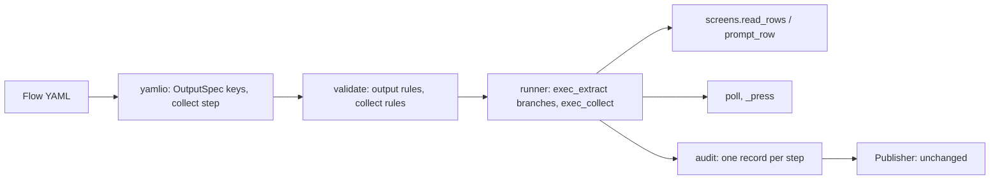

# Design Document

## Overview

This feature adds five read-only Command_Flows (`tk5-time`, `tk5-list-datasets`, `tk5-dataset-info`, `tk5-library-members`, `tk5-job-status`) that run one TSO command at `READY` and return what the host printed. It needs four small additions to the Flow runtime, two signatures, a three-step extension of the shared logon steps, and the promotion of 36 capture files. The change has these parts:

1. **Captures.** The 36 files of `.kiro/specs/more-flows/captures` move to `/captures` (28 captures, 56 files).
2. **Signatures.** `tso-cleared` and `tso-reenter` (12 bundled signatures). Matrix result in "Data Models": 28 captures x 12 signatures = 336 evaluations, each capture matches exactly one signature.
3. **Runtime.** (a) a Rows_Output (`max_rows`, `next_row` on `OutputSpec`), read by `extract` or by (b) the new `collect` step; (c) a Flag_Output (`equals`); (d) the `dsname` input rule, which needs no code (the existing `prepare_inputs` and `check_inputs` already do the work); (e) one behaviour-preserving refactor of `exec_key` so `collect` can press Enter.
4. **Flows.** Five new YAML files, and three Handle steps (the Logon_Cleanup) inserted into `tk5-logon.yaml` and `tk5-system-info.yaml`.
5. **Tests.** New files, and the smallest edits to the tests that pin counts. Property tests prove rows, collect, flag, the name rule, the YAML round trip, the REENTER outcome and the logon landing.
6. **Stable-blank rule (amendment after Checkpoint A).** A blank screen counts as `tso-cleared` only after it has stayed unchanged for 0.3 s: an optional `stable_for` in the signature YAML, judged by the Runner (section 10, Requirement 24). It fixes the live failure of the logon steps, which the scripted tests could not show.

Production Python edits: `greenscreen/flow/model.py`, `validate.py`, `yamlio.py`, `screens.py`, `runner.py`, `bundled.py`, and `greenscreen/recognizer/bundled.py`. `greenscreen/publisher/`, `greenscreen/connector/`, `greenscreen/publisher/ask/`, `greenscreen/publisher/console/` and `.env.example` are not changed by the default design. One console page change (CSS) is proposed as Open decision D1 because the console shows a multi-line output on one line.

### Conventions for the executor

- DO NOT COMMIT. Leave every change in the working tree. The reviewer commits.
- Do not edit `.kiro/steering`. The reviewer does (the steering note is in "File-by-file change list").
- Stop and report a defect in code outside the files named here. Do not edit a test that is not named in "Existing tests that change".
- No test, log, message, snippet, fixture or document prints or stores a password or another secret. The user id of the demo account appears in the real captures (the host prints it); this document and the new tests do not repeat it.
- No new dependency. `pyproject.toml` stays unchanged.
- The Python in this document is pseudocode, except the YAML, which is the exact text that the code must emit and read.

### What this design changes in the requirements (read this first)

The scratch work behind this design found points where the requirements text cannot be implemented as written. Nothing in `requirements.md` was edited. Each point has a default in this design, and a reviewer decision is listed in "Open items".

| # | Requirement text | Finding | Default in this design |
|---|---|---|---|
| X1 | Requirements 8.9, 11.3, 12.3, 13.4, 14.4, 15.3 give the Flow and input descriptions. | The existing test `tests/unit/test_publisher_helpers.py::test_probe_alphabet_is_absent_from_every_fixed_text` fails with those texts: it requires that no character of `~^!#%&*+=\|;?@\` occurs in any bundled Flow name, description, input name or input description, output name. The proposed texts contain `;` (five of six) and `#`, `@` (the `dsname` description). It is not in the table "Existing behaviour and tests that could be affected", and Conventions forbid editing an unnamed test. | Wording changed to avoid those characters (final texts in "Components and Interfaces", section 5). Meaning is unchanged. If the reviewer prefers the original wording, the test needs an edit instead (D2). |
| X2 | "Existing behaviour and tests" lists the tests that change. | Two more tests fail on the count: `tests/unit/test_publisher_slice.py` line 102 (`prepared.loaded_count == 3`) and line 136 (`len(prepared.registry) == prepared.loaded_count == 3`). | Both edited to 8 (table "Existing tests that change"). |
| X3 | Requirements 8.3, 20.4 and live check 3 say a bad `dsname` gives `request_invalid` (HTTP 400) in the Publisher. | Measured on 2026-11-19 through the real REST app: `{"dsname":"A..B"}` gives HTTP 422 `input_invalid`; `check_inputs` failure is mapped to `input_invalid` (`calls.py` lines 513 to 516, `HTTP_STATUS["input_invalid"] == 422`). `request_invalid` (400) is used only for a malformed body (`rest.py` lines 90 and 116). | The code is `input_invalid`, HTTP 422, in the Flow and in the Publisher. Live check 3 expects 422. No code change. |
| X4 | Requirement 17.6 and 18.4 say the console shows the outputs with no change. | The console puts an output into a `<dd>` with `String(value)` as a text node, and `.outputs dd` has no `white-space` rule, so the browser collapses each LF to a blank. A 136-member list shows as one wrapped line in 2rem bold type. | CSS-only page change (D1, closed: applied; tasks.md 9.3). |
| X5 | Requirement 7.1: `equals` is 1 to 80 printable ASCII characters. | A value with a leading or trailing blank can never equal the stripped region text, so the Flag_Output would always be 0. | Validator also rejects such a value (`equals_blank_edge`). Listed as D3. No bundled Flow is affected. |
| X6 | Requirement 6.12: "a known screen of another name stops with `unexpected_screen`". | The runner resolves only the signatures that the Flow references (`_resolve_signatures`). A screen whose signature the Flow does not name is "unknown", not "known". All five Command_Flows reference the ISPF menu and the logon screen through the prefix and the finally steps, so the case holds for them. | Tests for Property 4 use a probe Flow whose finally steps reference the other signature. |
| X7 | Requirement 3.5 renames the read-count rule. | The existing test `test_each_output_needs_exactly_one_extract` pins the old rule name for plain outputs. | Plain outputs keep `needs_exactly_one_extract`. A Rows_Output reports `needs_exactly_one_read`. |
| X8 | The table of tests that change names `NAMES` in `test_flow_bundled.py`. | `test_no_literal_credentials_or_placeholders` (line 319) is parametrized over `NAMES` and allows only the literals `X`, `LOGOFF`, `LOGON ` and ` RECONNECT`. With `NAMES` at eight it fails five times on `TIME`, `LISTCAT`, `STATUS`, `LISTDS '`, `' MEMBERS`. | Line 319 becomes `@pytest.mark.parametrize("name", NAMES[:3])`, so the allowed set is not widened; `test_flow_readonly.py` (Requirement 9.3) checks the literals of the five new files with their own sets. Verified in the scratch copy. |

### What was checked while writing this design

All probes ran on 2026-11-19 on a scratch copy of the repository in `%TEMP%` (outside the workspace), with throwaway scripts in `%TEMP%`. The repository itself was not changed. Results quoted below are the observed ones.

- **Matrix.** The two new signatures were loaded with the ten bundled ones, and all 12 were evaluated against the 28 captures with `signature_matches` (336 evaluations): exactly one match per capture, the expected one. The table is in "Data Models".
- **Runtime prototype.** The extension below was implemented in the scratch copy. The existing suites `tests/unit/test_flow_validate.py`, `test_flow_yaml.py`, `test_flow_runner_*.py` and `test_flow_static.py` passed unchanged with it.
- **Logon prefix.** `tk5-logon` and `tk5-system-info` with the three Handle steps were run on the normal path (logo, logon, password prompt, two pauses, menu; for `tk5-system-info` also `X`, `READY`, logoff) with 0, 1 and 2 stale reads per screen. The Session call lists, including the read calls, are identical to the unmodified Flows in all six runs. The audit records of indices 0 to 18 are identical, indices 19 to 25 are new (three `handle` records with `ok`, four body records `skipped`), and the later records are the old ones shifted by 7. Outputs are equal.
- **Existing tests with the logon change.** In a second scratch copy with the Logon_Cleanup and the 12 signatures but the old manifest (three Flows), `test_flow_sync.py`, `test_flow_logon_script.py`, `test_flow_logon_recovery.py`, `test_flow_system_info_script.py`, `test_flow_bundled.py`, `test_flow_runner_fixes_skipped.py` and `test_flow_packaging.py` pass without edit. With the five new Flows in the manifest, `test_flow_bundled.py` (three tests) and `test_flow_packaging.py` (one test) fail on the count only; the four logon test files still pass.
- **Five Flows.** Each Flow passed `check_flow` with the 12 bundled signatures and `Flow.from_yaml(flow.to_yaml()) == flow`, and was run through `run_flow` with `ScriptedSession` over the real captures (results in "Data Models", "Scripted results").
- **Publisher.** The real app (`prepare`, `build_app`, `FakeHost`) was built with all five Flows published and `GS_CALL_TIMEOUT=30`, Ask on. `/openapi.json`, MCP `tools/list` and one REST call were fetched (shapes in "Data Models").
- **Full suite.** `tests/unit` and `tests/property` ran in the scratch copy (results in "Testing Strategy").
- **Not run:** anything that needs the live host, a browser, or a real model.

### Library documentation checks

Pages read on 2026-11-19 (system clock). "Installed" is the version in this workspace.

| Library or tool | Page | Version | Conclusion |
|---|---|---|---|
| Python `re.fullmatch` | https://docs.python.org/3/library/re.html | installed 3.11.9; the page now documents 3.15 | `fullmatch(pattern, string, flags=0)` returns a match only if the whole string matches, and `None` otherwise; added in 3.4. So `prepare_inputs` needs no `^` or `$`, and a trailing LF is not accepted by `fullmatch` (unlike `$`). The page says nothing about backtracking limits, so no guard is assumed: the Dsn_Pattern relies on bounded quantifiers and a length cap of 44 applied first. Measured: 20,000 `fullmatch` calls on a 44 or 49 character near miss take 0.02 to 0.04 s. The same page documents `prefixmatch`, new in 3.15; the code uses `fullmatch` only. |
| Hypothesis strategies | https://hypothesis.readthedocs.io/en/latest/reference/strategies.html | installed 6.170.15; page is "latest" | `text(alphabet=..., min_size, max_size)` takes a collection of length-one strings or a strategy; the default alphabet excludes surrogates. `characters(min_codepoint, max_codepoint, categories, include_characters, exclude_characters)` and `lists(elements, min_size, max_size)` are as used here; `from_regex` exists but is not used for the name strategy, so the test does not depend on the Dsn_Pattern it checks. `composite`, `sampled_from`, `one_of`, `builds`, `integers` and `settings(max_examples=...)` are already used in `tests/property/`. |
| PyYAML `safe_dump` | https://pyyaml.org/wiki/PyYAMLDocumentation | installed 6.0.3; the page is from the 5.1 era | The page confirms that `default_flow_style=False` forces block style. It does not list `sort_keys`; `inspect.signature(yaml.safe_dump)` is `(data, stream=None, **kwds)` and the existing `to_yaml` already passes `sort_keys=False`. The new keys are plain strings and integers in the existing mappings, so no new PyYAML API is used. Round trip proved by Property 7 and by the scratch run (`from_yaml(to_yaml(f)) == f` for all eight bundled Flows). |
| s3270 and ws3270 scripting | https://x3270.miraheze.org/wiki/Scripting and https://manpages.ubuntu.com/manpages/trusty/man1/x3270-script.1.html | installed s3270 4.3 and ws3270 4.5; the man page is an old release | The wiki page gives the overview only; the action pages (`String`, `PA`) could not be fetched by URL (404 on guessed names). The old man page says `Clear`, `Enter`, `PF` and `PA` do not complete until the host unlocks the keyboard (the `AidWait` toggle, on by default). Every real capture of the REENTER prompt, the cleared screen and the pauses has a status line that starts `U F U` (keyboard unlocked), so `PA(1)` at the REENTER prompt does not block. That the 4.x text is the same as the old page is not verified. The Connector already sends `PA(n)` (`connector.py` line 187) and escapes only backslash and double quote in `String("...")`, so a typed apostrophe is passed through; whether the host echo shows one apostrophe is live check 7. |
| IBM TSO/E commands | https://www.ibm.com/docs/en/zos/3.1.0?topic=commands-list-tsoe and https://www.ibm.com/docs/en/zos/2.5.0?topic=command-listds-operands | z/OS 3.1 and 2.5 pages; the host is MVS 3.8j (TK5) | The list page describes `LISTCAT` as listing the data sets beginning with your prefix or those in a catalog, and `LISTDS` as listing certain attributes of data sets; this supports the plain-form descriptions. The `LISTDS` page says the data set list may contain a single asterisk in place of a level, which is why `*` is not allowed in the name pattern. z/OS is not TK5: every screen fact in this design comes from the captures, not from these pages. `TIME` and `STATUS` pages were not read (no operand is typed). |
| Node | not a library | local v24.19.0 | `node` is on `PATH`; the console page tests run through it. Only the proposed CSS change (D1) touches a page test, and that one is a Python CSS test. |
| FastAPI, Starlette, MCP SDK, httpx2 | no page read | as installed | No new API is used. The OpenAPI and MCP documents were produced by the existing code and read back (shapes in "Data Models"). |

Task 1.1 re-checks (executor, Windows):

- Checked 2026-11-19 (system clock): https://docs.python.org/3/library/re.html, installed 3.11.9 (page documents 3.15), `re.fullmatch(pattern, string, flags=0)` returns a match only when the whole string matches and `None` otherwise, added in 3.4; the page also lists `prefixmatch`, new in 3.15, which the code does not use. Same as the table.
- Checked 2026-11-19: https://hypothesis.readthedocs.io/en/latest/reference/strategies.html, installed 6.170.15 (same as the table), `text(alphabet, *, min_size, max_size)` and `characters(...)` take the arguments the table lists, `from_regex(..., fullmatch=False, alphabet=None)` exists. Same as the table.
- Checked 2026-11-19: no page fetched; installed PyYAML 6.0.3 (same as the table), `inspect.signature(yaml.safe_dump)` is `(data, stream=None, **kwds)`. Same as the table.
- Checked 2026-11-19: https://x3270.miraheze.org/wiki/PA returned HTTP 404, so the `PA` and `String` action pages could not be fetched; the table's conclusion (from the wiki overview and the old man page) stands and is not re-confirmed. Installed clients as in the table, not re-run (no live host).
- Checked 2026-11-19: Node v24.19.0 with `C:\Program Files\nodejs` prepended to `PATH`, same as the table.

## Architecture

### Decisions

| # | Decision | Choice | Why |
|---|---|---|---|
| A1 | Rows output type | `str`, lines joined by one LF, `OutputSpec.max_rows` set | Requirement Decision 1; `str` leaves OpenAPI, MCP, Ask projection and console contracts untouched (measured: `{"type": "string"}`). |
| A2 | Where rows are read | New `screens.read_rows` (the only module that reads `cell_grid`), called by `exec_extract` and `exec_collect` | Keeps `test_flow_static.py` true; one reader for both paths. |
| A3 | `collect` | New step kind and executor; the Enter is sent by `_press`, the body of today's `exec_key`, extracted unchanged | The key pre-check, the `pre_key_screen` bookkeeping and the `typed_fields` reset stay in one place. |
| A4 | Audit | One record per `collect` step, `kind` `collect`, `signature` the Final_Screen name, `iteration` `None` | The seven members are unchanged; the paging Enters leave no record (the debug log holds `count`). Measured through REST. |
| A5 | Caps | `max_rows` is checked after each screen is read, then `max_screens` before any Enter; both give `loop_limit` and no value | "A flow never guesses." The row cap is checked first, so a run that is over both stops at the row cap. |
| A6 | Flag | `equals` branch inside `exec_extract`, before the digit rule | One optional key and one branch. |
| A7 | Name rule | `max_length: 44` plus the Dsn_Pattern, both existing input features | No code. Checked by `prepare_inputs` before the first Session call. |
| A8 | Runner state | `poll`, `exec_handle`, `run_finally`, `_FINALLY_SKIP_REASONS`, `accept` and `release` are not changed | Verified by the scratch run: every walk-through in "Error Handling" works with them as they are. |
| A9 | REENTER | Listed in the `expect` after the command (Name_Flows only), so the next read step stops with a held screen | Requirement Decision 15; Finding 10. |
| A10 | Test support | `flow_support.has_partial_repaint(name)`; `_flow_strategies.ChainScript.states` falls back to a blank repaint when it is False | The three property tests that failed without it pass with it, unedited. |
| A11 | Page | No page change by default. CSS-only proposal in D1. | Requirement 17.6 and 18.4. |
| A12 | Transient blank screens | `stable_for` (0.3 s for `tso-cleared`) in the signature YAML, judged in `_RunState.recognize`; `recognize()` stays pure | One rule for every Flow and every runner path, with no step or validator change (section 10, options A to D). |
| A13 | A reconnect into more than 5 `***` pauses (amendment 2, Requirement 25) | Raise `max_count` of the logon `tso-pause` Handle from 5 to 10 in the shared Logon_Prefix (option B of section 7, "Deep pauses") | One call drains and releases; `loop_limit` is reachable only above the deepest listing the Flows can leave (10 screens, 9 pauses, plus one). The normal path is unchanged. |

### Where the new code sits



## Components and Interfaces

### 1. Captures

Move the 36 files of `.kiro/specs/more-flows/captures` into `/captures` with a plain file move (`Move-Item`), not `git mv`: `git mv` stages, and the executor stages nothing. 24 of the 36 files are tracked (commit `c09f567`) and 12 are untracked (`git ls-files` and `git status`, 2026-11-19), so after the move git shows 24 deletions and 36 new files, and the reviewer's commit records the same bytes as renames. The bytes must not change: the 36 SHA-256 values of the requirements were compared with the files on 2026-11-19 and all 36 match. After the move, `.kiro/specs/more-flows/captures` is empty and is removed (the folder keeps only `.config.kiro`, `requirements.md`, `design.md` and, later, `tasks.md`). The originals are not kept: two copies would let the spec folder drift from `/captures`.

The 18 stems, each with `.ascii.txt` and `.readbuffer.txt` (36 file names):

```
tso-cleared                     tso-listds-members-page5
tso-listcat-level               tso-listds-members-page6
tso-listcat-level-page2         tso-listds-members-page7
tso-listcat-level-page3         tso-listds-not-in-catalog
tso-listcat-output              tso-listds-output
tso-listds-members              tso-listds-reenter
tso-listds-members-page2        tso-listds-reenter-after-pa1
tso-listds-members-page3        tso-status-output
tso-listds-members-page4        tso-time-output
```

`/captures` then holds the 10 existing captures (20 files: `tk5-logo`, `tk5-logon`, `tso-input-not-recognized`, `tso-password-prompt`, `ispf-primary-menu`, `tso-ready`, `tso-pause-2`, `tso-userid-in-use`, `tso-reconnect-password-prompt`, `tso-reconnect-ok`) plus these 18 (36 files): 28 captures, 56 files. The incoming folder `captures/incoming` is already gone. No file is edited after the move; the test `tests/unit/test_command_capture_files.py` pins the hashes.

### 2. Signatures (exact YAML)

Both files are the output of `ScreenSignature.to_yaml()` for the draft objects (the emitted text equals the text below, checked in the scratch run), written to `greenscreen/recognizer/signatures/`. The descriptions avoid a colon, which PyYAML would have to quote. `_MANIFEST` in `greenscreen/recognizer/bundled.py` gains the two names after `tso-reconnect-ok`, in this order, and its docstring changes "ten" to "twelve".

`tso-reenter.yaml`

```yaml
version: 1
name: tso-reenter
description: TSO line-mode prompt asking for the operand again after the host rejected it.
matchers:
- kind: last_row
  text: ' REENTER -'
volatile: []
```

`tso-cleared.yaml` (26 matchers, limit 50; rows 1 to 22 repeat the last block with the row number changed)

```yaml
version: 1
name: tso-cleared
description: TSO line-mode input screen after Clear, every row blank.
matchers:
- kind: field_layout
  count: 1
  positions:
  - row: 23
    col: 79
- kind: cursor_field
  row: 23
  col: 79
  hidden: false
- kind: region_regex
  row: 0
  col: 0
  length: 80
  pattern: ^ *$
# ... the same block for rows 1 to 22 ...
- kind: region_regex
  row: 23
  col: 0
  length: 80
  pattern: ^ *$
volatile: []
```

Why each matcher is what it is, read from the captures and the matcher code (`greenscreen/recognizer/matching.py`):

| Screen | Last non-blank row | Cursor | Fields | Which signature |
|---|---|---|---|---|
| `tso-ready` | ` READY` | next row, col 0 (for example (1,0) or (10,0)) | several | `last_row ' READY'` |
| `tso-pause` | ` ***` | on that row, col 5 | several | `last_row ' ***'` and `before_cursor ' ***'` |
| `tso-cleared` | none (all 24 rows blank) | (0,0), inside the one field that wraps from (23,79) | one unprotected field at (23,79) | the 26 matchers above; a `last_row` matcher is false when no row is non-blank, so `tso-ready` cannot match it |
| `tso-reenter` | ` REENTER -` (row 2) | row 3, col 0 | five unprotected fields | `last_row ' REENTER -'` |
| after PA1 (`tso-listds-reenter-after-pa1`) | ` READY` (row 4); row 2 still holds ` REENTER -` | row 5, col 0 | nine | `tso-ready`: the last non-blank row is the prompt, so `tso-reenter` does not match |

Three consequences. (1) The screen after Clear matches no `last_row` signature, so it needs the geometry matchers; typed text on row 0 breaks the `region_regex` matchers, and the runner's `build_comparison` restores the typed field from the accepted screen before it recognizes the pre-key screen. Checked in the scratch run: the typed cleared screen recognizes as unknown by itself and as `tso-cleared` after `build_comparison(pre=typed, accepted=cleared)`. (2) `tso-reenter` must anchor on the last non-blank row, because the cursor is on the following row (so `before_cursor` cannot be used) and the text of row 1 varies between `INVALID DATA SET NAME` and `INVALID KEYWORD`. (3) Distinguishing "found" from "not in catalog" by signature is impossible (both end in ` READY`), which is why the Flag_Output reads the screen.

### 3. Model, YAML and Validator

#### 3.1 `greenscreen/flow/model.py`

```python
@dataclass(frozen=True, slots=True)
class OutputSpec:
    name: str; type: str; signature: str; row: int; col: int; length: int
    next_row: int | None = None     # new: first row of a continuation screen (Rows_Output)
    max_rows: int | None = None     # new: makes it a Rows_Output
    equals: str | None = None       # new: makes it a Flag_Output

@dataclass(frozen=True, slots=True)
class CollectStep:                  # new
    kind: ClassVar[str] = "collect"
    output: str
    more: str
    max_screens: int

Step = Union[ExpectStep, TypeStep, KeyStep, ExtractStep, CollectStep, HandleStep]
```

`plan()` needs no change: `_plan_list` only descends into a `HandleStep` body. `greenscreen/flow/__init__.py` keeps its nine names (`CollectStep` is not exported, as `ExtractStep` is not).

#### 3.2 `greenscreen/flow/yamlio.py`

Emitted key order for an output: `name, type, signature, row, col, length`, then `next_row`, `max_rows`, `equals`, each only when not `None`. An output without the three keys is emitted byte for byte as today. Accepted keys: the six are required, the three are optional.

```yaml
outputs:
- name: DATASETS            # a Rows_Output
  type: str
  signature: tso-ready
  row: 2
  col: 1
  length: 44
  next_row: 0
  max_rows: 60
- name: FOUND               # a Flag_Output
  type: int
  signature: tso-ready
  row: 2
  col: 1
  length: 27
  equals: --RECFM-LRECL-BLKSIZE-DSORG
```

The step form, all four keys required (`_STEP["collect"]`, `_STEP_REQUIRED["collect"]`):

```yaml
- kind: collect
  output: MEMBERS
  more: tso-pause
  max_screens: 10
```

`collect` inside a Handle body is rejected by the reader with the existing message `unsupported step kind 'collect'` (the body kinds are `type` and `key` only), so `tests/unit/test_flow_yaml.py` needs no edit.

#### 3.3 `greenscreen/flow/validate.py`: rules added

Messages hold rule names and field names only (existing style). Observed rule names from the scratch run, with the requirement they serve:

| Case | Rule text reported | Requirement |
|---|---|---|
| `max_rows` on an `int` output | `output X.max_rows: rows_requires_str` | 3.3 |
| `max_rows` not in 1 to 500 | `out_of_range` | 3.3 |
| `next_row` without `max_rows` | `next_row_requires_rows` | 3.3 |
| `next_row` not in 0 to 23 | `out_of_range` | 3.3 |
| `equals` on a `str` output | `equals_requires_int` | 7.1 |
| `equals` empty, not printable ASCII, or over 80 | `invalid_text` | 7.1 |
| `equals` longer than `length` | `longer_than_region` | 7.1 |
| `equals` with `max_rows` | `equals_excludes_rows` | 3.3, 7.1 |
| `equals` with a leading or trailing blank (D3) | `equals_blank_edge` | 7.1 (X5) |
| Rows_Output read zero times or twice (`extract` plus `collect`) | `needs_exactly_one_read` | 3.5 (X7) |
| plain output read zero times or twice | `needs_exactly_one_extract` (unchanged) | existing |
| `collect` on an output without `max_rows` | `step N: output: not_a_rows_output` | 5.2 |
| `more` not a valid name | `more: invalid_name` | 5.2 |
| `more` equal to the output signature | `more: same_as_output_signature` | 5.2 |
| `max_screens` not in 1 to 50 | `max_screens: out_of_range` | 5.2 |
| armed Expect lacks the output signature or `more` | `output: signature_not_in_arming_expect` | 5.2 |
| `collect` with no armed Expect | `output: unarmed` | 5.2 |
| `collect` in `finally` | `collect: not_in_steps` | 5.2 |
| `collect` in a Handle body (model built in code) | `kind: not_allowed_in_handle` | 5.2 |
| `collect` of an undeclared output | `output: undeclared_output` | 5.2 |

Walk changes, in `_StepWalk.walk`: a `CollectStep` branch calls `_collect` and, like `extract`, leaves `armed` and `arming` as they are (the Current_Screen is the Final_Screen, so a following `key` is armed; the scratch run accepted `expect, collect, key clear`). `extract_counts` counts a `collect` as the one read of its output. `reference_violations` checks `more` against the signature names. `_check_outputs` gets the checks of the table. No existing rule changes.

### 4. Runner

#### 4.1 `greenscreen/flow/screens.py`

```python
def prompt_row(view) -> int:
    # highest r with view.base_rows[r].strip(" ") non-empty; -1 if none.
    # base_rows already has every hidden cell blanked (ScreenView), so a hidden
    # field below the prompt cannot move it.

def read_rows(screen, view, start, col, length) -> list[str] | None:
    out = []
    for r in range(start, prompt_row(view)):          # empty range when start >= prompt row
        raw = read_region(screen, view, r, col, length)
        if raw is None:  return None                  # a hidden cell in the region
        text = raw.strip(" ")
        if text: out.append(text)
    return out
```

`read_region` is the existing function: it checks `view.hidden_mask` over the region before it reads a cell, so no hidden cell is turned into text. The module still reads only `cell_grid`; it adds no read of `text_grid`, `fields`, `find_field` or `Field.text`. Invariants: no returned string contains LF (a row has none); every returned string is stripped and non-empty; no row at or after the prompt row is read; no hidden cell is read.

#### 4.2 `exec_extract`: two new branches

```python
view = self.view_of(current)
if output.max_rows is not None:                       # Rows_Output
    rows = read_rows(screen, view, output.row, output.col, output.length)
    if rows is None:                halt hidden_output
    if len(rows) > output.max_rows: halt loop_limit   # detail "output <name>"
    outputs[name] = "\n".join(rows) ; return ok
raw = read_region(...)                                # unchanged from here
if raw is None: halt hidden_output
text = raw.strip(" ")
if output.equals is not None:                         # Flag_Output
    outputs[name] = 1 if text == output.equals else 0 ; return ok
... existing int / str conversion ...
```

The `screen_size` check and the `current.name != output.signature` check stay in front, so a pause screen where the Flow expected `tso-ready` stops with `unexpected_screen` and the screen held (this is the `tk5-time` pause case).

#### 4.3 `_press` (a refactor, no behaviour change)

`exec_key` today does: no current screen is `unexpected_screen`; read `pre`; `_key_check`; send the key; set `pre_key_screen`, `pre_key_name`; clear `current` and `typed_fields`. These lines move into `_press(idx, kind, key, n) -> str` (the name of the screen left), and `exec_key` becomes a call to it. `_key_check` takes the step `kind` so that its halts name `collect` when `collect` is the caller; for `exec_key` the kind is still `"key"`. Existing tests (the whole `test_flow_runner_*` family and the property tests) passed unchanged with this refactor in the scratch copy.

#### 4.4 `exec_collect`

```python
def exec_collect(item):
    output = the declared output; accepted = (output.signature, step.more)
    cur = self.current
    if cur is None or cur.name not in accepted:
        halt unexpected_screen(expected=accepted, screen=cur.screen if cur else None)   # held screen kept
    rows, screens = [], 0
    while True:
        screens += 1
        check the screen is 24x80, else halt screen_size
        first = output.row if screens == 1 or output.next_row is None else output.next_row
        got = read_rows(cur.screen, view, first, output.col, output.length)
        if got is None:                    halt hidden_output
        rows += got
        if len(rows) > output.max_rows:    halt loop_limit          # no value stored
        if cur.name == output.signature:   break                     # Final_Screen
        if screens >= step.max_screens:    halt loop_limit          # before any Enter
        self._press(idx, "collect", "enter", None)
        self.poll(idx, "collect", accepted=accepted, timeout=flow.timeouts.step, expected=accepted)
        cur = self.current
    outputs[name] = "\n".join(rows)
    return _StepDone("ok", cur.name, screens)      # audit signature = Final_Screen name, count = screens
```

Behaviour, each point observed in the scratch run:

- The poll has no `tolerate` list. A screen equal to the pre-key screen counts as "no answer yet" (existing `poll` rule), so a repaint that has not happened is waited for; a pause that differs from the previous pause is accepted at once because `more` is in the accepted set, even though the previous screen was also `tso-pause`.
- Unknown screen until the step timeout: `unknown_screen`, `current` is `None`, so the finally steps are skipped. Known screen of another referenced name: `unexpected_screen` at once, `current` is `None`, finally skipped. Ambiguous: `ambiguous_screen`. These are the existing `poll` outcomes; the reason codes stay 13.
- `loop_limit`, `hidden_output`, `screen_size` and an `unexpected_screen` at the first line leave a held `current`, so the finally steps run.
- The Enter count is `screens - 1` on success and at most `max_screens - 1` on any path. A `collect` step never presses Enter on a Final_Screen.
- `_budget` is checked by `read` and `key` before each Session call, so the `run` limit applies inside the loop.
- Only the Final_Screen is left as `current`. The next step (`key clear`) is armed and passes the pre-key check on it.

Invariants: (I1) value equals the join of the per-screen row lists in screen order; (I2) the number of Enter keys sent by the step is the number of More_Screens read, and never more than `max_screens - 1`; (I3) on any `loop_limit` no value for the output is stored; (I4) no row text is in a log record, a message or an audit field (`count` is a number of screens).

#### 4.5 Audit, console and Ask

One `AuditRecord` per `collect` step, with exactly the seven members. Observed through REST for `tk5-library-members` over the seven real pages:

```json
{"step_index": 37, "kind": "collect", "phase": "steps", "iteration": null,
 "signature": "tso-ready", "status": "ok", "duration_seconds": 0.0}
```

There is no record per screen and no record for the paging Enters; a failed `collect` has one record with status `failed` at the same index. The Publisher passes `kind` as a string (the `outputSchema` audit item says `{"type": "string"}`), `snippets.js` cuts it to 40 characters, `console.js` prints it, and `ask/service.py` `_AUDIT_TYPES` accepts any `str`. A search of `greenscreen/publisher` for an allow-list of step kinds found none. No Publisher, Ask or console change is needed.

#### 4.6 What the runner does not change

`poll`, `exec_handle`, `exec_type`, `run_finally`, `_FINALLY_SKIP_REASONS`, `FINALLY_SKIP_REASONS`, `accept`, `release`, `REASON_CODES` (13) and `ERROR_CODES` (22). The finally steps still run only when the run holds a Current_Screen (Finding 10); the design lists the REENTER screen in the command `expect` for that reason.

#### 4.7 Property tests for the extensions

| Property | Subject | Strategy (reused parts) |
|---|---|---|
| 1 | Rows extraction equals a reference model (value, `loop_limit` boundary, no LF inside a line, nothing at or after the prompt row) | `line_screen` builder over `tests/screen_support.make_screen`; `st.text` over printable ASCII for rows; `integers` for row, column, length, `max_rows` |
| 2 | A hidden cell in a region stops the run with `hidden_output`; a probe in hidden cells (also below the prompt) never reaches the value, a message, a summary or an audit field | same builder with a hidden field (`0xCC`) closed by a protected field (`0xE0`); the check style of `tests/unit/test_flow_runner_fixes_frames.py` |
| 3 | `collect` equals a page-sequence model (value, Enter count, `loop_limit` at `max_rows` or `max_screens`) | pages from the builder, `pause`/`ready` last rows, a unique token per page; `ScriptedSession` with the pages as states |
| 4 | An unknown screen as screen number k (k from 2) stops with `unknown_screen` after the step timeout and k - 1 Enters; a known screen of another name stops with `unexpected_screen` at once | same pages, `blank_screen()` or `capture("tk5-logon")` swapped in |
| 5 | Flag value is 1 exactly when the stripped region text equals `equals`, always 0 or 1 | `st.text` for region text and `equals` |
| 7 | `Flow.from_yaml(flow.to_yaml()) == flow` over Flows with Rows_Outputs, Flag_Outputs and `collect` steps | `rows_outputs` composite appended to `_flow_strategies.flows()` results |

The full list, with numbers, is in "Correctness Properties". Properties 1 to 10 were prototyped in the scratch copy with 200 examples each and passed (results in "Testing Strategy").

### 5. Input validation (the `dsname` input)

**Exact input** (identical in `tk5-dataset-info` and `tk5-library-members`, after `userid` and `password`):

```yaml
- name: dsname
  type: str
  required: true
  max_length: 44
  secret: false
  regex: '[A-Za-z$#@][A-Za-z0-9$#@]{0,7}(?:\.[A-Za-z$#@][A-Za-z0-9$#@]{0,7}){0,21}'
  description: Data set name, e.g. SYS2.JCLLIB, any case. Up to 44 characters. Dot-separated qualifiers of 1-8 characters, each starting with a letter, dollar, number sign or at sign, then letters, digits or those.
```

The description is 199 characters (limit 200) and contains none of the probe alphabet (X1). The regex is 72 characters (limit 200). `registry._ecma_safe` accepts it; the published property is `{"type": "string", "maxLength": 44, "pattern": "^(?:...)$", "description": ...}` (read back from `/openapi.json` and `tools/list`).

**Where it is checked.** `prepare_inputs` runs its checks in this order: type, `len(value) > max_length`, printable ASCII (0x20 to 0x7E), then `re.fullmatch(spec.regex, value)`; `run_flow` calls it before `_RunState` exists, so no Session call precedes it. The Publisher calls the same function through `check_inputs` before it takes the Limiter slot. Measured: for `A..B` the run raised `FlowInputError` ("input dsname violates regex", no value) and the `ScriptedSession` call list was empty; through REST the answer was HTTP 422 `input_invalid` (X3) and the host factory was not called. Because the length check comes first, the regex only ever sees at most 44 characters.

**Reference scanner** (a test function; pseudocode, no `re`, no `str.isalpha`, `isdigit` or `isalnum`, no copy of the pattern):

```python
UP = set(map(ord, "ABCDEFGHIJKLMNOPQRSTUVWXYZ")); LO = set(map(ord, "abcdefghijklmnopqrstuvwxyz"))
DIG = set(map(ord, "0123456789")); NAT = set(map(ord, "$#@"))
FIRST = UP | LO | NAT ; REST = UP | LO | DIG | NAT

def scanner(name) -> bool:
    if not 1 <= len(name) <= 44: return False
    q = 0                                      # characters in the current qualifier
    for ch in name:
        c = ord(ch)
        if c == 0x2E:                          # "."
            if q == 0: return False            # leading dot or ".."
            q = 0; continue
        if q == 0:
            if c not in FIRST: return False
        elif c not in REST: return False
        q += 1
        if q > 8: return False
    return q != 0                              # no trailing dot
```

In the scratch run, Property 6 (200 examples: valid names of 1 to 22 qualifiers, names of up to 23 qualifiers, arbitrary text, printable text, the empty string, and one-character inserts or replacements from quote, double quote, tab, blank, parentheses, asterisk, comma, percent sign, hyphen, underscore, slash, backslash, NUL, BEL, DEL, LF, CR, `.`, `é`, a full-width digit, an Arabic-Indic digit, and the right-to-left mark) found no disagreement between `prepare_inputs` on either Name_Flow and the scanner. The unit boundary examples of Requirement 20.7 are listed in "Testing Strategy".

### 6. The five Flows

Every file is `Flow.to_yaml()` output (the shipped text equals the emitted text, as `test_flow_sync` already requires for the existing Flows). A file is the concatenation of: the header block below, the `inputs` of `tk5-logon` (plus `dsname` for the two Name_Flows), the `outputs` and `timeouts` block, then `steps` made of the **Logon_Prefix** (15 steps, section 7), the **Exit and clear** block, the command block, the **Closing_Tail**, and the **Finally_Block**. Shared blocks:

**Exit and clear** (indices 27 to 31)

```yaml
- kind: expect
  signatures:
  - ispf-primary-menu
```

This is index 26, the last Logon_Prefix step. Then:

```yaml
- kind: type            # 27
  text: X
- kind: key             # 28
  key: enter
- kind: expect          # 29
  signatures:
  - tso-ready
- kind: key             # 30
  key: clear
- kind: expect          # 31
  signatures:
  - tso-cleared
```

**Closing_Tail** (five steps after the last read step)

```yaml
- kind: key
  key: clear
- kind: expect
  signatures:
  - tso-cleared
- kind: type
  text: LOGOFF
- kind: key
  key: enter
- kind: expect
  signatures:
  - tk5-logon
```

**Finally_Block** (13 plan indices; identical in all five files)

```yaml
finally:
- kind: handle                 # ispf-primary-menu: leave ISPF (not reached from a command stop)
  signature: ispf-primary-menu
  max_count: 1
  settle: 0.0
  steps:
  - kind: type
    text: X
  - kind: key
    key: enter
- kind: handle                 # drain a *** pause
  signature: tso-pause
  max_count: 20
  settle: 0.0
  steps:
  - kind: key
    key: enter
- kind: handle                 # leave a REENTER prompt
  signature: tso-reenter
  max_count: 3
  settle: 0.0
  steps:
  - kind: key
    key: pa
    n: 1
- kind: handle                 # READY: clear, so LOGOFF is typed on a blank screen
  signature: tso-ready
  max_count: 1
  settle: 0.0
  steps:
  - kind: key
    key: clear
- kind: handle
  signature: tso-cleared
  max_count: 1
  settle: 0.0
  steps:
  - kind: type
    text: LOGOFF
  - kind: key
    key: enter
- kind: expect
  signatures:
  - tk5-logon
```

**`timeouts`** (all five): `step: 10.0`, `run: 20.0`, `finally: 6.0`.

#### 6.1 `tk5-time`

```yaml
version: 1
name: tk5-time
description: 'Read the current date and time of the mainframe by running the TSO TIME command. TIME_TEXT holds the host''s own line: time of day, CPU time, service units, session time and date. The host clock can differ from real time. Read-only. Logs on and off with the bound account.'
inputs: [userid, password]     # as tk5-logon
outputs:
- name: TIME_TEXT
  type: str
  signature: tso-ready
  row: 1
  col: 1
  length: 79
  max_rows: 3
```

Command block (indices 32 to 35): `type TIME`, `key enter`, `expect [tso-ready, tso-pause]`, `extract TIME_TEXT`. Closing_Tail 36 to 40; Finally_Block 41 to 53. Description 271 characters.

#### 6.2 `tk5-list-datasets`

```yaml
name: tk5-list-datasets
description: List the data sets in the account's own catalog by running the TSO LISTCAT command. DATASETS holds one data set name per line. An empty string means none were listed. Only entries under the account's own prefix are shown. Read-only. Logs on and off with the bound account.
outputs:
- name: DATASETS
  type: str
  signature: tso-ready
  row: 2
  col: 1
  length: 44
  next_row: 0
  max_rows: 60
```

Command block (32 to 35): `type LISTCAT`, `key enter`, `expect [tso-ready, tso-pause]`, then

```yaml
- kind: collect
  output: DATASETS
  more: tso-pause
  max_screens: 5
```

Closing_Tail 36 to 40; Finally_Block 41 to 53. Description 272 characters.

#### 6.3 `tk5-dataset-info`

```yaml
name: tk5-dataset-info
description: Look up one data set by name (TSO LISTDS). FOUND is 1 when the data set is catalogued and 0 when the host says it is not in the catalog. A 0 is a normal answer, not an error. DETAILS then holds, on separate lines, record format, record length, block size and organisation, the text --VOLUMES--, and the volume serial numbers. Read-only.
outputs:
- name: FOUND
  type: int
  signature: tso-ready
  row: 2
  col: 1
  length: 27
  equals: --RECFM-LRECL-BLKSIZE-DSORG
- name: DETAILS
  type: str
  signature: tso-ready
  row: 3
  col: 1
  length: 79
  max_rows: 20
```

Command block (32 to 38):

```yaml
- kind: type            # 32
  text: LISTDS '
- kind: type            # 33
  input: dsname
- kind: type            # 34
  text: ''''
- kind: key             # 35
  key: enter
- kind: expect          # 36
  signatures:
  - tso-ready
  - tso-reenter
- kind: extract         # 37
  output: FOUND
- kind: extract         # 38
  output: DETAILS
```

Closing_Tail 39 to 43; Finally_Block 44 to 56. Description 336 characters.

#### 6.4 `tk5-library-members`

```yaml
name: tk5-library-members
description: List the member names of a partitioned data set (library) by name (TSO LISTDS with MEMBERS). MEMBERS holds one member name per line, in the host's order, up to 200. A longer list stops the call with an error. An empty MEMBERS means the library has no members or does not exist. Call tk5-dataset-info to tell the two apart. Read-only.
outputs:
- name: MEMBERS
  type: str
  signature: tso-ready
  row: 7
  col: 3
  length: 8
  next_row: 0
  max_rows: 200
```

Command block (32 to 37): `type "LISTDS '"`, `type input dsname`, `type "' MEMBERS"` (YAML `text: ''' MEMBERS'`), `key enter`, `expect [tso-ready, tso-pause, tso-reenter]` (36), then `collect MEMBERS` with `more: tso-pause`, `max_screens: 10` (37). Closing_Tail 38 to 42; Finally_Block 43 to 55. Description 333 characters.

#### 6.5 `tk5-job-status`

```yaml
name: tk5-job-status
description: List the jobs of the mainframe account by running the TSO STATUS command. JOBS holds one line per job with job name, job id and state. The account's own TSO session appears as EXECUTING. Read-only. Logs on and off with the bound account.
outputs:
- name: JOBS
  type: str
  signature: tso-ready
  row: 1
  col: 1
  length: 79
  next_row: 0
  max_rows: 40
```

Command block (32 to 35): `type STATUS`, `key enter`, `expect [tso-ready, tso-pause]`, `collect JOBS` with `max_screens: 3`. Closing_Tail 36 to 40; Finally_Block 41 to 53. Description 237 characters.

The plan indices above were read from `model.plan` in the scratch copy: last main index 40, 40, 43, 42, 40 and finally ranges 41 to 53, 41 to 53, 44 to 56, 43 to 55, 41 to 53 for the five Flows in the order of the headings, equal to the requirements' table. `tk5-logon` ends at index 26 and `tk5-system-info` at 37 with finally 38 to 44.

#### 6.6 Final tool descriptions

These are the texts the model sees (the Publisher uses the Flow `description` unchanged as the OpenAPI summary and the MCP tool description; Ask passes no output schema, so each text names every output, Finding 11). They differ from the requirements only where `;` split a sentence (X1). Lengths are 271, 272, 336, 333 and 237 characters (limit 500). A read of the texts for choosing between tools: the three listing tools say what they list and what an empty value means; `tk5-dataset-info` and `tk5-library-members` point to each other for the "does not exist" case; every text says `Read-only`.

### 7. Logon recovery extension

The three Handle steps are inserted into `tk5-logon.yaml` and `tk5-system-info.yaml` between the `tso-pause` Handle (indices 17 and 18) and the final `expect ispf-primary-menu`, exactly as Requirement 22.1 lists them. The resulting step list of `tk5-logon` (indices in brackets), as emitted by `to_yaml`:

```yaml
steps:
- kind: handle                      # [0,1]
  signature: tk5-logo
  max_count: 1
  settle: 3.0
  steps:
  - kind: key
    key: enter
- kind: handle                      # [2,3]
  signature: tso-input-not-recognized
  max_count: 1
  settle: 0.0
  steps:
  - kind: key
    key: clear
- kind: expect                      # [4]
  signatures:
  - tk5-logon
- kind: type                        # [5]
  input: userid
- kind: key                         # [6]
  key: enter
- kind: handle                      # [7..11] reconnect when the user id is in use
  signature: tso-userid-in-use
  max_count: 1
  settle: 0.0
  steps:
  - kind: type
    text: 'LOGON '
  - kind: type
    input: userid
  - kind: type
    text: ' RECONNECT'
  - kind: key
    key: enter
- kind: expect                      # [12]
  signatures:
  - tso-password-prompt
  - tso-reconnect-password-prompt
- kind: type                        # [13]
  input: password
- kind: key                         # [14]
  key: enter
- kind: handle                      # [15,16]
  signature: tso-reconnect-ok
  max_count: 1
  settle: 0.0
  steps:
  - kind: key
    key: enter
- kind: handle                      # [17,18]
  signature: tso-pause
  max_count: 10                     # amendment 2 (Requirement 25); it was 5
  settle: 0.0
  steps:
  - kind: key
    key: enter
- kind: handle                      # [19,20] NEW: leave a REENTER prompt
  signature: tso-reenter
  max_count: 3
  settle: 0.0
  steps:
  - kind: key
    key: pa
    n: 1
- kind: handle                      # [21,22] NEW: READY, clear
  signature: tso-ready
  max_count: 1
  settle: 0.0
  steps:
  - kind: key
    key: clear
- kind: handle                      # [23..25] NEW: cleared screen, log off
  signature: tso-cleared
  max_count: 1
  settle: 0.0
  steps:
  - kind: type
    text: LOGOFF
  - kind: key
    key: enter
- kind: expect                      # [26] moved from 19
  signatures:
  - ispf-primary-menu
```

`tk5-system-info` begins with the same 15 steps; its own steps follow at 27 to 37 (extracts 27 to 30, `expect` 31, `type X` 32, `key enter` 33, `expect tso-ready` 34, `type LOGOFF` 35, `key enter` 36, `expect tk5-logon` 37) and its `finally` stays at 38 to 44. The five Command_Flows copy the first 15 steps; `tests/unit/test_flow_command_sync.py` asserts equality with `tk5-logon.steps`, and the existing `test_flow_sync.py` keeps asserting the three old Flows.

**Why it costs nothing on the normal path.** After the `tso-pause` Handle the runner holds the ISPF menu as `current`. `exec_handle` polls only when `current is None`; each new Handle sees a name different from its signature, runs zero iterations, `_skip_body` writes the skipped records, and no Session call is made. Measured: identical call lists (reads included) in six runs (section "What was checked"), audit indices 19 to 25 new, the old tail moved by 7.

**What each landing does** (scripted runs of both Flows with the reconnect screens of `test_flow_logon_recovery.py`, then the landing from the real captures; 2026-11-19):

| Landing after the pause Handle | Enter keys from the password Enter on (the code sends 3 in all: the password Enter, one at the reconnect message, one at the first pause; plus one per further pause) | End |
|---|---|---|
| ISPF menu | the three Enters, no cleanup key | normal path |
| `READY` (`tso-ready`) | the three Enters, then Clear, `LOGOFF`, Enter | `unexpected_screen`, index 26, expected `ispf-primary-menu`, final screen `tk5-logon` |
| cleared screen | the three Enters, then `LOGOFF`, Enter | same |
| REENTER prompt | the three Enters, then PA1, Clear, `LOGOFF`, Enter | same (the PA1 screen is `tso-ready`, so the READY Handle runs next) |
| one more `***` pause, then `READY` | four Enters, then Clear, `LOGOFF`, Enter | same |
| nine more pauses, then `READY` (amendment 2) | twelve Enters (3 + 9), then Clear, `LOGOFF`, Enter | same: `unexpected_screen` at index 26, final screen `tk5-logon` |
| ten more pauses (was "five more pauses", seven Enters, before amendment 2) | twelve Enters (the password Enter, the reconnect message, ten at the pause Handle; the eleventh pause screen gets none) | `loop_limit` at index 17 |
| an unrecognized screen (stand-in for a sub-panel) | three Enters | `unknown_screen` at index 17, `tk5-logon` has no finally steps, so the session is left as it is |

For `tk5-system-info` the same keys are sent and the reason and index are the same; its finally steps hold the logon screen as `current`, so all three of its Handles run zero iterations and send no key (observed: 3 `ok` records, 4 `skipped`).

What remains unhandled: an orphan inside an ISPF sub-panel, an abandoned logon (`IKJ56700A`), the second IN USE state (`IKJ56400A`), an orphan at a `***` pause that the host shows again without a known screen, and any landing no signature knows. These stop with `unknown_screen`, `timeout` or `loop_limit`, as today. Whether the live host lands at `READY` or at the cleared screen after a reconnect is not verified (live check 12).

**Deep pauses (amendment 2, Requirement 25, decision A13).** What a call does when it reconnects into more than 5 `***` pauses. `tk5-library-members` collects up to 10 screens, so an orphan inside it can leave 9 pauses (the table of landings stops at 5). Code facts (read 2026-11-19): `exec_handle` raises `loop_limit` at the first screen after `max_count` iterations; `loop_limit` is not in `_FINALLY_SKIP_REASONS`, so the `finally` steps run when a Current_Screen is held (the pause is held); the `finally` of `tk5-logon` is empty and that of `tk5-system-info` has Handles on `ispf-primary-menu` and `tso-ready` only, so neither presses Enter at a pause and the account stays logged on; the five Command_Flows' `finally` has a `tso-pause` Handle (`max_count` 20), so they drain and log off at a `loop_limit` of the logon; `calls._session_clean` makes no claim for `loop_limit`. Evidence on the host: one run, a 7-page listing orphaned at its first pause (6 pauses behind it) needed all 5 Enters and landed on `READY`; whether the reconnect adds a pause of its own is not known, so the walk-through uses two models, M1 (the call sees as many pauses as the listing still holds, r) and M2 (it sees r + 1).

| | Option A: keep `max_count` 5 | Option B: `max_count` 10 (chosen) |
|---|---|---|
| Orphan at depth r = 9, flow `tk5-logon` or `tk5-system-info`, M1 | call 1: 5 Enters, sixth pause, `loop_limit` at 17, no key from `finally`, account still in use, no `session_clean` claim (r is now 4). Call 2: 4 pauses, `READY`, cleanup, `unexpected_screen` at 26, released. Call 3: 200. Three calls, two of them failures | call 1: 9 pauses, `READY`, cleanup, `unexpected_screen` at 26, released. Call 2: 200. |
| same, M2 | call 1: 10 pauses seen, `loop_limit`, r = 5. Call 2: 6 pauses, `loop_limit`, r = 1. Call 3: 2 pauses, `READY`, `unexpected_screen` at 26. Call 4: 200. Four calls, three failures | call 1: 10 pauses (the limit), `READY`, `unexpected_screen` at 26, released. Call 2: 200. |
| same, one of the five Command_Flows | call 1: `loop_limit` at 17, then the `finally` drains the rest (up to 20 Enters, within 6 s) and logs off. Call 2: 200. The result depends on the flow the next caller picks | as above, one call; `finally` is not needed |
| Each convergence step | needs no manual recovery but leaves the account in use between calls and says so nowhere | one failing call, then normal |
| Cost | none | none on the normal path; the Handle runs 0 to 2 iterations as today |

Chosen: option B, `max_count` 10. Reasons: the account is released by the call that meets the orphan, whatever Flow that is; every stop of the logon keeps a defined code (`unexpected_screen` at 26 for a released landing, `loop_limit` at 17 only above 10 pauses); option A needs 3 or 4 calls and leaves the account in use without a log claim in between. 10 is the deepest orphan the Flows can create (10 screens, 9 pauses) plus one pause for the reconnect, so `loop_limit` is reachable only if the host shows more pauses than any listing of these Flows holds. A larger value (12) would give two more spare pauses but costs 2 s more in the worst case and fails the 1.0 s-per-pause stress figure below; the validator allows 1 to 20. The limit applies to the shared prefix: `tk5-logon.yaml`, `tk5-system-info.yaml` and the five Command_Flows copy the same Handle, and `test_flow_sync.py` and `test_flow_command_sync.py` keep them equal. Above the limit (11 or more pauses) the call stops with `loop_limit` at 17 and the next call continues from where the pauses stand; the five Command_Flows drain in their `finally`.

Time of the worst released call (Requirement 16, criterion 4 estimates: reconnect part of the recovery 7 s, 0.5 s per pause or key; plus 0.4 s for the Settle_Time of the one cleared screen before `LOGOFF`): `7 + 10 x 0.5 + 4 x 0.5 + 0.4 = 14.4 s`, inside `run` 20.0 of the Command_Flows with 5.6 s spare (and inside 120.0 for `tk5-logon` and `tk5-system-info`), and inside the registry deadline 30.0 (`min(30, 20 + 6 + 30)`; `run + finally + 4.0 = 30.0`, so the Ask constraint C <= 40, deadline <= 30, still holds). With 1.0 s per pause the figure is 19.4 s, still inside 20.0. Measured basis: a call with up to 5 pauses took about 0.6 s in the reviewer's run, and the poll interval of the Publisher is 0.1 s, so the real figure is far below the estimate. Option A, per stop: `7 + 5 x 0.5 = 9.5 s`. The normal path is unchanged: golden call lists identical (0 to 2 pauses), and the Handle never runs more than today's iterations there.

Existing tests that pin the old value or the old range, searched in `tests/` for `max_count`, `tso-pause`, `five_pauses`, `loop_limit` and `range(5)`; each edit changes a value only:

| File | Pins | Before | After |
|---|---|---|---|
| `tests/unit/test_flow_bundled.py` `test_logon_pause_handle_step` | `handles[0].max_count == 5` | 5 | 10 |
| `tests/unit/test_flow_logon_cleanup.py` | landing row `five_pauses`: `_then(stale, *[pause_variant(i) for i in range(5)])`; `([ENTER] * 6, "loop_limit", 17)` | 5 variants, 6 Enters | row `ten_pauses`: `range(10)`, `[ENTER] * 11`, still `loop_limit`, 17 |
| `tests/property/test_flow_logon_landing.py` (Property 8) | `max_value=3`, docstring "0 to 3" | 3 | 9 |

Not affected (searched): `test_flow_logon_recovery.py` and `test_logon_recovery_publisher.py` (IN USE twice, not pauses), `test_flow_logon_script.py` and `test_flow_system_info_script.py` (golden lists with 1 and 2 pauses), `test_flow_sync.py` (compares the shipped files with each other and with `to_yaml()`, so it follows the edit), `test_flow_runner_handle.py`, `test_flow_handle_bound.py`, `test_flow_secret_leak.py` and `test_publisher_audit_summary.py` (their own test Flows), `test_flow_collect.py` (a test Flow). The five Command_Flows get the value when they are built (tasks 8.2 to 8.6 copy the prefix from `tk5-logon.steps`).

New scripted tests (task 6.10, new file `tests/unit/test_flow_logon_deep_pause.py`, and an addition to task 8.5): a reconnect into 9 further pauses (the pause under the reconnect message and `pause_variant(0..8)`, then `tso-ready`, cleared, logon): the first call ends `unexpected_screen` at 26 with 12 Enters from the password Enter on, then Clear, `LOGOFF`, Enter, and the Session ends on `tk5-logon`; a second call on a new `ScriptedSession` starting at the logon screen takes the normal path (outputs for `tk5-system-info`, the seven real pages for `tk5-library-members`, 136 names). The same with 10 further pauses stops with `loop_limit` at 17 and 12 Enters; `tk5-system-info` sends no key after them, `tk5-library-members` drains and ends on `tk5-logon` through its `finally`. For `tk5-library-members` the run passes with the Flow's own `run` 20.0 on a `FakeClock` at poll interval 0.1 with one stale read per screen.

**Scripted test plan.** New file `tests/unit/test_flow_logon_cleanup.py` (Requirement 22.8): one parametrized run per row of the table above for each of the two Flows, asserting the keys after the password, the reason, `step_index` 26, `expected`, the final screen, that no key follows on the menu path, and that the password does not occur in any output form (`forms_of_run`). It also pins the plan indices 19 to 26 and the shipped YAML equal to `to_yaml()`. Property 8 runs the landing sequences with 0 to 9 further pauses (amendment 2; it was 0 to 3) and 0 to 2 stale reads. The existing logon tests are edited only by the three flagged values of "Deep pauses" below.

**Spec text edits (Requirement 23).** At implementation time, after Requirement 22 is built, make exactly these replacements and no other change in the same files, then run `tests/unit/test_flow_spec_consistency.py`. Each replacement says which landings are verified and which are not yet seen (Requirement 23.2); the reviewer deletes the last clause of that remark after live check 10 has passed. Line numbers are those read on 2026-11-19. The remark is: "The menu landing was verified through the Flow on 2026-11-17 and 2026-11-18 and the REENTER landing by hand on 2026-11-19; the `READY` and cleared-screen landings are not yet seen on the host." It is written out in each new text below.

Edit 1. `.kiro/specs/publisher/requirements.md` line 22 (Assumptions bullet). Old words, from "Recovery covers only" to the colon after "is not handled":

```text
Recovery covers only an orphan session left at the ISPF primary option menu. An orphan left at `READY`, in a sub-panel or mid-logon (for example an abandoned logon showing `IKJ56700A ENTER USERID`, or the second IN USE state with `IKJ56400A` after an extra Enter) is not handled:
```

New:

```text
Recovery covers an orphan session left at the ISPF primary option menu, at `READY`, at the cleared screen and at a ` REENTER -` prompt. At the menu the call succeeds; at the other three the Flow ends the reconnected session and the call stops with `unexpected_screen`, so that the next call succeeds. The menu landing was verified through the Flow on 2026-11-17 and 2026-11-18 and the REENTER landing by hand on 2026-11-19; the `READY` and cleared-screen landings are not yet seen on the host. An orphan left in a sub-panel or mid-logon (for example an abandoned logon showing `IKJ56700A ENTER USERID`, or the second IN USE state with `IKJ56400A` after an extra Enter) is not handled:
```

The rest of the bullet (from "the call stops with `session_clean` false") stays.

Edit 2. Same file, line 23 (Not in scope). Old: `(the bundled Flows recover an orphan left at the ISPF primary option menu; an orphan left at `READY`, in a sub-panel or mid-logon is not recovered)`. New:

```text
(the bundled Flows recover an orphan left at the ISPF primary option menu, at `READY`, at the cleared screen or at a ` REENTER -` prompt; an orphan left in a sub-panel or mid-logon is not recovered)
```

Edit 3. Same file, line 491 (Requirement 23.7). Old words: "Recovery of a user id left logged on at the ISPF primary option menu is done by the bundled `tk5-logon` and `tk5-system-info` Flows, which send `RECONNECT`". New:

```text
Recovery of a user id left logged on at the ISPF primary option menu, at `READY`, at the cleared screen or at a ` REENTER -` prompt is done by the bundled Flows (the logon steps shared by all of them), which send `RECONNECT`
```

Edit 4. `.kiro/specs/publisher/design.md`, four places.

Line 20 (table row). Old: "It covers an orphan left at the ISPF primary option menu. An orphan left at `READY`, in a sub-panel or mid-logon (for example an abandoned logon showing `IKJ56700A ENTER USERID`, or the second IN USE state with `IKJ56400A` after an extra Enter) is not handled: the call stops with `unknown_screen` and `session_clean` false." New:

```text
It covers an orphan left at the ISPF primary option menu, at `READY`, at the cleared screen and at a ` REENTER -` prompt: at the menu the call succeeds; at the other three the Flow ends the reconnected session and the call stops with `unexpected_screen` and no `session_clean` claim, so that the next call succeeds. The menu landing was verified through the Flow on 2026-11-17 and 2026-11-18 and the REENTER landing by hand on 2026-11-19; the `READY` and cleared-screen landings are not yet seen on the host. An orphan left in a sub-panel or mid-logon (for example an abandoned logon showing `IKJ56700A ENTER USERID`, or the second IN USE state with `IKJ56400A` after an extra Enter) is not handled: the call stops with `unknown_screen` and `session_clean` false.
```

Line 471 ("The limit of recovery"). Old: "Recovery covers an orphan left at the ISPF primary option menu. An orphan left at `READY`, in a sub-panel or mid-logon is not handled." New:

```text
Recovery covers an orphan left at the ISPF primary option menu, at `READY`, at the cleared screen and at a ` REENTER -` prompt; for the last three the Flow ends the reconnected session and the call stops with `unexpected_screen` and no `session_clean` claim. The menu landing was verified through the Flow on 2026-11-17 and 2026-11-18 and the REENTER landing by hand on 2026-11-19; the `READY` and cleared-screen landings are not yet seen on the host. An orphan left in a sub-panel or mid-logon is not handled.
```

Line 758 (error table row, last cell). Old: "the bundled logon Flow recovers an orphan left at the ISPF primary option menu; an orphan left at `READY`, in a sub-panel or mid-logon is not handled and stops the call with `session_clean=false`;" New:

```text
the bundled logon Flow recovers an orphan left at the ISPF primary option menu and releases one left at `READY`, at the cleared screen or at a ` REENTER -` prompt (that call stops once with `unexpected_screen`; the `READY` and cleared-screen landings are not yet seen on the host); an orphan left in a sub-panel or mid-logon is not handled and stops the call with `session_clean=false`;
```

Line 910 (open item 2). Old: "It covers an orphan left at the ISPF primary option menu. An orphan left at `READY`, in a sub-panel or mid-logon (for example `IKJ56700A ENTER USERID`, or the second IN USE state with `IKJ56400A` after an extra Enter) is not handled and stops the call with `session_clean` false." New:

```text
It covers an orphan left at the ISPF primary option menu, at `READY`, at the cleared screen and at a ` REENTER -` prompt (the last three end the call once with `unexpected_screen`). The menu landing was verified through the Flow on 2026-11-17 and 2026-11-18 and the REENTER landing by hand on 2026-11-19; the `READY` and cleared-screen landings are not yet seen on the host. An orphan left in a sub-panel or mid-logon (for example `IKJ56700A ENTER USERID`, or the second IN USE state with `IKJ56400A` after an extra Enter) is not handled and stops the call with `session_clean` false.
```

Edit 5. `.kiro/specs/publisher/tasks.md`, line 294 only. Old words: "Recovery of an orphan left at the ISPF primary option menu is done by". New:

```text
Recovery of an orphan left at the ISPF primary option menu, at `READY`, at the cleared screen or at a ` REENTER -` prompt is done by
```

Line 31 holds none of the words to replace (read on 2026-11-19), so Requirement 23.1 names a line that needs no edit (Open item D8).

Edit 6. `.kiro/specs/flow-runtime/design.md` line 1051 (decision 13), three replacements inside the row. First, old: "`tk5-logon` recovers only an orphan left at the ISPF primary option menu:" New:

```text
`tk5-logon` recovers an orphan left at the ISPF primary option menu and releases one left at `READY`, at the cleared screen or at a ` REENTER -` prompt (three Handle steps before the final expect: PA1, Clear, `LOGOFF`):
```

Second, old: "An orphan left at `READY`, in a sub-panel or mid-logon is not handled." New: "An orphan left in a sub-panel or mid-logon is not handled." Third, in the last cell, old: "The reviewer's live pass on 2026-11-18 exercised the recovery from the ISPF menu only." New:

```text
The reviewer's live pass on 2026-11-18 exercised the recovery from the ISPF menu only. The REENTER landing was verified by hand on 2026-11-19; the `READY` and cleared-screen landings are not yet seen on the host.
```

Edit 7. `.kiro/specs/logon-recovery/requirements.md`.

Line 39 (Known limits, first bullet). Old: "Recovery covers an orphaned session that sits where the verified sequence assumes, at the ISPF primary option menu. After reconnect the flow presses Enter at `tso-reconnect-ok` and at the `***` pause and expects the menu. An orphan left elsewhere (for example at `READY` or inside an ISPF panel) lands on another screen and the flow stops with `unknown_screen`." New:

```text
Recovery covers an orphaned session that sits at the ISPF primary option menu, at `READY`, at the cleared screen or at a ` REENTER -` prompt. After reconnect the flow presses Enter at `tso-reconnect-ok` and at the `***` pause; at the menu it goes on, and at the other three it ends the reconnected session and stops with `unexpected_screen` at the final expect. The menu landing was verified through the Flow on 2026-11-17 and 2026-11-18 and the REENTER landing by hand on 2026-11-19; the `READY` and cleared-screen landings are not yet seen on the host. An orphan left inside an ISPF panel lands on another screen and the flow stops with `unknown_screen`.
```

Line 221. Old: "Recovery covers an orphaned session left at the ISPF primary option menu only." New:

```text
Recovery covers an orphaned session left at the ISPF primary option menu, at `READY`, at the cleared screen and at a ` REENTER -` prompt (the last three end the call once with `unexpected_screen`).
```

Line 222. Old words: "An orphan left at `READY` or inside an ISPF panel, an abandoned logon showing". New words: "An orphan left inside an ISPF panel, an abandoned logon showing". The rest of the line stays.

Edit 8. `.kiro/specs/logon-recovery/design.md` line 253. Old: "The recovery relies on one assumption: the orphan sits at the ISPF primary option menu (Known limits in the requirements). The flow has no other branch." New:

```text
The recovery assumes the orphan sits at the ISPF primary option menu (Known limits in the requirements). Three branches before the final expect release an orphan that sits elsewhere: at a REENTER prompt the flow presses PA1, at READY it presses Clear, at the cleared screen it types LOGOFF and presses Enter; after any of them the call stops with unexpected_screen at the final expect and the next call takes the normal path.
```

The statements about `IKJ56700A`, the second IN USE state, the 3-minute lock and RECONNECT taking over any session stay; the console and Ask documents are not edited; `flow-runtime/requirements.md` line 74 stays.

### 8. Publisher, Ask and console impact

**Registry.** `load_flows` reads `load_bundled_flows` (eight names in manifest order). With `GS_PUBLISH_FLOWS` unset all eight are published; the demo adds the five names to its list. Each Flow gets the deadline `min(30, 20 + 6 + 30) = 30.0`.

**OpenAPI and MCP shapes** (fetched from the real app; `additionalProperties: false` everywhere):

| Flow | request body (userid and password are bound) | `outputs` schema |
|---|---|---|
| `tk5-time` | `{"type":"object","properties":{},"additionalProperties":false}` | `{"TIME_TEXT":{"type":"string"}}` |
| `tk5-list-datasets` | same | `{"DATASETS":{"type":"string"}}` |
| `tk5-dataset-info` | `dsname` with `type string`, `maxLength 44`, `pattern ^(?:...)$`, `description`; `required ["dsname"]` | `{"FOUND":{"type":"integer"},"DETAILS":{"type":"string"}}` |
| `tk5-library-members` | as `tk5-dataset-info` | `{"MEMBERS":{"type":"string"}}` |
| `tk5-job-status` | as `tk5-time` | `{"JOBS":{"type":"string"}}` |

MCP `tools/list` carries the same `inputSchema`, the same description text and an `outputSchema` of `flow`, `outputs`, `audit`. The audit item schema is unchanged (seven members, `kind` a string). One REST call to `tk5-library-members` over the seven real pages returned HTTP 200, `MEMBERS` of 136 lines and 1,145 characters, and 8,445 body characters in all.

**Ask.** With Ask on, `GS_CALL_TIMEOUT=30`, the password bound for each Flow and `GS_ASK_FLOWS` unset, `plan_ask` offered all five (and `tk5-system-info`): no unbound input is secret (`dsname` is not), and for each Flow `need = 30 + 10 + 2 x 25 = 90 <= 90`. Numbers read back: Tool_Worst_Case 40.0 for each of the six; `worst_case_seconds` 92.5 (`90 + 0.5 + 2`, limit 98); `largest_tool_seconds` 40.0. The startup records are therefore `publishing 6 of 8 flows over http` for the six names above (`8 of 8` when `GS_PUBLISH_FLOWS` is unset), `ask enabled`, and `ask worst case` with `worst_case_seconds` 92.5 and `largest_tool_seconds` 40.0, the same two numbers as with `tk5-system-info` alone. With the password not bound, a Flow is not offered; with `GS_ASK_FLOWS` naming a Flow, the same eligibility rules apply.

**Result size against `GS_ASK_MAX_RESULT_CHARS` 4000.** `facing()` shows the model only `{"flow", "outputs"}`, serialized with `json.dumps(separators=(",", ":"))`. Measured on the real captures, and computed from the caps (LF counted as the two characters `\n`, no other character escaped):

| Flow | Measured on the real captures | Worst case from the caps | Requirement 4.6 formula `max_rows x (length + 2) + 200` |
|---|---|---|---|
| `tk5-time` | 123 | 287 | 443 |
| `tk5-list-datasets` (7 names) | 171 | 2,812 | 2,960 |
| `tk5-dataset-info` (found) | 105 | 1,680 | 1,820 |
| `tk5-library-members` (136 members) | 1,335 | 2,053 | 2,200 |
| `tk5-job-status` (1 job) | 77 | 3,285 | 3,440 |

All are under 4,000. The formula is an upper bound for plain text; a row full of quotes or backslashes, or of non-ASCII cells, would be longer once JSON escapes it (each such cell costs 2 to 6 characters). The consequence is a Rejected_Call `result_too_large`, which the model is told about and which logs nothing else; no safety property depends on the bound. The test of Requirement 4.6 asserts the formula for the bundled Flows.

**Console.** The page lists the five Flows through the same code, builds the form from the input schema (a text input with `maxlength` 44 for `dsname`), prints the description, and prints each output with `el("dd", null, text)`. The `text` keeps the LF characters as text nodes, and `.outputs dd` has no `white-space` rule, so the browser renders `MEMBERS` as one line with single blanks, in the `2rem` bold type of that rule. The REST and MCP bodies keep the LF. This is X4; the proposed fix (D1) is a CSS-only change to `console.css`:

```css
.outputs dd {
  /* existing declarations stay */
  white-space: pre-line;   /* keep each LF as a line break, collapse blanks as before */
  max-height: 24rem;       /* a 200-line list scrolls inside its box */
  overflow-y: auto;
}
```

with a new test `test_outputs_keep_line_breaks_and_scroll` in `tests/unit/test_console_css.py`, using the existing `_rule(css, ".outputs dd")` helper style of `test_console_seance.py`, that asserts `white-space` is `pre-line`, `max-height` is set and `overflow-y` is `auto`. No existing console test reads `.outputs dd` (searched), and no colour is added, so the contrast tests are unaffected. The snippets and the Run transcript copy `outputs` unchanged (`RESULT_SPECS` keeps `outputs: true`), so the transcript shows the whole value with `\n` escapes. Not applied by default: Requirements 17.6 and 18.4 say the console does not change.

### 9. Test support

| File | Edit |
|---|---|
| `tests/screen_support.py` | `CAPTURE_NAMES` gains the 18 stems (28 names) |
| `tests/flow_support.py` | `_SIGNATURE_CAPTURE` gains `"tso-cleared": "tso-cleared"` and `"tso-reenter": "tso-listds-reenter"`; new `has_partial_repaint(name) -> bool`; `partial_repaint` still raises `LookupError` when asked for a signature with no repaintable cell (`tso-cleared`), so no assertion of `tests/unit/test_flow_support.py` changes |
| `tests/property/_flow_strategies.py` | import `has_partial_repaint`; `ChainScript.states` uses `blank_screen() if code == 0 or not has_partial_repaint(prev) else partial_repaint(prev, code - 1)` |
| `tests/property/_flow_strategies.py` (new, for Property 7) | `rows_outputs()` composite and `COMMAND_FLOWS` strategy that append Rows_Outputs, Flag_Outputs and `collect` steps to a `flows()` result; `flows()` itself is not changed, so the existing property tests keep their draws |

Measured: with the first three edits, `test_flow_determinism.py`, `test_flow_stale_reads.py` and `test_flow_unknown_stops.py` pass unedited, as the requirements say.

Amendment (section 10, task 6.6): `tests/flow_support.py` gains timed blank frames. `ScriptedState.blanks` (a tuple of seconds, default empty) and the `ScriptedSession(..., clock=None)` argument are new; with neither, the class behaves as before.

### 10. The stable-blank rule (Requirement 24; amendment after Checkpoint A)

**What failed.** On the live host `tk5-system-info` failed 8 of 8 calls in 0.13 s with `unexpected_screen` at step 12 (`expect tso-password-prompt`, summary a blank screen, cursor (0,0), one field at (23,79)). The host paints a blank for about 6 ms after Enter on the logon screen and for 33 to 43 ms after Enter at a `***` pause during logon (steering, "Verified 2026-11-19 (night)"). The blank is cell for cell `tso-cleared`; the keyboard state stays `U`, so only time separates it from a genuine cleared screen. `_resolve_signatures` gives the runner every signature a Flow references and Requirement 22 put a Handle on `tso-cleared` into the logon steps, so the blank is now a known screen: `poll` accepts none of its names for the `expect` and halts with `unexpected_screen`; `exec_handle` polls with `accept_any`, takes the blank as the Current_Screen, lets the Handles on other signatures skip, and the final `tso-cleared` Handle would type `LOGOFF` into a screen that is already gone.

**Mechanism: an optional `stable_for` on the signature, judged by the Runner.**

| Option | For | Against |
|---|---|---|
| A. `stable_for` in the signature YAML, honoured in the Runner's recognition step (chosen) | The fact "this screen is only real after N seconds" is data next to the matchers, reviewable in one file; it applies to every Flow that references the signature, with no `expect` listing it (Requirement 24.9); `recognize` stays pure; one number to retune. | One optional YAML key (a format change, below). |
| B. A runner rule "a blank screen must settle" | No format change. | The Runner would define "blank" by looking at cells, duplicating what `tso-cleared` already says, and no other transient could be covered. |
| C. A `settle` option on each `expect` | Explicit. | A Handle polls with `accept_any` and lists no signature, and every Flow author must remember it. |
| D. `poll` tolerates `tso-cleared` everywhere | Tiny. | The Handle on `tso-cleared` would still type into the transient, and a genuine cleared screen could not be accepted. |

**Recognizer.** `recognize(screen, signatures)` and `matching` are unchanged and pure (no clock, no state). `ScreenSignature` gains a last field `stable_for: float = 0.0`, checked in `__post_init__` (int or float, not bool, 0 to 5, stored as float; `SignatureError` names the key). `yamlio` accepts the optional key and writes it directly after `description` only when above 0, so the other eleven files are emitted byte for byte as today. The loader rejects unknown keys today (`_check_keys` raises `unknown key '<name>'`, pinned by `test_unknown_key_names_key_and_index`), so adding the key is a format change: the schema key list of the document grows by one optional number key (the version stays 1, an old file reads unchanged, an old reader would refuse a new file). `_check_keys` types a key with `isinstance`, which refuses an int for a float, so `stable_for` gets its own check. `tso-cleared.yaml` gains the line `stable_for: 0.3` after `description`.

**Runner** (pseudocode; `greenscreen/flow/runner.py` only):

```python
class _Stable:                                   # Stable_Record: one per poll() or _settle() call
    screen: Screen | None = None
    since: float = 0.0
    def held(self, screen, now) -> float:        # seconds this exact screen has been read unchanged
        if self.screen is None or not same_screen(screen, self.screen):
            self.screen, self.since = screen, now
        return now - self.since

# _RunState.__init__
self.stable = {s.name: s.stable_for for s in sigs if s.stable_for > 0}    # {} for a Flow with none

def recognize(self, screen, held=None, confirmed=None) -> _Outcome:
    name = recognize(screen, self.sigs)          # the pure function, unchanged
    need = self.stable.get(name)
    if need is not None and name != confirmed and (held is None or held < need):
        return _Outcome("unknown")               # a pending screen is an unknown screen
    return _Outcome("name", name=name)

# poll(): tracker = _Stable() if self.stable else None; after every read (stale ones too):
#     held = None if tracker is None else tracker.held(screen, self.clock.monotonic())
#     outcome = self.recognize(screen, held)     # inside the existing "differs from pre-key" branch
# _settle(): the same, with its own tracker
# _key_check(): outcome = self.recognize(comparison, None, current.name)
```

Why this is the smallest correct change: every path that recognizes a screen goes through `_RunState.recognize` (`poll`, `_settle`, `_key_check`), so `expect`, the first read and the loop of a Handle, `collect` pages and the finally Handles all get the rule, and a pending blank is an `unknown` outcome, which `poll` already waits through (`last = "unknown"`, the Flow's own timeout, `unknown_screen` with the redacted summary that `halt` builds from the screen). No step, validator rule, model class or Flow YAML changes. The span runs from the first read of the screen in the call, so the host's own earlier blank time is not counted (conservative), and a stale read of the pre-key screen or any other screen restarts it. The record lives in one call and is dropped with the frame (`_clear_frames` already empties finished `greenscreen.flow` frames); it holds a `Screen` only for the length of the call, as `poll`'s own `screen` local does.

| Path | Before | After |
|---|---|---|
| `expect` (poll) | the blank is `tso-cleared`: `unexpected_screen` unless listed | pending blank is unknown: keep reading; accepted after 0.3 s; on timeout `unknown_screen` |
| Handle first read and loop (`accept_any`) | the blank becomes the Current_Screen; the `tso-cleared` Handle types `LOGOFF` | pending blank is unknown; the next real screen is what the Handles see |
| Handle `settle` watch | the blank would end the watch | pending blank ignored, as unknown |
| `collect` page poll | `unexpected_screen` on a blank between pages | as `expect` |
| pre-key check | any blank recognized as `tso-cleared` | the Current_Screen's own name needs no new span; another `stable_for` name is unknown |
| a flow with no `stable_for` signature | n/a | no tracker, no extra clock call |

Limit: an `expect` of `tso-cleared` whose `timeout` is below 0.3 s plus one poll interval can never succeed; no bundled Flow sets one (step timeout 10.0), and the test of 6.7 asserts it.

**The settle value: 0.3 s.** The longest blank seen was 43 ms (1 to 2 ms sampling, a few runs), so 0.3 s is seven times that and 50 times the 6 ms of the logon blank; 0.15 s (3.5 times) would save 0.15 s per cleared screen but leaves little room on a loaded emulator, and 1 s would cost 1.1 s per cleared screen. It is one number in `tso-cleared.yaml` (live check 15).

**Delay.** A Genuine_Cleared_Screen is accepted at the first read at least 0.3 s after its first read: worst case 0.3 s plus one poll interval plus read latency, 0.4 s at the Publisher's poll interval of 0.1 s. Measured on a scratch copy with `FakeClock`: 0.3 s at poll intervals 0.01 and 0.1, 0.5 s at 0.5 (each within 0.3 s plus the interval).

| Flow | Genuine cleared screens on the legitimate path | Added to `run` | Legitimate worst (Requirement 16.4) | With the rule | `run` limit |
|---|---|---|---|---|---|
| `tk5-time`, `tk5-list-datasets`, `tk5-dataset-info`, `tk5-job-status` | 2 (index 31, Closing_Tail `expect tso-cleared`) | 0.8 s | 12 s | 12.8 s | 20.0 s |
| `tk5-library-members`, 7 screens (10 screens) | 2 | 0.8 s | 17 s (18 s) | 17.8 s (18.8 s) | 20.0 s |
| `tk5-logon`, `tk5-system-info`, `tk5-logoff` | 0 on the normal path (0.4 s more only when a reconnect lands on a cleared screen) | 0 | unchanged | unchanged | 120 s and as before |

A finally path holds at most one Genuine_Cleared_Screen (Clear, then the `tso-cleared` Handle), so 0.4 s more inside `finally` 6.0 s: the path of four keys, estimated 2 to 4 s, becomes 2.4 to 4.4 s. Risk R3 gets 0.4 s worse; the margin of the 10-screen listing (18.8 of 20.0) is small, and the fallback `run` 18 of R3 would no longer hold for it (R11).

**Test support: timed frames.** Today's `ScriptedSession` cannot show a screen for a time: a key advances to the next state at once, and `stale_reads` and `repaints` are counted in reads, not seconds; `FakeClock` only moves in `sleep`. So no existing test can show a blank for 6 ms and then the next screen, which is why the scripted tests missed this failure. Flagged test-support edit (task 6.6): `ScriptedState.blanks` (tuple of seconds, each above 0) and `ScriptedSession(..., clock=None)`; blanks without a clock raise `ValueError`. After the key that produces the state, and after its stale reads and repaints, a read returns the `tso-cleared` capture while `clock.monotonic() - key_time` is below the running sum of `blanks`, then the state's screen. Back-to-back frames are one blank for the Runner, so the frame total after one key (at most 129 ms in the property) stays below 0.3 s. A 20-line subclass doing this was enough in the scratch run.

**Tests** (all without the host). Unit: `test_signature_stable_for.py` (emit position and absence, byte equality of the other eleven files, the error cases, `unknown key` still raised, `tso-cleared` loads with 0.3); `test_flow_stable_blank.py` (the live failure, stays and changes through `expect`, a Handle and a `collect` page, the logon landing, the delay at three poll intervals, the count of two cleared screens per Command_Flow once bundled, the call lists of the existing logon tests unchanged); `test_flow_support_timed.py` (the support change). Property tests: 12, 13 and 14 below. The three existing logon test files, the Flow property tests and `test_command_capture_negatives.py` run unedited (scratch result in "Scripted results").

## Data Models

### Capture facts (read with `ScreenParser` and `ScreenView`, 2026-11-19)

Rows and columns count from 0. "Prompt row" is `screens.prompt_row` (highest row with a visible non-blank cell). Every field on these screens is unprotected and not hidden; no capture has a hidden field.

| Capture | Cursor | Prompt row | Field starts | Signature |
|---|---|---|---|---|
| `tso-cleared` | (0,0) | none | 1 at (23,79) | `tso-cleared` |
| `tso-time-output` | (3,0) | 2 | 5 | `tso-ready` |
| `tso-listcat-output` | (10,0) | 9 | 19 | `tso-ready` |
| `tso-listcat-level`, `-page2` | (23,5) | 23 | 47, 49 | `tso-pause` |
| `tso-listcat-level-page3` | (6,0) | 5 | 13 | `tso-ready` |
| `tso-listds-output` | (7,0) | 6 | 13 | `tso-ready` |
| `tso-listds-not-in-catalog` | (4,0) | 3 | 7 | `tso-ready` |
| `tso-listds-reenter` | (3,0) | 2 | 5 | `tso-reenter` |
| `tso-listds-reenter-after-pa1` | (5,0) | 4 | 9 | `tso-ready` |
| `tso-listds-members`, `-page2` | (23,5) | 23 | 47, 49 | `tso-pause` |
| `tso-listds-members-page7` | (6,0) | 5 | 13 | `tso-ready` |
| `tso-status-output` | (3,0) | 2 | 5 | `tso-ready` |

Member counts read with region (7,3,8) on page 1 and (0,3,8) on pages 2 to 7: 16, 23, 23, 23, 23, 23, 5, total 136. The first three names are `$$$INDEX`, `$HISTORY`, `ADDALIAS`, the last is `ZAPDSCB`.

### Matrix result (12 signatures x 28 captures = 336 evaluations)

`signature_matches` over every pair, 2026-11-19, scratch copy with the two new signature files and the 12-name manifest: 336 evaluations, 0 mismatches, 28 captures with exactly one match each.

| Signature | Captures that match it (and only it) |
|---|---|
| `tk5-logo` | `tk5-logo` |
| `tk5-logon` | `tk5-logon` |
| `tso-input-not-recognized` | `tso-input-not-recognized` |
| `tso-password-prompt` | `tso-password-prompt` |
| `ispf-primary-menu` | `ispf-primary-menu` |
| `tso-userid-in-use` | `tso-userid-in-use` |
| `tso-reconnect-password-prompt` | `tso-reconnect-password-prompt` |
| `tso-reconnect-ok` | `tso-reconnect-ok` |
| `tso-cleared` (new) | `tso-cleared` |
| `tso-reenter` (new) | `tso-listds-reenter` |
| `tso-ready` (9) | `tso-ready`, `tso-time-output`, `tso-listcat-output`, `tso-listcat-level-page3`, `tso-listds-output`, `tso-listds-not-in-catalog`, `tso-listds-reenter-after-pa1`, `tso-listds-members-page7`, `tso-status-output` |
| `tso-pause` (9) | `tso-pause-2`, `tso-listcat-level`, `tso-listcat-level-page2`, `tso-listds-members`, `tso-listds-members-page2` to `-page6` |

Counts per capture: one match for all 28. The typed-over cleared screen: unknown on its own, `tso-cleared` after `build_comparison` (section 2).

### Scripted results (`ScriptedSession`, real captures, `FakeClock`, 2026-11-19)

All runs use the normal logon (logo, logon, password prompt, two pauses, menu) and the fake user id and password of the existing logon tests. "keys" are the Session calls other than reads.

| Scenario | Result |
|---|---|
| `tk5-time`, captures `tso-time-output` | success; `TIME_TEXT` is the 77-character row 1 (`TIME-` ... year); keys after the menu: `X`, Enter, Clear, `TIME`, Enter, Clear, `LOGOFF`, Enter; final screen `tk5-logon`; audit `extract` at 35; the 13 finally records are 6 `ok` and 7 `skipped`, no key sent |
| `tk5-time`, a `***` pause after the command | `unexpected_screen` at step 35 (`extract`), expected `tso-ready`; finally: Enter, Clear, `LOGOFF`, Enter; final `tk5-logon`; finally 10 `ok`, 3 `skipped` |
| `tk5-list-datasets`, `tso-listcat-output` | success; 7 names in screen order, none empty, no heading, final `tk5-logon` |
| test-only Flow with `LISTCAT LEVEL(SYS2)`, the 3 `LEVEL` captures (row 1, `next_row` 0, col 1, length 79, `max_rows` 100, `max_screens` 5) | success; 50 lines; line 45 `NONVSAM ------- SYS2.SUPRTREK.HELP`, line 46 `IN-CAT --- SYS1.MCAT.TK5` (the split entry stays adjacent); 2 Enters at the `collect` |
| `tk5-dataset-info`, `tso-listds-output` | `FOUND` 1; `DETAILS` `FB    80    27920   PO`, `--VOLUMES--`, `TSO001` (joined by LF); typed strings `X`, `LISTDS '`, the name, `'`, `LOGOFF` |
| `tk5-dataset-info`, `tso-listds-not-in-catalog` | success; `FOUND` 0, `DETAILS` empty |
| `tk5-dataset-info`, REENTER answer, then the after-PA1, cleared and logon captures | `unexpected_screen`, step 37, `kind` `extract`, expected `tso-ready`; keys after the command Enter: Enter, PA1, Clear, `LOGOFF`, Enter; final `tk5-logon`; finally 10 `ok`, 3 `skipped` |
| `tk5-dataset-info` with `A..B` | `input_invalid` naming `dsname` and `regex`; the Session call list was empty |
| `tk5-library-members`, the 7 real pages | success; 136 names, first three and last as above, 1,145 characters; 6 Enters at the `collect` (8 Enters after the command text: command, 6 pages, `LOGOFF`); one audit record `collect` at 37; same result with 0, 1 and 2 stale reads per screen (23 keys each time) |
| `tk5-library-members`, `tso-listds-not-in-catalog` | success; `MEMBERS` is the empty string |
| `tk5-library-members`, REENTER answer | `unexpected_screen`, step 37, `kind` `collect`, expected `tso-pause`, `tso-ready`; the same four keys after the command Enter |
| `max_screens` lowered to 3, 7 pages | `loop_limit` at step 37 (`collect`) with page 3 held; the finally steps pressed Enter 4 times (pages 4 to 7), Clear, `LOGOFF`, Enter; final `tk5-logon`; finally 13 `ok` |
| `max_rows` lowered to 30, 7 pages | `loop_limit` on page 2; finally 5 Enters, Clear, `LOGOFF`, Enter |
| a blank screen as page 3 | `unknown_screen` at step 37 after the step timeout, 2 Enters sent (one per screen before the bad one: the bad screen's number minus 1; 3 Enters when it is the fourth screen); all 13 finally records `skipped`; final screen unknown (the account is left logged on) |
| the ISPF menu as page 3 | `unexpected_screen` at 37 at once; `current` is `None`, so all 13 finally records `skipped` (the Finding 10 limit) |
| `tk5-job-status`, `tso-status-output` | `JOBS` is the one line `JOB <id>(TSU...) EXECUTING` |
| logon landings (section 7) | as in the table of section 7 |
| transient blank after Enter on the logon screen (6 ms), `tk5-logon`, poll intervals 0.01, 0.05, 0.1, 0.5 (scratch, 2026-11-19, amendment) | without the rule: `unexpected_screen` at step 12, as live. With `stable_for` 0.3: the menu, the same keys and strings as without the blank |
| a 43 ms blank between the Enter at a `***` pause and the menu, a Handle on `tso-cleared` (scratch) | without the rule: `LOGOFF` typed into the blank. With the rule: no string typed |
| `tso-cleared` served unchanged, `expect tso-cleared` (scratch) | accepted after 0.3 s at poll intervals 0.01 and 0.1, after 0.5 s at 0.5 |
| a 0.25 s blank, then `tso-ready` again (scratch) | never accepted: `timeout`, no `LOGOFF` |
| Property 12 prototype, `tk5-logon`, 100 examples (scratch) | passed; with the rule in place `tests/unit` and `tests/property` passed unedited, except the placeholder scan, which reads the old `.kiro` copy of the scratch folder |

### Shapes read back from the Publisher

See section 8 for the OpenAPI and MCP schemas, the audit record and the sizes.

## Correctness Properties

*A property is a characteristic or behavior that should hold true across all valid executions of a system-essentially, a formal statement about what the system should do. Properties serve as the bridge between human-readable specifications and machine-verifiable correctness guarantees.*

PBT applies here: the new runtime code is pure screen-to-value logic (row reading, paging, flag compare), a YAML reader and writer, and an input rule with a large input space. The Publisher wiring, the console, the files and the live host are covered by example and integration tests instead (see "Testing Strategy"). Library: Hypothesis 6.170.15 (already installed, no new dependency), at least 100 examples each and 200 for numbers 6 and 9 below.

### Property 1: Rows extraction matches the reference model

*For any* screen with a prompt row P, any text on the rows above P, any `row`, `col`, `length` and `max_rows`, an `extract` of a Rows_Output either stops with `loop_limit` exactly when the reference list of stripped non-empty region texts of rows `row` to P-1 is longer than `max_rows`, or stores a value whose LF-split lines equal that list in order (the empty string when the list is empty), no line contains an LF, no row at or after P is read, and no Session call is made.

**Validates: Requirements 4.1, 4.3, 4.5, 4.8**

### Property 2: Hidden cells never reach a value or any output

*For any* screen with a hidden field (above or below the prompt row, or overlapping a region) holding a probe text, the run stops with `hidden_output` exactly when a hidden cell lies in the region of a row that is read, stores no row of that output otherwise, and the probe occurs in no value, message, summary or audit field.

**Validates: Requirements 4.2, 4.9**

### Property 3: `collect` matches the page model

*For any* sequence of 0 to 12 More_Screens followed by one Final_Screen, with random rows per page and random `row`, `next_row`, `max_rows` and `max_screens`, the step stores the join of the per-page row lists in screen order, or stops with `loop_limit` exactly when the model needs more than `max_rows` rows or more than `max_screens` screens; the Enter keys sent equal the number of More_Screens read, and never exceed `max_screens - 1`; no value is stored on `loop_limit`.

**Validates: Requirements 6.2, 6.3, 6.4, 6.5, 6.6, 6.11**

### Property 4: A bad screen in the middle of a `collect` stops the run at once

*For any* page sequence with one page after the first replaced by a screen no signature of the Flow matches, the run stops with `unknown_screen` after the step timeout; with a screen of another signature that the Flow references, it stops with `unexpected_screen` before any further key; in both cases exactly k - 1 Enter keys were sent when the replaced screen is screen number k (k from 2).

**Validates: Requirements 6.7, 6.12**

### Property 5: The flag value is 1 exactly when the stripped region text equals `equals`

*For any* region text and any `equals` text, a Flag_Output stores 1 when the stripped region text equals `equals` and 0 otherwise, and the stored value is always 0 or 1; a region text equal to `equals` (with no edge blank) stores 1.

**Validates: Requirements 7.2, 7.4**

### Property 6: The input verdict equals the independent scanner, and accepted names are typed exactly

*For any* string drawn from valid names (1 to 22 qualifiers within 44 characters), names of up to 23 qualifiers, arbitrary text, and one-character mutations of those from the hostile set (quotes, blanks, tab, parentheses, comma, asterisk, percent sign, hyphen, underscore, slash, backslash, control characters including LF, CR and NUL, DEL, `é`, a full-width digit, an Arabic-Indic digit, the right-to-left mark, a doubled or leading or trailing dot, a nine-character qualifier, 45 characters, the empty string), `prepare_inputs` on the shipped `dsname` of each Name_Flow accepts exactly the strings that the Reference_Scanner accepts, and for an accepted name the typed strings of the run are the literal, the name and the literal.

**Validates: Requirements 8.3, 8.4, 8.5, 20.1, 20.2, 20.6, 20.9**

### Property 7: Flow YAML round trip

*For any* valid Flow built from the generators extended with Rows_Outputs, Flag_Outputs and `collect` steps, `Flow.from_yaml(flow.to_yaml())` equals the Flow.

**Validates: Requirements 3.1, 3.2, 3.6, 5.1**

### Property 8: A logon landing after a reconnect is released or continued, and nothing else is sent

*For any* landing sequence of 0 to 9 further `***` pauses (amendment 2; the Handle allows 10 with the pause under the reconnect message) followed by one landing from the ISPF menu, `READY`, the cleared screen or the REENTER prompt, with 0 to 2 stale reads per screen, `tk5-logon` ends at the ISPF menu exactly for the menu landing, and ends with `unexpected_screen` at step 26, expected `ispf-primary-menu`, and the logon screen as the last screen for the other three; the Enters from the password Enter on (the password Enter included) are `3 + p` (p further pauses), followed by exactly the cleanup keys of that landing.

**Validates: Requirements 22.3, 22.4, 22.5, 22.9, 25.2, 25.8**

### Property 9: A name the host rejects always ends logged off

*For any* name that the Dsn_Rule accepts and each Name_Flow, with a script that answers the command with the REENTER capture, the run ends with `unexpected_screen`, the keys after the command Enter are exactly PA1, Clear, `LOGOFF`, Enter, the last screen is `tk5-logon`, and the name occurs in no message or audit field.

**Validates: Requirements 21.3, 21.4, 21.9**

### Property 10: The published schema agrees with the runtime

*For any* name without LF or CR, the JSON Schema of the `dsname` input (`maxLength` 44 and `pattern`) accepts it exactly when `prepare_inputs` accepts it and exactly when the Reference_Scanner accepts it.

**Validates: Requirements 8.2, 8.6, 20.8**

### Property 11: A `collect` leaves one allow-listed audit record

*For any* page sequence that ends in success, the audit holds exactly one record of `kind` `collect` for the step, with `iteration` `None`, `signature` the Final_Screen name and status `ok`, with exactly the seven members of `AuditRecord`; on a `loop_limit` stop the record has status `failed`.

**Validates: Requirements 6.8**

### Property 12: Transient blank frames change neither the keys, the strings nor the outcome

*For any* bundled Flow (the names come from the manifest, each with its normal-path script), any poll interval of 0.01, 0.05, 0.1 or 0.5 s, 0 to 2 stale reads per screen and, after every key, 0 to 3 blank frames of 6 to 43 ms each, the outcome of the run (the outputs, or the reason, `step_index` and `kind` of the error, and each audit record's step index, status and signature) and the Session calls other than reads (every `string`, `enter`, `clear`, `pf` and `pa` with its arguments, in order) equal those of the run without blank frames, the reads are never fewer, and no `LOGOFF` is typed unless the run without blank frames types it.

**Validates: Requirements 24.5, 24.9, 24.11, 24.12**

### Property 13: A blank screen is accepted exactly when it has stayed the Settle_Time

*For any* script of frames alternating between the blank (`tso-cleared`) screen and a screen no signature of the Flow matches, with durations of 1 to 700 ms, an `expect tso-cleared` after a key accepts the screen at the first read at which the unbroken run of blank reads has lasted at least 0.3 s on the Clock (the run counted from its first read), never earlier, and stops with `unknown_screen` or `timeout` when no read reaches that span before the step timeout.

**Validates: Requirements 24.5, 24.6, 24.15**

### Property 14: The signature YAML round trip holds with `stable_for`

*For any* valid signature with `stable_for` an int or float from 0 to 5, `from_yaml(to_yaml(signature))` equals the signature, `to_yaml` contains no `stable_for` line exactly when the value is 0, and *for any* value that is a bool, a string, negative or above 5 the reader raises `SignatureError` naming `stable_for`.

**Validates: Requirements 24.1, 24.2, 24.3**

Prototype status (scratch run, 200 examples each, all passed): Properties 1, 2, 3, 4, 5, 6, 7, 8, 9 and 10. Property 11 is new in this design and was checked by example (one record at index 37 over the seven real pages, REST body), not yet as a property. Properties 12 to 14 are new in the amendment: Property 12 was prototyped on 2026-11-19 for `tk5-logon` only (100 examples, four poll intervals, 0 to 3 frames of 6 to 43 ms, passed), Properties 13 and 14 not yet.

## Error Handling

Every stop below was observed in a scratch run (section "Scripted results"). `session_clean` is taken from `calls._session_clean`: it is `false` for the reasons in `FINALLY_SKIP_REASONS` (`unknown_screen`, `ambiguous_screen`, `timeout`, `run_timeout`, `session_error`, `input_invalid`, `definition`), for a call timeout, an abort and a shutdown, and absent otherwise; the Publisher never reports `true`.

| Failure | Where it stops | Reason, HTTP | Finally steps | Account afterwards, log member |
|---|---|---|---|---|
| Name rejected by validation | `prepare_inputs`, before any Session call | `input_invalid`, 422 | none (nothing opened) | not opened; no `session_clean` |
| Name accepted, rejected by the host (REENTER prompt) | `extract` or `collect` at index 37, screen held | `unexpected_screen`, 502; `expected` `tso-ready` or `tso-pause`, `tso-ready` | run: PA1, Clear, `LOGOFF`, Enter, `expect tk5-logon` | logged off; no `session_clean` member |
| A `***` pause where the Flow reads a single screen (`tk5-time`) | `extract` at 35, screen held | `unexpected_screen`, 502 | Enter (pause), Clear, `LOGOFF`, Enter | logged off; no claim |
| A Rows_Output has more rows than `max_rows`, or a listing needs more than `max_screens` | `collect` (or `extract`), screen held | `loop_limit`, 502 | drain pauses (at most 20 Enters), Clear, `LOGOFF`, Enter | logged off if the drain fits in `finally` 6 s (risk R3); no claim |
| An unknown screen mid-listing or after the command | `poll` after Enter, `current` is `None` | `unknown_screen`, 502 after the 10 s step timeout | skipped (13 records) | left logged on, at the screen the host showed; `session_clean=false` |
| A known screen the Flow did not list mid-listing or after the command | `poll`, `current` is `None` | `unexpected_screen`, 502 | skipped | left logged on; no claim (Open decision 6 of the requirements, Finding 10) |
| A blank screen that keeps changing (never 0.3 s unchanged) where the Flow waits | `poll` after a key, `current` is `None` | `unknown_screen`, 502 after the step timeout (a pending blank is an unknown screen) | skipped | left logged on; `session_clean=false` |
| A step or the whole run is too slow | `poll` or `_budget` | `timeout` or `run_timeout`, 504 | skipped | left logged on; `session_clean=false` |
| A hidden cell in an output region | `extract` or `collect`, screen held | `hidden_output`, 502 | run | logged off if the screen is a pause drain; no claim |
| `GS_CALL_TIMEOUT` (30 s) reached | the Publisher cancels the call | `call_timeout`, 504 | not run | left logged on; `session_clean=false` |
| A later call finds the user id IN USE | the logon steps | on a menu, `READY`, cleared or REENTER landing: `unexpected_screen` at 26 once, then the next call is normal; elsewhere as before | the logon has no finally steps | released for the three new landings; not for a sub-panel or mid-logon |
| A later call reconnects into 1 to 10 `***` pauses (amendment 2) | the logon `tso-pause` Handle (`max_count` 10), then the landing | `unexpected_screen` at 26 once (released), then the next call is normal | none for the logon Flows; for the Command_Flows they run and send no key (the logon screen is held) | released; no claim |
| A later call reconnects into more than 10 pauses | the logon `tso-pause` Handle, index 17 | `loop_limit`, 502 | `tk5-logon` none; `tk5-system-info` none (no pause Handle); the five Command_Flows drain (up to 20 Enters) and log off | the first two stay logged on, no claim; the next call continues; the five are released if the drain fits in `finally` 6 s |

The recovery flow for an orphan left by the rows marked "left logged on" is the one of section 7. An orphan left at a `***` pause comes back at a pause: the logon `tso-pause` Handle presses Enter (up to 10, amendment 2) and the landing is then handled. A reconnect into a listing orphaned at its first pause was seen on 2026-11-19 (late): it needed 5 Enters and landed on `READY`; a deeper listing is not verified. More than 10 pauses stop with `loop_limit` at index 17 (no claim; the five Command_Flows drain and log off in their `finally`, `tk5-logon` and `tk5-system-info` leave the account in use and the next call continues).

Redaction. No path above adds a row, a name or a host line to a message, a log record or an audit member. The REENTER stop carries the host's rejected-name message in `summary`, which is the redacted screen summary that every `unexpected_screen` already carries (Requirement 21.5). `S3270Error.data_lines` is not touched.

## Testing Strategy

PBT applies to the row reading, the paging model, the flag, the name rule, the YAML round trip, the logon landing and the REENTER outcome; example and integration tests cover the rest. Windows only for the executor: commands use PowerShell, the wheel test builds with `pip wheel` and takes several minutes, and the page tests need `node` on `PATH` (v24.19.0 here). No test needs the live host except the three integration files, which skip when it is unreachable or `TK5_USERNAME` or `TK5_PASSWORD` is unset.

### Requirement-to-test map (new files)

| Requirement | New test file (unit unless stated) |
|---|---|
| 1.2 to 1.4, 1.7 | `test_command_capture_files.py` (36 SHA-256 values, both forms, 24 by 80, `Ascii()` rows equal `text_grid`, password absent in plain, lower, upper and hex forms, no non-blank hidden cell; skip the password part when `TK5_PASSWORD` is unset) |
| 1.6 | `test_command_capture_facts.py` (cursor, non-blank rows, first column and length, field starts, Prompt_Row per the table "Capture facts"; no user id literal) |
| 2.1 to 2.3, 2.5 | the existing matrix file (336 evaluations), plus `test_command_capture_negatives.py` (accepted: task 3.4 wrote it as a new file instead of appending to `test_command_capture_facts.py`): the typed-over cleared screen is unknown alone and `tso-cleared` after `build_comparison`, `tso-cleared` matches no other capture, no other signature matches the `tso-cleared` capture, and the `tso-reenter` negative cases |
| 3.1 to 3.5, 7.1 | `test_flow_rows_output.py` (every rule name of section 3.3, `to_yaml` key order and byte equality of the five shipped files, `tk5-logoff` byte for byte) |
| 4.1 to 4.7, 4.10 | `test_flow_rows_output.py`; `tests/unit/test_flow_static.py` (existing) for 4.7 |
| 4.8, 4.9 | `tests/property/test_flow_rows_extraction.py` (Properties 1, 2, 7) |
| 5.1 to 5.6 | `test_flow_collect.py` (YAML, every validator rule, `reference_violations` for `more`, `_referenced_names`) |
| 6.1 to 6.10, 6.13, 6.14 | `test_flow_collect.py` (real seven pages: 136 names, 6 Enters; the three `LEVEL` captures: 50 lines, adjacency of lines 45 and 46, 2 Enters; unknown, ambiguous, session errors; the finally outcome of each stop) |
| 6.11, 6.12, 6.8 | `tests/property/test_flow_collect_model.py` (Properties 3, 4, 11) |
| 7.2 to 7.6 | `test_flow_flag_output.py` (hidden cell, `FOUND` 1 and 0 on the two real screens, schema `{"type":"integer"}`); `tests/property/test_flow_flag_output.py` (Property 5) |
| 8, 20 | `test_flow_dataset_name.py` (boundary examples of 20.7; typed text exactly `LISTDS '` + name + `'` or `' MEMBERS`; empty call list); `tests/property/test_flow_dataset_name.py` (Properties 6 and 10, with the Reference_Scanner) |
| 9 | `test_flow_readonly.py` (typed-literal set per Flow, no PF key, the only PA is `pa 1` in a Handle on `tso-reenter`, Session call sequence per Flow, command literal equals row 0 of the capture) |
| 10.1 to 10.8 | `test_flow_command_sync.py`; `test_flow_command_flows.py` (finally steps at each stop: menu, `READY`, cleared, a pause mid-listing, the output screen, the cleared screen before `LOGOFF`; success sends no finally key; the Finding 10 expected-failure test) |
| 11 to 15 | `test_flow_command_flows.py` (one scripted run per Flow with the real captures; descriptions name every output; the synthetic two-screen plain `LISTCAT`; one blank-free token per name row of `tso-listcat-output`) |
| 24.1 to 24.4 | `test_signature_stable_for.py` (emit position and absence, the other eleven files byte for byte, error cases, unknown keys still rejected, `tso-cleared` has 0.3); `tests/property/test_signature_stable_for.py` (Property 14) |
| 24.5 to 24.10, 24.12 to 24.15 | `test_flow_stable_blank.py` (live failure for `tk5-logon` and `tk5-system-info`, stays and changes through `expect`, a Handle and a `collect` page, the logon landing, the delay at three poll intervals, no `expect tso-cleared` timeout below 1 s, golden lists unchanged); `tests/property/test_flow_blank_frames.py` (Property 12); `tests/property/test_flow_stable_blank_model.py` (Property 13); `test_flow_support_timed.py` (the support change) |
| 24.16 | `test_flow_command_timing.py` (two `expect tso-cleared` per Command_Flow, legitimate worst plus 0.8 s within `run`) |
| 16 | `test_flow_command_timing.py` (`run + finally + 4 <= 30`, `step <= run`, registry deadline 30.0, `plan_ask` worst case 40.0 and `C + 2M` 90 through `build_registry` and `plan_ask`) |
| 17 | `test_flow_command_flows.py` (manifest order, files equal `to_yaml()`, description and input description lengths, every output named); publisher tests below |
| 21 | `test_flow_reenter.py` (both Name_Flows, call list, every finally record `ok`, Publisher `CallService` with `FakeHost` gives `unexpected_screen`, 502, no `session_clean`; three PA1 at most; the Finding 10 test); `tests/property/test_flow_reenter_outcome.py` (Property 9) |
| 22, 23 | `test_flow_logon_cleanup.py` (table of section 7, both Flows, no password in any output form; plan indices 19 to 26); `tests/property/test_flow_logon_landing.py` (Property 8); `test_flow_spec_consistency.py` (existing, run after the document edits) |
| 4.6, 17.3, 17.4 | `test_flow_command_timing.py` (Ask sizes `max_rows x (length + 2) + 200 <= 4000` per Rows_Output; offered when the password is bound) |
| D1 (if approved) | `test_console_css.py` (`test_outputs_keep_line_breaks_and_scroll`) |
| 19.5 | `tests/integration/test_flow_live_commands.py`, `test_flow_live_reenter.py`, `test_flow_live_cleanup.py` (marked integration) |

Every property test has the comment `Feature: more-flows, Property <n>: <statement>`.

### Existing tests that change

Measured on 2026-11-19: with all edits below applied to the scratch copy, the failures listed in the first column disappear. No assertion is removed or weakened; a set or a count grows. Rows with "new" were not in the requirements table.

| Test | Failing before | Edit |
|---|---|---|
| `tests/screen_support.py` | (support) | `CAPTURE_NAMES` plus the 18 stems |
| `tests/flow_support.py`, `tests/property/_flow_strategies.py` | 3 property tests | section 9 |
| `tests/unit/test_recognizer_capture_inventory.py` | 3 | `EXPECTED_NAMES` plus the 18 stems; `len(paths) == 10` becomes 28; `len(CAPTURE_NAMES) == 10` becomes 28 |
| `tests/unit/test_recognizer_capture_matrix.py` | 31 | `EXPECTED` gets 17 overrides (`tso-listds-reenter` to `tso-reenter`, the 8 pause captures to `tso-pause`, the 8 other output captures to `tso-ready`; `tso-cleared` maps to itself by the default); the counts 10 become 28, 12, 12 and `28 * 12 == 336` |
| `tests/unit/test_recognizer_bundled.py` | 2 | `len(loaded) == 12`, `glob(...) == 12`, `len(load_bundled_signatures()) == 12`; `OWN_CAPTURES` plus `tso-cleared` and `tso-reenter` (`tso-listds-reenter`) |
| `tests/unit/test_recognizer_recognize.py` | 1 | line 117: `len(reduced) == 9` becomes 11 |
| `tests/unit/test_flow_captures.py` | 2 | `_EXPECTED_NAMES` plus the 18 stems |
| `tests/unit/test_flow_bundled.py` | 8 | `NAMES` the eight names (line 22); `len(flows) == 8` (line 40); the other two of the first three follow from `NAMES`; line 319 `parametrize("name", NAMES[:3])` (X8, the other five failures) |
| `tests/unit/test_flow_packaging.py` | 1 | `EXPECTED_YAML` plus the five file names |
| `tests/unit/test_publisher_registry.py` | 2 | `BUNDLED` the eight names (line 24) |
| `tests/unit/test_publisher_openapi.py` | 1 | line 55: `len(registry) == 3` becomes 8 |
| `tests/unit/test_publisher_stack.py` | 1 | lines 394 to 396: 3 becomes 8 three times; rename `test_unset_publish_list_publishes_all_three_flows` |
| `tests/unit/test_publisher_slice.py` (new) | 2 | line 102 `prepared.loaded_count == 3` becomes 8; line 136 `== prepared.loaded_count == 3` becomes 8 |
| `tests/unit/test_publisher_helpers.py` (new, X1) | 1 | no edit when the descriptions are worded as in section 6 (verified); an edit only if D2 is chosen |

Tests that must pass unchanged and did in the scratch run: the logon family (`test_flow_sync`, `test_flow_logon_script`, `test_flow_logon_recovery`, `test_flow_system_info_script`, `test_flow_runner_fixes_skipped`), `test_flow_runner_*`, `test_flow_validate`, `test_flow_yaml`, `test_flow_static`, `test_flow_public_api`, `test_flow_spec_consistency`, `test_publisher_error_table`, the property tests `test_flow_*`, `test_publisher_schema*`, `test_publisher_no_leak_*`, `test_render_left_inverse` (which parses every `captures/*.readbuffer.txt`, so it also covers the 18 new files), and the Ask and console tests.

### Results of the scratch run

All runs: `tests/unit` and `tests/property`, integration excluded, on the scratch copy (Python 3.11.9, pytest 9.1.1, Hypothesis 6.170.15).

- **First run** (runtime prototype, signatures, Flows and test-support edits, before the count edits): 50 failures, all in the table above, including `test_publisher_helpers` (the wording of X1, fixed afterwards), and none in `tests/property`. The same run showed that the three property tests that the requirements measured as failing pass with the test-support edits.
- **Second run** (count edits applied, descriptions reworded, 19 prototype property tests included): 3,691 tests, 5 failures, 4 skipped, 629 s. All 5 failures were `test_no_literal_credentials_or_placeholders` for the new Flows (X8). After the one-line edit of X8, `test_flow_bundled.py` passes as a whole (46 tests); the other files were not re-run, because the edit touches no other test.
- **Counts for the report.** Before: 3,548 tests collected (a copy with the old test files). After the edits to existing tests, without any new test file: 3,667 (plus 119, all from parametrization over 28 captures and 8 Flows). The new test files of "File-by-file change list" come on top. The 19 prototype tests are scratch and are not counted.
- **Prototype property tests** (Properties 1 to 9, 200 examples each, with Property 6 written as the name check of both Name_Flows): all passed in the second run. Property 10 (schema agreement) was run on its own, also 200 examples, and passed.

## File-by-file change list

| File | Change |
|---|---|
| `captures/<18 stems>.ascii.txt`, `.readbuffer.txt` (36 files) | moved from `.kiro/specs/more-flows/captures`, bytes unchanged; the source folder is then removed |
| `greenscreen/recognizer/signatures/tso-cleared.yaml`, `tso-reenter.yaml` | new (section 2) |
| `greenscreen/recognizer/bundled.py` | `_MANIFEST` plus `"tso-cleared"`, `"tso-reenter"` after `"tso-reconnect-ok"`; docstring "ten" becomes "twelve" |
| `greenscreen/flow/model.py` | `OutputSpec` three optional members; `CollectStep`; `Step` union |
| `greenscreen/flow/validate.py` | output rules, `_collect`, `finish` rule name, `reference_violations` for `more` (section 3.3) |
| `greenscreen/flow/yamlio.py` | optional output keys in the schema and the emitter (`_output_to_mapping`), `collect` in `_STEP`, `_STEP_REQUIRED`, `_step_to_mapping` and `_step_from_mapping` |
| `greenscreen/flow/screens.py` | `prompt_row`, `read_rows` |
| `greenscreen/flow/runner.py` | `_press` extracted from `exec_key`; `_key_check` takes `kind`; `exec_extract` rows and flag branches; `exec_collect`; `_EXECUTORS["collect"]`; `_referenced_names` adds `more` |
| `greenscreen/flow/bundled.py` | `_MANIFEST` plus the five names after `tk5-system-info`; docstring "three" becomes "eight" |
| `greenscreen/flow/flows/tk5-logon.yaml`, `tk5-system-info.yaml` | the three Handle steps (section 7); text equal to `to_yaml()` |
| `greenscreen/flow/flows/tk5-time.yaml`, `tk5-list-datasets.yaml`, `tk5-dataset-info.yaml`, `tk5-library-members.yaml`, `tk5-job-status.yaml` | new (section 6); write them with a one-off builder from `Flow` objects and `Flow.to_yaml()` so that the text is the emitted text |
| `tests/screen_support.py`, `tests/flow_support.py`, `tests/property/_flow_strategies.py` | section 9 |
| the 11 existing unit test files of "Existing tests that change" | the edits listed there |
| new unit tests | `test_command_capture_facts.py`, `test_command_capture_files.py`, `test_command_capture_negatives.py`, `test_signature_stable_for.py`, `test_flow_stable_blank.py`, `test_flow_support_timed.py`, `test_flow_rows_output.py`, `test_flow_collect.py`, `test_flow_flag_output.py`, `test_flow_command_flows.py`, `test_flow_command_sync.py`, `test_flow_readonly.py`, `test_flow_command_timing.py`, `test_flow_reenter.py`, `test_flow_logon_cleanup.py`, `test_flow_dataset_name.py` |
| new property tests | `test_flow_rows_extraction.py` (Properties 1, 2, 7), `test_flow_collect_model.py` (3, 4, 11), `test_flow_flag_output.py` (5), `test_flow_dataset_name.py` (6, 10), `test_flow_logon_landing.py` (8), `test_flow_reenter_outcome.py` (9), `test_flow_blank_frames.py` (12), `test_flow_stable_blank_model.py` (13), `test_signature_stable_for.py` (14) |
| `greenscreen/recognizer/signature.py`, `yamlio.py`, `signatures/tso-cleared.yaml`, `greenscreen/flow/runner.py` | section 10: `stable_for`, the optional YAML key, the Stable_Record and the rule in `recognize`, `poll`, `_settle`, `_key_check` |
| `tests/flow_support.py` (second edit) | section 10: timed blank frames |
| new integration tests | `tests/integration/test_flow_live_commands.py`, `test_flow_live_reenter.py`, `test_flow_live_cleanup.py` |
| spec documents of section 7 | edited at implementation time, after the logon change is built |
| `.kiro/steering/mainframe-host.md` | **not edited by the executor.** Reviewer note: line 249 says member names start at "col 2 counted from 0 (two blanks, then the name)". The captures show the `SF` at column 0, two blank cells, then the name from column 3, in all 136 rows. Suggested text: "one member name per row, the name starting at col 3 counted from 0 (field start at col 0, two blank cells, then the name)". The steering already says 136 members. After the live checks the reviewer may add the verified landings and timings |
| `greenscreen/publisher/**`, `greenscreen/connector/**`, `.env.example`, `README.md`, `pyproject.toml` | not changed |
| `greenscreen/publisher/console/console.css`, `tests/unit/test_console_css.py` | only if D1 is approved |

### Order of work (not a task list)

1. Promote the captures; add the two signatures and the manifest names; update the capture and signature tests and the test support; run `tests/property/test_flow_*` (the three tests that failed must pass).
2. Model, YAML, validator; the unit and property tests for the YAML round trip.
3. `screens.read_rows`, the runner changes; the rows, flag and collect tests.
4. The Logon_Cleanup in the two existing Flows; run the logon family unedited, then `test_flow_logon_cleanup.py`.
5. The five Flows and the manifest; the Flow, publisher and Ask tests; the edits of the count tests.
6. The spec text edits of section 7; run `test_flow_spec_consistency.py`.
7. Report: test counts before and after, files added, existing test edits with the assertion and the reason, everything not verified.

## Live-host checks (reviewer)

One session per user id: stop the Publisher before an integration test and never run two checks at once. Placeholders: `<API_KEY>` (16 characters or more), `<LLM_BASE_URL>`, `<LLM_MODEL>`, `<LLM_API_KEY>`. The demo account comes from `TK5_USERNAME` and `TK5_PASSWORD` in the shell; no command below prints them. The host is `192.168.68.72`, tn3270 port 3270. PowerShell, repository root.

**Start the Publisher** (terminal A; Ctrl+C stops it):

```powershell
$env:GS_S3270_BINARY = "D:\tools\wc3270\ws3270.exe"
$env:GS_HOST = "192.168.68.72"; $env:GS_PORT = "3270"
# Set GS_API_KEY in this shell first (16 characters or more, the <API_KEY> placeholder); no value is written here.
$env:GS_CALL_TIMEOUT = "30"; $env:GS_MAX_CONCURRENCY = "1"
$env:GS_PUBLISH_FLOWS = "tk5-time,tk5-list-datasets,tk5-dataset-info,tk5-library-members,tk5-job-status,tk5-system-info"
foreach ($f in "TK5_TIME","TK5_LIST_DATASETS","TK5_DATASET_INFO","TK5_LIBRARY_MEMBERS","TK5_JOB_STATUS","TK5_SYSTEM_INFO") {
  Set-Item "Env:GS_BIND_${f}__USERID" $env:TK5_USERNAME
  Set-Item "Env:GS_BIND_${f}__PASSWORD" $env:TK5_PASSWORD
}
greenscreen-publish
```

Expected on stderr: `publishing 6 of 8 flows over http`.

**Call helper** (terminal B; the body goes through a file so that PowerShell does not mangle the quotes):

```powershell
function Call($flow, $json = "{}") {
  Set-Content -Path "$env:TEMP\gs-body.json" -Value $json -NoNewline
  curl.exe -sS -X POST "http://127.0.0.1:8080/flows/$flow" -H "Content-Type: application/json" -H "X-API-Key: $env:GS_API_KEY" --data-binary "@$env:TEMP\gs-body.json" -w "`nHTTP %{http_code} in %{time_total}s`n"
  Remove-Item "$env:TEMP\gs-body.json"
}
```

| # | What | Command | Expected |
|---|---|---|---|
| 1 | Each Flow | `Call tk5-time`; `Call tk5-list-datasets`; `Call tk5-job-status`; `Call tk5-dataset-info '{"dsname":"SYS2.JCLLIB"}'`; `Call tk5-library-members '{"dsname":"SYS2.JCLLIB"}'` | HTTP 200 each. `TIME_TEXT` starts `TIME-`; `DATASETS` has 7 names; `JOBS` has one `JOB ... EXECUTING` line; `FOUND` 1 and 3 lines in `DETAILS`; `MEMBERS` has 136 names, the first three `$$$INDEX`, `$HISTORY`, `ADDALIAS`. After each call the host log shows the user id `LOGGED OFF` (Hercules console, port 8038, `http://192.168.68.72:8038`, the system log page; the path is not verified here) |
| 2 | Missing data set | `Call tk5-dataset-info '{"dsname":"NO.SUCH.DSN"}'`; `Call tk5-library-members '{"dsname":"NO.SUCH.DSN"}'` | HTTP 200; `FOUND` 0 and empty `DETAILS`; empty `MEMBERS` |
| 3 | Hostile names | `Call tk5-dataset-info '{"dsname":"A..B"}'` and the same for `1ABC`, `A B`, `X'`, `A(B)`, a 45-character name, a 9-character qualifier | HTTP **422** `input_invalid` (X3), no logon in the host log. `Call tk5-dataset-info '{"dsname":"sys2.jcllib"}'` returns 200 with `FOUND` 1 and the same `DETAILS` as the upper-case name |
| 4 | Name edge by hand | `ws3270 -model 3279-2`, Clear at `READY`, then `LISTDS '$A.#B.@C'`, a name with one 8-character qualifier, a 43-character name of 22 one-character qualifiers | an answer ending in ` READY`, never ` REENTER -` (otherwise the rule is looser than the host and must be tightened) |
| 5 | Plain `LISTCAT` over several screens | by hand, `LISTCAT` for a user id with more than 21 catalogued data sets, if one exists (creating one writes, so this spec cannot) | continuation screens start at row 0 with no ` IN CATALOG` heading; a repeated heading needs a `next_row` or a filter (R1) |
| 6 | STATUS with batch jobs | by hand, `STATUS` for an account with held output, if one exists | the line shapes beyond `JOB <id>(TSU...) EXECUTING` |
| 7 | The apostrophe | run the REENTER probe of row 9 and read row 0 of the redacted `summary` in the error body (the echoed command) | the echo is `LISTDS 'A..B'`: one apostrophe each side, none doubled or dropped |
| 8 | Timing | `1..10 | % { Call tk5-library-members '{"dsname":"SYS2.JCLLIB"}' }`, and the same for the other four | each `HTTP 200 in` under 17 s for the members list and under 12 s for the others; the time from the POST to the first Session call within the 4 s allowance; the per-screen time: `duration_seconds` of the `collect` audit record divided by 7 (`($r.audit | ? kind -eq collect).duration_seconds`) |
| 9 | REENTER and the 6 s `finally` budget | create a test-only Flow file: `python -c "from greenscreen.flow import load_bundled_flows; from dataclasses import replace; f=load_bundled_flows()['tk5-dataset-info']; i=tuple(replace(s, regex='.{1,44}') if s.name=='dsname' else s for s in f.inputs); open(r'%TEMP%\gs-flows\probe.yaml','w').write(replace(f, name='tk5-probe-reenter', inputs=i).to_yaml())"` (create `%TEMP%\gs-flows` first, set `GS_FLOWS_DIR` and `GS_BIND_TK5_PROBE_REENTER__USERID` and `__PASSWORD`, add the name to `GS_PUBLISH_FLOWS`, restart); then `Call tk5-probe-reenter '{"dsname":"A..B"}'` and `'{"dsname":"1ABC"}'` | HTTP 502 `unexpected_screen`, `step_index` 37, `kind` `extract`; the sum of `duration_seconds` of the `finally` audit records (`($r.error.audit | ? phase -eq finally | measure duration_seconds -Sum).Sum`) is the finally time, to compare with 6 s (R3); `1ABC` shows `INVALID KEYWORD`; the host log shows `LOGGED OFF`; a second call by `Call tk5-time` takes the normal path |
| 10 | Orphans | for each state in `ready`, `cleared`, `reenter`, `pause`: stop the Publisher, run `python %TEMP%\orphan.py <state>` (script below), start the Publisher, `Call tk5-time`, then `Call tk5-time` again | the first call ends HTTP 502 `unexpected_screen`, `step_index` 26, `expected` `["ispf-primary-menu"]`, no `session_clean` member, and the host log shows `LOGGED OFF` for the released session; the second call returns 200. Record the screen each reconnect landed on (the rows "not seen" of section 7). For `pause`, record what the call does (the expectation, not verified: a reconnect to a paused session shows a pause, the logon Handle presses Enter, then READY or the prompt is handled) |
| 11 | Existing live recovery | `python -m pytest tests/integration/test_flow_live_recovery.py -m integration -q` | passes unchanged (menu landing) |
| 12 | Integration files | `python -m pytest tests/integration/test_flow_live_commands.py tests/integration/test_flow_live_reenter.py tests/integration/test_flow_live_cleanup.py -m integration -q` (Publisher stopped) | pass; each logs the account off on every path |
| 13 | Fit in `GS_CALL_TIMEOUT` 30 | row 8 and row 10 | no `call_timeout` (504) in any call; worst observed durations against 30 s |
| 14 | Ask | restart with `GS_ENABLE_ASK=true`, `GS_LLM_BASE_URL=<LLM_BASE_URL>`, `GS_LLM_MODEL=<LLM_MODEL>`, `GS_LLM_API_KEY=<LLM_API_KEY>`; then for each of the five questions below `curl.exe -sS -X POST http://127.0.0.1:8080/ask -H "Content-Type: application/json" -H "X-API-Key: $env:GS_API_KEY" --data-binary "@ask-body.json"` with the body `{"question": "<question>"}` written to `ask-body.json` | stderr shows `ask enabled` and `ask worst case` with `worst_case_seconds` 92.5 and `largest_tool_seconds` 40.0; each answer uses the matching tool and is correct; `transport=ask` in the Call_Log_Record; the account is logged off afterwards |
| 15 | Blank screens (Requirement 24) | run `Call tk5-system-info` and each Command_Flow ten times; sample the screen every 1 to 2 ms after Enter at the logon screen, after Enter at a `***` pause and after Clear at `READY`, 20 runs each | no `unexpected_screen` at step 12 or after an Enter at a pause; the longest blank that another screen replaced is under 50 ms; a genuine cleared screen is accepted in about 0.3 to 0.4 s; if a transient blank over 250 ms shows up, raise `stable_for` in `tso-cleared.yaml` and recompute the budget (R11) |

Ask questions: "What is the host time?" (`tk5-time`), "Which data sets does my account have?" (`tk5-list-datasets`), "Does data set SYS2.JCLLIB exist, and what are its attributes?" (`tk5-dataset-info`), "Which members does SYS2.JCLLIB have?" (`tk5-library-members`), "Which jobs are running for my account?" (`tk5-job-status`). A sixth, "Does data set FOO.BAR exist?", expects `FOUND` 0 read as "no".

The orphan helper (a throwaway file outside the repository, reviewer-run from the repository root so that `tests` imports; it uses the Connector, the credentials come from the environment and nothing is printed):

```python
# %TEMP%\orphan.py  <ready|cleared|reenter|pause>   (same opening sequence as cleanup_logoff in
# tests/integration/test_flow_live_recovery.py; written here from that file, not run on the host)
import os, sys, time
from greenscreen.connector.connector import Connector
from greenscreen.connector.exceptions import ConnectorTimeoutError
from tests.flow_support import live_connector_config

state = sys.argv[1]
user, pw = os.environ["TK5_USERNAME"], os.environ["TK5_PASSWORD"]

def wait_any(conn, texts, timeout=15.0):
    end = time.monotonic() + timeout
    while time.monotonic() < end:
        for t in texts:
            try:
                conn.wait_for_text(t, timeout=0.3, poll_interval=0.1)
                return t
            except ConnectorTimeoutError:
                pass
    raise SystemExit("no expected screen text appeared")

with Connector(live_connector_config()) as conn:
    try:
        conn.wait_for_text("Logon ===>", timeout=4)
    except ConnectorTimeoutError:
        conn.enter()
        conn.wait_for_text("Logon ===>", timeout=15)
    conn.string(user); conn.enter()
    if wait_any(conn, ["ENTER CURRENT PASSWORD FOR", "IN USE"]) == "IN USE":
        raise SystemExit("the account is already IN USE; release it first")
    conn.string(pw); conn.enter()
    for _ in range(5):
        if wait_any(conn, ["ISPF primary option menu", "***"]) == "ISPF primary option menu":
            break
        conn.enter()
    conn.string("X"); conn.enter(); conn.wait_for_text("READY", timeout=15)
    if state in ("cleared", "reenter", "pause"):
        conn.clear()
    if state == "reenter":
        conn.string("LISTDS 'A..B'"); conn.enter(); conn.wait_for_text("REENTER -", timeout=15)
    if state == "pause":
        conn.string("LISTDS 'SYS2.JCLLIB' MEMBERS"); conn.enter(); conn.wait_for_text("***", timeout=15)
# leaving the with-block closes the connection without LOGOFF: the account stays IN USE
```

The integration file `test_flow_live_cleanup.py` carries the same sequence as a tested function, and the reviewer may run that file instead of this helper. If a call leaves the account IN USE and the Flows do not release it, recover by hand: `LOGON <id> RECONNECT` at `Logon ===>`, the password, Enter until the screen settles, then PA1 (at a REENTER prompt), Clear, `LOGOFF`, Enter. `cleanup_logoff` does the same for the menu and `READY` landings.

### Operator notes (no repository file carries them)

The bindings per Flow are `GS_BIND_<FLOW>__USERID` and `GS_BIND_<FLOW>__PASSWORD`, with `<FLOW>` the Flow name in upper case and hyphens replaced by underscores (`TK5_TIME`, `TK5_LIST_DATASETS`, `TK5_DATASET_INFO`, `TK5_LIBRARY_MEMBERS`, `TK5_JOB_STATUS`). The demo extends `GS_PUBLISH_FLOWS` with the five names. `.env.example` and `README.md` stay unchanged (Requirement 17.5, D4).

## Risks, open items and what was not verified

### Risks

| # | Risk | Mitigation or default |
|---|---|---|
| R1 | The plain `LISTCAT` may repeat ` IN CATALOG:...` at the top of a continuation screen. `DATASETS` starts at row 2 on the first screen and row 0 later, so a repeated heading would be returned as a row. | Live check 5. If it repeats, set `next_row` 2 (the fix is one YAML key). |
| R2 | A host repaint that is only half drawn when read could pass as a page. | The existing `poll` rules: a screen equal to the pre-key screen is waited for, an unrecognized screen is waited for, and the ` ***` or ` READY` row is the last row the host draws. The partial-repaint property tests exist for `poll`. Not tested live with a 7-page listing beyond one run. |
| R3 | The finally steps may need more than `finally` 6 s: a `loop_limit` stop leaves up to 20 pauses to drain (about 0.5 s each, estimated) plus Clear, `LOGOFF`, Enter. A stop on page 3 of 7 needs 4 drains, about 3.5 s; a stop at the 10-screen cap of a long listing needs up to 9 or more. When `finally` runs out, the finally `run_timeout` is dropped in favour of the main `loop_limit`, the account is left logged on, and the log has no `session_clean` claim. | Open decision 9 of the requirements: measure (live check 9 and 8); fallback `run` 18 and `finally` 8. A stricter option is to cap `max_screens` at 5 for `tk5-library-members`. |
| R4 | Finding 10 stays: an `expect` that stops on a known but unexpected screen after a key skips the finally steps and makes no `session_clean` claim. | Out of scope (Open decision 6 of the requirements); pinned by a test that expects the failure. |
| R5 | The name rule may be looser than the host (a name the host rejects after validation). | The REENTER path ends logged off (Property 9); live check 4 looks for a counter example. |
| R6 | `GS_CALL_TIMEOUT` 30 is tight for a recovery plus a 7-page listing (estimated 9.7 s recovery + 10 s). | Live check 8 and 13. |
| R7 | Output text reaches a third-party model when Ask is on (requirement Decision 21, accepted). | Not changed. |
| R8 | A row full of quotes, backslashes or non-ASCII cells exceeds the 4000-character Ask limit after JSON escaping. | Result is a Rejected_Call `result_too_large`; no safety effect. |
| R9 | The `exec_key` refactor touches the most used executor. | Behaviour-preserving; the whole existing suite passed unchanged in the scratch copy. |
| R10 | `tso-cleared` depends on the 3279-2 model (field at (23,79)). | The Connector always passes `-model 3279-2`; the signature and the capture agree. |
| R11 | The Settle_Time adds 0.8 s to the legitimate path and 0.4 s to a finally path. The 10-screen listing (18.8 of 20.0 s) is tight, and the R3 fallback `run` 18 would not hold for it. | Live check 15 measures the real blank lengths and the accepted time. If the margin is gone, the reviewer raises `run` (and lowers nothing else) or lowers `stable_for`; both are one number. |
| R12 | A reconnect may show more than 10 `***` pauses (a deeper listing than the Flows create, or an extra pause per reconnect that the one observation did not show). | `max_count` 10 covers the 9 pauses of a 10-screen listing plus one. Above it the call stops with `loop_limit` at 17 and the next call continues; live check 10 (state `pause`) records the real Enter count. If it is above 9, raise the value (1 to 20 allowed) and recompute the 14.4 s figure (one number in the shared prefix, and the Flows are regenerated with `to_yaml`). |
| R13 | A blank on the real host may last longer than the 43 ms measured on a few runs (a loaded emulator). A blank that stays 0.3 s counts as cleared, so a transient longer than that would be taken for a real one. | `stable_for` is one number in `tso-cleared.yaml`; live check 15 samples 20 runs per key. Not verified beyond the runs of 2026-11-19. |

### Open items (decisions for the reviewer)

Carried from the requirements:

1. REENTER reason code: default `unexpected_screen` (Decision 16). A dedicated code would change `REASON_CODES`, `ERROR_CODES`, `MESSAGES`, `HTTP_STATUS` and every test that pins 13 and 22.
2. Depth of the logon recovery: the three landings; a sub-panel, mid-logon and the second IN USE state stay unhandled.
3. `STATUS` for an account with batch jobs: only one line is captured.
4. PA1 at a `***` pause and other prompts a command can raise: not verified.
5. Plain `LISTCAT` over several screens: R1.
6. The latent Finding 10 gap: R4.
7. Steering correction: the note in "File-by-file change list".
8. Continuing the call after a landing at `READY`: deferred; today the call fails once.
9. The `finally` margin: R3.

New in this design:

| # | Item | Default in this design |
|---|---|---|
| D1 | Console shows a multi-line output on one line (X4). A CSS-only change to `.outputs dd` (section 8) fixes it, but Requirements 17.6 and 18.4 say the console is unchanged. | Not applied. Approve to add the three declarations and one CSS test. |
| D2 | X1: reword the descriptions (this design) or keep the requirement wording and edit `test_probe_alphabet_is_absent_from_every_fixed_text` (remove `;`, `#`, `@` from `PROBE_ALPHABET` or from the scan). | Reword. The test stays as it is. |
| D3 | X5: reject an `equals` with a leading or trailing blank (`equals_blank_edge`). | Added. No bundled Flow is affected. |
| D4 | Where the operator documentation lives (Requirement 17.5): `README.md` is 19 lines with no Flow list and `.env.example` may not change. | "Operator notes" above and the executor's report; no repository file. |
| D5 | X3: the Publisher answers HTTP 422 `input_invalid`, not 400 `request_invalid`, for a bad `dsname`. | Requirements 8.3, 20.4 and live check 3 read as 422. |
| D6 | Property 11 (one allow-listed audit record per `collect`) is added to the requirement-derived properties. | Added; it validates Requirement 6.8. |
| D7 | The test-support helper is named `has_partial_repaint` and lives in `tests/flow_support.py`. | As written; rename is free. |
| D8 | Requirement 23.1 names `.kiro/specs/publisher/tasks.md` lines 31 and 294. Line 31 holds none of the words to replace (read on 2026-11-19). | Only line 294 is edited (Edit 5 of section 7). |

### Not verified

- Anything on the live host: the five Flows end to end through the Connector, the apostrophe echo, the names at the edge of the rule, the `INVALID KEYWORD` form, PA1 at a pause, the plain `LISTCAT` over several screens, `STATUS` with several jobs.
- A reconnect that lands at `READY`, at the cleared screen, at a second pause, or at a `***` pause orphan; the Logon_Cleanup is proven only on scripted screens, with the REENTER landing (by hand on 2026-11-19) and the ISPF menu (through the Flow, 2026-11-17 and 2026-11-18) the only host evidence.
- All timings: the normal run (7 s), the 7-page listing (10 s), the finally path (2 to 4 s), the recovery (9.7 s measured for the menu only).
- The 4.x scripting text for `PA` and `String` (only the old man page was read); whether `PA(1)` blocks never at a REENTER prompt is inferred from the unlocked keyboard in the captures.
- Real model behaviour with the five tools; the Ask answer quality.
- A browser rendering of the console with a multi-line output (the finding is from the CSS and the DOM code, not from a browser).
- The Hercules log page path in live check 1.
- Property 11 as a property test (it was checked by example).
- `INPUT NOT RECOGNIZED`-style stops, `ambiguous_screen` and `session_error` during a `collect` were not scripted in the scratch run (they use the existing `poll` and `read` code unchanged).
