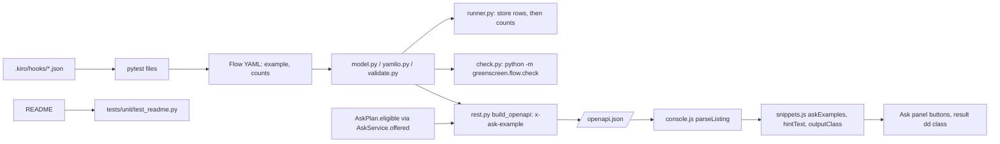

# Design Document

## Overview

This feature is a polish pass in seven parts. It adds one optional Flow member (`example`), one optional output member (`counts`), one runtime line, one OpenAPI vendor key that follows the Ask plan, one small command (`python -m greenscreen.flow.check`), three small page changes, two hook files, a new README and its tests, and a handful of text corrections. No Flow step kind, no route, no dependency and no host behaviour is added.

| Part | Production files | New tests |
|---|---|---|
| README (R1, R2) | `README.md` | `tests/unit/test_readme.py` |
| Hooks (R3 to R5) | `.kiro/hooks/flow-yaml-check.json`, `.kiro/hooks/captures-check.json` | `tests/unit/test_kiro_hooks.py`, `tests/property/test_kiro_hook_matchers.py` |
| Flow check command (R6) | `greenscreen/flow/check.py` | `tests/unit/test_flow_check.py`, `tests/property/test_flow_check.py` |
| `example` field (R7, R8) | `greenscreen/flow/model.py`, `yamlio.py`, `validate.py`; six `flows/*.yaml`; `greenscreen/publisher/rest.py`; `greenscreen/publisher/ask/service.py` (one property) | `tests/unit/test_flow_example.py`, `tests/property/test_flow_example.py`, `tests/unit/test_publisher_example.py`, `tests/property/test_publisher_example.py` |
| Ask examples (R9, R10) | `snippets.js`, `console.js` | `tests/console_node_extract.py` (support), `tests/unit/test_console_examples.py`, `tests/property/test_console_examples.py` |
| Multi-line font (R11) | `snippets.js`, `console.js`, `console.css` | `tests/unit/test_console_multiline.py` (and a property in `test_console_examples.py`) |
| `hashchange` (R12) | `console.js` | `tests/unit/test_console_hashchange.py`, `tests/property/test_console_fragment.py` |
| `MEMBER_COUNT` (R13 to R15) | `model.py`, `yamlio.py`, `validate.py`, `runner.py`; `tk5-library-members.yaml` | `tests/unit/test_flow_counts.py`, `tests/property/test_flow_counts.py`, `tests/unit/test_flow_member_count.py` |
| Stale text (R16) | two `.kiro/specs/linux-readiness` files, two `.kiro/specs/console` files, two `.kiro/specs/ask` files, one `.kiro/specs/more-flows` file, two test docstrings, one test name | `tests/unit/test_polish_stale_text.py` |

### Conventions for the executor

- DO NOT COMMIT and do not stage anything. The reviewer commits. `.kiro/steering` is never edited. The file `.kiro/specs/linux-readiness/sigterm-diagnostic.txt` is never edited. `%TEMP%\more-flows-amend` is never touched.
- Windows, PowerShell, Python 3.11. The full suite is `python -m pytest -m "not integration" -p no:cacheprovider`. Do not add `-q`: `pyproject.toml` already sets `addopts = "-ra -q"`. Node tests need `$env:Path = "C:\Program Files\nodejs;" + $env:Path`.
- The Python in this document is pseudocode except the YAML, the JSON, the CSS and the regular expressions, which are the exact text.
- Existing tests keep passing unedited, except the edits of the table "Every existing-test edit". New tests go into new files so that the edit list stays short.
- No secret, host address, key or `TK5_*` value in any file. Temp files live in a folder the executor creates and removes (`%TEMP%\polish-<task>`).

### Documentation checked

Read on 2026-11-20 (system clock) for the hook format. "Updated" is the date the page itself shows.

| Page | Updated | What it settles |
|---|---|---|
| https://kiro.dev/docs/hooks/ | 2026-11-12 | The file format: standalone JSON at `.kiro/hooks/<id>.json`; members `version` (`"v1"`), `hooks[]` with `name`, `description`, `trigger`, `matcher`, `action` (`type` `command` or `agent`, `command` or `prompt`), `timeout` (seconds, default 60), `enabled` (default true). A `matcher` for file events is a regular expression against the file path. Command actions run in the project root. The page says twice that a hook "receives the saved file path and session context via STDIN" and that a command "receives session context as JSON on STDIN"; it names no JSON member. |
| https://kiro.dev/docs/hooks/types/ | not shown | Triggers `PostFileSave` ("File Save") and `PostFileCreate` ("File Create") exist in the IDE and in CLI V3. Both are described as firing when "the agent" saves, modifies or creates matching files. The page does not say whether a save by the user in the editor fires `PostFileSave` (live check 6). |
| https://kiro.dev/docs/hooks/actions/ | 2026-10-10 | A command action with exit code 0 adds standard output to the agent context. Any other exit code sends standard error to the agent and reports an error. The default timeout is 60 s and `0` disables it. Shell commands are for deterministic work, agent prompts for work that needs the agent's context. |
| https://kiro.dev/docs/hooks/examples/ | 2026-08-21 | Examples use the words "File Save" and a "Target" glob in the editor UI. No JSON member for a glob appears in the `v1` format, only `matcher`. |

The brief remembered files named `*.kiro.hook` with `enabled`, `name`, `description`, `version`, `when {type, patterns}` and `then {type, prompt or command}`, and types `fileEdited` and `fileCreated`. That is the IDE 0.x form. The hooks page lists the migration "From IDE 0.x - Hooks moved from the previous format to standalone JSON files with PascalCase trigger names". The design uses the current form and records the difference here so that the reviewer does not look for `.kiro.hook` files.

### Hook payload finding (can the saved path reach the command?)

Question from the reviewer: can a Kiro hook pass the saved file's path to its command, as a path variable, an environment variable or stdin JSON? Pages re-read on 2026-11-20 (system clock), with the date each page shows:

| Page | Updated | What it says about the path |
|---|---|---|
| https://kiro.dev/docs/hooks/ | 2026-11-12 | "The hook receives the saved file path and session context via STDIN" (under the `PostFileSave` ESLint example) and "The command receives session context as JSON on STDIN". The `command` string in the example is `npx eslint --fix` with no placeholder, so the path does not appear on the command line. No member name is given. |
| https://kiro.dev/docs/hooks/actions/ | 2026-10-10 | Only the exit-code rule, the timeout and the advice to use shell commands for deterministic work. No variable, no placeholder, no payload. |
| https://kiro.dev/docs/hooks/types/ | not shown | The only environment variable is `USER_PROMPT`, for the Prompt Submit trigger. JSON payload examples exist for session start (`hook_event_name`, `cwd`, `session_id`), tool events (`tool_name`, `tool_input`), `PermissionRequest` and compaction (`summary`, `summary_path`). The File Create, File Save and File Delete sections have no payload example and no member name. |
| https://kiro.dev/docs/hooks/examples/ | 2026-08-21 | The two File Save examples use agent prompts and a "Target" glob in the editor UI; none runs a command on the saved path. |

Result: **the path cannot be passed to the command in a documented form.** Stdin JSON is the only carrier, and the pages do not name the member that holds the path, so a command would have to read an undocumented key. A wrapper that guessed (`path`, `file`, `filePath`, `file_path`, and so on) would stop being deterministic about what it checks, which breaks the product rule "a flow never guesses". Case recorded: **the Flow hook keeps the three test files** (Decision A3, Requirement 3, criterion 8), and the wrapper of section 3 is a separate command for a person, a script or a later hook.

How to settle it later (reviewer check 8, not run by the executor): add a throwaway hook with `"command": "python -c \"import sys; sys.stderr.write(sys.stdin.read()); sys.exit(1)\""`, matcher `\\.yaml$`, trigger `PostFileSave`, save a YAML file and read the JSON that reaches the agent on standard error. If the payload names the path member, a later spec can run `python -m greenscreen.flow.check` on that path before the three tests; the wrapper already takes one path argument and defines no option, so a later spec would add a small stdin reader that names the confirmed member, and the wrapper itself would not change.

Not read from documentation and therefore not relied on: the name of the path field in the standard-input JSON of a file hook; the regular-expression dialect and anchoring of `matcher` (the expressions below are written so that they behave the same under search and full match, and use only constructs common to Python, JavaScript and Rust).

## Architecture

### Decisions

| # | Decision | Choice | Rejected alternatives and why |
|---|---|---|---|
| A1 | Hook file format | Current `v1` JSON at `.kiro/hooks/<id>.json` | `*.kiro.hook` (IDE 0.x, replaced by the format above). |
| A2 | Hook action type | `command` running `python tests/hook_pytest.py` with fixed pytest paths, report on standard error | `agent` prompt: it runs on every save through a model turn, the result depends on the model's reading, and a model could "fix" a test. A command is deterministic, free and reports through the documented exit-code rule. Cost of the choice: a passing run is silent (standard output is empty, see Finding 3). |
| A2b | How the report reaches standard error | `command` is `python tests/hook_pytest.py <paths> -p no:cacheprovider`. The runner `tests/hook_pytest.py` calls `pytest.main(args)` with standard output redirected to standard error for the run and exits with pytest's exit code. Same text in `cmd`, PowerShell and `sh`. DECIDED by the user after task 10.1 found the parse error. | (a) Keep `1>&2` after the command: a parse error in PowerShell 7 (found by pasting the text into `pwsh`); it works only in `cmd` and `sh`. (b) Action type `agent`: see A2, a model turn on every save and a model could "fix" a test. |
| A3 | What the Flow hook runs | The three whole files `test_flow_bundled.py`, `test_flow_sync.py`, `test_flow_command_sync.py`. The hook stays in the shell-command form (reviewer decision). The wrapper of A16 exists, but the hook does not call it, because the saved path cannot be passed in a documented way (section "Hook payload finding"). | Calling the wrapper on the saved path: no documented carrier for the path. Reading stdin and guessing the member name: a guess. A `python -c` one-liner (quoting differs between `cmd`, PowerShell and `sh`). The three files already call `check_flow` for all eight Flows and compare each file with `to_yaml()`. |
| A4 | Where a question comes from | Optional `example:` member of the Flow YAML, carried in the OpenAPI operation as `x-ask-example` only for the Flows that Ask offers and only when Ask is on; the page shows a button only where the member exists (no generic fallback text) | (a) A hard-coded map of six names in `snippets.js`: forbidden by the brief and breaks with the seventh Flow. (b) Build the question from the description: no rule turns "List the jobs of the mainframe account..." into a good question. (c) A new route such as `/console/examples.json`: breaks the six-route allow-list test and the `apiFetch` path allow-list. (d) Carry it in MCP `tools/list` (`_meta`): the page does not read `tools/list` for the listing, and the MCP pins in `test_flow_command_publish.py` and the parity tests would change. (e) Put it in `description`: the description is the model's text, and mixing a human example in it costs characters of the 500 limit and confuses the model. |
| A5 | OpenAPI key name | `x-ask-example` on the operation | `example`, `examples`: forbidden by `test_publisher_openapi.py` (no `default`, `example`, `examples`, `const`, `enum` anywhere in the document). |
| A6 | Hint cut | First sentence, else cut before the last blank within 97 characters plus `...`, else empty | Keep `.slice(0, 100)`: the bug. Cut at 100 and back up one word: same as the chosen rule but without the sentence step, so a short first sentence would still run on into the next. |
| A7 | Multi-line mark | Class `multiline` on the `dd`, set by the pure function `outputClass(text)` | Select by CSS only: CSS cannot see an LF in text. Set an inline `style`: forbidden by the CSP and by the style tests. Data attribute: `data-*` is not in the `ALLOWED_ATTRS` of `el()`. |
| A8 | Multi-line size | `font-size: 0.9rem; line-height: 1.25` in `.outputs dd.multiline`, giving 24 / 1.125 = 21.3 lines | `max-height` raised: the brief keeps the D1 box. `0.8rem`: smaller than needed. A single size for all values: the brief keeps single values at 2rem. |
| A9 | `hashchange` test | Run the real `takeKeyFromFragment` text under Node with a stub `window`, by extracting the function from `console.js` | Move the logic into `snippets.js`: that module takes no key and has a pinned rule that no parameter is named like a key. Add jsdom: new dependency. A browser: not allowed. A static text test only: it would not catch a wrong argument to `replaceState`; it is added as well, for the wiring. |
| A10 | `hashchange` while a call runs | Adopt the key, do not reload the listing | Ignore the key: loses a pasted key silently. Abort the call: no abort path exists in the page. |
| A11 | Count mechanism | Optional `counts: <Rows_Output name>` on an `int` output (smallest change: one `OutputSpec` member, one YAML key, one validator block, one runner loop) | (a) Publisher-side derived `<NAME>_COUNT` for every Rows_Output: changes every schema and the listing of `tk5-list-datasets` and `tk5-job-status` for no request. (b) Count only in Ask's `project_result`: no change for REST and MCP callers, and the brief asks for an output of the tool. (c) A new step kind `count`: a new step, new audit record and a larger validator. (d) A count read from the screen: the host prints no count. |
| A12 | Count when no rows | Always present, value 0 | Omit the output: the response schema lists every output as `required`, so an omitted output would break the schema and every caller. 0 is true: zero lines were collected. |
| A13 | Count region members | A Count_Output repeats `signature`, `row`, `col`, `length` of its Rows_Output, and the validator checks equality | Make the four members optional for a Count_Output: changes the dataclass constructor and the YAML schema rules for every output. Ignore the four values: allows a YAML that says one thing and means another. |
| A14 | README spec list | Ten directories including `polish` | Nine: false once this folder exists (Open decision 1). |
| A15 | `MEMBER_COUNT` position | After `MEMBERS` | Before: `list(outputs)[0]` would change for callers that read the first output. |
| A16 | The Flow check command | A new module `greenscreen/flow/check.py`, run as `python -m greenscreen.flow.check <file.yaml>`; one argument, no option; built on `yaml.safe_load` (to tell "not YAML" from "not a Flow") and `Flow.from_yaml` with the bundled signatures (which calls `check_flow`); six exit codes (section 3) | A `console_scripts` entry in `pyproject.toml`: the brief forbids touching it. An option parser with `--json`, `--quiet`: more surface than the brief asks for. Printing all violations: `check_flow` raises on the first, and listing all would need the private `_build_flow`; the first violation is what the Publisher shows at startup, so the command shows the same text. Putting the code in `greenscreen/publisher`: the check belongs to the Flow package, which already owns `check_flow`. |
| A17 | How the OpenAPI document learns what Ask offers | A read-only property `offered` on `AskService` returning `plan.eligible`; `build_openapi` reads it from the `ask` argument it already receives | Pass the names as a new argument through `build_app` and `build_rest`: edits `app.py` and the signature of `build_rest`. Recompute the plan inside `rest.py`: duplicates `plan_ask` and could disagree with it. Read `GS_ASK_FLOWS` in `rest.py`: ignores the rules of `_rule`, so a listed name that Ask rejects would still get an example. |
| A18 | Example button cap | 12, one constant `ASK_EXAMPLE_MAX` in `snippets.js`, used by the clamp inside `askExamples` and as the argument in `console.js` | Keep 3: the demo has six offered tools. Keep two places with two numbers: that is the state today (argument 3 and clamp 3) and one can drift from the other. No cap: a hostile or very large listing would build unbounded buttons. 12 is twice the demo and fits the Ask panel without a scroll of its own. |
| A19 | When the document is built | Once at startup (as today), in `build_rest`, from the immutable registry and the frozen Ask plan | Rebuild per request: not needed, and it would read settings late. The document cannot go stale because its inputs are immutable (section 5). |

### Where the new code sits



## Components and Interfaces

### 1. Hook files

Both files are written exactly as below. JSON strings carry the regular expressions with doubled backslashes.

`.kiro/hooks/flow-yaml-check.json`:

```json
{
  "version": "v1",
  "hooks": [
    {
      "name": "Check bundled flow YAML on save",
      "description": "Runs check_flow for every bundled flow against the bundled signatures, compares each shipped file with Flow.to_yaml(), and runs the flow sync tests. Silent when everything passes; the report goes to standard error when it fails.",
      "trigger": "PostFileSave",
      "matcher": "^(?:.*[/\\\\])?greenscreen[/\\\\]flow[/\\\\]flows[/\\\\][^/\\\\]+\\.yaml$",
      "action": {
        "type": "command",
        "command": "python tests/hook_pytest.py tests/unit/test_flow_bundled.py tests/unit/test_flow_sync.py tests/unit/test_flow_command_sync.py -p no:cacheprovider"
      },
      "timeout": 120,
      "enabled": true
    }
  ]
}
```

Decoded `matcher`: `^(?:.*[/\\])?greenscreen[/\\]flow[/\\]flows[/\\][^/\\]+\.yaml$`. It matches `greenscreen/flow/flows/tk5-time.yaml`, the same with backslashes, and any absolute or relative form with a directory prefix. It does not match `greenscreen/flow/flows/__init__.py`, `greenscreen/recognizer/signatures/tso-ready.yaml`, `greenscreen/flow/flows/sub/x.yaml` or `greenscreen/flow/flows/tk5-time.yaml.bak`. Where `check_flow` runs: `test_every_bundled_flow_passes_validator` (all eight Flows, bundled signatures); the equality with `to_yaml()`: `test_shipped_yaml_equals_to_yaml`; a file that does not load fails the module fixture with the file name in the message (`bundled flow file <name>.yaml: ...`).

`.kiro/hooks/captures-check.json`:

```json
{
  "version": "v1",
  "hooks": [
    {
      "name": "Check captures when one is created",
      "description": "Runs the capture password and hidden-field scans, the capture file hash test and the capture inventory test. Skips the password part when the host password is not set. Silent when everything passes.",
      "trigger": "PostFileCreate",
      "matcher": "^(?:.*[/\\\\])?captures[/\\\\][^/\\\\]+$",
      "action": {
        "type": "command",
        "command": "python tests/hook_pytest.py tests/unit/test_flow_captures.py::test_no_capture_holds_a_typed_password tests/unit/test_flow_captures.py::test_every_capture_has_only_blank_hidden_cells tests/unit/test_flow_captures.py::test_no_password_hex_form_occurs_in_any_capture_file tests/unit/test_flow_captures.py::test_no_capture_exists_for_the_screen_after_the_password_entry tests/unit/test_flow_captures.py::test_sentinel_occurs_in_no_file_under_captures tests/unit/test_command_capture_files.py tests/unit/test_recognizer_capture_inventory.py -p no:cacheprovider"
      },
      "timeout": 120,
      "enabled": true
    },
    {
      "name": "Check captures when one is saved",
      "description": "Same checks as the create hook, for a saved capture file.",
      "trigger": "PostFileSave",
      "matcher": "^(?:.*[/\\\\])?captures[/\\\\][^/\\\\]+$",
      "action": {
        "type": "command",
        "command": "python tests/hook_pytest.py tests/unit/test_flow_captures.py::test_no_capture_holds_a_typed_password tests/unit/test_flow_captures.py::test_every_capture_has_only_blank_hidden_cells tests/unit/test_flow_captures.py::test_no_password_hex_form_occurs_in_any_capture_file tests/unit/test_flow_captures.py::test_no_capture_exists_for_the_screen_after_the_password_entry tests/unit/test_flow_captures.py::test_sentinel_occurs_in_no_file_under_captures tests/unit/test_command_capture_files.py tests/unit/test_recognizer_capture_inventory.py -p no:cacheprovider"
      },
      "timeout": 120,
      "enabled": true
    }
  ]
}
```

Decoded `matcher`: `^(?:.*[/\\])?captures[/\\][^/\\]+$`. It matches `captures/tk5-logon.ascii.txt` and `D:\greenMachine\captures\x.txt`. It also matches a file in any other directory named `captures`, for example `.kiro/specs/more-flows/captures/x` (the folder that the more-flows spec used before the move). That is accepted: the checks are fast and harmless there. It does not match `captures-notes.txt`, `tests/unit/test_flow_captures.py` or `captures/sub/x.txt`.

Node ids, all of them existing functions: `test_no_capture_holds_a_typed_password`, `test_every_capture_has_only_blank_hidden_cells` (parametrized: all names), `test_no_password_hex_form_occurs_in_any_capture_file` (skips when `TK5_PASSWORD` is unset), `test_no_capture_exists_for_the_screen_after_the_password_entry`, `test_sentinel_occurs_in_no_file_under_captures` (two sentinels) in `tests/unit/test_flow_captures.py`; the whole of `tests/unit/test_command_capture_files.py` (hashes of the 36 promoted files, 24 by 80, ascii versus readbuffer, password scan `test_no_capture_file_holds_the_password_in_any_form`, which skips when `TK5_PASSWORD` is unset); the whole of `tests/unit/test_recognizer_capture_inventory.py` (exactly the 28 names, both file forms). A new capture file therefore fails the inventory test until a spec updates it, which is the intended alarm.

Why `tests/hook_pytest.py` and not `1>&2`: pytest prints to standard output. Under the documented rule only standard error reaches the agent, and only for a non-zero exit. The suffix `1>&2` is a parse error in PowerShell 7 (task 10.1 found it by running the command text in `pwsh`) and works only in `cmd` and `sh`, and the hook shell is not fixed. The runner is plain Python: it calls `pytest.main(args)` inside `contextlib.redirect_stdout(sys.stderr)`, so pytest's terminal writer, which binds to `sys.stdout` when it starts, writes to standard error, and it exits with pytest's exit code. Checked on the current tree from `pwsh` and through `cmd` (`subprocess` with `shell=True`): exit 0, standard output empty. A deliberately failing test gives exit 1, empty standard output and the full report on standard error. On success the report also goes to standard error, which the agent does not read for exit 0; the hook card shows that the hook ran.

Why `-p no:cacheprovider`: the repository suite is run that way and the hook should not create `.pytest_cache` entries. Why no `-q`: `addopts` has it. Why `timeout` 120: the default of 60 s is close to the cold-start time of the Windows suite with Hypothesis imports.

The command assumes `python` on the `PATH` of the shell that Kiro starts, which on the dev machine is the project interpreter. A virtual environment that is not active would make the hook fail with "No module named pytest" on standard error, which is visible, not silent.

Why the Flow hook does not run the check command of section 3 first: the command needs the saved file's path, and the hook documentation gives no usable carrier for it (section "Hook payload finding"). The command stays available for hand use and for a later hook.

### 2. Hook test (`tests/unit/test_kiro_hooks.py`)

Pure Python, no Kiro. `HOOKS = REPO / ".kiro" / "hooks"`. Functions:

- `test_every_hook_file_parses_and_has_the_v1_shape`: for each `*.json`, `json.loads`, `version == "v1"`, non-empty `hooks`, each hook has non-empty `name` and `description`, `trigger in {"PostFileSave", "PostFileCreate"}`, `matcher` compiles, `action.type == "command"`, `1 <= timeout <= 300`, `enabled is True`. A synthetic broken file in `tmp_path` shows the failure names the file (Requirement 5, criterion 7).
- `test_flow_hook_matcher_...` and `test_capture_hook_matcher_...`: examples of Requirement 5.2, using both `re.search` and `re.fullmatch` and demanding that both give the same answer.
- `test_commands_name_existing_paths_and_node_ids`: split the command on blanks, drop `python`, `tests/hook_pytest.py`, `-p`, `no:cacheprovider`; each remaining token is `path` or `path::name`; the path exists; `name` is a function defined in that file (`ast`).
- `test_commands_have_the_fixed_shape`: starts with `python tests/hook_pytest.py `, ends with ` -p no:cacheprovider`, contains no `1>&2` and no `-m pytest`, no `-q`, no `-x`, and no command contains `greenscreen.flow.check` (Requirement 3, criterion 8; the hook runs the three tests, not the wrapper).
- `test_hook_files_hold_no_secret_names_or_hosts`: no `GS_`, `TK5_`, `http`, IPv4.
- `test_hooks_are_documented_and_not_ignored`: each file name occurs in `README.md`; `.gitignore` has no line that hides `.kiro/hooks`.
- `test_the_two_hook_files_are_exactly_these`: the file names equal `{"flow-yaml-check.json", "captures-check.json"}` and the triggers are `PostFileSave` for the first and one create and one save for the second.

`tests/property/test_kiro_hook_matchers.py` (Property 10) draws path prefixes and names; see Correctness Properties.

### 3. The Flow check command (`greenscreen/flow/check.py`)

Run as `python -m greenscreen.flow.check <file.yaml>`. The module defines `main(argv: Sequence[str] | None = None) -> int` and ends with `if __name__ == "__main__": raise SystemExit(main())`. `greenscreen/flow/__init__.py` is not edited, so the nine names of `__all__` stay (`test_all_holds_exactly_the_nine_names`). `pyproject.toml` is not edited: no console script.

Exit codes, defined once as module constants and listed in the README:

| Code | Name | Situation | Line written |
|---|---|---|---|
| 0 | `EXIT_OK` | the file is a valid Flow for the bundled signatures | stdout: `ok: <file name>` |
| 1 | `EXIT_VIOLATION` | the file is a YAML mapping and the Flow reader or `check_flow` reports a violation | stderr: `violation: <FlowDefinitionError message>` |
| 2 | `EXIT_USAGE` | no argument, more than one, an argument that starts with `-`, or an empty argument | stderr: `usage: python -m greenscreen.flow.check <file.yaml>` |
| 3 | `EXIT_NO_FILE` | the path does not exist, is not a regular file, or cannot be read | stderr: `error: file not found or not readable` |
| 4 | `EXIT_NOT_YAML` | not valid UTF-8, not parsable as YAML, or the top level is not a mapping | stderr: `error: not a YAML mapping`, plus ` (line L, column C)` when `yaml.MarkedYAMLError` gives a mark |
| 5 | `EXIT_NO_SIGNATURES` | `load_bundled_signatures()` raises | stderr: `error: bundled signatures could not be loaded` |

Order of work in `main` (each step returns at once on failure, so each situation has exactly one code):

```python
def main(argv=None) -> int:
    args = list(sys.argv[1:] if argv is None else argv)
    if len(args) != 1 or args[0] == "" or args[0].startswith("-"):
        return _fail(EXIT_USAGE, USAGE)
    path = Path(args[0])
    text = _read_text(path)            # None: missing, directory, unreadable -> 3
    ...
    doc = _parse(text)                 # yaml.safe_load; UnicodeDecodeError, YAMLError, non-dict -> 4
    signatures = _signatures()         # load_bundled_signatures(); any exception -> 5
    try:
        Flow.from_yaml(text, signatures)      # builds the Flow, then check_flow -> FlowDefinitionError
    except FlowDefinitionError as exc:
        return _fail(EXIT_VIOLATION, "violation: " + str(exc))
    print("ok: " + _clean(path.name))
    return EXIT_OK
```

The order is read (3), decode and parse (4), signatures (5), validate (1). A usage error comes first, so a bad call never touches the disk. The read uses `open(path, "rb")` and `bytes.decode("utf-8")` so that a decode error is told apart from an OS error; a directory raises `IsADirectoryError` (an `OSError`) and gives 3.

What is printed (Requirement 6, criterion 8): `_clean(text)` replaces every character outside 0x20 to 0x7E with `?` and cuts at 200 characters; the file name is `path.name` (no directory); the `FlowDefinitionError` message is the one `check_flow` and `_build_flow` already build (step index, step kind, field name, rule name, key names of at most 64 characters), which holds no YAML value; the parser's own message is never printed, only the line and column of its mark. Nothing is logged. The module reads no environment (`test_no_environment_access` applies to it), imports no `time`, `datetime` or `random` (`test_time_and_randomness_only_in_clock`), uses only `yaml.safe_load` (`test_yaml_entry_points_are_safe_only`), and imports nothing from `greenscreen.connector`.

Why one violation and not a list: `check_flow` raises on the first violation; the Publisher prints the same message when it refuses a file at startup. A list would need the private builder `_build_flow` and a second code path. If a file has several violations, fixing the first shows the next on the next run.

Tests: `tests/unit/test_flow_check.py` (the four required cases and the rest of Requirement 6, criterion 12, calling `main([...])` with `capsys`, plus one `subprocess.run([sys.executable, "-m", "greenscreen.flow.check", <file>])` call) and `tests/property/test_flow_check.py` (Property 11). The subprocess call passes an environment without any `TK5_` or `GS_` variable.

### 4. The Flow `example` member

`greenscreen/flow/model.py`:

```python
@dataclass(frozen=True, slots=True)
class Flow:
    name: str
    steps: tuple[Step, ...]
    description: str = ""
    inputs: tuple[InputSpec, ...] = ()
    outputs: tuple[OutputSpec, ...] = ()
    finally_steps: tuple[Step, ...] = ()
    timeouts: Timeouts = Timeouts()
    example: str = ""          # new; last, so positional construction is unchanged
```

`greenscreen/flow/yamlio.py`: `_TOP` gains `"example": "str"` (after `description`); `to_yaml` builds `doc` and inserts `example` right after `description` only when it is not empty:

```python
doc = {"version": 1, "name": flow.name, "description": flow.description}
if flow.example != "":
    doc["example"] = flow.example
doc.update(inputs=..., outputs=..., timeouts=..., steps=..., finally=...)
```

`_build_flow` passes `example=obj.get("example", "")`. An explicit `example: ''` therefore reads as no example and is not written back (the round trip is a property of Flows, not of texts).

`greenscreen/flow/validate.py`, in `_check_flow_fields`:

```python
example = flow.example
if not isinstance(example, str) or any(not 0x20 <= ord(c) <= 0x7E for c in example):
    out.add(None, 1, 6, "example", "invalid_text")
elif len(example) > 200:
    out.add(None, 1, 6, "example", "too_long")
elif "${" in example:
    out.add(None, 1, 6, "example", "interpolation_marker")
```

The message is built by `Flow.__post_init__` as `flow: example: <rule>`: field and rule only. `check_flow` on a loaded Flow gives `flow <name>: field 'example' violates rule '<rule>'`.

`runner.py` does not read `example`. The audit record and the run result have no member for it.

Bundled files (YAML, exact text of the new lines, placed after `description:` by `to_yaml`):

| File | `example:` | Length |
|---|---|---|
| `tk5-system-info.yaml` | `What system and release is the mainframe running?` | 49 |
| `tk5-time.yaml` | `What time is it on the mainframe?` | 33 |
| `tk5-list-datasets.yaml` | `Which data sets does this account have?` | 39 |
| `tk5-dataset-info.yaml` | `What are the record format and volume of SYS2.JCLLIB?` | 53 |
| `tk5-library-members.yaml` | `Which members does SYS2.JCLLIB have?` | 36 |
| `tk5-job-status.yaml` | `Which jobs are running for this account?` | 40 |

PyYAML writes these plain (no quotes) because they hold no `: ` or leading indicator. The executor writes each file from the loaded Flow with `dataclasses.replace(flow, example=...)` and `to_yaml()`, never by hand, so that the shipped text equals `to_yaml()` (test `test_shipped_yaml_equals_to_yaml`). `SYS2.JCLLIB` satisfies the `dsname` regex of the two Name_Flows (checked by `prepare_inputs` in the new test). The `?` is in `PROBE_ALPHABET` (`tests/property/_publisher_strategies.py`), but the probe tests scan the fixed text of a Flow's name, description, input and output names (`test_publisher_helpers.py::_fixed_text`, `test_flow_command_flows.py::test_no_probe_alphabet_character_in_any_fixed_text_of_a_flow`), which does not include `example`. The executor runs both and the leak property tests (`test_publisher_no_leak_*.py`) after the YAML change; a failure there is a stop-and-report.

### 5. Publisher: `x-ask-example` for the Flows that Ask offers

Three small edits, all in the Publisher.

**`greenscreen/publisher/ask/service.py`**, class `AskService`, next to the existing property `max_question_chars`:

```python
@property
def offered(self) -> frozenset[str]:
    """Names of the Flows that Ask offers: the eligible set of the Ask_Plan."""
    return self._plan.eligible
```

`plan.eligible` is the `frozenset` that `plan_ask` returns: the names of `GS_ASK_FLOWS` when it is set (each one checked, or the start fails), otherwise every published Flow that passes `_rule`. No other code of the Ask package changes, and the property returns names only, never a setting value.

**`greenscreen/publisher/rest.py`**, in `build_openapi`, which already receives `ask: AskService | None`:

```python
offered = ask.offered if ask is not None else frozenset()
...
operation = {"operationId": name, "summary": published.summary, "requestBody": {...},
             "responses": responses, "security": security}
if published.flow.example and name in offered:
    operation["x-ask-example"] = published.flow.example
paths[f"/flows/{name}"] = {"post": operation}
```

The member is last in the operation, after `security`. With Ask off, `offered` is empty and no operation gets the member. With Ask on and `GS_ASK_FLOWS` unset, every eligible published Flow that has an example gets it; with `GS_ASK_FLOWS=tk5-time,tk5-job-status` exactly those two get it, even though the other four Flows have examples. The docstring "Holds no value, default or example" becomes "Holds no value or default; the only example is the vendor key `x-ask-example`, a question text, set only for Flows that Ask offers". MCP `build_mcp_server` is not edited. `PublishedFlow` is not edited. Nothing logs the example.

**Why a cached or startup-built document stays correct (Requirement 8, criterion 7).** `build_rest` calls `build_openapi(registry, _package_version(), ask)` once and `/openapi.json` returns that dict from memory. Every input of the function is fixed for the life of the process:

| Input | Why it cannot change after startup |
|---|---|
| `registry` | `types.MappingProxyType` over entries built once by `build_registry` |
| `version` | read once from the package metadata |
| `ask.offered` | `AskPlan` is `@dataclass(frozen=True)` and `eligible` is a `frozenset`; `plan_ask` runs once in `prepare()` |
| `Flow.example` | `Flow` is a frozen dataclass; the Flow files are loaded once at startup |
| `GS_ASK_FLOWS`, `GS_ENABLE_ASK` | read once by `load_settings` into the frozen `AskSettings`; nothing re-reads the environment |

So the cached document equals the document that a rebuild would give at any later time, and a change of `GS_ASK_FLOWS` takes effect only with a restart, which rebuilds it. The response carries `Cache-Control: no-store` (the `_NoStore` middleware), so a browser or a proxy does not keep an older document across a restart. The test of this property builds the document, serves it twice through a raw ASGI scope, and asserts that both bodies equal `build_openapi(...)` called again with the same inputs and that a plan with other names gives a different document (the function is pure in its inputs).

### 6. Console: examples and hints

`snippets.js` gains three exports and changes one:

```js
export const ASK_EXAMPLE_MAX = 12;
const EXAMPLE_TEXT = /^[\x20-\x7E]+$/;

// First sentence of the text, or a whole-word cut with "...", or "". Never more than 100 characters.
export function hintText(source) {
  const words = typeof source === "string" ? source : "";
  const text = words.replace(/[^\x20-\x7E]/g, " ").replace(/ +/g, " ").trim();
  const end = /[.!?](?= |$)/.exec(text);
  const start = end === null ? text : text.slice(0, end.index + 1);
  if (start.length <= 100) {
    return start;
  }
  const cut = start.lastIndexOf(" ", 97);
  if (cut <= 0) {
    return "";
  }
  const kept = start.slice(0, cut).replace(/[ .!?,;:]+$/, "");
  return kept === "" ? "" : kept + "...";
}

// flows: listing items {name, description or blurb, inputs, example}.
// Returns at most min(limit, ASK_EXAMPLE_MAX) items {text, hint}, one per Flow that carries an example.
export function askExamples(flows, limit, maxQuestion) {
  const found = [];
  const most = Number.isSafeInteger(limit) ? Math.min(Math.max(limit, 0), ASK_EXAMPLE_MAX) : 0;
  if (!Array.isArray(flows)) {
    return found;
  }
  for (const flow of flows) {
    if (found.length >= most) {
      break;
    }
    if (!isObject(flow) || typeof flow.name !== "string" || !ASK_NAME.test(flow.name)) {
      continue;
    }
    const inputs = Array.isArray(flow.inputs) ? flow.inputs : [];
    if (inputs.some((input) => !isObject(input) || input.secret === true)) {
      continue;
    }
    if (typeof flow.example !== "string" || !EXAMPLE_TEXT.test(flow.example)) {
      continue;
    }
    if (Number.isSafeInteger(maxQuestion) && flow.example.length > maxQuestion) {
      continue;
    }
    const words = typeof flow.description === "string" ? flow.description : typeof flow.blurb === "string" ? flow.blurb : "";
    found.push({ text: flow.example, hint: hintText(words) });
  }
  return found;
}

export function outputClass(text) {
  return typeof text === "string" && text.includes("\n") ? "multiline" : null;
}
```

There is no fallback text and no `required` test: a Flow without an example is skipped, and a Flow with an example is shown whether or not it has a required input (the question names its own value, for example `SYS2.JCLLIB`). With Ask off the server sends no `x-ask-example`, so `parseListing` gives items with `example: ""`, `askExamples` returns an empty list and the panel has no buttons (and the Ask panel itself is hidden, as today). No parameter is named like a key (`test_snippets_has_no_parameter_named_like_a_key`), no forbidden name occurs, and the module stays free of `import`, host names and URLs. The name `hintText` is not matched by the `function project\w*(` count of `test_ask_trace_parity.py`.

**The cap, reconciled.** Today the number 3 stands in two places: `console.js` calls `askExamples(flows, 3)` and the function clamps with `Math.min(..., 3)`. The new rule has one constant: `ASK_EXAMPLE_MAX = 12`. The function clamps every limit to it (a limit of 13, 99 or 1000 gives at most 12 items), and `console.js` passes the same constant, so the two cannot drift. The existing test `test_ask_examples_limits_and_hostile_values` asserts `len(askExamples(flows, 99)) == 3` for a fixture with four qualifying Flows; with the cap at 12 and the examples added to the fixture the same call returns 4 (the number of Flows with an example), which is the edit in the table "Every existing-test edit". The cap is tested at exactly 12 and at 13 (Requirement 9, criterion 12): a listing of 12 Flows with examples gives 12 items for the limit 12 and for the limit 13; a listing of 13 gives 12 for both limits.

`console.js`:

- `parseListing`: after `const text = ...` add `const example = typeof operation["x-ask-example"] === "string" ? operation["x-ask-example"] : "";` and push `{ name, blurb: text, inputs, example }`.
- `renderAsk`: `askExamples(flows, ASK_EXAMPLE_MAX, askMax.maxQuestion)` (import `ASK_EXAMPLE_MAX`, `outputClass`, nothing else new).
- The button handler stays as it is: `refs.askInput.value = item.text; updateAskCount(); refs.askInput.focus({ preventScroll: true });`.

The three cases that the tests pin (Requirement 9, criterion 12), over the real OpenAPI document of the six Published_Tools with the userid and password bound:

| Case | Server document | Page result |
|---|---|---|
| Ask off | no `x-ask-example` anywhere, no `/ask` path | zero items, zero buttons |
| Ask on, all six offered | six `x-ask-example` members, one per tool | six items in listing order (`tk5-system-info`, `tk5-time`, `tk5-list-datasets`, `tk5-dataset-info`, `tk5-library-members`, `tk5-job-status`), six buttons |
| Ask on, `GS_ASK_FLOWS` = two names | the two named Flows carry the member, the four others do not | exactly two items, two buttons |

The hints are the first sentences of the six descriptions; their lengths are measured in the test, not guessed here, and a first sentence longer than 100 characters becomes a whole-word cut with `...`.

Static facts that stay true: no new fetch path, no inline script or style, no `innerHTML`, all text through text nodes, the six console routes and four response headers unchanged.

### 7. Console: multi-line outputs

`console.js` `showSuccess`: `outputs.appendChild(el("div", null, el("dt", null, name), el("dd", { class: outputClass(text) }, text)));` (`el()` skips a `null` attribute value, so a single value gets no `class`).

`console.css`, directly after the rule `.outputs dd`:

```css
.outputs dd.multiline {
  font-size: 0.9rem;
  line-height: 1.25;
}
```

`.outputs dd` is not edited: `font-size: 2rem`, `line-height: 1.2`, `white-space: pre-line`, `max-height: 24rem`, `overflow-y: auto` stay. The multi-line rule has higher specificity and overrides only the two members. Arithmetic: 0.9 x 1.25 = 1.125 rem per line; 24 / 1.125 = 21.3 lines in the box, which is at least 20. The 136 member lines need 153 rem, so the box scrolls. `.outputs > div` keeps its `minmax(11rem, 1fr)` column; a member name has at most 8 characters.

The new CSS test reads the stylesheet, finds both rules by exact selector with the helper style of `test_console_css.py::_rule_declarations`, and asserts: `.outputs dd` still has `font-size: 2rem`; `.outputs dd.multiline` has a `rem` font size between 0.8 and 1, a numeric line height, and `24 / (size * line_height) >= 20`; the `max-height` of `.outputs dd` is `24rem` (read, not assumed); the new rule has no colour literal, no `var(--` token that is undefined, no `url(`. The existing tests `test_console_css.py`, `test_console_seance.py`, `test_console_audit_layout.py` and `test_ask_assets.py` run unedited: none reads a font size of `.outputs`, and the 1 rem floor of `test_ask_assets.py` is limited to the Ask block, which this rule is not part of.

### 8. Console: the key on `hashchange`

`console.js`: `takeKeyFromFragment` now returns whether it took a key. Its body is unchanged except the two returns.

```js
function takeKeyFromFragment() {
  const prefix = "#key=";
  const hash = window.location.hash;
  if (typeof hash !== "string" || !hash.startsWith(prefix)) {
    return false;
  }
  const raw = hash.slice(prefix.length);
  let text = raw;
  try {
    text = decodeURIComponent(raw);
  } catch (error) {
    text = raw;
  }
  if (text !== "") {
    apiKey = text;
    keyHeld = true;
  }
  window.history.replaceState(null, "", window.location.pathname + window.location.search);
  return text !== "";
}

takeKeyFromFragment();   // on load, as before: still above `refs`, still before the first fetch(
```

New handler, placed after `connect()`:

```js
function onHashChange() {
  if (!takeKeyFromFragment()) {
    return;
  }
  showKeyPanel(false);
  if (!running) {
    loadListing();
  }
}
```

In `start()`, after `codes = await loadCodes();`:

```js
window.addEventListener("hashchange", onHashChange);
onHashChange();   // a fragment that arrived while the error table was loading
```

Why this is safe: `history.replaceState` does not fire `hashchange`, so removing the key cannot loop. The first `history.replaceState` text still stands above the first `fetch(` in the file (the test `test_replace_state_comes_before_first_fetch` reads the first occurrence, which is in `takeKeyFromFragment`). `apiKey` is only assigned in the handler path, never read, so `test_api_key_variable_is_read_only_inside_api_fetch` holds. `location.hash` is only read. If the new key is wrong, `loadListing` gets 401 and `forgetKey()` shows the key panel, as for a typed wrong key. While a call runs, `showKeyPanel(false)` runs and the key is adopted; `loadListing` is not called, so the running call and its own `finally` are not disturbed (decision A10).

Test harness `tests/console_node_extract.py` (support, new): `function_source(text, name)` returns the source of `function name(...) {...}` by brace matching (the same method as `_function_body` in `test_console_assets.py`); `run_fragment(cases)` starts one `node` process, runs in `vm.runInNewContext` the prelude `let apiKey = null; let keyHeld = false;`, the extracted `takeKeyFromFragment` source and, per case, a stub `window = {location: {hash, pathname, search}, history: {replaceState: (...args) => calls.push(args)}}`, and returns `{taken, apiKey, keyHeld, calls}` per case. Results contain the generated key text because it is test data (a random string, never a real key); a failure message names the case index and the rule, not the value.

### 9. Count_Output

`greenscreen/flow/model.py`:

```python
@dataclass(frozen=True, slots=True)
class OutputSpec:
    name: str
    type: str
    signature: str
    row: int
    col: int
    length: int
    next_row: int | None = None
    max_rows: int | None = None
    equals: str | None = None
    counts: str | None = None     # new: name of the Rows_Output whose row count this output holds
```

`yamlio.py`: `_OUTPUT_OPTIONAL = {"next_row": "int", "max_rows": "int", "equals": "str", "counts": "str"}` (the emit loop and the check loop already iterate this dict, so `counts` is written after `equals` and read with the same rules).

`validate.py`: in `_check_outputs`, after the per-output loop, one more loop (the numbers in `out.add` are the internal requirement and criterion numbers of the `Violation` record):

```python
by_name = {o.name: o for o in flow.outputs if isinstance(o, OutputSpec) and isinstance(o.name, str)}
for i, spec in enumerate(flow.outputs):
    if not isinstance(spec, OutputSpec) or spec.counts is None:
        continue
    field = f"{_label('output', i, spec.name)}.counts"
    if spec.type != "int":
        out.add(None, 3, 8, field, "counts_requires_int")
    if spec.max_rows is not None or spec.next_row is not None or spec.equals is not None:
        out.add(None, 3, 8, field, "counts_excludes_extras")
    target = by_name.get(spec.counts) if isinstance(spec.counts, str) else None
    if target is None or target is spec:
        out.add(None, 3, 8, field, "counts_unknown_output")
    elif target.max_rows is None:
        out.add(None, 3, 8, field, "counts_target_not_rows")
    elif (target.signature, target.row, target.col, target.length) != (
        spec.signature, spec.row, spec.col, spec.length
    ):
        out.add(None, 3, 8, field, "counts_region_mismatch")
```

In `_StepWalk._extract` and `_collect`, after the output is looked up: `if spec.counts is not None: add(idx, 4, 4, "output", "counts_not_readable"); return`. In `_StepWalk.finish`, outputs with `counts is not None` are skipped (they need no read step). The messages are `flow: output MEMBER_COUNT.counts: counts_region_mismatch` and so on: the output name, the field and the rule, never a YAML scalar.

`runner.py`: one helper and two call sites.

```python
def _store_rows(self, output: OutputSpec, rows: list[str]) -> None:
    self.outputs[output.name] = "\n".join(rows)
    for other in self.flow.outputs:
        if other.counts == output.name:
            self.outputs[other.name] = len(rows)      # int, never a bool
```

`exec_extract` (Rows_Output branch, now `self.outputs[output.name] = "\n".join(rows)`) and `exec_collect` (last lines) call `self._store_rows(output, rows)`. No step, key, screen read or audit record is added. The final dict is still built in declaration order (`{o.name: extracted[o.name] for o in flow.outputs if o.name in extracted}`), so `MEMBER_COUNT` follows `MEMBERS`. A run that stops with `loop_limit` before the store sets neither. A value of `rows` is not logged, raised or stored anywhere new.

`tk5-library-members.yaml` outputs after the change (the rest of the file is unchanged, 31 steps and 6 finally steps):

```yaml
outputs:
- name: MEMBERS
  type: str
  signature: tso-ready
  row: 7
  col: 3
  length: 8
  next_row: 0
  max_rows: 200
- name: MEMBER_COUNT
  type: int
  signature: tso-ready
  row: 7
  col: 3
  length: 8
  counts: MEMBERS
```

and the description (381 characters, below 500, no `;`, `#` or `@`), written after `to_yaml` re-emits the file:

`List the member names of a partitioned data set (library) by name (TSO LISTDS with MEMBERS). MEMBERS holds one member name per line, in the host's order, up to 200. MEMBER_COUNT is the number of names in MEMBERS. A longer list stops the call with an error. An empty MEMBERS means the library has no members or does not exist. Call tk5-dataset-info to tell the two apart. Read-only.`

### 10. Contract impact of `MEMBER_COUNT`

The output schema and the REST 200 body schema (which is also the MCP `outputSchema`) of `tk5-library-members`, as `build_schemas` generates them after the change:

```json
{
  "output_schema": {
    "type": "object",
    "properties": {
      "MEMBERS": {"type": "string"},
      "MEMBER_COUNT": {"type": "integer"}
    },
    "additionalProperties": false,
    "required": ["MEMBERS", "MEMBER_COUNT"]
  },
  "success_schema": {
    "type": "object",
    "properties": {
      "flow": {"type": "string"},
      "outputs": {
        "type": "object",
        "properties": {
          "MEMBERS": {"type": "string"},
          "MEMBER_COUNT": {"type": "integer"}
        },
        "additionalProperties": false,
        "required": ["MEMBERS", "MEMBER_COUNT"]
      },
      "audit": {
        "type": "array",
        "items": {
          "type": "object",
          "properties": {
            "step_index": {"type": "integer"},
            "kind": {"type": "string"},
            "phase": {"type": "string"},
            "iteration": {"type": ["integer", "null"]},
            "signature": {"type": ["string", "null"]},
            "status": {"type": "string"},
            "duration_seconds": {"type": "number"}
          },
          "additionalProperties": false,
          "required": ["step_index", "kind", "phase", "iteration", "signature", "status", "duration_seconds"]
        }
      }
    },
    "additionalProperties": false,
    "required": ["flow", "outputs", "audit"]
  }
}
```

The input schema is unchanged. A call with the `userid` and `password` bound and `{"dsname": "SYS2.JCLLIB"}` returns `{"flow": "tk5-library-members", "outputs": {"MEMBERS": "$$$INDEX\n$HISTORY\n...", "MEMBER_COUNT": 136}, "audit": [...]}`.

| Consumer | Effect |
|---|---|
| REST and MCP | one more `outputs` member; schemas from `build_schemas`, no code change |
| OpenAPI | the 200 schema of `/flows/tk5-library-members` as above; the operation also carries `x-ask-example` |
| Ask | `project_result` keeps `MEMBER_COUNT` (an `int` that is not a `bool`); `facing()` shows `{"flow","outputs"}`; the description names `MEMBER_COUNT`, which is how the model learns that the count exists (Ask passes no output schema) |
| Result size for Ask | `,"MEMBER_COUNT":136` adds 19 characters to the measured 1335, so the expected size is 1354; the limit is 4000. The executor measures it and writes the measured number into the pin. |
| Console | `String(136)` in the large font, one more `dt/dd` pair, no code change |

### The `/openapi.json` operation of `tk5-library-members`

With the demo configuration (the inputs `userid` and `password` bound, so only `dsname` is a request member), Ask enabled and `tk5-library-members` in the Ask_Offered_Set, `paths["/flows/tk5-library-members"]` is this (the error statuses under `responses` are the same as for every Flow and are left out here; the executor prints the whole generated operation into the report and the test compares the parts below):

```json
{
  "post": {
    "operationId": "tk5-library-members",
    "summary": "List the member names of a partitioned data set (library) by name (TSO LISTDS with MEMBERS). MEMBERS holds one member name per line, in the host's order, up to 200. MEMBER_COUNT is the number of names in MEMBERS. A longer list stops the call with an error. An empty MEMBERS means the library has no members or does not exist. Call tk5-dataset-info to tell the two apart. Read-only.",
    "requestBody": {
      "required": true,
      "content": {
        "application/json": {
          "schema": {
            "type": "object",
            "properties": {
              "dsname": {
                "type": "string",
                "maxLength": 44,
                "pattern": "^(?:[A-Za-z$#@][A-Za-z0-9$#@]{0,7}(?:\\.[A-Za-z$#@][A-Za-z0-9$#@]{0,7}){0,21})$",
                "description": "Data set name, e.g. SYS2.JCLLIB, any case. Up to 44 characters. Dot-separated qualifiers of 1-8 characters, each starting with a letter, dollar, number sign or at sign, then letters, digits or those."
              }
            },
            "additionalProperties": false,
            "required": ["dsname"]
          }
        }
      }
    },
    "responses": {
      "200": {
        "description": "The flow finished.",
        "content": {"application/json": {"schema": "<the success_schema of section 10, with MEMBERS (string) and MEMBER_COUNT (integer), both required>"}}
      }
    },
    "security": [{"ApiKeyAuth": []}, {"BearerAuth": []}],
    "x-ask-example": "Which members does SYS2.JCLLIB have?"
  }
}
```

The placeholder text inside `"schema"` stands for the object printed in section 10 above; the test writes it out as a literal. With Ask off, or with `GS_ASK_FLOWS` naming other Flows, the last member `x-ask-example` is absent and everything else is the same. The `pattern` is present because `_ecma_safe` accepts the `dsname` regular expression (the executor reads the generated value; a difference in `pattern` is reported, not patched).

## Data Models

### New members

| Where | Member | Type | Default | YAML key | Emitted when |
|---|---|---|---|---|---|
| `Flow` | `example` | `str` | `""` | `example` (top level, after `description`) | not empty |
| `OutputSpec` | `counts` | `str \| None` | `None` | `counts` (output item, after `equals`) | not `None` |

### Rules added to the validator

| Rule | Where | Condition |
|---|---|---|
| `example: invalid_text` | Flow | not a string, or a character outside 0x20 to 0x7E |
| `example: too_long` | Flow | more than 200 characters |
| `example: interpolation_marker` | Flow | contains `${` |
| `counts_requires_int` | output | `type` is not `int` |
| `counts_excludes_extras` | output | `max_rows`, `next_row` or `equals` is set |
| `counts_unknown_output` | output | `counts` names no declared output, or the output itself |
| `counts_target_not_rows` | output | the named output has no `max_rows` |
| `counts_region_mismatch` | output | `signature`, `row`, `col` or `length` differs from the named output |
| `counts_not_readable` | step | an `extract` or `collect` names a Count_Output |

### README outline (the test finds sections by these exact headings)

```
# Green Screen Medium
## What it is
## Published tools            (table: six names, one line each, plus the demo URL line)
## Run the Publisher locally
### Install and start         (pip install, greenscreen-publish, Windows and Linux blocks)
### Environment variables     (one table row per GS_Variable)
### Bound inputs              (Binding_Rule)
## How a Flow is built        (one valid YAML block, the six step kinds)
### Check a Flow file         (python -m greenscreen.flow.check <file.yaml>, one example, a table of the six exit codes 0 to 5)
## Call a tool                (REST, MCP, Kiro MCP config, with <YOUR_API_KEY>)
## How Kiro built it          (Specs table of ten rows, Steering, Captures, Hooks (commands run through `python tests/hook_pytest.py`), Tests)
## Not built yet
## License
```

Rules for the text (each is tested): no sentence outside "Not built yet" contains `recorder`, `5250`, `AS/400`, `web terminal`, `write flow` or `Flows that write`; the secret-bearing variables (`GS_API_KEY`, `GS_LLM_API_KEY`, the `GS_BIND_` family and `TK5_*`) appear only as names, and a PowerShell or `sh` block that sets one starts with a prompt command, for example `Set-Item -Path Env:GS_API_KEY -Value (Read-Host "API key")` and `read -rs GS_API_KEY && export GS_API_KEY`; both start with another word, so `_ASSIGN` in `test_publisher_static.py` (which needs the name at the start of the line, optionally after `export `, `set ` or `$env:`, then `=` or `:`) does not match them. Host values appear as `<mainframe host>` and `<path to s3270 or ws3270>`. The environment table is written from the code names and `.env.example`; the list on 2026-11-20 is `GS_S3270_BINARY`, `GS_HOST`, `GS_PORT`, `GS_TRANSPORT`, `GS_PUBLISH_HOST`, `GS_PUBLISH_PORT`, `GS_MAX_CONCURRENCY`, `GS_CALL_TIMEOUT`, `GS_MAX_BODY_BYTES`, `GS_SHUTDOWN_GRACE`, `GS_AUTH_DISABLED`, `GS_ENABLE_DOCS`, `GS_ENABLE_CONSOLE`, `GS_FLOWS_DIR`, `GS_API_KEY`, `GS_PUBLISH_FLOWS`, `GS_ENABLE_ASK`, `GS_LLM_BASE_URL`, `GS_LLM_MODEL`, `GS_LLM_API_KEY`, `GS_LLM_REASONING_EFFORT`, `GS_ASK_MAX_TOOL_CALLS`, `GS_ASK_MAX_TURNS`, `GS_ASK_TIMEOUT_SECONDS`, `GS_ASK_MODEL_TIMEOUT_SECONDS`, `GS_ASK_FLOWS`, `GS_ASK_MAX_QUESTION_CHARS`, `GS_ASK_MAX_ANSWER_CHARS`, `GS_ASK_MAX_RESULT_CHARS` and `GS_ASK_DAILY_LIMIT`. The test derives the list; this one is for the writer. The descriptions are copied in meaning from `.env.example`, which already states the ranges and defaults that `config.py` enforces.

Statements the README makes and the code that makes each true: replay without an LLM (`greenscreen/flow/runner.py` imports no model code; `test_flow_static.py` pins the imports); stop on an unknown screen (`unknown_screen`, flow-runtime); MCP at `/mcp` and over stdio (`mcp_server.py`, `GS_TRANSPORT`); REST at `/flows/<name>` and `/openapi.json` (`rest.py`); key in header `X-API-Key` or as Bearer (`build_openapi` security schemes); console at `/` with `GS_ENABLE_CONSOLE`; Ask at `/ask` with `GS_ENABLE_ASK`; one TSO session per user id and `GS_MAX_CONCURRENCY` default 1 (`.env.example`, steering); the default publishes every loaded Flow (eight) and the demo sets `GS_PUBLISH_FLOWS` to the six names (`.env.example`); `tk5-logon` leaves the user id logged on and locked, which is why the README tells the reader to set `GS_PUBLISH_FLOWS` to the six names.

The short Flow example in the README is checked with `Flow.from_yaml(text)` against the bundled signatures:

```yaml
version: 1
name: logon-prompt-check
description: Type a user id at the logon screen and stop at the password prompt. For illustration only.
inputs:
- name: userid
  type: str
  required: true
  max_length: 8
  regex: '[A-Za-z0-9@#$]{1,8}'
steps:
- kind: expect
  signatures:
  - tk5-logon
- kind: type
  input: userid
- kind: key
  key: enter
- kind: expect
  signatures:
  - tso-password-prompt
```

It is a fragment for explaining the format and the README says so; it is not a Flow to publish (it leaves the host at the password prompt). The executor confirms by running the validator on it before writing the README.

## Correctness Properties

*A property is a characteristic or behavior that should hold true across all valid executions of a system-essentially, a formal statement about what the system should do. Properties serve as the bridge between human-readable specifications and machine-verifiable correctness guarantees.*

Reflection. Requirements 7.5 (a Flow without an `example` writes the same YAML as before), 7.6 and 13.8 (round trips) are one property over generated Flows. 8.4 to 8.8 are one property over the operation members, the Ask switch and the offered subset, and the build-once criterion 8.7 joins it as the equality of two builds. 9.1 to 9.7 are one property over a generated listing document, with the cap inside it. 10.1 to 10.6 are one property over strings. 12.2 to 12.5 and 12.9 are one property over fragment strings. 13.3 to 13.7 and 13.9 are one mutation property. 14.1 to 14.3, 14.5 and 14.6 are one property over page sequences. 3.2, 4.2 and 5.2 are one matcher property for both hook files. 6.2, 6.3, 6.6, 6.8, 6.10 and 6.11 are one agreement property over file contents. The README, hook-file shape, bundled-file, stale-text, hook-payload and exit-code-table criteria are examples. The six cases that the brief names for the examples (Ask off, six offered, two offered) are example tests on the real six tools, because the input space is small and the interesting values are the six real Flows; the cap at 12 and 13 is inside Property 4 and also an example test.

### Property 1: Example validation agrees with its definition

For any string `s`, a Flow with `example=s` is accepted exactly when `s` is empty or has at most 200 characters, all in 0x20 to 0x7E, and no `${`; a rejected Flow raises `FlowDefinitionError` whose message names `example` and one of `invalid_text`, `too_long` or `interpolation_marker`, and does not contain `s` when `s` has 4 or more characters.

**Validates: Requirements 7.3, 7.4**

### Property 2: YAML round trip with `example` and `counts`

For any valid Flow, with or without an `example` and with or without a Count_Output, `Flow.from_yaml(flow.to_yaml()) == flow`; and when `example` is empty the emitted text has no line that starts with `example:`, and when no output has `counts` the emitted text has no `counts:` line.

**Validates: Requirements 7.2, 7.5, 7.6, 13.2, 13.8**

### Property 3: The OpenAPI operation carries the example if and only if Ask offers the Flow and the Flow has one

For any registry of Flows, with and without examples, with Ask off or on, and for any subset of the registry as the Ask_Offered_Set (including a subset that stands for a `GS_ASK_FLOWS` list), every operation of the OpenAPI_Document has the member `x-ask-example` equal to the Flow's `example` exactly when Ask is on, the Flow is in the subset and the `example` is not empty, has no such member otherwise, and has exactly the members it had before this spec apart from that one; the document contains none of the keys `default`, `example`, `examples`, `const` and `enum`; and a second build from the same inputs equals the first (the document that is built once at startup equals a rebuild).

**Validates: Requirements 8.4, 8.5, 8.6, 8.7, 8.8**

### Property 4: The example buttons follow the listing

For any listing document (operations with a `summary`, an `x-ask-example` of any JSON type or absent, request schemas with required, optional and secret properties, 0 to 30 operations), any limit and any question length, the items that `parseListing` and `askExamples` produce equal an independent model: one item per Flow with a valid name, no secret input and a valid example (a non-empty string of printable ASCII), in listing order, with the example as text, skipping texts longer than the question length, at most `min(limit, 12)` items (a limit above 12 counts as 12), no generic text for a Flow without an example, no item at all when no operation has an example, and never a Flow name that is not in the listing.

**Validates: Requirements 9.1, 9.2, 9.3, 9.4, 9.5, 9.6, 9.7**

### Property 5: A hint ends at a whole word

For any string, `hintText` returns at most 100 characters, all printable ASCII, equal to the result of the model (first sentence, whole-word cut with `...`, or empty), and when it ends with `...` the text before the dots is a prefix of the normalised input that ends at a word boundary of the input.

**Validates: Requirements 10.1, 10.2, 10.3, 10.4, 10.5, 10.6**

### Property 6: `outputClass` marks exactly the multi-line values

For any string `s`, `outputClass(s)` is `"multiline"` when `s` contains LF and `null` otherwise, and for any non-string it is `null`.

**Validates: Requirements 11.1**

### Property 7: The fragment reader matches its model

For any address fragment string, any pathname and any search string, the real `takeKeyFromFragment` text returns `taken` equal to the model (the fragment starts with `#key=` and the decoded text is not empty), sets the key to the decoded text (or the raw text when decoding fails) only when it took a key, leaves the key state alone otherwise, calls `history.replaceState` exactly once with `(null, "", pathname + search)` when the fragment starts with `#key=` and never otherwise, and no `replaceState` argument contains the key text.

**Validates: Requirements 12.2, 12.3, 12.4, 12.5, 12.9**

### Property 8: Count_Output validation agrees with its mutations

For any valid Flow with a Rows_Output and a Count_Output, the Flow is accepted; and for any one mutation from the list (type not `int`, `max_rows` or `next_row` or `equals` added, `counts` pointing at an unknown name or at itself or at an output without `max_rows`, one region member changed, an `extract` or `collect` step naming the Count_Output) the Flow is rejected with exactly the rule that the mutation defines, and the message contains the output name and the rule and no generated text.

**Validates: Requirements 13.3, 13.4, 13.5, 13.6, 13.7, 13.9**

### Property 9: The count equals the number of rows read

For any page sequence of a listing (0 to 10 screens, 0 to 22 lines per screen, rows without LF and not empty), a Flow with a Rows_Output and a Count_Output returns the Count_Output as an `int` that is not a `bool`, equal to the total number of lines on the pages, equal to `len(value.split("\n"))` when the Rows_Output value is not empty and 0 when it is empty, with the outputs in declaration order; and the keys sent and the audit of the run are equal to those of the same Flow without the Count_Output.

**Validates: Requirements 14.1, 14.2, 14.3, 14.5, 14.6**

### Property 10: Hook matchers accept exactly their paths

For any directory prefix (empty, relative, absolute with either separator) and any file name without a separator, the Flow_Hook matcher matches `<prefix>greenscreen/flow/flows/<name>` (or the backslash form) exactly when the name ends with `.yaml`; the Capture_Hook matchers match `<prefix>captures/<name>` (either separator) for every name; neither matches a path whose parent directory is another directory; and `re.search` and `re.fullmatch` agree.

**Validates: Requirements 3.2, 4.2, 5.2**

### Property 11: The check command agrees with the Flow reader

For any file content (text produced by `to_yaml` of small valid Flows, the same text with one field changed to an unknown signature, an out-of-range number or a removed key, arbitrary YAML mappings and sequences, malformed YAML, and arbitrary bytes that include invalid UTF-8), `main([path])` returns 0 exactly when `Flow.from_yaml(text, bundled signatures)` accepts the text; returns 4 when the bytes are not UTF-8, the YAML does not parse or the top level is not a mapping; returns 1 for every other rejected text; every line it prints is printable ASCII of at most 200 characters; and no printed line contains a free-text value that the generator put into the file (a description, an xample or a 	ext to type, 4 or more characters long).

**Validates: Requirements 6.2, 6.3, 6.6, 6.8, 6.10, 6.11**

## Error Handling

| Situation | Behaviour |
|---|---|
| A Flow YAML has an invalid `example` | `FlowDefinitionError` `flow: example: <rule>`; at publisher start `StartupError: flow file <name>: ...` as for any bad Flow file; no text echoed |
| A Flow YAML has a bad `counts` | `FlowDefinitionError` with the output name, `.counts` and the rule |
| A run stops before the rows are stored | no outputs (as today), so no count |
| Ask is off | no `x-ask-example` in the document, no example in any item, no button |
| `GS_ASK_FLOWS` names a subset | only those Flows carry `x-ask-example`; the start fails as before when a name is unpublished or ineligible |
| `example` has a wrong type or a non-printable character in the OpenAPI document (a hostile or older server) | `parseListing` treats a non-string as absent and `askExamples` skips a Flow whose example is not printable ASCII; no button for it |
| A hint source has no blank within 97 characters | empty hint, no hint line |
| The new key is wrong | `loadListing` gets 401, `forgetKey()` shows the key panel and the error text, as for a typed key |
| `decodeURIComponent` throws | the raw text is adopted, as on load |
| A hook command fails | non-zero exit; the pytest report on standard error reaches the agent |
| `python` or `pytest` is not found by the hook shell | the shell's error text on standard error, non-zero exit; visible, not silent |
| `TK5_PASSWORD` unset | the password scans skip with a reason; the other checks run |
| The README test fails | the message names the file, the rule and the line number, never a secret-looking value |
| The check command gets a bad call, a missing file, a non-YAML file, a violation | exit 2, 3, 4 or 1 with the one fixed line of section 3; exit 0 and `ok: <name>` for a clean file; a failure of the bundled signatures is exit 5 |
| An unexpected exception inside the check command | not caught by name: `main` catches `Exception` around the read, the parse and the signature load and maps each to its fixed code and line, so no traceback and no cause text is printed |

## Testing Strategy

PBT applies to the validators, the YAML round trip, the OpenAPI projection, the page functions (run under Node), the fragment reader, the count, the hook matchers and the check command. It does not apply to the README text, the hook file shape, the bundled file contents, the CSS arithmetic or the text edits; those are example and static tests. Windows only for the executor; commands are PowerShell; Node tests need `C:\Program Files\nodejs` on `PATH` (recorded with `node --version` in task 1.1). No test needs the live host, a real model or a browser.

Property tests use Hypothesis, at least 100 examples (200 for Properties 1, 8 and 9), exactly one `@given` test per property, first line `# Feature: polish, Property <n>: <statement>`. Node properties send one batch of cases to one `node` process per example (the style of `tests/console_node_ask.py`), so a failure message names the case index and the rule, not a generated value that could look like a key.

| File | Kind | Covers |
|---|---|---|
| `tests/unit/test_readme.py` | static | R1, R2 including the check command text and the six exit codes (scanner self-tests with three synthetic documents) |
| `tests/unit/test_kiro_hooks.py` | static | R3 to R5 (including: no hook command calls the check command) |
| `tests/property/test_kiro_hook_matchers.py` | property | Property 10 |
| `tests/unit/test_flow_check.py` | unit | R6: good file (a bundled Flow), bad file with a violation (an unknown signature name, exit 1, line holds the rule and no value), missing file (3), directory as file (3), non-YAML files (`key: [unclosed` and bytes `\xff\xfe`, exit 4), a YAML list (4), usage errors (no argument, two arguments, `-x`, empty; exit 2), signatures failure with a monkeypatched loader (5), the six codes are distinct, a `subprocess` call of `python -m greenscreen.flow.check` (0 for a bundled file, 3 for a missing one), a file that is not modified, no `TK5_` or `GS_` variable read |
| `tests/property/test_flow_check.py` | property | Property 11 |
| `tests/unit/test_flow_example.py` | unit | R7, R8.1 to R8.3, runner ignores `example` |
| `tests/property/test_flow_example.py` | property | Properties 1, 2 |
| `tests/unit/test_publisher_example.py` | unit | R8.4 to R8.11: `AskService.offered` equals the plan; the three server cases over the six tools (Ask off: none; Ask on, six offered: six; `GS_ASK_FLOWS` of two names: exactly those two); MCP unchanged; `caplog`; the built-once document equals a rebuild and two served bodies are equal |
| `tests/property/test_publisher_example.py` | property | Property 3 |
| `tests/console_node_extract.py` | support | extraction of `parseListing` and `takeKeyFromFragment` from `console.js` |
| `tests/unit/test_console_examples.py` | Node | R9, R10 examples: the three page cases over the real OpenAPI documents of the six Published_Tools (Ask off: zero buttons; six offered: six; two offered: two), the cap at exactly 12 and at 13 listed Flows (and the limit 13), no name list in the page, click handler text |
| `tests/property/test_console_examples.py` | property (Node) | Properties 4, 5, 6 |
| `tests/unit/test_console_multiline.py` | static + CSS text | R11 |
| `tests/unit/test_console_hashchange.py` | static + Node | R12 wiring: listener after `loadCodes`, handler text, existing pins still true |
| `tests/property/test_console_fragment.py` | property (Node) | Property 7 |
| `tests/unit/test_flow_counts.py` | unit | R13, R14 examples (rules, hidden-cell and secret-leak checks as in `test_flow_secret_leak.py`) |
| `tests/property/test_flow_counts.py` | property | Properties 8, 9 (Property 2 for `counts` lives in `test_flow_example.py` with a generator that covers both) |
| `tests/unit/test_flow_member_count.py` | unit | R15: the shipped file, 136 over the seven real pages, 0 for `tso-listds-not-in-catalog`, the schemas of section 10 as literals, the `/openapi.json` operation of section 10 as a literal, REST and MCP bodies, Ask `project_result` with an int |
| `tests/unit/test_polish_stale_text.py` | static | R16: scans `linux-readiness`, `console` and `ask` spec folders except `sigterm-diagnostic.txt` |

Notes for the executor, recorded from reading the code:

- `tests/property/_flow_strategies.py` builds valid Flows for the YAML round trip. The new tests build their own small Flows from `OutputSpec` and `ExpectStep` and do not edit that module.
- Page pins that must stay green and that the new `console.js` text must respect: `test_replace_state_comes_before_first_fetch`, `test_api_key_variable_is_read_only_inside_api_fetch`, `test_api_key_header_name_appears_once`, `test_requests_stay_on_allowed_paths`, the `FORBIDDEN` name list, the summary scan (`operation.summary` is the only allowed read; the new code reads `operation["x-ask-example"]`), `test_snippets_has_no_parameter_named_like_a_key` and the Node-name list for `snippets.js`.
- `test_ask_trace_parity.py::test_snippets_has_one_projection_and_the_ask_functions_define_none` counts `function project\w*(` in `snippets.js`; the new function names (`hintText`, `outputClass`) do not match, and `askExamples` stays free of `SPECS` names.
- The Ask package gets one property. The `test_ask_*` files (`test_ask_openapi.py`, `test_ask_service*.py`, `test_ask_static.py` and the others) run unedited; a failure there is a stop-and-report. `test_ask_openapi.py` builds the real document with and without Ask through `build_app`, so it exercises the new read of `ask.offered`.
- `greenscreen/flow/check.py` is scanned by `test_flow_static.py` (`_modules()` is `rglob("*.py")`): no environment access, no time or randomness, safe YAML entry points only. `test_flow_public_api.py` pins `__all__` of `greenscreen.flow` at nine names; `check.py` is not exported.
- `.env.example` is not edited, so `test_env_example_has_names_only` is unaffected.

### Every existing-test edit

No other existing test file is edited. "Before" and "after" are the values the executor must see.

| Task | File | Edit | Before | After |
|---|---|---|---|---|
| 2.2 | `tests/unit/test_flow_bundled.py` | rename the function `test_exactly_three_entries_with_expected_keys`, body unchanged | name with `three` | `test_exactly_eight_entries_with_expected_keys` |
| 2.2 | `tests/unit/test_flow_sync.py` | line 1 docstring | `The three bundled flows must not drift apart (...)` | `The Flows tk5-logon, tk5-logoff and tk5-system-info must not drift apart (...)` with the requirement list kept |
| 2.2 | `tests/property/test_publisher_bindings.py` | line 4 docstring | `(after the three bundled Flows, in file order)` | `(after the eight bundled Flows, in file order)` |
| 5.3 | `tests/unit/test_flow_command_flows.py` | in `test_library_members_check_flow_and_yaml_round_trip`: description length; the single-output unpacking | `len(flow.description) == 333`; `(out,) = flow.outputs` | `== 381`; `(out, count) = flow.outputs` plus asserts `count.name == "MEMBER_COUNT"`, `count.type == "int"`, `count.counts == "MEMBERS"`, region equal to `out`, step counts still 31 and 6 |
| 5.3 | `tests/unit/test_flow_command_publish.py` | `OUTPUTS["tk5-library-members"]`; the type check in `test_output_schemas` | `{"MEMBERS": {"type": "string"}}`; `if k != "FOUND"` | `{"MEMBERS": {"type": "string"}, "MEMBER_COUNT": {"type": "integer"}}`; `if k not in ("FOUND", "MEMBER_COUNT")` and an assert that `MEMBER_COUNT` is `integer` |
| 5.3 | `tests/unit/test_flow_command_timing.py` | `MEASURED["tk5-library-members"]` | `1335` | the measured value, expected `1354` (1335 + 19) |
| 5.3 | `tests/unit/test_flow_command_timing.py` | `WORST["tk5-library-members"]` (the worst case from the caps; found by task 5.1, not in the first version of this table) | `2053` | `2079` as measured by `test_worst_case_from_the_caps_is_under_the_limit[tk5-library-members]` (2053 + 26); the pin `max(WORST.values()) == 3285` is unchanged |
| 7.1 | `tests/unit/test_ask_snippets.py` | `test_ask_examples_limits_and_hostile_values`: the fixture gets an `example` on `ok-one` (`What is ok-one?`), `ok-two` (`What is ok-two?`), `ok_3` (`What is ok_3?`) and `ok-4` (`What is ok-4?`) and one new row `needs-dsname` with `example` `Which members does SYS2.JCLLIB have?` and a required input, placed after `ok-4`; the expected texts, hints and counts follow the new rules | texts `Run ok-one and tell me what it returns.`, `Run ok-two and tell me what it returns.`, `Run ok_3 and tell me what it returns.`; hint of `ok-two` `"b" * 100`; `len(askExamples(flows, 99)) == 3`; `len(askExamples(flows, 1)) == 1` | texts `What is ok-one?`, `What is ok-two?`, `What is ok_3?` for the limit 3; hint of `ok-two` `""` (one 300-character word has no whole-word cut); hint of `ok-one` stays `Shows the system info`; hint of `ok_3` stays `""`; `len(askExamples(flows, 99)) == 5` (the four Flows plus `needs-dsname`, which is shown because it has an example); `len(askExamples(flows, 1)) == 1`; the `limit 0` and `"junk"` lines stay; `needs-input` (a required input and no example) is still skipped |
| 10.1 | `tests/property/test_flow_collect_model.py` | `test_a_bad_screen_in_the_middle_of_a_collect_stops_the_run_at_once`, the ISPF branch: float rounding of the summed fake clock (11 screens) made it fail on unmodified HEAD as `2.0000000000000004 < 2.0` | `assert clock.now < _T.step  # no wait for the step timeout` | `assert clock.now < _T.step + 1e-9  # no wait for the step timeout (1e-9 absorbs float rounding of the summed fake clock)`; the tolerance is far below any real wait (the step is 2.0 s). Runtime code unchanged. DECIDED by the user (Decision B). |
| 6.2 | `tests/unit/test_ask_openapi.py` | `test_ask_only_adds_the_path_and_the_three_schemas`: with Ask on, the operations of offered Flows carry `x-ask-example`, so the two documents differ in more than `/ask` and the three schemas | after popping `/ask` and the three schemas: `assert on == off` | before that assert, for each `/flows/*` operation: assert that the only member Ask-on adds is `x-ask-example`, then pop it; the final `assert on == off` stays |
| 6.3 | `tests/property/test_publisher_parity.py` | `test_front_ends_agree_and_success_fits_schema`, strategy `_arguments`: the unexpected_screen body carries row text of the ISPF menu capture, which contains `TERMINAL : 3277`, and the probe `count=3277` equals it, so `find_leaks` reports a false leak (fails on clean HEAD with the saved example `{'userid': ';;;;', 'count': 3277}`). Not a leak. `find_leaks` and production code unchanged. DECIDED by the user. | `probes("int", max_size=4)` | `probes("int", max_size=4).filter(lambda n: str(n) not in _SCREEN_TEXT)`, where `_SCREEN_TEXT` is the text of every screen of `mini_states()` (derived, not hard-coded). Any other value, and every string probe, is unchanged, so a real leak is still found. |
| 2.1 | `.kiro/specs/linux-readiness/design.md`, `requirements.md` | text | `publishing 1 of 3` (design lines 67, 376; requirements line 22) | `publishing 1 of 8` (line 67 also `flows over stdio`) |
| 2.1 | `.kiro/specs/console/design.md` (line 298), `.kiro/specs/console/requirements.md` (line 42) | text | `publishing 1 of 3` | `publishing 1 of 8` |
| 2.1 | `.kiro/specs/ask/design.md` (line 1312), `.kiro/specs/ask/tasks.md` (line 447) | text | `publishing 1 of 3 flows over http` | `publishing 1 of 8 flows over http` |
| 2.2 | `.kiro/specs/more-flows/tasks.md` | line 109 sentence | `The test name test_exactly_three_entries_with_expected_keys keeps its name (only the numbers change)` | the sentence says polish renamed it to `test_exactly_eight_entries_with_expected_keys` |

Tests that exercise the same code and must pass unedited (the executor runs them before and after and stops on any failure not in the table): `test_flow_yaml.py`, `test_flow_validate.py`, `test_flow_model.py`, `test_flow_rows_output.py`, `test_flow_collect.py`, `test_flow_flag_output.py`, `test_flow_static.py`, `test_flow_public_api.py`, `test_flow_readonly.py`, `test_flow_command_sync.py`, `test_flow_command_finally.py`, `test_publisher_openapi.py`, `test_publisher_mcp.py`, `test_publisher_registry.py`, `test_publisher_helpers.py`, `test_publisher_static.py` (including the scan of the new README and hook files), `test_publisher_packaging.py`, `test_flow_packaging.py`, `test_console_assets.py`, `test_console_css.py`, `test_console_seance.py`, `test_console_audit_layout.py`, `test_ask_assets.py`, `test_ask_trace_parity.py`, `test_ask_trace.py`, `test_ask_flows.py`, `test_ask_openapi.py`, the property tests `test_flow_*`, `test_publisher_*`, `test_console_*` and `test_ask_*`.

## File-by-file change list

| File | Change |
|---|---|
| `README.md` | rewritten, outline above |
| `.kiro/hooks/flow-yaml-check.json`, `captures-check.json` | new |
| `tests/hook_pytest.py` | new: shell-independent pytest runner for the hooks |
| `greenscreen/flow/check.py` | new: `main`, six exit codes |
| `greenscreen/flow/model.py` | `Flow.example`, `OutputSpec.counts` |
| `greenscreen/flow/yamlio.py` | `_TOP`, `_OUTPUT_OPTIONAL`, `to_yaml`, `_build_flow` |
| `greenscreen/flow/validate.py` | `example` rules, Count_Output rules, `_extract`, `_collect`, `finish` |
| `greenscreen/flow/runner.py` | `_store_rows` and two call sites |
| `greenscreen/flow/flows/tk5-*.yaml` | six `example` lines; `tk5-library-members.yaml` also `MEMBER_COUNT` and the description |
| `greenscreen/publisher/rest.py` | `x-ask-example` for offered Flows, docstring |
| `greenscreen/publisher/ask/service.py` | read-only property `AskService.offered` |
| `greenscreen/publisher/console/snippets.js` | `hintText`, `askExamples`, `outputClass`, `ASK_EXAMPLE_MAX` |
| `greenscreen/publisher/console/console.js` | `parseListing`, `renderAsk`, `showSuccess`, `takeKeyFromFragment`, `onHashChange`, `start` |
| `greenscreen/publisher/console/console.css` | rule `.outputs dd.multiline` |
| `tests/` | the new files and the edits of the table |
| `.kiro/specs/linux-readiness/design.md`, `requirements.md`; `.kiro/specs/console/design.md`, `requirements.md`; `.kiro/specs/ask/design.md`, `tasks.md`; `.kiro/specs/more-flows/tasks.md` | text corrections |
| not touched | `.kiro/steering`, `sigterm-diagnostic.txt`, `pyproject.toml`, `.env.example`, `greenscreen/flow/__init__.py`, `greenscreen/connector`, `greenscreen/recognizer`, the rest of `greenscreen/publisher/ask` (only `service.py` gets one property), `calls.py`, `app.py`, `cli.py`, `captures/` |

## Live-host checks (reviewer)

One session per user id: stop the Publisher before an integration test. The demo account comes from the shell (`TK5_USERNAME`, `TK5_PASSWORD`); no command prints it. Commands are PowerShell from the repository root; secrets are read with `Read-Host` or taken from the shell and never written into a file. `<LLM_BASE_URL>`, `<LLM_MODEL>` and `<MAINFRAME_HOST>` are placeholders.

Common setup for checks 2 to 5 (a fresh shell for each Publisher run):

```powershell
$env:GS_HOST = "<MAINFRAME_HOST>"; $env:GS_PORT = "3270"
$env:GS_S3270_BINARY = "<path to ws3270.exe>"
$env:GS_PUBLISH_HOST = "127.0.0.1"; $env:GS_PUBLISH_PORT = "8080"
$env:GS_ENABLE_CONSOLE = "true"
$env:GS_PUBLISH_FLOWS = "tk5-system-info,tk5-time,tk5-list-datasets,tk5-dataset-info,tk5-library-members,tk5-job-status"
Set-Item -Path Env:GS_API_KEY -Value (Read-Host "API key (16 characters or more)")
foreach ($f in "TK5_SYSTEM_INFO","TK5_TIME","TK5_LIST_DATASETS","TK5_DATASET_INFO","TK5_LIBRARY_MEMBERS","TK5_JOB_STATUS") {
  Set-Item -Path "Env:GS_BIND_${f}__USERID" -Value $env:TK5_USERNAME
  Set-Item -Path "Env:GS_BIND_${f}__PASSWORD" -Value $env:TK5_PASSWORD
}
```

1. **Check command (no host).** `python -m greenscreen.flow.check greenscreen\flow\flows\tk5-time.yaml; $LASTEXITCODE` prints `ok: tk5-time.yaml` and `0`. `python -m greenscreen.flow.check no-such.yaml; $LASTEXITCODE` prints the not-found line and `3`. `python -m greenscreen.flow.check; $LASTEXITCODE` prints a `usage:` line and `2`. For `1` and `4`, copy a Flow file to `$env:TEMP`, change one signature name in it (exit 1, the line names the rule), and run the command on `README.md` (exit 4).
2. **Ask off: no examples.** Start `greenscreen-publish` with the common setup (no `GS_ENABLE_ASK`). In a second shell run `curl.exe -s -H "X-API-Key: <YOUR_API_KEY>" http://127.0.0.1:8080/openapi.json | python -c "import json,sys; d=json.load(sys.stdin); print([k for k,v in d['paths'].items() if 'x-ask-example' in v.get('post',{})])"`. Expected: `[]`. Open `http://127.0.0.1:8080/#key=<YOUR_API_KEY>`: the Ask panel is hidden and there is no example button.
3. **Ask on, six offered.** Add `$env:GS_ENABLE_ASK = "true"; $env:GS_LLM_BASE_URL = "<LLM_BASE_URL>"; $env:GS_LLM_MODEL = "<LLM_MODEL>"; Set-Item -Path Env:GS_LLM_API_KEY -Value (Read-Host "model key")` and restart. The same `curl.exe` command prints the six names. `curl.exe -s -H "X-API-Key: <YOUR_API_KEY>" http://127.0.0.1:8080/openapi.json | python -c "import json,sys; print(json.dumps(json.load(sys.stdin)['paths']['/flows/tk5-library-members']['post'], indent=2))"` prints the operation of section 10 (request schema, 200 schema with `MEMBER_COUNT`, `x-ask-example`). The page shows six buttons in the order of the listing; each hint is a whole sentence or ends with `...` after a whole word; a click puts the text into the question field and Ask answers from the matching tool.
4. **Ask on, two offered.** Add `$env:GS_ASK_FLOWS = "tk5-time,tk5-job-status"` and restart. The same `curl.exe` command prints exactly `['/flows/tk5-time', '/flows/tk5-job-status']` in listing order of the registry (`tk5-time` first), and the page shows two buttons.
5. **`hashchange`.** With the page open, paste a second `#key=<YOUR_API_KEY>` link into the same tab. The key panel is hidden, the list reloads, the fragment is gone. Repeat with a wrong key: the key panel returns with the 401 text.
6. **Multi-line font and `MEMBER_COUNT`.** In the page run `tk5-library-members` for `SYS2.JCLLIB`: the `MEMBERS` box shows at least 20 lines at the smaller size and scrolls, `MEMBER_COUNT` shows `136` in the large size. `curl.exe -s -X POST -H "X-API-Key: <YOUR_API_KEY>" -H "Content-Type: application/json" -d "{\"dsname\":\"SYS2.JCLLIB\"}" http://127.0.0.1:8080/flows/tk5-library-members | python -c "import json,sys; print(json.load(sys.stdin)['outputs']['MEMBER_COUNT'])"` prints `136`. With Ask on, ask "How many members does SYS2.JCLLIB have?": the answer says 136.
7. **Hooks.** In Kiro save a bundled Flow YAML: the hook card shows the Flow hook ran. Break a Flow on purpose (an unknown signature name) and save: the agent receives the pytest report. Create and save a file under `captures/`: the capture hook runs and the inventory test reports the new file. Also check whether a save in the editor, not only by the agent, fires `PostFileSave`.
8. **Hook payload (settles Decision A3).** Add a throwaway file `.kiro/hooks/zz-payload.json` that is deleted afterwards: `{"version":"v1","hooks":[{"name":"payload probe","trigger":"PostFileSave","matcher":"\\.yaml$","action":{"type":"command","command":"python -c \"import sys; sys.stderr.write(sys.stdin.read()); sys.exit(1)\""},"timeout":10}]}`. Save any `.yaml` file: the agent receives the JSON on standard error. Record the member that holds the path. Do not commit the probe file.
9. **README on Linux.** On a Linux box with `s3270` installed follow the README commands from a clean virtual environment up to a `/health` answer.

## Risks, open items and what was not verified

### Risks

- **File-hook semantics.** Whether `PostFileSave` fires for a save by the user, and whether `matcher` is applied as a search or a full match, is not documented on the pages read. The expressions work under both, and live check 7 settles the first point. If the hook does not fire for user saves, the fallback is the `agent` action type with the same test list in the prompt.
- **A silent success.** A passing hook adds nothing to the agent context. The brief asked that the result be reported; the documented rule gives only failures. The alternative `2>&1` would put the report on standard output, which reaches the agent only on success.
- **The hook does not call the check command.** A person saving a Flow in Kiro gets the three test files, which cover every bundled Flow, but not a Flow outside `greenscreen/flow/flows`. The check command covers any file when run by hand.
- **Probe alphabet.** The example texts hold `?`, which is in `PROBE_ALPHABET`. The scans that use the alphabet do not read `example`, but the executor runs them (Components section 4). A failure is a stop.
- **Hint of the six descriptions.** Some first sentences are longer than 100 characters and will end in `...`. That is the rule working; the live check reads them.
- **One property on `AskService`.** The Ask package is otherwise untouched. If a static test of the package pins its public members, that test fails and the executor stops and reports; the alternative is to pass the names through `build_app` and `build_rest` (Decision A17).
- **The cap is 12.** A deployment with more than 12 offered Flows with examples shows the first 12 in listing order.

### Open items

1. The README lists ten specs (confirmed).
2. The hook action type is `command` (Decision A2, confirmed). If the reviewer prefers `agent`, only the two JSON files and the "starts with `python tests/hook_pytest.py`" assertion of the Hook_Test change. The `1>&2` suffix is rejected (Decision A2b).
3. If live check 8 shows the member that carries the saved path, a later spec can run the check command on that one file before the three tests.

### Not verified

The Kiro behaviour of the hooks, the page in a browser, the real model's answers and the host value 136 are not verified by the executor. The 136 members and the 1,145 characters are recorded in the steering file and in `test_flow_command_publish.py` over the real captures. The commands of the live checks were not run while this design was written.
