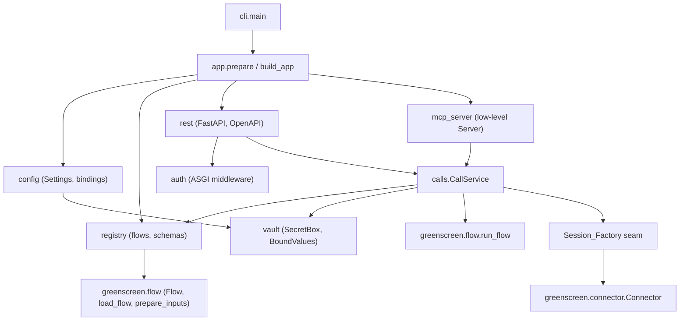
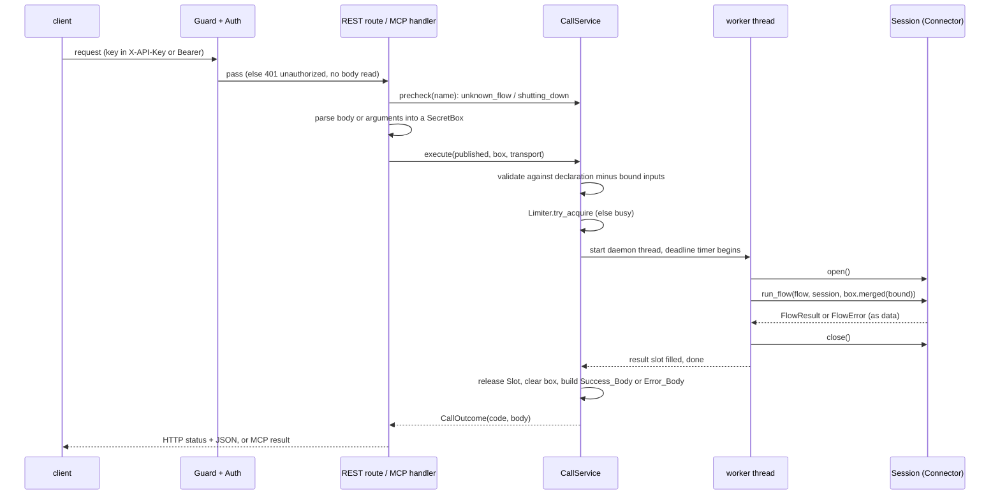

# Design Document: publisher

## Overview

`greenscreen.publisher` is Core Piece 5 of Green Screen Medium. One process loads every Flow and publishes each of them twice, as an MCP tool and as a REST endpoint. A call opens its own `Connector` session, runs `run_flow` on a worker thread, closes the session and returns the declared outputs with a value-free audit summary. The runtime stays deterministic: no LLM, no guessing, and a Flow that stops on an unexpected screen is reported as a structured error.

**Design goals**

- Lean. Nine small modules, no abstraction that a requirement does not ask for (list of things deliberately not built below).
- One call path. REST and MCP differ only in how they parse the request and wrap the result. Both call `CallService.execute`, which owns validation, the concurrency limit, the worker thread, the timeout and the error mapping.
- Nothing secret leaves. The rule is "never hand a value to a logger, an exception message or a response". Secrets live in two kinds of object: a `SecretBox` (per call, emptied in a `finally`) and a `BoundValues` store (per process, opaque repr). Defence in depth is limited to the cases that tests cannot rule out: a crash guard outside Starlette's error middleware and a traceback-stripping log filter.
- Same conventions as the sibling packages: `from __future__ import annotations`, frozen dataclasses with `slots=True`, a package logger `greenscreen.publisher`, exceptions that carry no values, and `ConnectorConfig` for the mainframe settings.
- No change to `greenscreen.connector`, `greenscreen.flow` or `greenscreen.recognizer`. The one thing the Connector is not (thread-safe) is handled by a small adapter in the publisher (section "Timeout teardown").

**What this design deliberately does not build**

| Not built | Why |
|---|---|
| Session pool, keep-alive, reuse across calls | Requirement 3.2. A session is opened and closed per call; the host allows one TSO session per user id (mainframe-host steering, "Verified 2026-11-17"). |
| Recovery of a locked TSO user id (`RECONNECT`, retry, session reaper) | Requirement 23.7. A follow-up spec builds a self-healing logon Flow; see "Account lock and recovery". |
| Per-call loading of Signatures, a patchable loader | The Signatures are loaded once at startup and passed to every `run_flow` call (Requirements 1.8, 3.7). |
| `ScreenView` / `recognize` cache | Requirement 17, decided below. |
| Stateful MCP sessions, SSE transport, resources, prompts | Not required. The Streamable HTTP manager runs stateless with JSON responses, so a call holds no MCP state. |
| A redacting log filter that knows secrets | Per-call secrets are not known to a global filter. Rule "never log a value" plus Properties 6, 7 and 10 is stronger than redaction. Only a traceback-stripping filter exists (section "Logging"). |
| Rate limiting beyond `GS_MAX_CONCURRENCY`, CORS, TLS, request ids echoed to callers | Not required. TLS belongs to a reverse proxy: the API key travels in a header, so the default bind is `127.0.0.1`. |
| FastAPI-generated OpenAPI | The document is built by one function from the registry (Requirement 12.5 needs it to equal the Schema_Generator output). FastAPI is used as the application class and for `get_swagger_ui_html`. Plain Starlette would work too; FastAPI stays because Requirement 18.2 approves it. |
| Hot reload, custom Signature directory, Flow-to-Flow calls | Out of scope (requirements, Assumptions). |
| Signal handling for stdio beyond `KeyboardInterrupt` | stdin EOF is the normal end; SIGTERM is turned into `KeyboardInterrupt`. |

### Documentation checked

Checked on 2026-11-17. All local checks ran in a throwaway venv under the system temp directory with `mcp==2.3.0`, `fastapi==0.163.2`, `starlette==1.10.0`, `uvicorn==0.54.0`, `pydantic==2.14.3`, `anyio==4.16.0`, `httpx2==2.16.2` (pip resolved these from `mcp>=2.3,<3` and `fastapi>=0.163,<1`), Python 3.11.9 on Windows. The venv and the scripts were deleted afterwards. Nothing was installed into the project environment and `pyproject.toml` was not touched. SDK source of the pinned version was read where the docs are silent.

**Installed versions (added 2026-11-17).** The project environment holds starlette 1.6.0 and uvicorn 0.38.0, older than the versions checked above (starlette 1.10.0, uvicorn 0.54.0). The behaviour recorded in Claims 5 and "Also recorded" (replaced validation handler, the re-raise of `ServerErrorMiddleware`, the streaming body read, graceful shutdown) was observed on the newer versions only. The re-check in task 5.2 decides whether minimum version pins are needed; until then the design relies on the newer versions' behaviour.

**Summary of what differs from the assumptions in the requirements (flagged for the user)**

| # | Requirement assumption | Evidence | Effect on the design |
|---|---|---|---|
| D1 | "The v2 low-level server does not validate tool arguments" is the reason to validate ourselves (Requirement 4.6). True for `Server`, **false for `MCPServer`**: `MCPServer` validates against a Pydantic model built from the function signature and puts the rejected value into the error text the client receives. | Claim 2 below | Use the low-level `Server` with hand-written schemas. The decision is forced by this, not by taste. |
| D2 | "An exception that escapes a tool becomes `Error executing tool <name>`" is the `MCPServer` behaviour only. In the low-level `Server`, a handshake-era client receives the **exception text** (`boom hunter2-SECRET`); a 2026-07-28 client receives `Internal server error`. Both log an ERROR record with the traceback. | Claim 3 below | The rule "no exception escapes the call handler" matters more than assumed. |
| D3 | `stdio_server()` documents that fd 1 points at stderr while serving. On Windows with 2.3.0 a `print()` inside a handler reached the protocol stream. | Stdio hygiene below | The CLI wires explicit duplicated streams instead of relying on the SDK claim. |
| D4 | Requirement 18.2 lists what `mcp` brings in. The real transitive set has 31 packages (`mcp-types`, `opentelemetry-api`, `pyjwt`, `cryptography`, `cffi`, `sse-starlette`, `python-multipart`, `pywin32` on Windows and others). All are permissive. | Licence table | Table below. |
| D5 | Replacing the unhandled-exception handler is enough (Requirement 6.9). Starlette's `ServerErrorMiddleware` sends the handler's response **and then re-raises**, so uvicorn still logs a traceback with the exception text at ERROR. | Claim 5 below | An outermost ASGI crash guard swallows the re-raise. |
| D6 | Requirement 20.3 lists floats among the type violations "rejected by both" the validator and the schema. JSON Schema 2020-12 treats `1.0` as an integer, so the schema cannot reject it. | JSON Schema 2020-12 `integer` | Property 2 draws floats with a fractional part only; `1.0` and `1e3` are covered by a unit test of the validator. |

#### Claim 1: `MCPServer`, transports, hand-written schemas, mounting

- Pages: [Add to an existing app](https://py.sdk.modelcontextprotocol.io/run/asgi/index.md), [The low-level Server](https://py.sdk.modelcontextprotocol.io/advanced/low-level-server/index.md), [home](https://py.sdk.modelcontextprotocol.io/) (v2 is the stable line). Version `mcp` 2.3.0. Date 2026-11-17.
- Verified in the docs and in the source:
  - `from mcp.server import MCPServer, Server` works (`mcp.server.mcpserver.server`, `mcp.server.lowlevel.server`). `MCPServer` wraps a `Server` (`self._lowlevel_server`).
  - `MCPServer.add_tool` calls `Tool.from_function`, which derives `parameters` from the function signature (`func_metadata`). It has no parameter for a hand-written input or output schema. The docs name the low-level `Server` for "an exact schema (loaded from a file, generated from a database)". `Tool(name=, description=, input_schema=, output_schema=)` from `mcp_types` is the hand-written form.
  - stdio: `async with stdio_server() as (r, w): await server.run(r, w, server.create_initialization_options())`. `Server` has no `run(transport=...)`.
  - Streamable HTTP: `Server.streamable_http_app(streamable_http_path="/mcp", json_response, stateless_http, max_request_body_size, transport_security, host, ...)` returns a Starlette app whose lifespan runs `session_manager.run()`. The docs state that a mounted sub-application's lifespan never runs, so the host app must enter `session_manager.run()` itself. With `host` in `127.0.0.1`/`localhost`/`::1` the app arms DNS-rebinding protection with a localhost allowlist and answers `421` for any other Host.
  - `StreamableHTTPSessionManager(app, stateless=, json_response=, security_settings=, max_request_body_size=, ...)` and `StreamableHTTPASGIApp(manager)` are importable from `mcp.server.streamable_http_manager`. `run()` may be called once per instance.
- Local check: a low-level `Server` with `on_list_tools` / `on_call_tool` and hand-written `input_schema` / `output_schema` was served through `StreamableHTTPSessionManager(low, stateless=True, json_response=True, security_settings=None, max_request_body_size=65536)` as `Route("/mcp", StreamableHTTPASGIApp(mgr))` inside a FastAPI app whose lifespan enters `mgr.run()`. An `mcp.Client` over `httpx2.ASGITransport` listed the tool and called it in both modes (`auto` negotiated 2026-07-28, `legacy` negotiated 2025-11-25). A raw POST without the API key to `/mcp` was stopped by a pure ASGI middleware on the host app (401), so the same middleware protects REST and MCP.
- Decision: low-level `Server`, a `Route` (not a `Mount`, so `/mcp` has no `/mcp/` redirect and no sub-app lifespan to forget), stateless JSON responses, `security_settings=None` (the Publisher does its own Host rule, Requirement 13.7), the manager entered in the host lifespan.

#### Claim 2: are arguments validated before the handler runs?

- Pages: [Handling errors](https://py.sdk.modelcontextprotocol.io/servers/handling-errors/index.md) ("a bad argument never reaches your function"), [The low-level Server](https://py.sdk.modelcontextprotocol.io/advanced/low-level-server/index.md) ("Nothing is checked for you"). Version 2.3.0. Date 2026-11-17.
- Result: **different for `MCPServer`**. `Tool.run` calls `fn_metadata.validate_arguments` and on a Pydantic `ValidationError` raises `ToolError(f"Error executing tool {name}: {exc}")`, whose text includes `input_value=...`.
- Local check (in-memory `Client`, tool `t(n: int, s: str)`): `call_tool("t", {"n": "hunter2-SECRET", "s": "x"})` returned `is_error=True` with text `... input_value='hunter2-SECRET', input_type=str` (value echoed to the client: **True**). The server log held one INFO line with field names only (`rejected arguments: ['n']`, value not logged). So the SDK logs carefully and answers carelessly.
- Low-level `Server`: `{"n": "not-an-int", "s": "hunter2-SECRET", "extra": 1}` reached `on_call_tool` unchanged in both protocol eras. The input schema is advertised only.
- Malformed JSON-RPC params are validated by the SDK before our handler (`name` as a list, `arguments` as a string). Over HTTP the reply was `-32602 "Invalid request parameters"` with `data: ""`. The secret appeared in neither the response nor any log record at DEBUG.
- Design consequence: the Publisher validates every argument itself, with the same function for both front ends, and the SDK never sees an invalid argument it could echo, because the low-level `Server` does not look at the arguments at all.

#### Claim 3: an exception that escapes a tool

- Page: [Handling errors](https://py.sdk.modelcontextprotocol.io/servers/handling-errors/index.md). Version 2.3.0. Date 2026-11-17.
- `MCPServer`: the client gets `Error executing tool t` (no exception text); the server logs `Tool 't' raised an unexpected exception` at ERROR with `exc_info`. Local check: client text had no secret; the log text did contain `boom hunter2-SECRET` because the formatted traceback contains the exception message.
- Low-level `Server`, local check with `raise RuntimeError("boom " + secret)` inside `on_call_tool`:
  - 2026-07-28 client: `MCPError: Internal server error`; ERROR record from `mcp.shared.direct_dispatcher` with `exc_info`.
  - 2025-11-25 (handshake era) client: `MCPError: boom hunter2-SECRET`. The docs promise a generic message; the dispatcher in 2.3.0 sent the exception text in this era. ERROR record from `mcp.shared.jsonrpc_dispatcher`.
  - In both, the record's `exc_info` reaches frames whose locals hold the secret (7 frames, including our handler's).
- Loggers can be silenced or filtered with the standard `logging` API, but that is a mitigation for the next bug, not a design. The rule of Requirement 14.6 stands and is stricter than assumed: every `Exception` is caught inside the call handler, nothing but cancellation escapes into the SDK, and the SDK's error paths are never exercised by a Flow call.

#### Claim 4: `isError: true` with `structuredContent` when an `outputSchema` is declared

- Pages: [The low-level Server, structured output](https://py.sdk.modelcontextprotocol.io/advanced/low-level-server/index.md) ("the server never compares the two fields; this SDK's `Client` does"). Version 2.3.0. Date 2026-11-17. Open risk "MCP error results" (Decision 8).
- Source: server side, `_serialize` only validates the result against the `CallToolResult` model (no `outputSchema` check). Client side, `ClientSession.call_tool` runs `validate_tool_result` only `if isinstance(result, CallToolResult) and not result.is_error`.
- Local check: a tool declared with `output_schema = Success_Schema`, returning `CallToolResult(is_error=True, structured_content={"error": {...}}, content=[TextContent(json)])`, was called through the in-memory `Client` and over HTTP in both eras. The client returned `is_error=True` and the error body without raising. A success call with conforming content returned `is_error=False`. The docs say a non-conforming success body makes the SDK client raise `RuntimeError("Invalid structured content ...")`, which is why Property 3 validates every Success_Body against its Success_Schema.
- Chosen mechanism: low-level `CallToolResult(is_error=True, structured_content=error_body, content=[one text block with the same JSON])`. Residual risk: a third-party client that validates error results against `outputSchema` would reject them. The SDK client does not, and the spec text the SDK documents is silent. Recorded under "Open items".

#### Claim 5: FastAPI default validation handler and the other handlers

- Page: [Handling errors](https://fastapi.tiangolo.com/tutorial/handling-errors/) (override `RequestValidationError` and `StarletteHTTPException`; "`RequestValidationError` contains the body it received"), [Starlette exceptions](https://starlette.dev/exceptions/) (errors "bubble through the entire middleware stack", `ServerErrorMiddleware` is outermost). Versions fastapi 0.163.2, starlette 1.10.0. Date 2026-11-17.
- Local reproduction with a typed body route (`password: int`) posted `{"password": "hunter2-SECRET"}`:
  - default: `422 {"detail":[{"type":"int_parsing","loc":["body","password"],"msg":"...","input":"hunter2-SECRET"...` (echoed: **True**);
  - with `@app.exception_handler(RequestValidationError)`: `400 {"error":{"code":"request_invalid"}}` (echoed: False);
  - `StarletteHTTPException` handler replaced: 404 and 405 both mapped to our body; `Exception` handler replaced: 500 with our body.
- Starlette source (`middleware/errors.py`): after sending the handler's response, `ServerErrorMiddleware` "always continues to raise the exception". Local check with real `uvicorn.Server` (`log_config=None`, `access_log=False`) and a route that raises `RuntimeError("boom " + header)`: the client got our 500 body, and `uvicorn.error` logged ERROR with `exc_info`; the secret **was** in the log text. With an outermost pure ASGI guard that catches `Exception` for `http` scopes and logs a fixed text, the same request logged no traceback and no secret.
- The Publisher routes take the raw `Request` and the path parameter `name: str`, so FastAPI's own request validation never runs; the replaced handler is a backstop.

#### Also recorded

- **Body size cap and streaming read** ([Starlette requests](https://starlette.dev/requests/), 1.10.0): `request.stream()` yields chunks without storing the body. Local check with a 100-byte limit: `Content-Length: 5000` answered 413 before reading; a chunked 4000-byte body answered 413 after 160 bytes were read. Starlette 1.10 also has `max_body_size` and `RequestBodyLimitMiddleware`, but they answer a plain-text 413, not our Error_Body, so the route reads the stream itself. `/mcp` gets `max_request_body_size=GS_MAX_BODY_BYTES` from the session manager (plain-text 413, outside Requirement 4.5, which names the REST front end).
- **OpenAPI with dynamic paths and two security schemes** ([Extending OpenAPI](https://fastapi.tiangolo.com/how-to/extending-openapi/)): FastAPI generates the document from routes through `get_openapi`; `app.openapi` can be replaced. The design does not use route introspection (the Flow routes are one raw-`Request` route) and builds the document dictionary by hand. Local check: `fastapi.openapi.models.OpenAPI.model_validate` accepted a document with `components.securitySchemes` of type `apiKey` (header `X-API-Key`) and `http` (scheme `bearer`), per-operation `security: [{"ApiKeyAuth": []}, {"BearerAuth": []}]`, `security: []` on `/health` and `writeOnly` / `pattern` in a schema, and rejected a scheme of type `nonsense`. That model is the validity oracle in the tests, so no new test dependency is needed.
- **One lifespan, one Limiter**: the host app's lifespan enters the MCP session manager and, on exit, drains the `CallService`. Both front ends are built from the same `CallService` object (one `Limiter`) in the one event loop (uvicorn, or `anyio.run` for stdio), so the Limiter needs no lock: `try_acquire` has no `await` between check and increment.
- **Graceful shutdown** (uvicorn 0.54.0 source): `Server.handle_exit(sig, frame)` is the signal hook and `Config(timeout_graceful_shutdown=)` bounds the wait for open connections before the remaining request tasks are cancelled. The Publisher subclasses `uvicorn.Server` to set `closing` in `handle_exit`.
- **stdio hygiene** (local, Windows, 2.3.0): with the default `stdio_server()`, a `print("stray")` inside a handler appeared on stdout between protocol lines (not JSON). With the CLI duplicating fd 0 and fd 1 first, pointing fd 1 at stderr (`os.dup2(2, 1)`), setting `sys.stdout = sys.stderr`, and passing explicit `anyio.wrap_file(TextIOWrapper(...))` streams to `stdio_server(stdin=, stdout=)`, a handler's `print` and `os.write(1, ...)` both landed on stderr and every stdout line parsed as JSON-RPC.
- **Timeout teardown** (local, Windows): a `Connector` over a stand-in process that never answers `ReadBuffer`; a worker thread blocked in `read_screen()`; `Popen.kill()` + `wait()` from another thread unblocked the worker with `S3270Error` in 0.02 s; `Connector.close()` afterwards returned in 0.0 s; `enter()` afterwards raised `SessionClosedError`. The proc was captured through the public `process_factory` argument of `Connector`, so no Connector change is needed.
- **Front-end overhead** (local): in-process REST and MCP add about 4 ms and 5 ms per call over the bare worker-thread run of `run_flow` against a `ScriptedSession`. The earlier measurements of a whole run included reloading the Signatures on every call; the Publisher loads them once (Requirement 1.8), so those figures no longer apply and are not used. The cost of a whole generated call is measured in the property-test task (see "Time budget").

### Licences of the new packages

Resolved with `pip install 'mcp>=2.3,<3' 'fastapi>=0.163,<1'` (the project's only current dependency, PyYAML, was already present and is excluded). Licence read from the installed distribution metadata (`License-Expression` or `License` field) and the licence file in `.dist-info`, checked 2026-11-17. `pygments`, `pytest`, `hypothesis`, `iniconfig`, `pluggy`, `packaging`, `sortedcontainers` and `colorama` came from the test tools and are not part of the `publish` extra.

| Package | Version | Licence (SPDX) | Pulled by | MIT-compatible |
|---|---|---|---|---|
| mcp | 2.3.0 | MIT | direct | yes |
| fastapi | 0.163.2 | MIT | direct | yes |
| mcp-types | 2.3.0 | MIT | mcp | yes |
| starlette | 1.10.0 | BSD-3-Clause | mcp, fastapi | yes |
| uvicorn | 0.54.0 | BSD-3-Clause | mcp, fastapi | yes |
| click | 8.5.1 | BSD-3-Clause | uvicorn | yes |
| h11 | 0.16.0 | MIT | uvicorn, httpcore2 | yes |
| pydantic | 2.14.3 | MIT | mcp, fastapi | yes |
| pydantic-core | 2.50.4 | MIT | pydantic | yes |
| annotated-types | 0.8.0 | MIT | pydantic | yes |
| typing-inspection | 0.4.5 | MIT | pydantic, mcp, fastapi | yes |
| typing-extensions | 4.16.0 | PSF-2.0 | many | yes (permissive) |
| annotated-doc | 0.0.6 | MIT | fastapi | yes |
| anyio | 4.16.0 | MIT | mcp, starlette | yes |
| idna | 3.20 | BSD-3-Clause | anyio, httpx2 | yes |
| httpx2 | 2.16.2 | BSD-3-Clause | mcp, starlette (test client) | yes |
| httpcore2 | 2.16.2 | BSD-3-Clause | httpx2 | yes |
| truststore | 0.10.5 | MIT | httpx2 | yes |
| jsonschema | 4.26.0 | MIT | mcp | yes |
| jsonschema-specifications | 2025.9.1 | MIT | jsonschema | yes |
| referencing | 0.37.0 | MIT | jsonschema | yes |
| rpds-py | 2026.9.1 | MIT | jsonschema | yes |
| attrs | 26.1.0 | MIT | jsonschema | yes |
| pyjwt | 2.15.1 | MIT | mcp | yes |
| cryptography | 50.0.2 | Apache-2.0 OR BSD-3-Clause | pyjwt | yes |
| cffi | 2.1.1 | MIT-0 (metadata expression; licence file is the MIT text) | cryptography | yes |
| pycparser | 3.12 | BSD-3-Clause | cffi | yes |
| python-multipart | 0.0.34 | Apache-2.0 | mcp, fastapi | yes |
| opentelemetry-api | 1.45.2 | Apache-2.0 | mcp, fastapi | yes |
| sse-starlette | 3.7.0 | BSD-3-Clause | mcp | yes |
| pywin32 | 312 | PSF (metadata `License: PSF`; Python Software Foundation licence) | mcp, Windows only | yes (permissive) |

**Verdict: all 31 packages are permissive (MIT, BSD, Apache-2.0, PSF). No GPL, LGPL, MPL or unknown licence.** Apache-2.0 packages (`python-multipart`, `opentelemetry-api`, and `cryptography` under its Apache option) may be depended on by an MIT project; if the project ever ships a bundled binary it must carry their NOTICE texts. The transitive set is larger than Requirement 18.2 lists (D4); the user's approval covered `mcp` and `fastapi` "and their transitive dependencies" only implicitly, so the list is shown here for review.

**Test-only dependencies (Requirement 18.4):** `pytest`, `hypothesis` (already in `dev`), `httpx2` and `jsonschema` (installed with `mcp`), `starlette.testclient` (part of Starlette, needs `httpx2`), `fastapi.openapi.models` (part of FastAPI). No `pytest-asyncio`: async bodies run through `asyncio.run` inside plain test functions. When the tasks phase edits `pyproject.toml`, the `dev` extra must also pull the `publish` extra (for example `greenscreen-connector[publish]`), because the publisher tests import `mcp` and `fastapi`.

---

## Architecture

### Package layout

```
greenscreen/publisher/
    __init__.py       # exports build_app, prepare, Settings, StartupError (no mcp/fastapi import)
    vault.py          # SecretBox (per call), BoundValues (per process): the only holders of plaintext
    config.py         # Settings, load_settings, parse_publish_list, parse_bindings, StartupError
    registry.py       # PublishedFlow, load_flows, select_published, build_registry, build_schemas, check_inputs
    calls.py          # Limiter, CallService (lifecycle, timeout, teardown), session adapter, error mapping
    auth.py           # extract_key, AuthMiddleware (pure ASGI), host-header rule
    rest.py           # FastAPI app: routes, body reader, handlers, OpenAPI builder, CrashGuard
    mcp_server.py     # low-level Server handlers, session manager, stdio runner
    app.py            # PublisherApp, build_app, prepare, lifespan, logging limits
    cli.py            # greenscreen-publish: environment, logging, uvicorn or stdio, exit codes
```

Imports are limited to the standard library, `greenscreen.flow`, `greenscreen.connector`, `greenscreen.recognizer.summary` (already imported by the runner) and, in `rest.py`, `mcp_server.py`, `app.py` and `cli.py` only, `mcp`, `fastapi`, `starlette`, `uvicorn`, `anyio`. `cli.py` imports only the standard library at module level and imports the rest inside `main` after a check that prints the missing module and the extra `publish` (Requirement 16.5).



The ASGI stack, outermost first: `CrashGuard` (catches what Starlette re-raises, adds `Cache-Control: no-store`) then `AuthMiddleware` then the FastAPI app, which holds the Flow route, `/health`, `/openapi.json`, `/docs` (optional) and the `/mcp` route.

### One call



---

## Components and Interfaces

### `vault.py`

```python
class SecretBox:
    """One call's plaintext. repr shows names only. Not iterable, not hashable."""
    __slots__ = ("_items", "_merged")
    @classmethod
    def adopt(cls, items: dict[str, object]) -> "SecretBox"   # takes ownership, no copy
    def mapping(self) -> dict[str, object]                    # for the validator
    def merged(self, bound: Mapping[str, str | int]) -> dict[str, object]  # fresh dict, kept in the box
    def clear(self) -> None                                    # empties both dicts in place

class BoundValues:
    """Per-process plaintext of the GS_BIND_ variables. Opaque repr, no pickling."""
    def for_flow(self, flow_name: str) -> Mapping[str, str | int]   # read-only view, empty if none
    def names_for(self, flow_name: str) -> frozenset[str]
    def __repr__(self) -> str          # "BoundValues(flows=N)"
```

`BoundValues` is the one permitted long-lived holder of Bound_Values (Requirement 7.6): a frame may reference the store, but no value taken from it, and the store is never logged or placed in an exception message or attribute.

Why a box and not "just delete the local": the `finally` that empties the box runs on every path, including cancellation, and a frame that still references the box holds nothing. `adopt` takes the very dict the SDK or the JSON parser produced and empties it, so the SDK's `params.arguments` is scrubbed too. A frame never binds a single secret value to a name: values are only reached through `box.mapping()` or `box.merged(...)` used as call arguments.

### `config.py`

```python
class StartupError(Exception):
    """Message holds fixed text plus variable, file, flow, Input and rule names. Never a value."""

@dataclass(frozen=True, slots=True, repr=False)
class Settings:
    connector: ConnectorConfig
    publish_host: str; publish_port: int; transport: str          # "http" | "stdio"
    api_key: str | None; auth_disabled: bool
    max_concurrency: int; call_timeout: float; max_body_bytes: int
    shutdown_grace: float; enable_docs: bool; flows_dir: Path | None
    publish_flows: str | None      # raw GS_PUBLISH_FLOWS; None when unset or empty (zero length)

def load_settings(environ: Mapping[str, str]) -> Settings
def parse_publish_list(text: str | None) -> tuple[str, ...] | None   # None = publish every Loaded_Flow
def parse_bindings(environ: Mapping[str, str], loaded: Mapping[str, Flow],
                   published: Collection[str]) -> BoundValues
```

`load_settings` reads exactly the variables of Requirement 15.1, once, treating empty as unset. `ConnectorConfig` is built with explicit `binary`, `host`, `port` from the injected mapping (so tests never touch `os.environ`); a `ConfigurationError` is mapped through `{"binary": "GS_S3270_BINARY", "host": "GS_HOST", "port": "GS_PORT"}` to `"<VARIABLE>: missing or invalid"`, never the exception text (it can contain the bad port). Ranges: `GS_PUBLISH_PORT` 1..65535 (default 8080), `GS_MAX_CONCURRENCY` 1..64 (default 1), `GS_CALL_TIMEOUT` 1..900 (default 180, finite), `GS_MAX_BODY_BYTES` 1024..1048576 (default 65536), `GS_SHUTDOWN_GRACE` 1..120 (default 10), booleans exactly `true` or `false`. Auth rules (13.5, 13.6) apply only when `transport == "http"`; the key must be at least 16 characters. Loopback means `localhost`, an `ipaddress` loopback address, with or without brackets.

**Publish list (Requirement 1, criteria 9 to 15), `parse_publish_list`.** `None` (unset or zero-length) returns `None`. Otherwise `text.split(",")` with each item `strip()`ped (a whitespace-only value is not empty, so it yields an empty item). The checks run in this order and the first failure is reported: an empty item gives `StartupError("GS_PUBLISH_FLOWS: empty_item")`; a repeated name gives `"GS_PUBLISH_FLOWS: duplicate_name (<flow>)"`. The third check, a name that no Loaded_Flow has, needs the loaded Flows and lives in `select_published` (`"GS_PUBLISH_FLOWS: unknown_flow (<flow>)"`). Names match exactly and case-sensitively. A Flow_Name is not a secret, so it may appear in a message. `Settings` keeps the raw text and `prepare` calls `parse_publish_list` after all Flows are loaded, so that a bad Flow file still stops the startup first (criterion 14) and the three checks keep one fixed order.

**Binding algorithm (Requirement 22), `parse_bindings`.** `loaded` holds every Loaded_Flow and `published` the names that the Publish_List selected:

1. Collect `(name, value)` from the mapping where `name.startswith("GS_BIND_")` (case-sensitive) and `value != ""`. Process in ascending name order, so the first error is deterministic.
2. `rest = name[8:]`; `i = rest.find("__")`. If `i <= 0` or `rest[i + 2:] == ""`: `StartupError("<name>: name_format")`. Else `flow_part = rest[:i]`, `input_part = rest[i + 2:]` (the input part may itself contain `__`).
3. `norm(s) = s.upper().replace("-", "_")`. If at least one binding exists, check once: any Published_Flow whose `norm(name)` contains `__` or ends with `_` gives `StartupError("<Flow_Name>: ambiguous_name")` (Requirement 22.9). Order of this check: before step 4 for every variable.
4. Loaded_Flows (not only published ones, Requirement 22.4) with `norm(flow.name) == flow_part`: none gives `"<name>: unknown_flow"`, more than one gives `"GS_BIND_<flow_part>__: ambiguous_name"`. A single match that is not in `published` gives `"<name>: flow_not_published"`. Inputs are then matched on the published Flow only.
5. Inputs of that Flow with `norm(spec.name) == input_part`: none gives `"<name>: unknown_input"`, more than one gives `"GS_BIND_<flow_part>__<input_part>: ambiguous_name"`.
6. Parse by `spec.type`: `str` keeps the text verbatim; `int` needs `re.fullmatch(r"-?[0-9]+", text)` and `len(text) <= spec.max_length` before `int(text)` (so the digit-limit `ValueError` cannot occur), otherwise `"<name>: value_invalid"`.
7. Validate with the `Input_Validator` against the full spec: `prepare_inputs(_Decl((dataclasses.replace(spec, required=True),)), {spec.name: value})`. `FlowInputError` gives `"<name>: <rule>"` where `rule` is taken from `exc.args` text after `violates`. The value is stored in a local `dict` that is cleared before any raise.
8. Matching is case-sensitive and the variable name is upper-case (Requirement 22.4): `flow_part` and `input_part` must equal `norm(...)` of the Flow and Input names exactly. A lower-case variable such as `GS_BIND_a__u` therefore matches no Flow and is a startup error `"GS_BIND_a__u: unknown_flow"`; `GS_BIND_A__U` is a different variable and is not treated as its twin. Because `flow_part` and `input_part` are fixed by the matched pair and the first `__` split, one `(Flow, Input)` pair has exactly one possible variable name, and environment names are unique, so no second variable can bind the same Input. A "duplicate binding" check therefore has no input that reaches it (see "Implementation notes").

Every raise is made after the frame's value dictionary was cleared, with `from None`, so neither `__context__` nor a frame holds a value. `os.environ` itself still holds the plaintext; `cli.main` removes `GS_API_KEY` and every Binding_Variable from the process environment once `prepare` has read them, so the s3270 processes that the Publisher starts do not inherit them (Requirement 15.8).

### `registry.py`

```python
@dataclass(frozen=True, slots=True)
class PublishedFlow:
    flow: Flow
    source: str                      # "bundled" or the file name
    bound_names: frozenset[str]
    decl: "_Decl"                    # inputs minus bound ones, in declaration order
    input_schema: dict; output_schema: dict; success_schema: dict
    summary: str                     # description or "Run flow <name>."
    deadline: float                  # Requirement 10.2

Registry = Mapping[str, PublishedFlow]   # types.MappingProxyType, insertion = publication order

def load_flows(flows_dir: Path | None) -> dict[str, tuple[Flow, str]]      # every Loaded_Flow
def select_published(loaded, names: tuple[str, ...] | None) -> dict[str, tuple[Flow, str]]
def build_registry(published, bound: BoundValues, call_timeout: float) -> Registry   # published only
def build_schemas(flow: Flow, bound_names: frozenset[str]) -> tuple[dict, dict, dict]
def check_inputs(published: PublishedFlow, box: SecretBox) -> str | None   # message or None
```

`load_flows`: bundled flows (`load_bundled_flows()`), then `sorted(p for p in dir.iterdir() if p.is_file() and p.suffix == ".yaml")` through `load_flow(p)`. Any `FlowDefinitionError`, `OSError` or a missing or non-directory path becomes a `StartupError` naming the file and the fixed rule text of `FlowDefinitionError` (those messages hold only field names and indexes, by the flow-runtime design). A duplicate Flow_Name raises `StartupError("<name>: duplicate in <source A> and <source B>")`. No session is opened. `load_flows` loads and validates ALL Flows (bundled and directory) before any allow-list is looked at.

`select_published(loaded, names)` returns `loaded` unchanged when `names` is `None`. Otherwise it raises `StartupError("GS_PUBLISH_FLOWS: unknown_flow (<flow>)")` for the first name (list order) that is not in `loaded`, and returns the named Flows in **loading order** (bundled first, then directory files by name), not list order. Only this subset reaches `build_schemas`, `build_registry`, the routes, the OpenAPI document, `tools/list` and `/health`. A Loaded_Flow outside the subset is unknown to every front end: the registry has no entry for it, so `precheck` gives the same `unknown_flow` body as for a name that no Flow has, and the response cannot reveal that it exists (Requirement 1.15).

**Demo setting.** The demo runs with `GS_PUBLISH_FLOWS=tk5-system-info`, because `tk5-logon` stops at the ISPF menu without a logoff and leaves the user id in use ("Account lock and recovery").

`load_startup_signatures() -> Sequence[Signature]` (Requirement 1.8) calls `load_bundled_signatures()` exactly once, in `prepare`, and wraps any `Exception` in `StartupError("signatures: load_failed")`, with `from None` and no exception text. The result is held by `Prepared` and then by `CallService`, and is passed as `signatures=` to every `run_flow` call. Custom Signatures are out of scope. The loading opens no session and no Call loads Signatures.

**`_Decl` and the Input_Validator.** `prepare_inputs(flow, supplied)` reads only `flow.inputs`. A `Flow` cannot be copied with fewer Inputs, because `Flow.__post_init__` re-validates and the steps reference the removed Inputs. `_Decl(inputs=...)` is a one-field frozen dataclass passed in place of a `Flow`; a unit test pins that `prepare_inputs` accepts it (the only coupling to flow-runtime internals; a typing change to `Protocol` there would remove the cast, but nothing requires it). `check_inputs` calls it inside `try/except FlowInputError as exc: message = str(exc)` and returns `message` after the block, so the exception (and with it the traceback) is gone before the caller continues. `prepare_inputs` already clears its own locals on failure. A bound name supplied by a caller is an undeclared name for `_Decl`, which gives Requirement 22.2 without special code. At call time the validated box is then merged with the Bound_Values, and `run_flow` validates the merged mapping again against the full declaration.

**`build_schemas`** (one pure function, Requirement 2). Output uses no `$schema` key (MCP and OpenAPI 3.1 both default to 2020-12) and is rebuilt per call of the function, so equal Flows give equal, independent dictionaries.

| Piece | Rule |
|---|---|
| Input_Schema | `{"type":"object","properties":{...},"additionalProperties":False}` plus `"required": [...]` only when the list is not empty. Properties are the non-bound Inputs in declaration order. |
| `str` Input | `{"type":"string","maxLength":max_length}`, `"pattern": "^(?:<regex>)$"` only when the regex passes `_ecma_safe`. |
| `int` Input | `{"type":"integer","maximum":10**m-1,"minimum":-(10**(m-1)-1) if m > 1 else 0}`. The regex of an `int` Input is not expressible and is omitted. |
| secret | `"writeOnly": True` on secret Inputs only. |
| description | copied when not empty. |
| Output_Schema | object, `additionalProperties` false, one property per Output (`string` or `integer`), all required. |
| Success_Schema | object with `flow` (string), `outputs` (the Output_Schema inline), `audit` (array of objects with exactly `step_index`, `kind`, `phase`, `iteration`, `signature`, `status`, `duration_seconds`; `iteration` and `signature` are `integer`/`string` or `null`). All members required. No `enum`, `const`, `default`, `example`. |

**Regex dialect (Requirement 2.8).** `re.fullmatch(regex, s)` is Python; JSON Schema `pattern` is ECMA-262 `search`. Over the Input domain (printable ASCII, enforced by the validator) the anchored form `^(?:regex)$` means the same thing for a conservative subset. `_ecma_safe(regex)` is true only when the regex contains no `(?` other than `(?:`, no backslash escape other than `\d \D \w \W \s \S \b \B` and escaped punctuation, no possessive quantifier (`*+`, `++`, `?+`, `}+`) and no `[:`. Otherwise the `pattern` member is omitted: a missing pattern only makes the schema looser, so it never rejects what the validator accepts. The schema stays advisory; the validator is the authority. Limit of this check: `jsonschema` evaluates `pattern` with Python `re`, so the tests prove the subset rule in Python and cannot prove ECMA behaviour.

### `calls.py`

```python
class Session(Protocol):                 # runner's Session plus lifecycle (Requirement 19.1, 10.3)
    def open(self) -> None
    def read_screen(self) -> Screen
    def string(self, text: str) -> None
    def enter(self) -> None; def clear(self) -> None
    def pf(self, n: int) -> None; def pa(self, n: int) -> None
    def close(self) -> None
    def abort(self) -> None              # thread-safe, callable from another thread, kills the s3270
                                         # process without using the send path, idempotent (Req 19.1)

SessionFactory = Callable[[], Session]   # called on the event loop thread; must not block

ErrorCode = str                          # one of REASON_CODES | PUBLISHER_CODES (22 values), checked at runtime
ResponseCode = str                       # "ok" or an ErrorCode: the only codes a response can carry
LogOutcome = str                         # ResponseCode or "cancelled": used by the Call_Log_Record only
LOG_ONLY_OUTCOMES = frozenset({"cancelled"})

class Limiter:                           # event-loop confined; no lock
    def __init__(self, limit: int)
    in_flight: int
    def try_acquire(self) -> bool
    def release(self) -> None

@dataclass(frozen=True, slots=True)
class CallOutcome:
    code: ResponseCode                   # "ok" or an Error_Code; never "cancelled"
    body: dict                           # Success_Body or Error_Body, JSON types only
    step_index: int | None = None
    close_failed: bool = False
    session_clean: bool | None = None    # False or None; never True (Requirement 23.6)

class CallService:
    def __init__(self, registry, bound, signatures, limiter, session_factory, *,
                 clock=None, poll_interval=0.1)   # signatures: Startup_Signatures
    closing: bool
    def precheck(self, name: str, transport: str = "rest") -> PublishedFlow | CallOutcome
                                                                   # unknown_flow, shutting_down; logs its own record
    async def execute(self, published: PublishedFlow, box: SecretBox, transport: str) -> CallOutcome
    def log_rejection(self, flow: str | None, transport: str, code: str, started: float) -> None
    def begin_shutdown(self) -> None
    async def drain(self, grace: float) -> None
```

**`execute` steps (Requirement 3.1 order).**

1. `closing` gives `shutting_down` at once (nothing validated; REST also checks the flow name first).
2. `message = check_inputs(published, box)`; if not `None`, return `input_invalid` with that message. No factory call, no Slot.
3. `limiter.try_acquire()` or return `busy`. From here a `try/finally` guarantees the Slot is released and `box.clear()` runs.
4. `session = factory()` on the loop thread; an exception gives `host_unavailable` (no session object to close).
5. Build a `_Run` (session, the Startup_Signatures, a per-run `threading.Event aborted`, the result slot, an `anyio.Event done`), register it in the service's set of runs in flight, start `threading.Thread(target=_work, daemon=True)`. A failure to start the thread gives `internal_error`.
6. `with anyio.move_on_after(published.deadline) as scope: await run.done.wait()`.
7. If `scope.cancelled_caught`: `run.abort_reason = "timeout"`, teardown (below), outcome `call_timeout`. If `drain` tore the run down, `run.abort_reason` is `"shutdown"` and the outcome is `shutting_down`. If the awaiting task is cancelled instead: `except BaseException:` set `run.abort_reason = "shutdown"` when `closing` is true and `"cancel"` otherwise, run the teardown inside `anyio.CancelScope(shield=True)`, set the log outcome (see "Call_Log_Record"), then re-raise.
8. Read the result slot, release the Slot (in `finally`), write the Call_Log_Record (the one writer, also on cancellation), return the outcome. A `BaseException` stored by the worker is re-raised here after the Slot is released (Requirement 6.8).

**Call_Log_Record and `session_clean` (Requirements 8.2, 23).** `execute` has one `finally` that writes the record, after the Slot is released and for every path that got a Slot or opened a session; calls rejected before the Slot (`shutting_down`, `input_invalid`, `busy`, `unknown_flow`) write the record too, without `session_clean`. The record is written by `logger.info(...)` with `extra`, which is synchronous and has no `await`, so it also runs while a cancellation is propagating. `session_clean` is computed in one function from the final `outcome code` and `run.abort_reason`: it is `False` when the code is `unknown_screen` (in the steps or in the `finally` phase, the code is the same), when the code is `call_timeout`, or when `abort_reason` is `"cancel"` or `"shutdown"`; for every other outcome the key is omitted (no claim). The key is never written with `True`. The record holds no value, no screen text and no Host_Data.

**One record per Call, also for a rejection** (Requirement 8.9, 8.10). The one writer is the private `CallService._write_log(record, started)`; every record is built as a `_Record` that holds no value. Two public entry points feed it: `precheck(name, transport)` writes the record of an `unknown_flow` or `shutting_down` rejection itself (so a front end must not log it again), and `log_rejection(flow, transport, code, started)` writes the record of a rejection that happens in the front end before `execute` is reached. `flow` is the name from the URL; `log_rejection` looks it up in the registry and writes `unknown` when it is not published, so a caller cannot probe for an unpublished Flow through the log either. `started` is a `time.monotonic()` value taken when the request arrived, and `code` must be an Error_Code (else `ValueError`). The record has `call_id`, `flow`, `transport`, `outcome` and `duration_ms` and nothing else. `rest.py` calls `log_rejection` for every rejection before `execute`: wrong media type, malformed JSON, duplicate key, non-finite number, non-object body, oversize body (declared or streamed) and every other `request_invalid` or `request_too_large` raised in the route. The replaced framework handlers (unknown path, wrong method) answer a path that is not a Flow route and write no record (Requirement 8.10). Rejections by `AuthMiddleware` write no record: they are not Calls. MCP argument-validation failures need no hook: `on_call_tool` goes through `precheck` and `execute`, and `execute` writes the record for `input_invalid`, `busy` and `shutting_down`. A `BaseException` that the worker stored is re-raised by `execute` after teardown and its record has `outcome` `internal_error` (Requirement 8.11).

**Log outcome of a call without a response** (Requirements 8.2, 8.8, 23.3, 23.4). A call torn down by `drain`, or cancelled while `closing` is true, logs `outcome = shutting_down`. A call cancelled while `closing` is false (the client disconnected) logs `outcome = cancelled`. Both set `session_clean=false`. `execute` reads `closing` once, at the moment it catches the cancellation, and passes the result to the single log writer as a `LogOutcome`. `cancelled` is a log-only value, not an Error_Code.

**Keeping `cancelled` out of responses.** Two separate types carry the two meanings. `CallOutcome.code` is a `ResponseCode` (`ok` or an Error_Code), and only a `CallOutcome` is turned into a body, an HTTP status or an MCP result. The log writer takes a `LogOutcome` (`ResponseCode` or `cancelled`) from its own local variable and never from a `CallOutcome`. The cancellation path has no `CallOutcome` at all, because no response is built. Enforcement does not rely on a type checker (none is a project dependency; this was not checked beyond `pyproject.toml` being untouched here). It is runtime and test based: `CallOutcome.__post_init__` raises `ValueError` for any code outside `{"ok"} | REASON_CODES | PUBLISHER_CODES`, so `CallOutcome("cancelled", ...)` cannot be built; `HTTP_STATUS` and `MESSAGES` have exactly the 22 Error_Codes as keys (the totality test of Property 4 asserts `"cancelled"` is in neither and that `LOG_ONLY_OUTCOMES` is disjoint from the codes); and the cancellation unit tests assert that the string `cancelled` appears in no response body, header, OpenAPI document or `tools/list` output.

**Worker.** Everything that touches the Connector runs in this one thread:

```python
def _work(run: _Run) -> None:           # no secret is ever bound to a local name here
    res = run.result
    try:
        try:
            run.session.open()
        except Exception:
            res.kind = "host_unavailable"; return
        try:
            res.value = run_flow(run.flow, _Guarded(run.session, run.aborted),
                                 run.box.merged(run.bound), signatures=run.signatures,
                                 clock=run.clock, poll_interval=run.poll)
            res.kind = "ok"
        except FlowError as exc:                       # includes FlowInputError
            res.kind, res.error = "flow_error", _flow_error_data(exc)   # plain data only
        except Exception:
            res.kind = "internal"                      # no str(), no repr(), no attribute reads
        except BaseException as exc:
            res.kind, res.base = "base", exc
    finally:
        run.box.clear()
        try:
            run.session.close()
        except Exception:
            res.close_failed = True
        run.loop.call_soon_threadsafe(run.done.set)
```

`_flow_error_data` reads only `reason`, `step_index`, `kind`, `expected`, `summary` (turned into a plain dict by `RedactedSummary.to_dict()`) and `audit`. `S3270Error.data_lines`, `status_line`, `ParseError.raw` are never read, and `str()` or `repr()` is called on no exception except `FlowInputError` (Requirement 6.7). A `FlowError` raised by the Session itself cannot happen: the runner converts Session exceptions to `session_error`.

### Timeout teardown (Requirements 10.3, 10.4; the key open risk)

**Facts from the source.** `Connector.send` writes to `proc.stdin` and then blocks in `PipeReader.readline` (a queue fed by a daemon reader thread). `Connector` has no lock and is not documented as thread-safe. `Connector.close` and `_terminate_proc` use `proc.terminate/wait/kill`. The constructor takes a public `process_factory` argument (used by the existing tests for `FakeS3270`).

**Mechanism.** A Connector is touched by exactly one thread, the worker, for `open`, every Session call and `close`. The only cross-thread operation is `abort()`, and `abort()` never calls the Connector. It sets a `threading.Event` and kills the s3270 process through the `Popen` object that the adapter captured:

```python
class ConnectorSession:                       # default product of the Session_Factory
    def __init__(self, config: ConnectorConfig) -> None:
        self._lock = threading.Lock(); self._proc = None; self._aborted = False
        self._conn = Connector(config, process_factory=self._spawn)
    def _spawn(self, cmd, **kw):             # called by Connector.open on the worker thread
        with self._lock:
            if self._aborted: raise OSError("aborted")
            self._proc = subprocess.Popen(cmd, **kw); return self._proc
    def abort(self) -> None:                 # any thread
        with self._lock:
            self._aborted = True; proc = self._proc
        if proc is not None:
            proc.kill()
            try: proc.wait(5)
            except subprocess.TimeoutExpired: pass
    # open/close and the six Session calls delegate to self._conn
```

What happens on expiry: the loop sets `run.aborted` (the `_Guarded` wrapper then raises `SessionClosedError` before any further `string`, `enter`, `clear`, `pf` or `pa` reaches the session, which `run_flow` turns into `session_error`), calls `session.abort()` in an `anyio` worker thread (kill is immediate, `wait` is bounded by 5 s), and waits up to 5 s for `run.done`. The worker's blocked read fails with `S3270Error` within milliseconds (EOF on the pipe), `run_flow` returns `session_error` (finally steps are skipped for that reason), the worker's `finally` calls `session.close()` on the dead process (verified: instant, no hang) and signals `done`. Only then is the Slot released and `call_timeout` returned. A fake session implements `abort()` by raising in its blocked call.

**Why no key can follow.** After `abort()` returns, the s3270 process has exited (killed and waited), so nothing can reach the host. Before that, the `_Guarded` check stops new keys. The window between "guard check passes" and "process dies" can still hold one key that was already written to the pipe; that key was sent before `call_timeout` was returned, which is the sense of Requirement 10.4. If the worker does not finish within the 5 s grace it is logged with a fixed text (`worker_stuck`), the Slot is released anyway (the process is dead, so the number of live s3270 processes is unaffected) and the daemon thread cannot keep the process alive.

**Required change to `greenscreen.connector`: none.** An `abort()` method on `Connector` would be tidier, but the public `process_factory` seam is sufficient and keeps the existing API and its tests untouched. One consequence for the user: on `call_timeout` the Flow's `finally` steps (logoff) do not run, killing s3270 does not end the TSO session, and the user id stays logged on and locked for the next caller (see "Account lock and recovery").

**Session_Factory contract (Requirement 19.1).** A session has `open()`, `close()`, `abort()` and the runner's Session protocol. `abort()` is thread-safe, kills the s3270 process without using the send path, and is idempotent. The Fake_Host sessions implement it, and a session that was aborted raises from every later Session call and from a blocked call (Requirement 19.2).

### Account lock and recovery

Facts (mainframe-host steering, "Verified 2026-11-17"): a second logon for a user id that is already logged on is refused with `IKJ56425I LOGON REJECTED, USERID <id> IN USE` and no password prompt, and no bundled Signature matches that screen. Closing the connection without `LOGOFF` (`Connector.close()` or killing s3270) leaves the TSO session alive, and the user id stays `IN USE` for at least three minutes without clearing by itself. Recovery by hand is `<id> RECONNECT` at `Logon ===>`.

- **What locks the account.** A call that ends without the Flow's `finally` logoff: `call_timeout`, the `abort()` it triggers, a cancellation, a shutdown teardown, a killed process, and a stop on a screen where the `finally` steps cannot log off (for example `unknown_screen`). In all of these the worker's `session.close()` closes the connection only. Each is marked `session_clean=false` in the Call_Log_Record (Requirement 23); no other outcome is marked, and the absence of the field makes no claim.
- **Symptom.** A Flow that logs on stops with `unknown_screen` at the Expect of `tso-password-prompt`, because the host answered with the `IKJ56425I` screen.
- **No recovery logic.** The Publisher does not send `RECONNECT`, does not retry a call and does not reap sessions (Requirement 23.7). Recovery will be a self-healing logon Flow (new Signatures and a change to a bundled Flow, built on captures that the user supplies) in a separate small spec.
- **Exposure.** The Publisher MUST NOT be exposed publicly until that spec is done. The defaults stay: loopback listen address and a mandatory API key.
- **The demo runs with `GS_PUBLISH_FLOWS=tk5-system-info`.** `tk5-logon` leaves the user id logged on and therefore `IN USE`, so it is a Loaded_Flow that the demo does not publish. A caller cannot tell an unpublished Flow from an unknown one (same `unknown_flow` body). The allow-list is the operator's only way to keep a locking Flow off the wire; the default (unset) still publishes every Loaded_Flow.
- **`GS_MAX_CONCURRENCY` defaults to 1** because the host allows one TSO session per user id; with a higher limit and the same Bound_Values, a concurrent logon is refused as above (Requirement 9.5).
- **Bundled Flows** (read from `greenscreen/flow/flows/*.yaml`): `tk5-system-info` logs off (steps end with `X` and `LOGOFF`; its `finally` steps repeat the logoff from the ISPF menu or from `READY`), so a normal call leaves the account free. `tk5-logon` stops at the ISPF menu with empty `finally`, so a call leaves the user logged on. `tk5-logoff` expects `ispf-primary-menu` as its first step; a per-call session starts at the logo or logon screen, so a call is expected to stop and does not log off another call's session. That last point is inferred from the Flow files, not run on the host.

### Error mapping

`calls.py` holds three constants: `MESSAGES` (one fixed text per code), `HTTP_STATUS` (one status per code) and `error_body(code, **members)`. The Error_Body is built from plain data only.

| Error_Code | HTTP | Retry / header | Source |
|---|---|---|---|
| `unauthorized` | 401 | `WWW-Authenticate: Bearer` | Auth_Guard |
| `request_invalid` | 400 | | non-JSON media type, malformed JSON, duplicate key, non-finite number, non-object body, wrong method, unknown non-flow path |
| `request_too_large` | 413 | | body over `GS_MAX_BODY_BYTES` |
| `unknown_flow` | 404 | | `precheck`; an unknown name and a Loaded_Flow left out by `GS_PUBLISH_FLOWS` give the same body |
| `input_invalid` | 422 | | validator (Reason_Code of the same name) |
| `busy` | 429 | `Retry-After: 1` | Limiter |
| `shutting_down` | 503 | | `closing`, or a call torn down by the drain |
| `host_unavailable` | 502 | | factory or `open()` raised |
| `call_timeout` | 504 | | Call_Deadline |
| `internal_error` | 500 | | `FlowDefinitionError`, any other `Exception`, thread start failure, the crash guard |
| `timeout`, `run_timeout` | 504 | | the host was too slow for a step or the run |
| `unknown_screen`, `ambiguous_screen`, `unexpected_screen`, `loop_limit`, `bad_target`, `secret_target`, `hidden_output`, `output_type`, `screen_size`, `session_error` | 502 | | the host did not behave as the recorded Flow |

Reasons: 4xx means the caller can fix the request (422 for a value the declaration rejects, 400 for a request that is not a valid JSON object). 502 and 504 mean the upstream host is at fault or slow, which is what a Flow stop is. 429 carries the concurrency cap, and 503 means "not now, shutting down". 22 codes, 22 entries, and the totality test iterates `REASON_CODES` and the nine Publisher_Codes to prove it. Every code maps to an MCP result with `isError: true` and the same body as `structuredContent`. `cancelled` is not in this table: it is a Call_Log_Record outcome only (see "Keeping `cancelled` out of responses").

Fixed `message` texts (examples; one per code, defined once): `unauthorized` "A valid API key is required."; `unknown_screen` "The host showed a screen the flow does not know."; `busy` "All sessions are in use."; `internal_error` "The publisher failed to run the flow." The Error_Body of a Flow stop is `{"error": {"code", "message", "step_index", "kind", "expected", "summary", "audit"}}`; `input_invalid` is `{"error": {"code", "message"}}` with `message = str(FlowInputError)`; every other code is `{"error": {"code", "message"}}`.

### `auth.py`

```python
def extract_key(headers: Sequence[tuple[bytes, bytes]]) -> str | None   # Requirement 13.11, pure
class AuthMiddleware:   # pure ASGI; wraps the whole FastAPI app including /mcp, /openapi.json, /docs
    def __init__(self, app, *, api_key: str | None, disabled: bool)
```

`extract_key` works on the raw ASGI header list, so duplicates are visible (Starlette's `Headers` would merge them). Rules, in order: more than one `x-api-key` or more than one `authorization` header gives `None`. `X-API-Key` present: its value must be non-empty (an empty value is malformed and gives `None`, even next to a valid Bearer). `Authorization` present: it must fullmatch `[Bb][Ee][Aa][Rr][Ee][Rr] +[!-~]+` (the scheme case-insensitively, one or more spaces, credentials of visible ASCII without any whitespace); anything else gives `None`. Both present: both well formed and equal bytes (`hmac.compare_digest`), else `None`. Neither: `None`. Otherwise the common key is returned, and the middleware compares it with `hmac.compare_digest(key.encode(), api_key.encode())`. The failure body is the same fixed `unauthorized` Error_Body for every cause, sent before any body is read.

With authentication on, `GET /health` is the only path let through without a key. When `disabled` (HTTP transport and `GS_AUTH_DISABLED=true`) the middleware instead requires a loopback `Host` header (single header, host part extracted with port and brackets handled, `localhost` or an `ipaddress` loopback), so a DNS-rebinding page cannot reach it. This Host rule applies to every path, `/health` included (Requirement 13.7, confirmed by the user). With `transport == "stdio"` the middleware does not exist.

### `rest.py`

`build_rest(service, registry, settings, mcp_asgi) -> FastAPI` creates `FastAPI(docs_url=None, redoc_url=None, openapi_url=None, lifespan=...)` and registers:

- `POST /flows/{name}` taking `request: Request`. Order: `started = time.monotonic()`, `service.precheck(name, "rest")` (unknown flow, shutting down; writes its own record), media type check (`application/json` with optional parameters; else `request_invalid`), `read_json(request, limit) -> SecretBox | CallOutcome`, `service.execute(...)`, `JSONResponse(outcome.body, status_code=HTTP_STATUS[outcome.code], headers=...)`. Each rejection of the media type check and of `read_json` calls `service.log_rejection(name, "rest", outcome.code, started)` once before the response is returned (Requirement 8.9). `build_rest` takes an optional keyword `lifespan`, which `build_app` uses to enter the MCP session manager.
- `GET /health` returning `{"status": "ok", "flows": N}` with `N = len(registry)`, which counts Published_Flows only.
- `GET /openapi.json` returning the prebuilt document, and `GET /docs` only when `enable_docs` (Swagger UI from `get_swagger_ui_html`, which loads its assets from a CDN in the browser; a browser cannot send the key header on navigation, so the page is for `curl`-style clients or a header-injecting extension. It is off by default).
- `Route("/mcp", StreamableHTTPASGIApp(manager))` appended to `app.router.routes`.
- Exception handlers for `RequestValidationError`, `StarletteHTTPException` and `Exception`, all returning Error_Bodies (`request_invalid` 400 for validation and for every HTTP exception, including 404 and 405 of unknown paths and wrong methods; `internal_error` 500).

**`read_json`** reads `Content-Length` first (over the limit gives `request_too_large` with no read), then `async for chunk in request.stream()` into a `bytearray` and stops with `request_too_large` as soon as the count passes the limit. Parsing uses `json.loads(text, object_pairs_hook=_no_duplicates, parse_constant=_reject)`: the hooks raise a private marker class, and the `except` block only records a flag; the `request_invalid` outcome is returned after the block. This matters because `JSONDecodeError.doc` holds the whole body. A non-`dict` top level, a decode error, `RecursionError`, a `ValueError` (for example the integer digit limit) and invalid UTF-8 all give `request_invalid`. JSON `1.0` and `1e3` stay Python `float` and the validator rejects them with rule `type`; `true` for an `int` Input is a `bool`, which the validator also rejects. The bytearray is cleared and `chunk` deleted in a `finally`; the returned `SecretBox.adopt(parsed)` is the only holder.

**OpenAPI builder** `build_openapi(registry, version) -> dict`: `openapi: "3.1.0"`, one `/flows/<name>` path item per Flow (`post` with `operationId`, `summary`, `requestBody` = Input_Schema, `responses` `200` = Success_Schema, one entry per HTTP status of the table with `$ref: #/components/schemas/ErrorBody` and a description listing that status's codes, `security: [{"ApiKeyAuth": []}, {"BearerAuth": []}]`), `/health` with `security: []`, `components.securitySchemes` (`ApiKeyAuth`: `apiKey`, `in: header`, `name: X-API-Key`; `BearerAuth`: `http`, `scheme: bearer`) and one `ErrorBody` schema. Embedded schemas are the registry's objects, so Requirement 12.5 holds by construction.

**`CrashGuard`** (outermost pure ASGI): for `http` scopes, `try: await app(...) except Exception:` it writes one log record with the fixed text `unhandled_error` (no exception text, no traceback, no `exc_info`) and, when the response has not started, sends the `internal_error` Error_Body itself, so the client always receives it (Requirement 6.10; normally the replaced `Exception` handler has already sent it). It wraps `send` to add `cache-control: no-store` when absent. `CancelledError` and other `BaseException` pass through.

On `/mcp`, a body over `GS_MAX_BODY_BYTES` is answered by the SDK transport (`max_request_body_size`) with its own plain-text 413, not an Error_Body (Requirement 4.5). That answer contains no part of the body, and the Session_Factory is called zero times; a unit test checks it.

### `mcp_server.py`

```python
def build_mcp_server(service: CallService, registry: Registry) -> Server
def build_manager(server: Server, settings: Settings) -> StreamableHTTPSessionManager
async def run_stdio(server: Server, service: CallService, *, stdin=None, stdout=None,
                    grace: float) -> None   # stdin/stdout: the duplicated streams of task 6.1
```

`Server("greenscreen-publisher", version=__version__, on_list_tools=..., on_call_tool=...)` and nothing else (no resources, no prompts: capabilities follow the handlers, Requirement 14.8). `on_list_tools` returns a result prebuilt at startup from the registry (`Tool(name, description=summary, input_schema, output_schema)`). `on_call_tool` is wrapped in one `try/except Exception` that returns an `internal_error` result, so nothing reaches the SDK error path:

```python
async def on_call_tool(ctx, params):
    try:
        found = service.precheck(params.name)
        if isinstance(found, CallOutcome):
            outcome = found
        else:
            outcome = await service.execute(found, SecretBox.adopt(params.arguments or {}), "mcp")
    except Exception:
        outcome = internal_error_outcome()
    return CallToolResult(content=[TextContent(type="text", text=json.dumps(outcome.body))],
                          structured_content=outcome.body, is_error=outcome.code != "ok")
```

`SecretBox.adopt(params.arguments or {})`: when `arguments` is `None` a fresh `{}` is adopted, otherwise the SDK's dict is adopted and emptied by the call. The manager is built with `stateless=True, json_response=True, security_settings=None, max_request_body_size=settings.max_body_bytes`.

**stdio runner (`run_stdio`) and hygiene.** Before the loop starts, `cli` duplicates the standard input and output descriptors for the protocol streams, points descriptor 1 (`os.dup2(2, 1)`) and `sys.stdout` at stderr, and builds explicit text streams (`TextIOWrapper(..., encoding="utf-8", newline="\n")`) from the duplicates. These go to `stdio_server(stdin=..., stdout=...)`. Logging goes to stderr. Nothing in the process then has a path to the protocol stream except the SDK writer. Startup failures print to stderr and exit before the streams are touched.

### `app.py`

```python
@dataclass(frozen=True, slots=True)
class Prepared:
    settings: Settings; registry: Registry   # registry = Published_Flows only
    bound: BoundValues; signatures: Sequence[Signature]
    loaded_count: int                        # Loaded_Flows, for the startup record "published N of M"
def prepare(environ: Mapping[str, str]) -> Prepared                # all startup checks, no port, no session
def build_app(prepared: Prepared, *, session_factory: SessionFactory | None = None,
              clock: Clock | None = None, poll_interval: float = 0.1) -> "PublisherApp"

@dataclass(frozen=True, slots=True)
class PublisherApp:
    asgi: ASGIApp                         # CrashGuard(AuthMiddleware(FastAPI))
    service: CallService
    server: Server                        # low-level MCP server (for the in-memory Client in tests)
    def lifespan(self) -> AbstractAsyncContextManager[None]
```

`prepare` order: `load_settings`, `load_flows` (loads and validates ALL Flows), `parse_publish_list` and `select_published` (the allow-list, Requirement 1.14), `load_startup_signatures`, `parse_bindings(environ, loaded, published)` (matches over Loaded_Flows, reports `flow_not_published`), `build_registry` (schemas for Published_Flows only). A failure of the Signature loading raises `StartupError("signatures: load_failed")`, and `cli` exits with code 2 before it binds a port or reads stdin (Requirements 1.8, 16.4). `Prepared` holds the Startup_Signatures and `build_app` passes them to the `CallService`. The lifespan is `async with manager.run(): try: yield finally: await service.drain(settings.shutdown_grace)`. `build_app` also calls `limit_third_party_loggers()` (clamps `uvicorn`, `starlette`, `mcp`, `anyio`, `httpx2`, `httpcore2`, `asyncio` to at least INFO, Requirement 8.5). The default `session_factory` is `lambda: ConnectorSession(settings.connector)`. Tests pass a Fake_Host factory, a `FakeClock` and a `poll_interval`; no environment variable or option selects a factory (Requirement 19.1).

### `cli.py`

`main() -> int`: check that `mcp`, `fastapi`, `uvicorn` import (message names the module and the extra `publish`, exit 2); `prepare(os.environ)`, catching `StartupError` and printing only its message to stderr (exit 2); pop the `GS_BIND_*` and `GS_API_KEY` variables from `os.environ`; install the logging handler on stderr; then either `uvicorn.Server(Config(app, host, port, log_config=None, access_log=False, log_level="info", timeout_graceful_shutdown=shutdown_grace))` (a subclass whose `handle_exit` first calls `service.begin_shutdown()`) or the stdio path above with `signal.signal(SIGTERM, raise KeyboardInterrupt)`. After either path, `service.drain(0)` runs once more so no session outlives the process. Exit code 0 on a clean stop.

### Logging

Every record comes from `logging.getLogger("greenscreen.publisher")` and uses only these arguments: Flow_Name, Error_Code, an integer, a duration in milliseconds, an environment variable name, a file name or fixed text. The Call_Log_Record is one INFO record per call with `extra={"call_id", "flow", "transport", "outcome" (ok, an Error_Code or cancelled), "duration_ms", "step_index"?, "close_failed"?, "session_clean"?}`, written in `execute`'s `finally` after the Slot is released (see "Call_Log_Record and `session_clean`"). `close_failed` is present only when true and `session_clean` only when false; neither carries a value, screen text or Host_Data.

**Is a redacting filter worth it?** No for values: a global filter does not know the per-call values, and a filter that scans every record for Bound_Values and the API key would give false assurance for everything else. The design instead removes the ways a value can reach a record (nothing passes a value; exceptions never escape; third-party loggers are clamped to INFO so their DEBUG records, which can quote frames, are never emitted). One filter is kept, on the stderr handler (Requirement 8.7): `StripTraceback` replaces the traceback of any record, from any logger, by one fixed line `ExceptionClass at file.py:LINE in function` (innermost frame only, no exception message, no frame local). No requirement or property relies on it. Reason: a future bug in this package or in a dependency would otherwise write the exception text through `uvicorn.error` or `mcp.*`, which Claims 3 and 5 showed. The Property 6 and 7 tests install their own handlers and therefore see the unfiltered records, so they test the stronger claim.

### Shutdown

`begin_shutdown()` sets `closing` (new calls get `shutting_down`). `drain(grace)` waits up to `grace` seconds, polling `limiter.in_flight` every 50 ms, then tears down every `_Run` still registered with the same teardown as a timeout (`abort()`, wait for `done`), sets its `abort_reason` to `"shutdown"`, and the waiting `execute` returns `shutting_down` and writes its Call_Log_Record with `outcome=shutting_down` and `session_clean=false`. The `finally` steps of the Flow do not run, so the user id stays logged on ("Account lock and recovery"). uvicorn is configured with `timeout_graceful_shutdown=GS_SHUTDOWN_GRACE`, so open connections end by cancellation after the grace; the shielded teardown in `execute` closes the session. The process exits only after `drain` returned, so every session was closed or aborted. In stdio mode the end of stdin makes the SDK cancel in-flight handlers; the same shielded teardown runs.

### ScreenView caching (restated decision)

No `ScreenView` or `recognize` result is cached and `greenscreen.recognizer` gets no cache key (Requirement 17). Measured on 2026-11-17, a `recognize` call costs 0.8 ms and a poll cycle is 100 ms, and a cache key would be derived from Screen content that can include hidden-field text. The perf test of Requirement 17.4 guards a 5 ms median.

---

## Data Models

```python
@dataclass(slots=True)
class _Result:                     # the worker's result slot (written by the worker, read after done)
    kind: str = "pending"          # ok | flow_error | host_unavailable | internal | base
    value: FlowResult | None = None
    error: dict | None = None      # plain data of a FlowError (code, step_index, kind, expected, summary, audit)
    base: BaseException | None = None
    close_failed: bool = False

@dataclass(slots=True)
class _Run:
    flow: Flow; session: Session; box: SecretBox; bound: Mapping[str, str | int]
    signatures: Sequence[Signature]          # the Startup_Signatures, shared and read-only
    clock: Clock | None; poll: float
    aborted: threading.Event; result: _Result; done: anyio.Event; loop: asyncio.AbstractEventLoop
    abort_reason: str = ""         # "" | "timeout" | "shutdown" | "cancel"
```

**Success_Body** (Requirement 5):

```json
{"flow": "tk5-system-info",
 "outputs": {"USERID": "HERC01", "SYSTEMID": "TK5R", "RELEASE": "V2.2.000", "TERMINAL": "3277"},
 "audit": [{"step_index": 0, "kind": "handle", "phase": "steps", "iteration": 0,
            "signature": "tk5-logo", "status": "ok", "duration_seconds": 3.0}]}
```

(the numbers are illustrative; real values come from `FlowResult`). **Error_Body** examples:

```json
{"error": {"code": "unknown_screen", "message": "The host showed a screen the flow does not know.",
           "step_index": 3, "kind": "expect", "expected": ["tk5-logon"],
           "summary": {"rows": 24, "columns": 80, "cursor": [0, 0], "...": "hidden cells shown as *"},
           "audit": []}}
{"error": {"code": "busy", "message": "All sessions are in use."}}
```

Everything in a body is `str`, `int`, `float`, `bool`, `None`, list or dict, so `json.dumps` cannot fail and no object with a repr crosses a boundary.

---

## Correctness Properties

*A property is a characteristic or behavior that should hold true across all valid executions of a system-essentially, a formal statement about what the system should do. Properties serve as the bridge between human-readable specifications and machine-verifiable correctness guarantees.*

**Property reflection.** The prework found the 14 universal statements of Requirement 20. Redundancy review: Property 5 (responses) and Property 6 (logs) share generators but observe different channels, so they stay two tests (Requirement 20.1 wants one `@given` test each). Property 8 (audit and summary) is a subset of Property 5 for responses, but it adds the "hidden cells shown as `*`" claim and the residual-password screen, so it stays. Criteria 3.1, 3.2, 3.3, 3.4, 3.5, 3.6, 9.3, 9.4 and 10.4 are one family and are folded into Property 12. Criteria 2.1 to 2.7, 2.9 to 2.12 and 12.2 to 12.5 are folded into Property 1. Criteria 22.1 and 22.2 are folded into Properties 1, 2 and 9. Criteria 22.3 to 22.9 and 22.12 are one family about startup parsing and are folded into Property 14 (Requirement 20.15). Criteria 13.2, 13.3, 13.7, 13.9 and 13.11 are folded into Property 13. The remaining criteria are examples, edge cases, smoke tests or integration tests and appear in the Testing Strategy.

### Property 1: Schemas are valid, deterministic, free of values and embedded unchanged

*For any* valid Flow (from the flow-runtime `flows()` strategy) and any subset of its Input names treated as Bound_Inputs, the Schema_Generator returns an Input_Schema, an Output_Schema and a Success_Schema that are valid draft 2020-12 JSON Schemas; two calls on equal arguments return equal results; the Input_Schema has `additionalProperties` false, one property per non-bound Input in declaration order, `required` exactly the required non-bound Inputs (absent when empty), `writeOnly` true on exactly the secret Inputs, `maxLength`, `pattern`, `minimum` and `maximum` as specified; no schema anywhere contains `default`, `examples`, `example`, `const` or `enum`; no Output or Success schema contains a property taken from an Input; the Output_Schema and Success_Schema depend only on the Outputs and the Flow name; and the OpenAPI document and `tools/list` for a registry built from that Flow embed schemas equal to the generator's output, with no Bound_Input name or value in either document.

**Validates: Requirements 2.1, 2.2, 2.3, 2.4, 2.5, 2.6, 2.7, 2.9, 2.10, 2.11, 2.12, 12.2, 12.5, 12.7, 22.1**

### Property 2: The schema never rejects what the validator accepts

*For any* Flow, any set of Bound_Inputs and any generated JSON mapping (valid values, wrong types, booleans, floats with a fractional part, overlong strings, undeclared names, missing Inputs, a supplied Bound_Input name), every mapping accepted by the Input_Validator over the non-bound declaration is valid under the Input_Schema, and every mapping that violates `type` (other than integral floats), `required`, `additionalProperties` or `maxLength` is rejected by both. A Flow whose Inputs are all bound has an Input_Schema with empty `properties`, no `required`, which accepts only `{}`.

**Validates: Requirements 2.8, 20.3, 22.1, 22.2**

### Property 3: Both front ends return the same body, and a success body fits its schema

*For any* published Flow, any valid Input values and any Fake_Host behaviour (success, or a stop with any Reason_Code), the REST response and the MCP result carry equal `outputs`, or the same Error_Code with equal `step_index`, `kind`, `expected`, `summary` and Audit_Summary; every Success_Body validates against its Success_Schema and consists of `flow`, `outputs` in declaration order and `audit` entries with exactly the seven members; and no body contains an Input value, a Redacted_Summary on a success, or Host_Data.

**Validates: Requirements 4.6, 5.1, 5.2, 5.3, 5.4, 5.5, 11.1, 11.7, 14.2, 14.7**

### Property 4: Error mapping is total, single-valued and fixed-text

*For any* Reason_Code (all 13), any Publisher_Code (all 9), and any injected exception class (`FlowError`, `FlowInputError`, `FlowDefinitionError`, `S3270Error`, `ConnectorTimeoutError`, `ParseError`, `ConfigurationError`, `SessionClosedError`, `OSError`, `RuntimeError`, an arbitrary `Exception` subclass) at open, at each Session call and at close, the REST response has exactly one Error_Code and the one HTTP status of the table, the MCP result has `isError` true with the same body as `structuredContent`, the `message` is the fixed text of the code (except `input_invalid`), the `error` object has no member beyond those allowed for that code, no exception reaches the SDK error path (the `mcp` loggers write no ERROR record), and a `BaseException` that is not an `Exception` re-raises unchanged after the session was closed and the Slot released.

**Validates: Requirements 6.1, 6.2, 6.3, 6.4, 6.5, 6.6, 6.8, 14.3, 14.6**

### Property 5: No Input value or Bound_Value in any response

*For any* published Flow, any valid Probe_Values supplied as Inputs, any Probe_Values set as Bound_Values (bound Input marked secret or not), and any Fake_Host outcome (success, every Reason_Code, every injected failure), no HTTP body, HTTP header or MCP result (text and `structuredContent`) contains any Leak_Form of any supplied Input value or Bound_Value, including the responses to `/openapi.json`, `tools/list` and `/health`. For the residual-password screen, the sentinel is supplied as the password and the rule still holds.

**Validates: Requirements 7.1, 7.7, 7.8, 7.9, 22.10**

### Property 6: No Input value or Bound_Value in any log record

*For any* of the same generated Calls, including startup and shutdown of the Publisher with the generated Bound_Values set, no log record from any logger at DEBUG (a handler on the root logger and on every non-propagating logger) contains a Leak_Form of any supplied Input value, Bound_Value or the API key in its message, any element of `args`, `exc_text`, `stack_info`, or the formatted `exc_info`, and every record of `greenscreen.publisher` has only the permitted fields.

**Validates: Requirements 7.2, 7.7, 8.2, 8.3, 8.4, 13.8, 22.10**

### Property 7: No Host_Data in responses or logs

*For any* Flow call and any failure injected by the Fake_Host (an `S3270Error` whose `data_lines` hold a marker, a `ConnectorTimeoutError`, a `ParseError` whose `raw` holds a marker, a `ConfigurationError`, a `SessionClosedError`, and an arbitrary `Exception` whose message holds a marker), neither a response nor a log record contains the marker, the text `Traceback`, a file path of a frame, a `Screen` or `Field` repr, or the cell text of a hidden field.

**Validates: Requirements 6.7, 7.3, 7.7**

### Property 8: Audit entries and summaries are free of secrets and mask hidden cells

*For any* Call, no Audit_Summary entry and no Redacted_Summary in a response contains a Leak_Form of an Input value or Bound_Value, and every hidden cell in a returned summary row is `*`.

**Validates: Requirements 7.4, 22.10**

### Property 9: Validation errors never echo a submitted value

*For any* request whose body or MCP arguments fail validation (wrong type, too long, regex violation, undeclared name, a Bound_Input name, missing Input, malformed JSON, duplicate key at any depth, `NaN` or `Infinity`, non-object body, oversized body, wrong media type), the response contains no Leak_Form of any submitted value, no `input` member echoing a value, and the Session_Factory was called zero times. Undeclared names are drawn from an alphabet disjoint from the Probe_Values (an undeclared name can appear in the message by design, because it is an identifier).

**Validates: Requirements 4.1, 4.2, 4.3, 4.4, 4.7, 7.5, 11.2, 22.2**

### Property 10: No traceback frame of the publisher holds a value

*For any* generated Input values and Bound_Values, and any exception that leaves a function of `greenscreen.publisher` (a cancellation of a call in flight, a `BaseException` raised by the Session, an exception injected into the test seam, a failure of `parse_bindings` at startup), no frame of module `greenscreen.publisher` in the traceback and its chain holds in its locals an Input value, a Bound_Value, the supplied or merged mapping (compared by identity with the object handed to `run_flow`), a `Screen`, or a container (dict, list, tuple, set, `SecretBox`) that holds one, and `"".join(traceback.format_exception(err))` with chain contains no Leak_Form. The long-lived `BoundValues` and `PublishedFlow` objects are the permitted holders and are treated as opaque by the frame scanner.

**Validates: Requirements 3.6, 3.9, 6.8, 7.6, 22.10**

### Property 11: The Limiter never lets more than the limit through

*For any* limit from 1 to 64, any sequence of concurrent Calls over REST and MCP, and any outcomes of the Fake_Host, the number of Calls in flight never exceeds the limit, the number of Slots held and of live fake sessions returns to zero after all Calls ended, every rejected Call is `busy`, was not queued and opened no session, and the number of simultaneously live sessions never exceeds the limit.

**Validates: Requirements 9.1, 9.2, 9.3, 9.6**

### Property 12: Session lifecycle

*For any* generated outcome of the Fake_Host (success, every failure at the factory, at `open`, at each Session call and at `close`, a deadline expiry on a blocked read, a cancellation of the call in flight, a `BaseException`), every session that was created is closed exactly once, `close` happens before the Slot is released, the Slot count returns to zero, a Call rejected before the Slot (validation, authentication, unknown Flow, shutting down) created zero sessions, no session is reused by another Call, and after `call_timeout` was returned the session receives no further key (the recorded call list does not grow when the blocked read is released).

**Validates: Requirements 3.1, 3.2, 3.3, 3.4, 3.5, 3.6, 9.3, 9.4, 10.3, 10.4**

### Property 13: Authentication

*For any* generated key string that differs from the API_Key in either Key_Carrier, any pair of differing values in both carriers, any malformed `Authorization` header (other scheme, missing credentials, internal whitespace, non-ASCII, repeated header), a present but empty `X-API-Key` with and without a valid `Authorization: Bearer` header, a repeated `X-API-Key`, a request to a Flow route, `/openapi.json`, `/docs` or `/mcp` returns `unauthorized` with the one fixed body, leaves the Fake_Host session count at zero, reads no body, and contains no Input value or Bound_Value; the valid key in either carrier, or in both when equal, is accepted. With `GS_AUTH_DISABLED=true`, any request whose `Host` header is not loopback (or repeated, or missing) gets `unauthorized`. The pure function `extract_key` is the oracle of the first part.

**Validates: Requirements 13.2, 13.3, 13.7, 13.9, 13.11, 13.12**

### Property 14: Publish list and binding variables either start cleanly or stop the startup

*For any* generated set of Flows, `GS_PUBLISH_FLOWS` value (unset, valid, with empty items, duplicates, unknown names, leaving Flows unpublished) and Binding_Variables (valid ones, names for an unpublished Flow, names with a missing or empty part, empty values, unknown Flows or Inputs, normalised-name collisions, `-` and `_` variants, values that violate type, `max_length`, printable ASCII or `regex`), `prepare` either returns a registry that holds exactly the selected Flows in loading order and in which every Bound_Input is absent from every schema, with every Bound_Value accepted by the Input_Validator over the full spec, or stops with a `StartupError` whose message names the variable (or `GS_PUBLISH_FLOWS`, or the Flow, or the family `GS_BIND_<flow>__`) and the rule (`empty_item`, `duplicate_name`, `unknown_flow`, `flow_not_published`, `ambiguous_name` and the others) and contains no Leak_Form of any value; it opens no session either way; the outcome equals the outcome of a small independent model of Requirement 22; and in both cases no Leak_Form of any Bound_Value appears in any log record of startup and shutdown (all loggers at DEBUG), in the response of `/health`, in the OpenAPI document, in the output of `tools/list`, or in the stdout and stderr of a failed startup.

**Validates: Requirements 1.9, 1.10, 1.11, 1.12, 1.13, 1.14, 1.15, 22.1, 22.3, 22.4, 22.5, 22.6, 22.7, 22.8, 22.9, 22.10, 22.12, 7.8**

---

## Error Handling

| Situation | Where handled | Result | Note |
|---|---|---|---|
| Missing or wrong API key, malformed headers | `AuthMiddleware` | 401 `unauthorized` | before any body read |
| Auth disabled, non-loopback Host | `AuthMiddleware` | 401 `unauthorized` | Requirement 13.7 |
| Unknown path, wrong method, FastAPI validation | replaced handlers | 400 `request_invalid` | one status per code |
| Non-JSON media type, malformed body, duplicate key, `NaN` | `read_json` | 400 `request_invalid` | flag set in `except`, returned after it |
| Body over the limit | `read_json` | 413 `request_too_large` | stops reading at the limit |
| Flow name unknown | `precheck` | 404 `unknown_flow` | MCP: error result, same code |
| Validator rejects | `check_inputs` | 422 `input_invalid` | message is `str(FlowInputError)` |
| All Slots held | `Limiter` | 429 `busy` | no queue |
| `closing` or drain teardown | `execute` | 503 `shutting_down` | |
| Factory or `open()` raises | `execute`, worker | 502 `host_unavailable` | `close` still called when a session exists |
| `FlowError` from `run_flow` | worker | status by Reason_Code | plain data copied, exception dropped |
| `FlowDefinitionError`, other `Exception`, thread start failure | worker, `execute` | 500 `internal_error` | no `str()`, no attribute read |
| Deadline | `execute` | 504 `call_timeout` | abort, wait, release, then return |
| `close` raises | worker | outcome unchanged | `close_failed: true` in the log record |
| Cancellation, `BaseException` in the worker | `execute` | propagates | teardown and Slot release first (Requirement 6.8) |
| Exception in a route or middleware | Starlette handler then `CrashGuard` | 500 `internal_error` | traceback never logged by uvicorn |
| Startup check fails | `prepare`, `cli` | stderr message, exit 2 | before any port or stdin use |
| `load_bundled_signatures()` fails at startup | `prepare`, `cli` | stderr `signatures: load_failed`, exit 2 | before any port or stdin use, no Flow published, no exception text (Requirement 1.8) |
| Account locked (user id still logged on) | the Flow | 502 `unknown_screen` at `tso-password-prompt` | no recovery in the Publisher; `session_clean=false` on the earlier call ("Account lock and recovery") |
| Call cancelled, or torn down by `drain` | `execute` | no response; log `outcome` `cancelled` (client gone, not shutting down) or `shutting_down` (drain, or cancelled while shutting down) | `session_clean=false`, session aborted and closed, Slot released; `cancelled` is never in a response |
| `GS_PUBLISH_FLOWS` has an empty item, a repeated name or an unknown name | `parse_publish_list`, `select_published` | stderr `GS_PUBLISH_FLOWS: empty_item` / `duplicate_name` / `unknown_flow`, exit 2 | before any port, session or schema; checked after all Flows were loaded |
| `GS_BIND_*` names a Loaded_Flow that is not published | `parse_bindings` | stderr `<variable>: flow_not_published`, exit 2 | no value in the message |
| `/mcp` body over the limit | SDK transport | plain-text 413 | no Error_Body (Requirement 4.5) |
| `publish` extra missing | `cli` | stderr message naming the module and the extra, exit 2 | |
| Unexpected exception text from a third-party logger | `StripTraceback` | one fixed line | defence in depth |

**Where a value could escape, and the guard.** Request body bytes: read into a `bytearray` that is cleared in `finally`. Parsed JSON: adopted by a `SecretBox` and emptied. Validator error: only `str(FlowInputError)` (Input name and rule) is kept. JSON decode errors: never stored (they hold the document). Worker: no secret bound to a local; box cleared in `finally`. Worker exception: converted to plain data inside the `except` block. Crash paths of FastAPI and uvicorn: replaced handler plus `CrashGuard`. MCP SDK: handler never raises, arguments never validated by the SDK. Logs: only the permitted field list; third-party loggers clamped; traceback stripped at the handler.

---

## Testing Strategy

PBT applies: the schema generator, `extract_key`, the validator comparison, `parse_bindings`, the error mapping and the leak rules are functions of generated data. It does not apply to packaging, the live-host test, signal handling and the CLI exit codes, which are example, smoke and integration tests.

**Libraries.** `pytest`, `hypothesis` (already `dev`), `jsonschema` (Draft 2020-12 `check_schema` and validation), `httpx2` with `ASGITransport` for the REST app, `mcp.Client(server, mode=...)` for in-memory MCP, `fastapi.openapi.models.OpenAPI` for the OpenAPI oracle. Each property is one `@given` test with `@settings(max_examples=100, deadline=None)`, tagged `# Feature: publisher, Property N: <title>`. No property test is hand-rolled.

### Test support (`tests/publisher_support.py`, built on `tests/flow_support.py`)

- **Fake_Host**: a `SessionFactory` returning `HostSession` objects. `HostSession` wraps `ScriptedSession` (with `echo_typing=True`) and implements `open`, `close`, `abort`. Injectable failures: at the factory, at `open`, at the n-th call of each Session method, at `close`, each with a chosen exception class or a `BaseException`. A blocking mode: the n-th `read_screen` waits on a `threading.Event`; `abort()` releases it by raising `SessionClosedError` in the blocked call. Counters: sessions created, opened, closed, aborted, live; a list of every call with a sequence number, so "no key after abort" is checkable; the thread ident of each call (Requirement 3.8).
- **Mini Flow** `MINI`: `expect tk5-logon`, `type userid`, `key enter`, `expect ispf-primary-menu`, `extract RELEASE`, with an optional secret `password` Input and an optional `int` Input, so most properties run one cheap Flow instead of `tk5-system-info`. Properties 1 and 2 use `flows()` from `tests/property/_flow_strategies.py`. Reason-code scripts come from the existing `chain_scripts()` helpers and the capture screens; the residual-password screen from `sentinel_password_screen`.
- **Signatures**: the app loads the Startup_Signatures once in `prepare`, so the property modules build the app once and no loader is patched (Requirement 19.1).
- **`_publisher_strategies.py`**: `probes()` (at least 4 characters, printable ASCII, alphabet disjoint from every fixed text, so a hit is a leak; `int` probes of at least 4 digits), `leak_forms(v)` (the forms of the Glossary: plain, JSON-escaped, URL-quoted twice, hex lower/upper with and without spaces, base64 and URL-safe base64 with and without padding), `bound_sets(flows)`, `fake_host_plans()`, `bad_requests()`, `key_headers(api_key)`, `binding_envs(flows)`.
- **`LogCapture`** context manager: sets the root logger to level 1, attaches a recording handler to the root logger and, after `build_app`, to every logger in `logging.root.manager.loggerDict` that has `propagate = False`, because a record from a non-propagating logger never reaches the root handler. It records the formatted message, `args`, `exc_text`, `stack_info` and the formatted `exc_info`. `build_app` has already clamped the third-party loggers, as production would.
- **Frame scanner** (Property 10): walks `err.__traceback__` with `traceback.walk_tb` for the exception and its `__cause__` / `__context__` chain; for frames whose `f_globals["__name__"]` starts with `greenscreen.publisher`, scans `f_locals` values recursively (depth 4) over dict keys and values, list, tuple, set, frozenset, and the slots and `__dict__` of objects, except instances of `BoundValues` and `PublishedFlow`; it flags a string or bytes that contains a probe, and any object `is` one of the mapping objects recorded by a wrapper around `greenscreen.publisher.calls.run_flow`.
- **Clients**: REST through `httpx2.AsyncClient(transport=ASGITransport(app=pub.asgi))` inside `async with pub.lifespan()`; MCP through `Client(pub.server, mode=m)` for `m` in `"legacy"` and `"auto"` (2.x negotiates 2026-07-28 by default, so `auto` exercises the new era and `legacy` the handshake era); one HTTP MCP test over `streamable_http_client(http_client=...)` per mode. Async bodies run through `asyncio.run`; per example, the app is built once per test (module-level) and the Fake_Host plan is swapped in a holder.

### Property-to-test mapping

| Property | File | Generated input | Oracle |
|---|---|---|---|
| 1 | `test_publisher_schema.py` | `flows()` and bound subsets | `check_schema`, structure walk, forbidden-key walk, equality with OpenAPI and `tools/list` |
| 2 | `test_publisher_schema_agree.py` | flows, bound subsets, JSON mappings | `prepare_inputs` on the reduced declaration versus `Draft202012Validator.is_valid` |
| 3 | `test_publisher_parity.py` | MINI and bundled Flows, Input values, `chain_scripts()` ending in each Reason_Code | REST body versus MCP body, Success_Schema validation |
| 4 | `test_publisher_errors.py` | Reason_Codes, Publisher_Codes, exception classes, failure points | one code, one status, fixed text, allowed members, no `mcp` ERROR record |
| 5 | `test_publisher_no_leak_responses.py` | probes, bound sets, Fake_Host plans | substring search of every Leak_Form over every body and header |
| 6 | `test_publisher_no_leak_logs.py` | same as 5 including startup and shutdown | `LogCapture` search plus field-shape check |
| 7 | `test_publisher_no_hostdata.py` | marker-bearing injected exceptions | marker, `Traceback`, path and `repr` search |
| 8 | `test_publisher_audit_summary.py` | Calls ending in each Reason_Code and the residual-password screen | probe search, `*` check on hidden cells |
| 9 | `test_publisher_validation_echo.py` | `bad_requests()` | probe search, `input` member check, factory count zero |
| 10 | `test_publisher_frames.py` | probes, bound sets, injected `BaseException`, cancellation, startup failures | frame scanner and formatted traceback |
| 11 | `test_publisher_limiter.py` | limits 1..64, concurrent call plans over both front ends | counters of the Fake_Host and the Limiter |
| 12 | `test_publisher_lifecycle.py` | Fake_Host plans including blocked reads and cancellation | event log ordering, counters, no call after abort |
| 13 | `test_publisher_auth.py` | `key_headers()`, Host headers | `extract_key` model, response code, session count zero |
| 14 | `test_publisher_bindings.py` | `binding_envs()` over generated Flows, `GS_PUBLISH_FLOWS` lists (valid, empty items, duplicates, unknown names, Flows left unpublished) and Binding_Variables; one startup and shutdown of the app per accepted example | independent model of the Requirement 22 algorithm; Leak_Form search over the startup-failure stdout and stderr, all-logger DEBUG records of startup and shutdown, `/health`, `/openapi.json` and `tools/list` |

**Time budget.** Requirement 20.17 gives the publisher property modules 25 s and `tests/property` as a whole 115 s. No end-to-end cost per generated call has been measured since the Signatures are loaded once; the only measured figure is the front-end overhead (about 4 ms for REST and 5 ms for MCP per call). Planning estimate, to be measured in the property-test task: a generated call against the Fake_Host costs roughly 5 to 15 ms including the worker thread, so 14 properties of 100 examples, with P3, P5, P6 and P12 making one to two calls per example, come to roughly 10 to 20 s in total. If the measured total passes 25 s, the first lever is to draw one front end per example in P3, P5 and P6 instead of both; the minimum of 100 examples per property stays. The limits of 25 s and 115 s stay as the requirements give them.

### Unit tests (`tests/unit/test_publisher_*.py`)

| Area | Covers |
|---|---|
| allow-list (Requirement 19.10) | unset and empty `GS_PUBLISH_FLOWS` publish all Loaded_Flows; a valid list publishes exactly the named Flows in loading order; whitespace around names is trimmed; trailing comma, adjacent commas and a whitespace-only value give `empty_item`; a repeated name gives `duplicate_name`; an unknown name gives `unknown_flow`; each failure: exit 2, message names `GS_PUBLISH_FLOWS`, no session, no port; an invalid file in `GS_FLOWS_DIR` that the list would leave out still stops the startup; an unpublished Flow is absent from routes, OpenAPI, `tools/list` and the `/health` count, and a call to it through REST and MCP gives the same `unknown_flow` body as an unknown name; `GS_BIND_*` for an unpublished Loaded_Flow gives `flow_not_published` |
| registry and config | each criterion of Requirements 1, 15 and 22 (examples per startup failure: exit code 2, stderr message, no value of any variable in stdout or stderr, no Leak_Form of a Bound_Value), `_Decl` accepted by `prepare_inputs`, bundled Flows load without a session, `.env.example` holds no values |
| calls | Requirement 3 and 10 criteria with `FakeClock` and the Fake_Host; real `Connector` with a stand-in process that never answers, aborted through `ConnectorSession.abort` (worker unblocked, `close` instant, no key after); `_Guarded` after abort |
| error mapping | table totality over 13 + 9 codes (keys of `HTTP_STATUS` and `MESSAGES` equal exactly these 22; `cancelled` is in neither), HTTP and MCP envelope for each, fixed texts |
| auth | constant-time comparison (a `str` subclass key whose `__eq__` raises, plus a spy on `hmac.compare_digest`), each route, `GS_AUTH_DISABLED` and Host, stdio ignores the key |
| rest | `/health` with a factory that fails the test when called, the three-Flow OpenAPI document through `OpenAPI.model_validate`, the replaced handlers (422, 404, 405, 500), unhandled exception through a real `uvicorn.Server` with log capture (traceback not logged), body limits (`Content-Length` and chunked), `Cache-Control: no-store`, route inventory |
| mcp | `tools/list` and `tools/call` for the three bundled Flows in both eras, unknown tool, no resource or prompt capability, error result with `outputSchema` declared, the stdio subprocess (every stdout line is JSON-RPC even when a handler prints and writes to fd 1) |
| parity example | `tk5-system-info` through both front ends against screens from `captures/`, bodies equal |
| shutdown | `begin_shutdown`, `drain` with a blocked session, every opened session closed, new calls `shutting_down` |
| `session_clean` (Requirement 19.8, 23) | example-based, with `caplog` at INFO on `greenscreen.publisher`: `unknown_screen` in the steps and in the `finally` phase, `call_timeout`, a call cancelled while not shutting down (outcome `cancelled`, and the string `cancelled` is absent from every response, OpenAPI and `tools/list`), a call torn down by `drain` and a call cancelled while `closing` (both outcome `shutting_down`) each give `session_clean` false; `CallOutcome("cancelled", ...)` raises `ValueError`; a success, `unexpected_screen`, `timeout` and `host_unavailable` give no `session_clean` key; every record holds no value and no screen text |
| `abort()` (Requirement 19.9) | `abort()` while a Fake_Host call is blocked: the blocked call raises, no later Session call succeeds, a second `abort()` has the effect of one, `close()` after `abort()` returns |
| startup signatures | `load_bundled_signatures` is called once at `prepare` and never during a call; a failing loader gives exit code 2 with `signatures: load_failed`, no port bound |
| rejection log records (Requirement 19.11) | one test per rejection kind (wrong media type, malformed JSON, duplicate key, `NaN`, array body, oversize with `Content-Length`, oversize chunked, unknown Flow, `input_invalid` over REST and MCP, `busy`, `shutting_down`): `caplog` at INFO holds exactly one `greenscreen.publisher` record with only `call_id`, `flow`, `transport`, `outcome`, `duration_ms`, `flow` equal to `unknown` for an unpublished Flow, and no submitted value; an Auth_Guard rejection, `/health` and an unknown path write none |
| `/mcp` oversize | a body over `GS_MAX_BODY_BYTES` gets the plain-text 413 from the SDK, contains no part of the body, factory called zero times |
| perf (`@pytest.mark.perf`) | Requirement 17.4: median `recognize` under 5 ms on four captures |
| packaging smoke | `greenscreen.flow`, `connector`, `recognizer` import without `mcp`, `fastapi`, `starlette`, `uvicorn` (subprocess `sys.modules` check); missing-extra message; `pyproject.toml` has the dependencies only under `publish` (checked in the tasks phase) |

### Integration test (`tests/integration/test_publisher_live.py`, `@pytest.mark.integration`)

Builds the app with the default Session_Factory and calls `POST /flows/tk5-system-info` through the ASGI client. Skips naming each missing variable if `TK5_USERNAME` or `TK5_PASSWORD` is unset or empty (the test passes them as call values or as Binding_Variables of the app under test), and skips when the `host_reachable` fixture reports the host down. Asserts `USERID` equals the user id case-insensitively, `SYSTEMID` and `RELEASE` are non-blank, the password appears in no response and no DEBUG log record in plain, hex, base64 and URL-encoded form, and no `s3270` / `ws3270` process started by the test is still running. `GS_MAX_CONCURRENCY` stays at 1, and the test makes one call at a time so that the single user id is never logged on twice. A previous run that did not log off can lock the account and make this test stop with `unknown_screen`; the test does not recover it.

---

## Implementation notes and accepted exceptions (2026-11-17)

Recorded after the day-one checkpoint, which the user accepted. They describe the code as built.

**Accepted exceptions**

- The registry unit test that monkeypatches `load_bundled_signatures` does so only to simulate the `signatures: load_failed` startup failure. This is an accepted exception to the rule of Requirement 19.1 that tests do not patch the loader. No call path and no other test patches it.
- The three older packaging guard tests (`tests/unit/test_flow_model.py`, `tests/unit/test_flow_packaging.py`, `tests/unit/test_recognizer_packaging.py`) were edited to accept the `publish` extra and the `greenscreen-connector[publish]` entry of the `dev` extra (Requirement 18.3). The rule that `dependencies` stays `pyyaml`-only is unchanged.

**Accepted by the user on 2026-11-17: CLI shutdown, log level, live run, bindings, Host rule**

- **`handle_exit` does not call `super()`.** The `uvicorn.Server` subclass in `cli.py` overrides `handle_exit` and replicates uvicorn's `should_exit` / `force_exit` logic (a second SIGINT forces exit) after calling `service.begin_shutdown()`. With uvicorn 0.38, `super().handle_exit` leads to a captured signal being re-raised after the graceful stop, which killed the process with exit code 3 before the final `drain(0)` ran. A test fails if `handle_exit` calls `super()`.
- **No uvicorn log level below INFO.** `build_uvicorn_config` passes the fixed `UVICORN_LOG_LEVEL = "info"`, reads no level from the environment and has no parameter for it. uvicorn's TRACE level overrides the third-party logger clamp and logs the ASGI scope, which holds path and query. A test pins this.
- **Live run.** The user ran the real CLI against the live host with bound credentials. REST and MCP each returned the four outputs, the exit code was 0 and nothing leaked.
- **Binding names are case-sensitive and upper-case (Requirement 22.4).** `GS_BIND_a__u` is an `unknown_flow` startup error. The "duplicate binding" guard in `parse_bindings` (`if (flow.name, spec.name) in bound: ... ambiguous_name`, and the `bound` set that feeds it) is unreachable under case-sensitive matching: the variable name is fully determined by the matched Flow and Input, and environment names are unique. It is being removed in the code task, together with its `bound` set. No test is kept for it. No other route to it was found in `config.py`: the other `ambiguous_name` checks (normalised Flow names, normalised Input names, the `__` and trailing `_` rule) stay and stay tested.
- **Auth-disabled Host rule covers every path, `/health` included (Requirement 13.7).**

**Seams and signatures added in code**

- `CallService.precheck(name, transport="rest")` takes an optional `transport`. A rejection (`unknown_flow`, `shutting_down`) writes its own Call_Log_Record, so no caller logs it again.
- `CallService.log_rejection(flow, transport, code, started)` is the public hook of the single log writer for rejections made before `execute` (section "Call_Log_Record and `session_clean`"; Requirement 8.9). It is added in task 5.2.
- `build_rest(..., *, lifespan=None)` takes an optional `lifespan`.
- `ConnectorSession(config, *, popen=subprocess.Popen)` takes a keyword-only `popen`. Tests substitute the process; the production default is `subprocess.Popen`.
- `run_stdio(server, service, *, stdin=None, stdout=None, ...)` takes optional `stdin` and `stdout` streams. Task 6.1 passes the duplicated streams.
- A `BaseException` stored by the worker is re-raised by `execute` after teardown, and its Call_Log_Record has `outcome` `internal_error`. `internal_error` is an Error_Code, so Requirement 8.2 already allows it; Requirement 8.11 states it.

**Dead fields removed (task 5.2)**

`CallService` is built with `call_timeout` and `shutdown_grace`, and nothing reads `call_timeout`. The per-Flow `PublishedFlow.deadline` already applies the `GS_CALL_TIMEOUT` cap (Requirement 10.2), so `call_timeout` on the service is redundant and is removed. `shutdown_grace` is also removed: `drain(grace)` takes the grace as an argument from its caller. `app.py` passes `settings.shutdown_grace` in the lifespan, and `cli.py` and `run_stdio` (new keyword `grace`) pass it on the stdio path. The service holds no grace field. The constructor callers to change are `app.py` (`build_app`), `mcp_server.py` (`run_stdio` currently reads `service.shutdown_grace`), and the tests `tests/unit/test_publisher_calls.py`, `test_publisher_mcp.py` and `test_publisher_rest.py`. `Settings.call_timeout` and `Settings.shutdown_grace` stay, since `build_registry` and the lifespan read them.

## Open items and requirement issues

**Open items (recorded, not resolved)**

1. A third-party MCP client that validates `isError` results against `outputSchema` would reject our error results. The SDK client does not (Claim 4). Accepted (Requirement open item 2).
2. Recovery of a locked user id is not in this spec ("Account lock and recovery"). The Publisher must not be exposed publicly until the follow-up spec is done.

**Points for review:** none open. The log outcome of a call without a response is settled by Requirements 8.2, 8.8, 23.3 and 23.4 (`cancelled` or `shutting_down`).

**Resolved in requirements.** The points the first design round raised (low-level `Server` instead of `MCPServer`, the `CrashGuard`, the `BoundValues` exemption, one-directional float agreement, `abort()` in the Session_Factory contract, the empty `X-API-Key`, `request_invalid` for an unknown path or wrong method, the /mcp plain-text 413, stdio descriptor handling, the transitive dependency list, the disjoint Probe_Value alphabet, Property 14, Startup_Signatures) are now stated in the requirements and need no separate list. One limit stays: /docs is protected by the key, so a browser navigation cannot open it (Requirement 12.6); it is off by default.

**Packaging (for the tasks phase, not done here):** extra `publish = ["mcp>=2.3,<3", "fastapi>=0.163,<1"]`, console script `greenscreen-publish = "greenscreen.publisher.cli:main"`, `dev` extra pulling `publish`, and `.env.example` with names only (including `GS_PUBLISH_FLOWS`, with a comment that the demo sets it to `tk5-system-info`).
