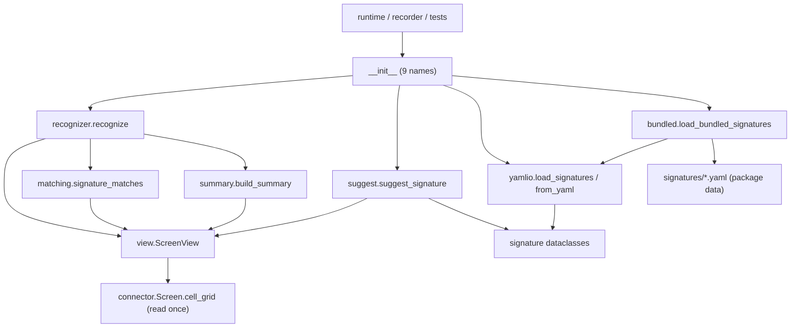

# Design Document: screen-recognizer

## Overview

`greenscreen.recognizer` identifies which known screen a `greenscreen.connector.Screen` is. It is Core Piece 2 of Green Screen Medium. The runtime calls `recognize(screen, signatures)` at every flow step and stops on any unexpected screen, so the result must be deterministic, offline and auditable.

A `ScreenSignature` is a named, YAML-serializable list of matchers (seven kinds) plus optional volatile regions that recognition ignores. `recognize` returns the one matching name or raises `UnknownScreenError` or `AmbiguousScreenError`. The package also ships seven bundled signatures built from `captures/`, and `suggest_signature(screen)` for the future recorder.

**Design goals**

- Pure and offline: `recognize` does no I/O, uses no clock and no randomness.
- Hidden fields never leak. The recognizer builds one blanked view of the screen (`ScreenView`) and every other component reads only that view. Nothing in the package reads `Screen.text_grid`, `Screen.fields`, `Screen.find_field` or `Field.text`.
- Same conventions as `greenscreen.connector`: `from __future__ import annotations`, frozen dataclasses, a logger named after the package, an exception base class of its own, YAML data shipped as package data and loaded with `importlib.resources`.
- Facts about captures are read from the capture files by tests on every run, never taken from memory (see "Verifying facts about the captures").

### Research summary

| Question | Finding | Effect on the design |
|---|---|---|
| `yaml.safe_load` / `yaml.safe_dump` ([PyYAML docs](https://pyyaml.org/wiki/PyYAMLDocumentation)) | `safe_load` builds only standard tags and returns `None` for an empty document. `safe_dump` accepts the emitter keywords. Verified locally on PyYAML 6.0.3: `sort_keys=False` keeps key order, and `yaml.safe_load("version: yes")` returns `True`. | `to_yaml` passes `sort_keys=False`. The loader checks `type(v) is int` because `True == 1` in Python. |
| `safe_dump` with `allow_unicode=True` | Verified locally: the string `"\x85"` (NEL) does **not** round-trip (it is emitted in single quotes and reloaded as a different string). Every other code point tested (0 to 0x7FF, U+2028/2029, U+FEFF, U+FFFE/FFFF, astral) did. | `to_yaml` uses `allow_unicode=False`. Non-ASCII characters are written as `\xE9`, `\N`, `\u2028` escapes in double quotes. This round-trips every character and keeps `yaml.safe_dump` as the only emitter. A 20,000-string fuzz run with these options passed. |
| `safe_load` error text | `yaml.YAMLError` messages quote the offending source text. | `SignatureError` never includes `str(yaml_error)`. It uses only line and column numbers from `problem_mark`. |
| Duplicate mapping keys | `safe_load("a: 1\na: 2")` silently returns `{"a": 2}`. | Not detectable without a custom loader. Accepted limitation, listed under "Decisions". |
| Package data ([setuptools docs](https://setuptools.pypa.io/en/stable/userguide/datafiles.html)) | `[tool.setuptools.package-data]` maps a dotted package name to glob patterns relative to that package. The wheel contains files matched by `package-data`. `include-package-data` defaults to `true` in `pyproject.toml`, but it needs `MANIFEST.in` or a VCS plugin, so it cannot be relied on here. Patterns use `/`. | Add `"greenscreen.recognizer.signatures" = ["*.yaml"]` next to the existing `greenscreen.connector.testing` entry. The `signatures` directory gets an `__init__.py`, the same shape as `connector/testing/fixtures`. |
| `importlib.resources.files` ([Python docs](https://docs.python.org/3/library/importlib.resources.html)) | `files(anchor)` returns a `Traversable`. `joinpath(name).read_text(encoding="utf-8")` works from a source tree, a wheel and a zip. | `load_bundled_signatures` reads each file by name from `files("greenscreen.recognizer.signatures")`, matching `connector.testing.fixtures.load_bundled_fixture`. |

Content from the sources above was paraphrased; the PyYAML and setuptools behaviors marked "verified locally" were run against PyYAML 6.0.3 on Python 3.11.9.

---

## Architecture

### Package layout

```
greenscreen/recognizer/
    __init__.py        # exports exactly the 9 public names; logger setup is NOT here
    errors.py          # RecognizerError, SignatureError, UnknownScreenError, AmbiguousScreenError
    signature.py       # frozen dataclasses: 7 matchers, VolatileRegion, ScreenSignature, validation
    view.py            # FieldGeom, ScreenView (geometry, hidden mask, Visible_Text)
    matching.py        # evaluate matchers and signatures against a ScreenView
    summary.py         # RedactedSummary and build_summary
    recognizer.py      # recognize()
    yamlio.py          # signature <-> YAML mapping, load_signatures
    suggest.py         # suggest_signature and its helpers
    bundled.py         # load_bundled_signatures
    signatures/
        __init__.py    # empty; makes the directory a package, like connector/testing/fixtures
        tk5-logo.yaml
        tk5-logon.yaml
        tso-input-not-recognized.yaml
        tso-password-prompt.yaml
        ispf-primary-menu.yaml
        tso-ready.yaml
        tso-pause.yaml
```

Imports are limited to the standard library, PyYAML and `greenscreen.connector` (Requirement 12.3). `suggest.py` imports `Screen` and `SFToken` for typing and for reading `cell_grid`. `view.py` is the only module that reads `Screen` attributes. `recognizer.py`, `matching.py`, `summary.py` and `suggest.py` receive a `ScreenView`.



### Data flow of `recognize`

```mermaid
sequenceDiagram
    participant C as caller
    participant R as recognize
    participant V as ScreenView
    participant M as matching
    C->>R: screen, signatures
    R->>R: list(signatures) once; duplicate names? raise SignatureError
    R->>V: ScreenView(screen)  (hidden cells blanked here)
    loop each signature
        R->>V: visible_rows(sig.volatile)
        R->>M: all matchers satisfied?
    end
    alt exactly one
        R-->>C: name
    else none
        R->>R: build_summary(view); drop local `screen`
        R-->>C: raise UnknownScreenError(summary)
    else many
        R-->>C: raise AmbiguousScreenError(sorted names)
    end
```

`ScreenView` copies what it needs out of the `Screen` in its constructor and keeps no reference to the `Screen` or its grids. Everything after that point works on derived strings, integers and booleans.

---

## Components and Interfaces

### `errors.py`

```python
class RecognizerError(Exception): ...                 # not a ConnectorError (Req 6.1)
class SignatureError(RecognizerError): ...
class UnknownScreenError(RecognizerError):
    summary: RedactedSummary
class AmbiguousScreenError(RecognizerError):
    names: tuple[str, ...]                            # sorted by code point, unique
```

Each exception calls `super().__init__(message)` with a single string, so `args` is `(message,)` and `repr()` is `ClassName('message')`. `UnknownScreenError.__init__(message, *, summary)` and `AmbiguousScreenError.__init__(message, *, names)` store only those extra attributes. No exception stores a `Screen`, a grid or a `Field`.

### `signature.py`

All classes are `@dataclass(frozen=True, slots=True)` and normalize sequences to tuples in `__post_init__` (via `object.__setattr__`), so equality and hashing are value-based and `from_yaml(to_yaml(sig)) == sig` holds for signatures built from lists.

```python
@dataclass(frozen=True, slots=True)
class TextAtMatcher:      kind: ClassVar[str] = "text_at";        row: int; col: int; text: str
class RowContainsMatcher: kind = "row_contains";                  row: int; text: str
class FieldLayoutMatcher: kind = "field_layout";                  count: int; positions: tuple[tuple[int, int], ...]
class CursorFieldMatcher: kind = "cursor_field";                  row: int; col: int; hidden: bool
class RegionRegexMatcher: kind = "region_regex";                  row: int; col: int; length: int; pattern: str
                          # + _compiled: re.Pattern = field(init=False, repr=False, compare=False)
class LastRowMatcher:     kind = "last_row";                      text: str
class BeforeCursorMatcher:kind = "before_cursor";                 text: str

Matcher = TextAtMatcher | RowContainsMatcher | ... (the seven)
MATCHER_KINDS: dict[str, type]    # exactly the seven kinds (Req 1.2)

class VolatileRegion:     row: int; col: int; length: int

class ScreenSignature:
    name: str
    matchers: tuple[Matcher, ...]
    volatile: tuple[VolatileRegion, ...] = ()
    description: str = ""
    def to_yaml(self) -> str                       # delegates to yamlio
    @classmethod
    def from_yaml(cls, text: str) -> ScreenSignature
```

`to_yaml` and `from_yaml` import `yamlio` inside the method body to avoid an import cycle (`yamlio` imports `signature`).

**Validation** runs in `__post_init__` and raises `SignatureError`. Messages name the matcher kind, the field name and, inside a signature, the index (`matchers[2] (text_at): col above 255`). They never include matcher text, patterns or other scalar values, with one exception: an invalid `name` is echoed through `repr(name[:64])` because the name is the identifier the caller needs (Req 1.10).

| Rule | Requirement |
|---|---|
| `name` fullmatches `[a-z0-9_-]{1,64}` (use `re.fullmatch`, because `$` also matches before a trailing newline) | 1.10 |
| `description` is a `str` of 0 to 500 characters | 1.1 |
| 1 to 50 matchers, 0 to 50 volatile regions, each of the right type | 1.1, 1.9 |
| every `row`, `col` is `type(v) is int` with `0 <= v <= 255`; `length >= 1`; `col + length - 1 <= 255` (for `text_at` the length is `len(text)`) | 1.11 |
| `FieldLayoutMatcher.count == len(positions)` and each position passes the row/col rule | 1.6, 4.11 |
| `pattern` is `str`, at most 200 characters, and `re.compile` accepts it. The message says `invalid regular expression (error at position N)` using `exc.pos`, never `exc.msg`, because `re.error` messages can quote the pattern | 1.12 |
| a `text_at` or `region_regex` rectangle shares a cell with a `VolatileRegion` (same row and column intervals intersect) | 1.13 |
| `hidden` is exactly `bool` | 1.7 |
| text of `text_at`, `row_contains`, `last_row`, `before_cursor` is a non-empty `str` | see Decisions D2 |

`type(v) is int` excludes `bool`, which is an `int` subclass.

### `view.py`

```python
@dataclass(frozen=True, slots=True)
class FieldGeom:
    start_row: int; start_col: int; byte_length: int
    protected: bool; hidden: bool
    linear_start: int           # start_row * columns + start_col

class ScreenView:
    rows: int; columns: int
    cursor_row: int; cursor_col: int
    fields: tuple[FieldGeom, ...]                 # in Screen.fields order (ascending linear_start)
    def __init__(self, screen: Screen) -> None
    base_rows: tuple[str, ...]                    # hidden data cells -> " ", SF/null -> " "
    hidden_mask: bytes                            # rows*columns bytes; 1 where a hidden data cell lies
    def visible_rows(self, volatile: Sequence[VolatileRegion]) -> tuple[str, ...]
    def containing_field(self, row: int, col: int) -> FieldGeom | None
    def unprotected_fields(self) -> tuple[FieldGeom, ...]
    def input_fields(self) -> tuple[FieldGeom, ...]
    def summary_rows(self) -> tuple[str, ...]     # hidden data cells -> "*", trailing spaces removed
```

**Construction** reads `screen.cell_grid` only:

1. One pass finds every `SFToken` cell and its attribute byte. `protected = bool(c0 & 0x20)`, `hidden = (c0 & 0x0C) == 0x0C`. These are the same formulas as `Screen._build_field`.
2. Field extent uses the same arithmetic as `Screen.fields`: with `total = rows * columns`, one SF gives `byte_length = total - 1`; otherwise the span runs to the next SF in linear order, wrapping modulo `total`. No `Field` object is created, so no hidden text is ever decoded. The class is covered by a parity property (Property 13) against `Screen.fields` and `Screen.find_field`.
3. Characters: an `int` cell other than `0x00` becomes `chr(cell)`; `0x00` and `SFToken` cells become `" "`.
4. For each hidden field, the cells `linear_start + 1 .. linear_start + byte_length` (mod `total`) are marked in `hidden_mask` and replaced by `" "` in `base_rows`. The SF cell is already a space. A hidden field of length 0 marks nothing.
5. Only `base_rows`, `hidden_mask`, the geometry and the cursor are stored.

**`visible_rows(volatile)`** returns `base_rows` with every cell inside any volatile region replaced by `" "`. Each region is clipped to `[0, rows) x [0, columns)`; a region fully outside has no effect. Rows are rebuilt only when touched, and each touched row is converted to a `list`, blanked, and joined once, so overlapping regions blank each cell once (Req 2.7).

**`containing_field(row, col)`** returns `None` when the position is outside the screen or when `fields` is empty. Otherwise it takes `linear = row * columns + col`, finds the greatest `linear_start <= linear` with `bisect_right`, and wraps to the last field when none qualifies. This is the same containment rule as `Screen.find_field`.

**`input_fields()`** returns fields with `not protected and (hidden or containing_field(cursor) is that field)`. This implements Requirement 3.1. An unprotected hidden field is an Input_Field wherever the cursor is (3.8).

**Visible_Text helpers.** All "blank" tests use the single space only: `row.rstrip(" ")` and `row.strip(" ")`, never bare `strip()`. A bare `strip()` would also remove `\t`, `\x85` and other whitespace that a cell can hold.

### `matching.py`

```python
def signature_matches(sig: ScreenSignature, view: ScreenView) -> bool
def matcher_satisfied(m: Matcher, rows: tuple[str, ...], view: ScreenView) -> bool
```

`signature_matches` builds `rows = view.visible_rows(sig.volatile)` once and returns `all(matcher_satisfied(m, rows, view) for m in sig.matchers)`. Dispatch is a `dict[type, callable]`; an unknown type raises `TypeError` (a programming error, not a screen outcome).

| Matcher | Satisfied if and only if | Out of range |
|---|---|---|
| `text_at` | `0 <= row < rows`, `col + len(text) <= columns`, and `rows[row][col:col+len(text)] == text` | `False` |
| `row_contains` | `0 <= row < rows` and `text in rows[row]` | `False` |
| `field_layout` | `[(f.start_row, f.start_col) for f in view.unprotected_fields()] == list(positions)` (the count is then equal too) | not applicable |
| `cursor_field` | the cursor is inside the screen, `f = view.containing_field(cursor)` exists, `f` is in `view.input_fields()`, and `(f.start_row, f.start_col, f.hidden) == (row, col, hidden)` | `False` |
| `region_regex` | `0 <= row < rows`, `col + length <= columns`, and `compiled.search(rows[row][col:col+length])` is not `None` | `False` |
| `last_row` | some row has a non-space cell and `rows[i].rstrip(" ") == text` for the greatest such `i` | `False` when no non-blank row |
| `before_cursor` | cursor row and column are inside the screen and `rows[cursor_row][:cursor_col].rstrip(" ").endswith(text)` | `False` |

Cursor column equal to `columns` counts as outside. Because `visible_rows` has already blanked hidden and volatile cells, no matcher can see them (Req 1.15, 1.16, 7.5). `field_layout` and `cursor_field` read geometry only, so volatile regions cannot affect them (Req 2.4).

Regular expressions run on slices of at most 256 characters with `re.search` and no flags. Catastrophic backtracking is not mitigated (stdlib `re` has no timeout); signatures come from the repository or the recorder, not from untrusted sources (Decision D8).

### `summary.py`

```python
@dataclass(frozen=True, slots=True)
class RedactedSummary:
    rows: int; columns: int
    cursor: tuple[int, int]
    field_count: int; unprotected_count: int; hidden_count: int
    fields: tuple[tuple[int, int, int, bool, bool], ...]   # (start_row, start_col, byte_length, protected, hidden)
    row_text: tuple[str, ...]                               # len == rows; hidden data cells shown as "*"
    def to_text(self) -> str                                # "\n".join(row_text): exactly `rows` lines
    def to_dict(self) -> dict                               # str / int / bool, list, dict only
def build_summary(view: ScreenView) -> RedactedSummary
```

`row_text` comes from `ScreenView.summary_rows()`. Hidden data cells are `*` even when they hold spaces or nulls (Req 6.4). Volatile regions are not applied (the summary is signature independent). Trailing spaces are removed, so a hidden run that ends a row keeps its asterisks. `to_dict()` returns `{"rows", "columns", "cursor": [r, c], "field_count", "unprotected_count", "hidden_count", "fields": [{"start_row", ..., "hidden"}], "row_text": [...]}`. A screen with zero fields gives counts of 0 and `fields == ()` (Req 6.10). The default dataclass `repr` shows only these redacted values.

### `recognizer.py`

```python
def recognize(screen: Screen, signatures: Iterable[ScreenSignature]) -> str
```

1. `sigs = list(signatures)` (one consumption of an iterator). Any element that is not a `ScreenSignature` raises `TypeError`.
2. Duplicate names: collect names occurring more than once; if any, raise `SignatureError("duplicate signature name(s): a, b")` before any matcher runs (Req 5.5).
3. `view = ScreenView(screen)`.
4. `matched = sorted(s.name for s in sigs if signature_matches(s, view))`. Names are unique, so there are no duplicates in `matched`. Sorting is by code point.
5. One match returns the name. Zero matches builds `summary = build_summary(view)`, then logs and raises `UnknownScreenError`. Several matches log and raise `AmbiguousScreenError`.
6. Before raising, the function runs `del screen, view`. The raise statement sits outside any `except` block and uses `from None`. The exception therefore has no `__cause__` and no `__context__`, and the traceback frame of `recognize` holds no `Screen` or grid (Req 13.4). Frames of the caller are the caller's own.

Message formats, which contain only integers and names:

- Unknown: `no signature matches: 24x80 screen, cursor (22, 11), 28 fields (1 unprotected, 0 hidden), 7 signatures evaluated`.
- Ambiguous: `3 signatures match: a, b, c`.
- Duplicate names: `duplicate signature name(s): a, b`.

Logging: `logger = logging.getLogger("greenscreen.recognizer")`, as `greenscreen.connector` does. Exactly one DEBUG record per call, with lazy arguments: `logger.debug("recognize outcome=%s evaluated=%d matched=%s", outcome, len(sigs), ",".join(matched))`, where `outcome` is `matched`, `unknown` or `ambiguous`. `load_signatures` and `load_bundled_signatures` may log `"loaded %d signatures"` with a count. No other record exists (Req 6.9).

### `yamlio.py`

**Document schema (version 1).** Key order is fixed, and every key is always written:

```yaml
version: 1
name: ispf-primary-menu
description: ISPF primary option menu with the clock ignored.
matchers:
- kind: text_at
  row: 0
  col: 28
  text: ISPF primary option menu
- kind: field_layout
  count: 1
  positions:
  - row: 1
    col: 13
- kind: cursor_field
  row: 1
  col: 13
  hidden: false
volatile:
- row: 3
  col: 71
  length: 5
```

| `kind` | Keys, in emitted order |
|---|---|
| `text_at` | `kind row col text` |
| `row_contains` | `kind row text` |
| `field_layout` | `kind count positions` (each position is `row col`) |
| `cursor_field` | `kind row col hidden` |
| `region_regex` | `kind row col length pattern` |
| `last_row` | `kind text` |
| `before_cursor` | `kind text` |

Required document keys: `version`, `name`, `matchers`. Optional: `description` (default `""`) and `volatile` (default `[]`). Every key of a matcher is required. A volatile entry has `row col length`.

**Emit.** `yaml.safe_dump(doc, sort_keys=False, default_flow_style=False, allow_unicode=False, width=10_000, indent=2)`. `width` is large so that no scalar is folded (the longest string is 255 characters). Output is a pure function of the signature, so equal signatures give identical strings (Req 4.5). `doc` is built from plain `dict`, `list`, `str`, `int`, `bool` with insertion order as above.

**Parse.** `yaml.safe_load(text)` inside `try/except yaml.YAMLError`. The handler raises `SignatureError("malformed YAML at line L, column C")` using `problem_mark.line + 1` and `column + 1` when present, with `from None`. The handler itself builds the message from integers only.

**Structure checks** (`_signature_from_mapping(obj, index)`), each raising `SignatureError` with a location prefix (`signature[2]: ` for a list item, nothing for a single document):

1. `obj` is a `dict`, otherwise `document structure is invalid`.
2. Unknown key: `unknown key 'foo'` (the key text is allowed by Req 4.8). Missing required key: `missing key 'matchers'`. Wrong type: `key 'row' must be an integer`.
3. `version`: `type(v) is int and v == 1`, otherwise `unsupported version <repr(v) truncated to 32 characters> (type str)`. This is the single place a YAML scalar is echoed, as Requirement 4.7 requires. `True` fails the check.
4. Each matcher: `kind` must be one of the seven (an unknown kind gives `matchers[i]: unknown or missing 'kind'` without echoing the value). The remaining keys are checked against the table above. Constructor `SignatureError`s are re-raised with the `matchers[i] (kind)` prefix.
5. `field_layout.count` must equal `len(positions)` or the error names key `count`.

`from_yaml(text)` accepts one mapping and rejects a list. `load_signatures(path)`:

- `Path(path).read_text(encoding="utf-8")` inside `try/except (OSError, UnicodeDecodeError)`, raising `SignatureError("signature file could not be read: <path>")`. The path is not a YAML scalar.
- A mapping gives a list of length 1. A list gives its items in order (an empty list gives `[]`). Anything else, including an empty document (`None`), is `document structure is invalid`.
- After all items parse, duplicate names raise `SignatureError("duplicate signature name 'x' at indexes 0 and 3")`. Any failure returns nothing partial, because the list is built only after every item succeeded.

### `suggest.py`

```python
def suggest_signature(screen: Screen, name: str | None = None) -> ScreenSignature
```

Algorithm. Let `view = ScreenView(screen)` and `rows = view.base_rows` (hidden cells blank).

1. **No identifying features.** If every row of `rows` is blank (`rstrip(" ") == ""`) and `view.fields` is empty, raise `SignatureError("screen has no identifying features")` (Req 9.9). This is the only way the function raises for a valid `Screen`, apart from an invalid `name`.
2. **Volatile runs.** For each row, scan `rows[r]` with this module-level pattern (ASCII digits only; `\d` is avoided because it matches non-ASCII digits):

   ```python
   _VOLATILE = re.compile(
       r"(?:[01][0-9]|2[0-3]):[0-5][0-9]:[0-5][0-9]"      # HH:MM:SS
       r"|(?:[01][0-9]|2[0-3]):[0-5][0-9]"                # HH:MM
       r"|(?:0[1-9]|[12][0-9]|3[01])\.[0-9]{2}\.[0-9]{2}"  # DD.MM.YY
   )
   ```

   `finditer` gives leftmost, non-overlapping runs, and the `HH:MM:SS` alternative is tried before `HH:MM`. Each run becomes `VolatileRegion(row, start, length)`. Every run, including any beyond the 50-region cap, goes into an `excluded` set of cells. The signature keeps the first 50 regions in reading order. Runs that would end past column 255 are skipped for the region but stay excluded.
3. **Selected row.** `r0` is the first row that has at least one non-space cell outside `excluded`. This equals "the first row with a non-blank character" of Requirement 9.5 whenever that row has stable text. If that row is entirely volatile, the next row with stable text is used (Decision D5). If no such row exists, there is no text matcher.
4. **Candidates.** Split row `r0` into segments: a segment is a maximal run of cells that contains no excluded cell and no two consecutive spaces, trimmed of leading and trailing spaces. Take the first three segments from left to right as `(r0, first_col, text)`. A candidate is **discarded** if any of its cells lies in `hidden_mask` (Req 7.3). A single hidden cell between two letters yields a segment such as `AB CD` that covers a hidden cell, so it is discarded. Surviving candidates become `TextAtMatcher(r0, col, text)`. If every candidate is discarded, no text matcher is produced and the function does not fall through to later rows (Req 7.6). Candidates with `col + len - 1 > 255` are skipped.
5. **Layout.** If `view.unprotected_fields()` is not empty, add exactly one `FieldLayoutMatcher(count, positions)` in `Screen.fields` order (Req 9.3). A hidden unprotected field appears here by position only (Req 7.4).
6. **Cursor.** If the cursor lies in an Input_Field (`view.input_fields()` contains `view.containing_field(cursor)`), add one `CursorFieldMatcher(start_row, start_col, hidden)` (Req 9.4).
7. **Fallback.** If steps 4 to 6 produced no matcher, add `FieldLayoutMatcher(0, ())`. It is always satisfied by the screen it came from, which satisfies Req 9.2 and 1.9 for screens that have no stable text and no input structure (Decision D6).
8. **Name.** `name` is used unchanged if given. Otherwise take the stable text of `r0` (volatile cells blank, hidden cells blank), apply `.lower()`, `re.sub(r"[^a-z0-9-]+", "-", s)`, `.strip("-")`, then `[:64]`. An empty result, or no `r0`, gives `unnamed-screen` (Req 9.7, Decision D7). A caller-supplied invalid name raises `SignatureError` from the constructor.
9. **Result.** `ScreenSignature(name, matchers=text + layout + cursor, volatile=regions sorted by (row, col), description="")`. The function reads the `Screen` only through `ScreenView`, so it cannot modify it (Req 9.12). The result depends only on the screen cells and `name`, so equal inputs give equal outputs (Req 9.10).

Because text matchers never touch an excluded cell, and volatile regions never overlap a text matcher, the validation rule 1.13 cannot fire on a suggested signature. Because every matcher is built from `rows` (the same blanked text the evaluator will see) the signature matches its source screen (Req 9.2).

### `bundled.py`

```python
_MANIFEST = ("tk5-logo", "tk5-logon", "tso-input-not-recognized",
             "tso-password-prompt", "ispf-primary-menu", "tso-ready", "tso-pause")

def load_bundled_signatures() -> list[ScreenSignature]
```

For each name in `_MANIFEST` it reads `importlib.resources.files("greenscreen.recognizer.signatures").joinpath(f"{name}.yaml").read_text(encoding="utf-8")` and calls `ScreenSignature.from_yaml`. A missing file (`FileNotFoundError`, `OSError`), a decoding error or a `SignatureError` is re-raised as `SignatureError(f"bundled signature file {name}.yaml: <reason>")`. The list is returned only after all seven loaded, so no partial list can escape (Req 8.14). A signature whose `name` differs from its file stem is also an error. Nothing is cached, so there is no module-level state. The result does not depend on the working directory, because `importlib.resources` resolves the package location (Req 8.1).

### `__init__.py`

Imports and lists exactly nine names in `__all__`: `ScreenSignature`, `recognize`, `suggest_signature`, `load_signatures`, `load_bundled_signatures`, `RecognizerError`, `UnknownScreenError`, `AmbiguousScreenError`, `SignatureError` (Req 12.1). Matcher classes and helpers live in submodules and are imported from there by tests.

### Packaging

`pyproject.toml` gains one line, with no change to `dependencies`:

```toml
[tool.setuptools.package-data]
"greenscreen.connector.testing" = ["fixtures/*.yaml"]
"greenscreen.recognizer.signatures" = ["*.yaml"]
```

`[tool.setuptools.packages.find]` already includes `greenscreen*`, so `greenscreen.recognizer` and `greenscreen.recognizer.signatures` are discovered. The wheel content is checked by a task step (see Testing Strategy), because building a wheel starts a subprocess and unit tests must not do that (Req 10.9).

---

## Data Models

### Matchers and signature

Defined in "Components and Interfaces / `signature.py`". All values are immutable, hashable and compare by value.

### Visible_Text

For a screen `S` and a signature `G`:

```
base[r][c]    = " "                      if cell is SFToken or 0x00
              = " "                      if (r, c) is a data cell of a hidden field
              = chr(cell)                otherwise
visible[r][c] = " "                      if (r, c) lies in any VolatileRegion of G (clipped to the screen)
              = base[r][c]               otherwise
```

Hidden data cells are cells `linear_start + 1 .. linear_start + byte_length` of a field with `hidden = True`, modulo `rows * columns`. The SF cell holds no content and is already a space.

### Verifying facts about the captures

The design needs facts such as where the clock sits and where the cursor is. They are **read from `captures/*.readbuffer.txt` at design time and re-read by tests on every run**; no value in this document or in a bundled YAML is trusted from memory.

1. **Loader.** `tests/screen_support.py::load_capture_screen(name)` reads `captures/<name>.readbuffer.txt` (path resolved from `Path(__file__).parents[1] / "captures"`, as `tests/unit/test_parser.py` does). It follows the block logic of `_parse_capture_readbuffer` in `tests/property/test_render_left_inverse.py`: collect `data: ` lines, take the status line that precedes the `ok`, and use the **last** block in the file. It builds the `Screen` with the existing `ScreenParser.parse_status_line` and `parse_readbuffer`. The `.ascii.txt` files are not used for cell data.
2. **Facts test.** `tests/unit/test_recognizer_capture_facts.py` asserts every fact in the table below with `ScreenParser`, one test per row. A fact that stops being true fails loudly instead of silently producing a wrong signature.
3. **Derivation rule for bundled YAML.** A bundled matcher may only use a value that a facts-test row asserts. A second test (`test_recognizer_bundled.py::test_bundled_matchers_match_capture_cells`) walks each bundled signature and checks every `text_at` text against the capture's `text_grid` at that position, every volatile region against the date/time pattern in the capture, and every `cursor_field` and `field_layout` against `Screen.fields`. It uses `Screen.text_grid` and `Screen.fields` here deliberately: it is test code, it is independent of the recognizer, and it must never be applied to a screen that holds a typed password.
4. **Privacy check.** The same test file asserts that the hidden field of `tso-password-prompt` holds only blank cells, and that no `.yaml` under `signatures/` contains the userid `HERC01`, which is on `captures/tso-password-prompt` and `captures/ispf-primary-menu`.
5. **Capture inventory.** A test asserts that the set of `*.readbuffer.txt` names in `captures/` equals the seven screens named in Requirement 10.2 (`tk5-logo`, `tk5-logon`, `tso-input-not-recognized`, `tso-password-prompt`, `ispf-primary-menu`, `tso-ready`, `tso-pause-2`). It fails if any other capture appears, so a capture of the residual-password screen cannot be added unnoticed (Req 13.6).

**Facts read from the files (all 24 rows by 80 columns, each file holds one block):**

| Capture | Facts relied on | Source of the fact |
|---|---|---|
| `tk5-logo` | cursor (0,0), in a protected field; 0 unprotected fields; row 0 text `Hercules Version  :` starts at col 1; rows 16 and 17 contain `The MVS 3.8j` and `Tur(n)key System`; row 23 contains `see SYS2.JCLLIB(CREDITS) for complete credits`. Host name, OS and version text on rows 0 to 6 vary by host and are not used. | `ScreenParser` on the file |
| `tk5-logon` | cursor (22,11) in the unprotected field starting at (22,10), the only unprotected field; `Logon ===>` at row 22 col 0; labels `Date` at (0,66) and `Time` at (1,66); date value `15.11.26` at row 0 col 72 length 8; time value `16:25:01` at row 1 col 72 length 8. `CUU0C0` in the top-left corner is not used. | parse; regex scan of `text_grid` for the date and time patterns |
| `tso-input-not-recognized` | cursor (0,0), inside the unprotected field that starts at (4,40) and wraps; `INPUT NOT RECOGNIZED` at row 3 col 0; it is the last non-blank row; no other non-blank cell | parse |
| `tso-password-prompt` | cursor (1,1); unprotected fields start at (0,0), (0,35), (1,0) and (23,79); only (1,0) is hidden (c0 `cc`) and the cursor is in it; row 0 is ` ENTER CURRENT PASSWORD FOR HERC01-` (text starts at col 1); row 0 is the only non-blank row; every cell of the hidden field is blank | parse |
| `ispf-primary-menu` | cursor (1,14) in the only unprotected field, which starts at (1,13); title `ISPF primary option menu` at row 0 col 28; `Option  ===>` (two spaces) at row 1 col 1; time `04:09` at row 3 col 71 length 5; row 2 holds the userid and is not used | parse |
| `tso-ready` | cursor (1,0), inside the field starting at (0,7); ` READY` is the only non-blank row, row 0 | parse |
| `tso-pause-2` | cursor (11,5), inside the field starting at (11,4); ` ***` on row 11 is the last non-blank row; text above it differs from other pause screens | parse |

The values for date and time columns come from running the two patterns over `text_grid` of the file, which is how they were found, and the facts test repeats that scan.

---

## Bundled signatures

Each file below is written from the table above, loaded through `from_yaml`, and checked by the facts-based test in step 3. "Why exclusive" notes which matcher separates the screen from the other six.

| Name | Matchers | Volatile | Why exclusive |
|---|---|---|---|
| `tk5-logo` | `text_at(0,1,"Hercules Version  :")`, `row_contains(16,"The MVS 3.8j")`, `row_contains(17,"Tur(n)key System")`, `row_contains(23,"see SYS2.JCLLIB(CREDITS) for complete credits")`, `field_layout(0, [])` | none | the version label appears on no other capture |
| `tk5-logon` | `text_at(22,0,"Logon ===>")`, `text_at(0,66,"Date")`, `text_at(1,66,"Time")`, `field_layout(1,[(22,10)])`, `cursor_field(22,10,false)` | `(0,72,8)`, `(1,72,8)` | the `Logon ===>` prompt |
| `tso-input-not-recognized` | `text_at(3,0,"INPUT NOT RECOGNIZED")`, `last_row("INPUT NOT RECOGNIZED")` | none | the message text (Req 8.10) |
| `tso-password-prompt` | `region_regex(0,0,80,"^ ENTER CURRENT PASSWORD FOR [^ ]{1,8}- *$")`, `cursor_field(1,0,true)` | none | the prompt and the hidden field under the cursor (Req 8.8) |
| `ispf-primary-menu` | `text_at(0,28,"ISPF primary option menu")`, `text_at(1,1,"Option  ===>")`, `field_layout(1,[(1,13)])`, `cursor_field(1,13,false)` | `(3,71,5)` | the title text and the single input field (Req 8.9) |
| `tso-ready` | `last_row(" READY")` | none | only the last row decides (Req 8.18) |
| `tso-pause` | `last_row(" ***")`, `before_cursor(" ***")` | none | no field layout and no fixed row (Req 8.19) |

Notes:

- **Password prompt regex.** `[^ ]{1,8}-` accepts a userid of 1 to 8 non-space characters followed by `-`. A nine-character id fails because the `-` must follow within eight characters and ` *$` must then reach the end. The userid is never in the YAML. The regex runs on the visible text, where hidden cells are blank, so a residual password cannot satisfy or break it.
- **`tso-pause`.** `last_row(" ***")` fails when any non-blank text sits below the `***` row. `before_cursor(" ***")` requires the cursor on that row just after the text. Row 10 or row 11 does not matter, because neither matcher names a row. The text above the `***` row varies (steering notes broadcast text and a random fortune), which is why no matcher looks above it.
- **Disjointness.** The three line-mode signatures that use `last_row` have different declared strings (`INPUT NOT RECOGNIZED`, ` READY`, ` ***`). The password prompt is separated by its prompt regex and by the hidden field under the cursor. The logo, logon and ISPF screens are separated by their text.
- **Prototype check.** While writing this design, the matcher semantics above were prototyped in a throwaway script against the seven captures. Each capture matched exactly its own signature and no other. The real test is `test_recognizer_bundled.py::test_capture_matrix` (7 by 7), which must reproduce that result with the shipped code.

---

## Correctness Properties

*A property is a characteristic or behavior that should hold true across all valid executions of a system-essentially, a formal statement about what the system should do. Properties serve as the bridge between human-readable specifications and machine-verifiable correctness guarantees.*

**Reflection.** The prework found that matcher semantics (1.3 to 1.8, 1.15, 1.16), volatile rules (2.1 to 2.7), hidden rules (3.6, 3.7, 7.x, 13.x), recognition outcomes (5.x), suggestion (9.x), YAML (4.x) and the summary (6.x) are universal. Overlaps were merged as follows: 1.3 is covered by Property 10 (the oracle uses `all`); 2.4 and 2.5 are covered by Properties 2 and 12; 3.7 and 13.2 are covered by Property 20 plus a static check; 5.2 is covered by Properties 1 and 7; 6.7 and 9.11 are covered by Properties 4 and 5; 7.2 and 13.5 are the same metamorphic claim, written once as Property 20; 7.4 is covered by Properties 4 and 17. Properties 4 and 5 stay separate because Requirements 11.4 and 13.7 each ask for their own test, and their generators differ.

### Property 1: Suggest then recognize

For any generated Screen with at least one identifying feature, `suggest_signature(screen)` matches that Screen, and `recognize(screen, [suggest_signature(screen)])` returns that Signature's name.

**Validates: Requirements 5.2, 9.2, 11.1**

### Property 2: Volatile content does not affect the result

For any Screen, any Signature from `suggest_signature`, and any replacement of the characters in cells inside its volatile regions, the match result for the Screen is unchanged.

**Validates: Requirements 2.2, 2.4, 9.8, 11.2**

### Property 3: Changing one text-matched cell breaks the match

For any Screen and any Signature from `suggest_signature` that has a `text_at` matcher, replacing the character in exactly one cell covered by that matcher (outside every volatile region and every hidden field) with a different character makes the Signature stop matching.

**Validates: Requirements 1.4, 11.3**

### Property 4: Hidden content never appears in any output

For any generated Screen containing hidden fields whose text is a sentinel of 1 to 80 characters that appears in no other cell, no character of the sentinel appears in: the suggested Signature and its `to_yaml()` (including the `\xNN` escape form); `str()`, `repr()`, `args` and attributes of `UnknownScreenError` and `AmbiguousScreenError` raised for that Screen; the Redacted_Summary `to_text()`, `to_dict()` and `repr()`; and every DEBUG record (message and arguments) on `greenscreen.recognizer`.

**Validates: Requirements 6.7, 7.1, 7.4, 9.11, 13.1, 11.4**

### Property 5: Residual hidden content on non-password screens

For any generated line-mode Screen that is not the password prompt (a ` ***` row, the cursor on that row, and a hidden field holding a sentinel elsewhere, including cells in rows that would otherwise look like the last non-blank row), the sentinel appears in none of: the `suggest_signature` output and its `to_yaml()`; the `str()`, `repr()`, `args` and `vars()` of every Recognizer exception; the Redacted_Summary `to_text()` and `to_dict()`; and the DEBUG log records. For the same Screen, `recognize` returns the same result with the residual content present and with it replaced by spaces.

**Validates: Requirements 13.1, 13.3, 13.7**

### Property 6: YAML round trip and determinism

For any valid Signature built from any of the seven matcher kinds, with strings drawn from all Unicode code points except surrogates (including quotes, backslashes, colons, leading and trailing spaces, U+0085 and non-ASCII characters), `from_yaml(sig.to_yaml()) == sig`, and two calls to `to_yaml()` on equal Signatures return identical strings that begin with `version: 1`.

**Validates: Requirements 4.1, 4.3, 4.5, 4.11, 11.5**

### Property 7: Recognition ignores signature order and iterator form

For any Screen and any list of 0 to 10 Signatures with distinct names, every permutation of the list, and an iterator over the list, give the same returned name or the same exception type with the same sorted `names` tuple.

**Validates: Requirements 5.2, 5.4, 5.6, 5.7, 11.6**

### Property 8: `tso-pause` matches wherever the `***` row sits

For any text generated above the ` ***` row, any row `n` from 1 to 22 holding ` ***`, and the cursor on row `n` at column 5, the bundled `tso-pause` Signature matches the Screen.

**Validates: Requirements 8.19, 8.20, 11.10**

### Property 9: `last_row` and `before_cursor` unsatisfied cases

For any Screen with no non-blank visible cell and any `last_row` text, the matcher is unsatisfied. For any Screen and any cursor position outside it (negative, row at or above `rows`, column at or above `columns`) and any `before_cursor` text, the matcher is unsatisfied and no exception is raised.

**Validates: Requirements 1.15, 1.16, 11.11**

### Property 10: Matchers agree with a direct model

For any Screen (including hidden fields and unformatted screens) and any signature, each matcher kind is satisfied exactly when an independent oracle says so, and a Signature matches exactly when all its matchers are satisfied. The oracle builds Visible_Text from `Screen.text_grid` and `Screen.fields` attributes other than `text` of hidden fields, and uses `Screen.find_field` for the cursor field.

**Validates: Requirements 1.3, 1.4, 1.5, 1.6, 1.7, 1.8, 1.15, 1.16, 3.4, 3.5**

### Property 11: Out-of-screen addressing never raises

For any Screen and any matcher or volatile region that addresses rows or columns partly or fully outside it, evaluation raises no exception; a matcher that addresses a position outside is unsatisfied, and a volatile region is clipped so that it only affects cells inside the Screen.

**Validates: Requirements 1.14, 2.6**

### Property 12: Visible_Text construction

For any Screen and any list of volatile regions (possibly overlapping or out of range), `visible_rows` equals the Screen's `text_grid` with the data cells of hidden fields and the clipped union of the regions replaced by a single space each, with all other cells unchanged. With no hidden fields and no regions it equals `text_grid`.

**Validates: Requirements 2.1, 2.5, 2.7, 3.6, 13.2**

### Property 13: Geometry and Input_Field parity

For any Screen, the `(start_row, start_col, byte_length, protected, hidden)` of each `ScreenView` field equals the same attributes of the corresponding `Screen.fields` entry in order; for any in-range position `containing_field` agrees with `Screen.find_field` (and returns `None` for unformatted screens); and `input_fields()` equals the fields that are unprotected and either hidden or contain the cursor.

**Validates: Requirements 3.1, 3.8, 1.6, 1.7**

### Property 14: Signature validation

For any generated name, description, matcher or region values, construction succeeds exactly when the rules of Requirements 1.1 and 1.9 to 1.13 hold (name pattern, counts, integer ranges excluding booleans, `length >= 1`, last column at most 255, pattern length and validity, and no rectangle overlap between a `text_at` or `region_regex` and a volatile region); otherwise it raises `SignatureError` and creates no object.

**Validates: Requirements 1.1, 1.9, 1.10, 1.11, 1.12, 1.13**

### Property 15: Redacted summary shape

For any Screen, the summary has `rows`, `columns`, cursor, field counts and one field tuple per field equal to those of the Screen (hidden text excluded); `to_text()` has exactly `rows` lines; every hidden data cell, even blank, shows `*` in the row text and no non-hidden cell shows a different character than the Screen's text; and `to_dict()` contains only `str`, `int`, `bool`, `list` and `dict` values. A Screen with zero fields gives counts of 0 and no field tuples.

**Validates: Requirements 6.3, 6.4, 6.5, 6.10**

### Property 16: Recognition outcomes and messages

For any Screen and any set of Signatures: when none matches, `UnknownScreenError` is raised with a `summary` equal to `build_summary` of that Screen and a single-line message made only of integers and fixed words; when several match, `AmbiguousScreenError.names` is sorted, unique, contains exactly the matching names, and the message contains every name and no Screen text; neither the Screen nor any Signature differs (deep copy comparison) after the call, whether it returns or raises; and `recognize` with duplicated names raises `SignatureError` containing each duplicated name.

**Validates: Requirements 5.3, 5.4, 5.5, 5.8, 6.2, 6.6, 6.8**

### Property 17: Suggested signature structure

For any Screen with identifying features: the Signature contains exactly one `field_layout` matcher listing the unprotected fields in order when any exist; exactly one `cursor_field` matcher when the cursor is in an Input_Field; `text_at` matchers only on the first row that has stable text, none of whose cells overlap a volatile region or a hidden cell; every `HH:MM`, `HH:MM:SS` or `DD.MM.YY` run with valid ranges is covered by a volatile region (up to the cap) and invalid ones (hour 24, minute 60, day 32 or 00) are not; a supplied valid `name` is used unchanged; a derived name is either `unnamed-screen` or matches `[a-z0-9-]{1,64}`; two calls with equal arguments return equal Signatures; and the Screen is unchanged afterwards.

**Validates: Requirements 7.3, 7.4, 9.3, 9.4, 9.5, 9.6, 9.7, 9.8, 9.10, 9.12**

### Property 18: Load errors never echo scalars

For any valid Signature document into which one invalid value, unknown key or wrong type is injected, with a sentinel string as the injected scalar, `from_yaml` raises `SignatureError`, the message names the key (and the zero-origin index for a list) and does not contain the sentinel. Malformed YAML also raises `SignatureError` without quoting its source.

**Validates: Requirements 4.6, 4.8**

### Property 19: Exceptions hold no Screen reference

For any Screen that makes `recognize` raise, a walk over `args`, `vars()`, `__cause__`, `__context__` and the locals of traceback frames that belong to `greenscreen.recognizer` finds no reference (by identity) to the Screen, its `cell_grid`, its rows or any `Field`. `__cause__` and `__context__` are `None`.

**Validates: Requirements 13.1, 13.4**

### Property 20: Hidden-only differences change nothing

For any two Screens that differ only in the cell content of data cells of hidden fields, `recognize` against any set of Signatures returns the same result (or raises the same exception type with equal `names`), `suggest_signature` returns equal Signatures, and a text-based matcher whose cells lie inside a hidden field is evaluated as if those cells held spaces.

**Validates: Requirements 3.7, 7.2, 7.5, 13.2, 13.5**

---

## Error Handling

| Situation | Exception | Message content |
|---|---|---|
| Invalid signature, matcher or region value | `SignatureError` | kind, field name, index; never matcher text |
| Malformed YAML | `SignatureError` | line and column only |
| Not a mapping or list of mappings; empty document | `SignatureError` | `document structure is invalid` |
| Unknown or missing key; wrong type | `SignatureError` | key name; list index when in a list |
| Unsupported `version` (including `True`, `"1"`, `2`) | `SignatureError` | `repr` of the value truncated to 32 characters, and its type name |
| Duplicate names in `load_signatures` | `SignatureError` | the name and both zero-origin indexes |
| File missing or unreadable (also invalid UTF-8) | `SignatureError` | `signature file could not be read: <path>` |
| Duplicate names passed to `recognize` | `SignatureError` | each duplicated name |
| Bundled file missing or invalid | `SignatureError` | bundled file name and the reason |
| No match | `UnknownScreenError` | counts and cursor; `summary` attribute carries the redacted screen |
| More than one match | `AmbiguousScreenError` | count and sorted names; `names` attribute |
| `suggest_signature` on an empty screen | `SignatureError` | `screen has no identifying features` |
| Non-`ScreenSignature` element in `recognize` | `TypeError` | type name |

Rules that apply everywhere:

- Every `SignatureError` and every raise in `recognize` uses `from None` and sits outside an `except` block that holds a `Screen`, so `__cause__` and `__context__` stay empty.
- YAML and regex library messages are never copied into an error, because both can quote their input.
- A matcher addressing a position outside the screen is not an error; the matcher is unsatisfied (Req 1.14).
- `RecognizerError` does not derive from `ConnectorError`. A caller that wants both families catches both explicitly.

### Decisions and limits

- **D1. PyYAML and U+0085.** Solved with `allow_unicode=False` (see Research summary). No deviation from Requirement 4.4.
- **D2. Empty text.** An empty `text` in `text_at`, `row_contains`, `last_row` or `before_cursor` would match every screen or cannot match, so the design rejects it with `SignatureError`. Requirement 1.9 and 1.11 do not list this condition. **Requirements gap:** add it to the conditions of Requirement 1 so Requirement 10.8 covers it with a test.
- **D3. `field_layout` count and positions.** The YAML carries both `count` and `positions` (Req 4.11), so the design requires them to be equal. This adds a `SignatureError` condition that the requirements do not list.
- **D4. Hidden flag recording.** Requirements 7.4 and 7.6 say a hidden field is recorded by position and `hidden` flag. Of the seven matcher kinds, only `cursor_field` carries a `hidden` flag, and it needs the cursor inside the field. The design records an unprotected hidden field by position in `field_layout`, and by flag only when the cursor is in it. **Requirements gap:** the wording cannot be met literally for a hidden field outside the cursor.
- **D5. Row selection in `suggest_signature`.** Requirement 9.5 uses the first non-blank row. If that row consists only of volatile runs, nothing stable is left to match, so the design moves to the next row with stable text.
- **D6. Fallback matcher.** A screen with no stable text, no unprotected field and no input field would give a signature with zero matchers, which Requirement 1.9 forbids. The design adds `field_layout` with count 0.
- **D7. Derived name.** The name comes from the stable text of the selected row (volatile and hidden cells blank). Taken literally, Requirement 9.7 would put the date of the logon screen into the name, giving a different name on every visit.
- **D8. Regex cost.** `re` has no timeout. The 200-character pattern limit and 256-character subject bound do not prevent catastrophic backtracking. Signatures from untrusted sources are out of scope.
- **D9. Duplicate YAML keys** are not detected, because `safe_load` keeps the last value.
- **D10. Traceback scope of Requirement 13.4.** Python builds `__traceback__` as the exception unwinds, and the caller's frame still holds its own `Screen`. The design guarantees that `args`, `vars()`, `__cause__`, `__context__` and the frames inside `greenscreen.recognizer` hold no reference. It does not claim to clear the caller's frames.
- **D11. Hidden extent.** Hidden cells are the field's data cells. The SF cell is not marked, because it carries no content and is displayed as a space.
- **D12. Volatile and time-looking text.** Date and time runs are detected without word boundaries, as Requirement 9.8 describes. Over-matching only makes the signature more tolerant, never less.

---

## Testing Strategy

### Approach

Property-based testing applies: the recognizer is pure, in-memory logic with large input spaces (cell grids, strings, signatures). Both kinds of test are used.

- **Unit tests** (`tests/unit`) cover captures, bundled signatures, error conditions, API shape, packaging and the static rules.
- **Property tests** (`tests/property`) use **Hypothesis**, the library already used by the project (`hypothesis>=6.170.15`). No property-testing code is written from scratch.
- Every property test is one `@given` test with `@settings(max_examples=100, deadline=None)` or more, and begins with a comment `# Feature: screen-recognizer, Property N: <title>`, the same style as `tests/property/test_text_at.py`.
- None of these tests touch the network or start a subprocess. Screens come from `cell_grid` values built directly (Req 11.7). The generators keep screens small (1 to 24 rows, 1 to 80 columns, mostly blank cells with a few printable runs) so that the property modules finish in well under 90 seconds (Req 11.9). The original 60 s figure predates the recognizer's 20 properties.

### Files

```
tests/screen_support.py                      # load_capture_screen(name), make_screen(...), CAPTURE_NAMES
tests/property/_recognizer_strategies.py     # screens, signatures, sentinel screens, line-mode screens
tests/unit/test_recognizer_capture_facts.py  # every fact in the table above, read from the files
tests/unit/test_recognizer_signature.py      # validation per SignatureError condition (Req 1.9-1.13, 10.8)
tests/unit/test_recognizer_matchers.py       # one satisfied and one unsatisfied case per kind (Req 10.1, 10.11)
tests/unit/test_recognizer_view.py           # Input_Field on the two captures (Req 3.2, 3.3, 10.7)
tests/unit/test_recognizer_recognize.py      # recognize, Unknown/Ambiguous, ISPF removal case (Req 10.5, 10.6), benchmark (5.10)
tests/unit/test_recognizer_yaml.py           # load_signatures files, version values, duplicate names, unreadable file
tests/unit/test_recognizer_suggest.py        # empty screen, all-candidates-hidden (Req 7.6, 9.9), naming examples
tests/unit/test_recognizer_bundled.py        # own capture, 7x7 matrix, provenance, missing file, cwd independence
tests/unit/test_recognizer_public_api.py     # the nine names; exceptions not ConnectorError
tests/unit/test_recognizer_static.py         # source scans: no yaml.load/dump, imports, no text_grid/.fields/.text/find_field
tests/property/test_recognizer_<name>.py     # one module per property or small group, see table
```

**Capture-based unit tests (Req 10.2 to 10.7, 10.10).** Screens for the seven captures come only from `load_capture_screen`, through `ScreenParser`. Tests assert: each bundled signature matches its own capture; `recognize` over all seven signatures returns exactly the capture's name (`tso-pause-2` gives `tso-pause`); removing `ispf-primary-menu` makes `recognize` raise `UnknownScreenError` whose `summary.to_text()` contains `Option  ===>` and no hidden content; two signatures that both match raise `AmbiguousScreenError` naming exactly those two; `tso-pause` matches synthetic screens with different text above and `***` on rows 10 and 11; `tso-ready` does not match the ISPF capture. The residual-password screen is always synthetic (Req 13.6).

**Synthetic builders.** `make_screen(rows, columns, text={(r, c): "..."}, fields=[(r, c, c0)], cursor=(r, c))` builds a `cell_grid` of `0x00` cells with `SFToken`s and text bytes, then a `Screen` with empty `sa_tokens` lists.

**Static tests (Req 3.7, 4.4, 12.3, 13.2).** Parse each module of `greenscreen/recognizer` with `ast`. Fail if any module outside `view.py` references `text_grid`, `.fields` on a `Screen`, `find_field` or an attribute named `text` on a field; if `view.py` references `text_grid`, `find_field` or `Field.text`; if any `yaml.` call other than `yaml.safe_load` and `yaml.safe_dump` appears (this rejects `load`, `dump`, `full_load` and the `_all` variants); or if an import is outside the standard library, `yaml` and `greenscreen`.

**Other unit checks.** `pyproject.toml` `dependencies` list is unchanged and contains the `package-data` entry (Req 8.12, 12.4); `recognize` runs with `socket.socket`, `subprocess.Popen` and `builtins.open` patched to fail (Req 5.9); the unit suite itself opens no network connection and starts no subprocess (Req 10.9).

**Wheel check (task step, not a unit test).** Run `pip wheel . --no-deps --no-build-isolation -w <tmp>` and list the archive with `python -m zipfile -l`. The listing must contain the seven `greenscreen/recognizer/signatures/*.yaml` files. Then install the wheel into a clean virtual environment and run `python -c "from greenscreen.recognizer import load_bundled_signatures as f; print(len(f()))"` from an unrelated directory; it must print 7 (Req 8.1, 8.12, 12.8).

### Property-to-test mapping

| Property | Test module | Generator notes |
|---|---|---|
| 1 Suggest then recognize | `test_recognizer_suggest_roundtrip.py` | screens with and without fields, hidden fields, planted times |
| 2 Volatile content | `test_recognizer_volatile.py` | planted `HH:MM` and `DD.MM.YY` runs, random replacement text |
| 3 One-cell mutation | `test_recognizer_text_mutation.py` | screens with stable text; pick a cell of a `text_at` matcher |
| 4 No hidden content in output | `test_recognizer_hidden_leak.py` | sentinel alphabet is Latin-1 `0xC0..0xFF`; every other cell avoids it; test checks each sentinel character and its `\xNN` form |
| 5 Residual on line-mode screens | `test_recognizer_residual_hidden.py` | ` ***` row, cursor after it, hidden field elsewhere with sentinel, extra cells on later rows |
| 6 YAML round trip | `test_recognizer_yaml_roundtrip.py` | `st.text()` without surrogates; all seven kinds; edge strings `"\x85"`, `" "`, `"''"` |
| 7 Order and iterator | `test_recognizer_order.py` | 0 to 10 signatures, copies of a suggested signature under new names for ambiguity |
| 8 `tso-pause` position | `test_recognizer_pause_signature.py` | text above is `st.text(printable)`; row `n` in 1..22 |
| 9 `last_row` and `before_cursor` | `test_recognizer_line_matchers.py` | blank screens; cursors outside |
| 10 Matchers vs model | `test_recognizer_matcher_model.py` | oracle written separately from `matching.py` |
| 11 Out-of-screen | `test_recognizer_out_of_range.py` | rows and columns up to 255 against small screens |
| 12 Visible_Text | `test_recognizer_visible_text.py` | overlapping and out-of-range regions |
| 13 Geometry parity | `test_recognizer_geometry_parity.py` | any SF layout, including zero and one SF, and wrapping |
| 14 Signature validation | `test_recognizer_validation.py` | boundary values and booleans |
| 15 Summary shape | `test_recognizer_summary.py` | includes blank hidden fields and zero-field screens |
| 16 Outcomes and messages | `test_recognizer_outcomes.py` | message regex `^[^\n]*$` with integers and fixed words |
| 17 Suggested structure | `test_recognizer_suggest_structure.py` | planted valid and invalid time and date runs |
| 18 Load errors | `test_recognizer_load_errors.py` | mutate one key or value of a valid dict, dump with `safe_dump`, reload |
| 19 No Screen reference | `test_recognizer_exception_refs.py` | walks `gc.get_referents` and traceback frames |
| 20 Hidden-only differences | `test_recognizer_hidden_invariance.py` | two screens that differ only in hidden data cells |

The generators for Properties 4, 5 and 20 place hidden fields by writing an `SFToken` whose attribute byte has bits `0x0C` set and then putting the sentinel in the data cells that follow, so the field extent is real. Property 5 also puts non-blank text in rows below the `***` row inside the hidden extent, so that without blanking the last non-blank row would move.

### Requirements coverage not expressed as a property

Requirements 1.2, 1.9, 1.12, 3.2 to 3.5, 4.2, 4.4, 4.6 (per condition), 4.7, 4.9, 4.10, 5.1, 5.5, 5.9, 5.10, 6.1, 7.6, 8.1 to 8.19, 8.21, 9.1, 9.9, 12.x and 13.6 are covered by the unit tests listed above. Requirements 10 and 11 are requirements on the suite itself and are met by the files and mapping in this section.
