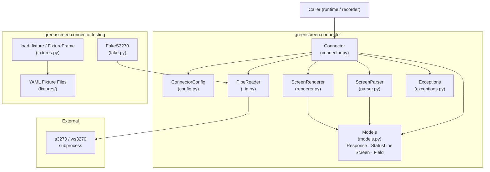

# Design Document: tn3270-connector

## Overview

The `tn3270-connector` is a Python 3.11+ library that drives an `s3270` (Linux/macOS) or `ws3270` (Windows) subprocess to maintain a headless IBM 3270 terminal session. It is Core Piece 1 of Green Screen Medium: the deterministic bridge between modern callers and legacy MVS/TK5 hosts.

The library's public surface is intentionally narrow — open a session, send actions, wait for the host, read a structured screen, close the session. All subprocess lifecycle management, response parsing, cross-platform pipe I/O, and timeout enforcement happen inside the library. Callers never touch raw s3270 protocol strings.

**Key design goals:**

- Deterministic and auditable: no LLM, no inference, every step is reproducible.
- Fully testable without a live host, using `FakeS3270` and recorded fixtures.
- Cross-platform: the same code runs on Windows (ws3270) and Linux/macOS (s3270) with no caller-visible differences.
- Typed end-to-end: all public APIs use dataclasses and typed return values; raw strings stay inside module boundaries.

---

## Architecture

### Component Diagram



### Data Flow for a Single Action

```
Caller
  │  connector.read_screen()          connector.ascii()
  │        │                                  │
  │  connector.send("ReadBuffer(Ascii)")  connector.send("Ascii()")
  ▼
Connector
  │  writes "ReadBuffer(Ascii)\n" to subprocess stdin
  ▼
s3270 subprocess  (or FakeS3270 in tests)
  │  emits: "data: ...\n"  (zero or more)
  │          "<status line>\n"
  │          "ok\n"
  ▼
PipeReader (daemon thread)
  │  readline() loop → Queue
  ▼
Connector._read_response()
  │  queue.get(timeout=N) until "ok" or "error"
  ▼
ScreenParser.parse_readbuffer() (for ReadBuffer responses)
  │  builds Screen object (cell_grid + sa_tokens; text_grid/fields are derived)
  ▼
Caller receives Response or Screen object
```

`read_screen()` sends only `ReadBuffer(Ascii)` — a single atomic round-trip. The text grid is a derived view on the resulting `Screen`. `ascii()` is available separately for callers that need the human-readable text form independently.

---

## Package Structure

```
greenscreen/
└── connector/
    ├── __init__.py          # Public exports
    ├── config.py            # ConnectorConfig dataclass
    ├── connector.py         # Connector class
    ├── models.py            # Response, StatusLine, Screen, Field
    ├── parser.py            # ScreenParser
    ├── renderer.py          # ScreenRenderer
    ├── exceptions.py        # Exception hierarchy
    ├── _io.py               # PipeReader (cross-platform thread+queue)
    └── testing/
        ├── __init__.py
        ├── fake.py          # FakeS3270
        ├── fixtures.py      # load_fixture, FixtureFrame
        └── fixtures/
            ├── tk5-logo.yaml
            └── tk5-logon.yaml

tests/
├── unit/                    # Unit tests (FakeS3270 or direct)
├── property/                # Hypothesis tests
└── integration/             # Live-host tests (auto-skip)
```

---

## Components and Interfaces

### `config.py` — ConnectorConfig

```python
from dataclasses import dataclass, field
import os

@dataclass
class ConnectorConfig:
    host: str = ""                   # falls back to GS_HOST env var
    port: int = 23                   # falls back to GS_PORT env var; range 1–65535
    binary: str = ""                 # falls back to GS_S3270_BINARY env var
    model: str = "3279-2"
    default_timeout: float = 30.0    # range 1–3600

    def __post_init__(self) -> None:
        # Resolve env-var fallbacks for binary, host, port
        if not self.binary:
            self.binary = os.environ.get("GS_S3270_BINARY", "")
        if not self.host:
            self.host = os.environ.get("GS_HOST", "")
        if self.port == 23:  # sentinel: check env override
            env_port = os.environ.get("GS_PORT", "")
            if env_port:
                self.port = int(env_port)
        self._validate()

    def _validate(self) -> None:
        # Raises ConfigurationError for missing required fields or out-of-range values
        ...
```

Fields requiring resolution before the first subprocess start:

| Field | Env var fallback | Default | Valid range |
|---|---|---|---|
| `binary` | `GS_S3270_BINARY` | — (required) | non-empty path |
| `host` | `GS_HOST` | — (required) | non-empty string |
| `port` | `GS_PORT` | `23` | 1–65535 |
| `model` | — | `3279-2` | any non-empty string |
| `default_timeout` | — | `30.0` | 1–3600 |

Credentials (`username`, `password`) are explicitly excluded from `ConnectorConfig`; they are passed as arguments at call time or read from env vars by the caller.

---

### `exceptions.py` — Exception Hierarchy

```python
class ConnectorError(Exception):
    """Base class for all tn3270-connector exceptions."""

class ConfigurationError(ConnectorError):
    """A configuration parameter is missing, wrong type, or out of range."""
    # .parameter_name: str

class S3270Error(ConnectorError):
    """s3270 returned an error response, or the subprocess exited unexpectedly."""
    # .action: str
    # .data_lines: list[str]
    # .status_line: StatusLine | None
    # .exit_code: int | None   (set when subprocess exited unexpectedly)

class ConnectorTimeoutError(ConnectorError):
    """A read or wait operation exceeded its configured deadline."""
    # .operation: str    (action name or wait type)
    # .deadline: float   (seconds)

class ParseError(ConnectorError):
    """The ScreenParser could not interpret s3270 output."""
    # .raw: str          (the offending line or token)

class SessionClosedError(ConnectorError):
    """A method was called on a Connector whose session is already closed."""
```

Hierarchy diagram:

```
Exception
└── ConnectorError
    ├── ConfigurationError
    ├── S3270Error
    ├── ConnectorTimeoutError
    ├── ParseError
    └── SessionClosedError
```

`ConnectorTimeoutError` is intentionally named to avoid shadowing Python's built-in `TimeoutError`.

---

### `models.py` — Data Models

```python
from dataclasses import dataclass, field as dc_field
from typing import Union


@dataclass(frozen=True)
class StatusLine:
    keyboard_state: str       # field 1 — exact token, e.g. "U"
    screen_formatting: str    # field 2
    field_protection: str     # field 3
    connection_state: str     # field 4 — exact token, e.g. "C(127.0.0.1)"
    emulator_mode: str        # field 5
    model_number: str         # field 6 — e.g. "2"
    rows: int                 # field 7 — decimal integer
    columns: int              # field 8 — decimal integer
    cursor_row: int           # field 9 — zero-origin
    cursor_col: int           # field 10 — zero-origin
    window_id: str            # field 11 — e.g. "0x0"
    command_time: str         # field 12 — e.g. "0.006"

    def serialize(self) -> str:
        """Reconstruct the original 12-token status line string."""
        return (
            f"{self.keyboard_state} {self.screen_formatting} "
            f"{self.field_protection} {self.connection_state} "
            f"{self.emulator_mode} {self.model_number} "
            f"{self.rows} {self.columns} "
            f"{self.cursor_row} {self.cursor_col} "
            f"{self.window_id} {self.command_time}"
        )


@dataclass(frozen=True)
class SFToken:
    """A field-attribute token occupying one cell position."""
    c0: int        # raw attribute byte, e.g. 0xc8, 0xe0

@dataclass(frozen=True)
class SAToken:
    """A color-attribute token (SA(42=xx)); does not occupy a cell (verified 2026-11-15: every row has exactly 80 non-SA tokens)."""
    value: int     # raw value byte, e.g. 0xf2

# CellValue is either an int (0x00–0xFF, the raw ASCII byte) or an SFToken.
# SAToken is recorded in a separate per-row list (not in the main cell grid).
CellValue = Union[int, SFToken]


@dataclass(frozen=True)
class Field:
    """Pure derived view computed from the raw cell grid. Not stored directly."""
    start_row: int
    start_col: int
    # end position is implicitly the cell before the next SF token (wrapping)
    protected: bool      # derived: bool(sf_token.c0 & 0x20)
    modified: bool       # derived: bool(sf_token.c0 & 0x01)
    # text and byte_length are derived from the cell_grid slice for this field


@dataclass
class Screen:
    rows: int
    columns: int
    cursor_row: int      # zero-origin, from status line
    cursor_col: int      # zero-origin, from status line
    # Primary storage: raw cell grid. Each row is exactly `columns` CellValues.
    # An int cell is the raw byte (0x00 stays 0x00, not space).
    # An SFToken cell marks the start of a 3270 field attribute at that position.
    cell_grid: list[list[CellValue]]
    # SA tokens: per-row list of (col_index, SAToken) pairs, in order of appearance.
    sa_tokens: list[list[tuple[int, SAToken]]]

    # Derived views (computed properties, not stored):
    @property
    def text_grid(self) -> list[str]:
        """One string per row; SFToken cells → ' ', int 0x00 → ' ', others → chr(byte)."""
        ...

    @property
    def fields(self) -> list[Field]:
        """Derive Field list from SFToken positions, wrapping across row boundaries."""
        ...

    def text_at(self, row: int, col: int, length: int) -> str:
        """Extract `length` chars from text_grid[row] starting at col."""
        # Raises ValueError for any out-of-bounds argument.
        ...

    def find_field(self, row: int, col: int) -> Field | None:
        """Return the Field containing (row, col), or None."""
        ...

    def __eq__(self, other: object) -> bool:
        """Equality on cell_grid and sa_tokens only (derived views are ignored)."""
        ...


@dataclass(frozen=True)
class Response:
    success: bool
    data_lines: list[str]   # "data: " prefix stripped
    status: StatusLine
```

---

### `_io.py` — Cross-Platform Pipe Reader

The challenge: `select.select()` does not support subprocess pipes on Windows. The solution is a daemon reader thread that calls `readline()` in a tight loop and puts each line into a `queue.Queue`. The main thread calls `queue.get(timeout=N)` to enforce deadlines.

```python
import queue
import threading
from typing import IO

class PipeReader:
    """Background daemon thread that drains a readable pipe into a queue."""

    def __init__(self, pipe: IO[bytes]) -> None:
        self._pipe = pipe
        self._queue: queue.Queue[bytes | None] = queue.Queue()
        self._thread = threading.Thread(
            target=self._reader_loop,
            daemon=True,     # exits when the main process exits
            name="gs-pipe-reader",
        )
        self._thread.start()

    def _reader_loop(self) -> None:
        """Run in background thread. Puts None on EOF.

        Binary pipe: strip \\r\\n explicitly after each readline() call.
        Python's binary-mode readline() on a Windows pipe returns lines ending
        with \\r\\n. The PipeReader strips \\r\\n explicitly before putting
        the line on the queue. All downstream code receives bare bytes without
        line endings.
        """
        try:
            for raw_line in self._pipe:
                line = raw_line.rstrip(b"\r\n")
                self._queue.put(line)
        finally:
            self._queue.put(None)   # sentinel: pipe closed / process exited

    def readline(self, timeout: float) -> bytes:
        """
        Block until one line is available or `timeout` seconds elapse.
        Returns bare bytes (line endings already stripped by _reader_loop).
        Raises ConnectorTimeoutError on timeout.
        Raises S3270Error (with exit_code) on EOF (process exited).
        """
        try:
            line = self._queue.get(timeout=timeout)
        except queue.Empty:
            raise ConnectorTimeoutError(...)
        if line is None:
            raise S3270Error(...)   # subprocess exited
        return line
```

**Why this is correct on both platforms:**
- `readline()` on a pipe blocks in the OS and delivers a full line atomically. No polling is needed.
- `queue.Queue` is thread-safe; no locks are needed in callers.
- The daemon flag ensures the thread is reaped when the process exits, even if `close()` is never called.
- On Windows, `readline()` over a pipe returns lines ending with `\r\n`; `rstrip(b"\r\n")` normalises them before they reach the queue. On Linux, `\n`-terminated lines are unaffected.

---

### `connector.py` — Connector

```python
import logging
import subprocess
import sys
from types import TracebackType

logger = logging.getLogger("greenscreen.connector")

class Connector:
    def __init__(self, config: ConnectorConfig) -> None:
        self._config = config
        self._proc: subprocess.Popen | None = None
        self._reader: PipeReader | None = None
        self._closed = False

    # ── Context manager ──────────────────────────────────────────────────
    def __enter__(self) -> "Connector":
        self.open()
        return self

    def __exit__(
        self,
        exc_type: type[BaseException] | None,
        exc_val: BaseException | None,
        tb: TracebackType | None,
    ) -> bool:
        self.close()
        return False   # always re-raise

    # ── Lifecycle ────────────────────────────────────────────────────────
    def open(self) -> None:
        """Start s3270 subprocess and send Connect(host:port)."""
        ...

    def close(self) -> None:
        """Send Disconnect() + Quit(), wait up to 5 s, then terminate."""
        ...

    # ── Actions ──────────────────────────────────────────────────────────
    def send(self, action: str) -> Response:
        """Write action to stdin, read response, return Response or raise."""
        ...

    def enter(self) -> Response:
        return self.send("Enter()")

    def pf(self, n: int) -> Response:
        if not 1 <= n <= 24:
            raise ValueError(f"PF key n must be 1–24, got {n!r}")
        return self.send(f"PF({n})")

    def pa(self, n: int) -> Response:
        if not 1 <= n <= 24:
            raise ValueError(f"PA key n must be 1–24, got {n!r}")
        return self.send(f"PA({n})")

    def clear(self) -> Response:
        return self.send("Clear()")

    def string(self, text: str) -> Response:
        """Escape text for s3270 String() and send it."""
        if len(text) > 3000:
            raise ValueError(f"text length {len(text)} exceeds 3000-character limit")
        escaped = _escape_s3270_string(text)
        return self.send(f'String("{escaped}")')

    def move_cursor(self, row: int, col: int) -> Response:
        if row < 0 or col < 0:
            raise ValueError(f"row and col must be non-negative, got ({row}, {col})")
        return self.send(f"MoveCursor({row},{col})")

    # ── Wait operations ───────────────────────────────────────────────────
    def wait_for_output(self, timeout: float | None = None) -> Response:
        t = self._resolve_timeout(timeout)
        # Read deadline = t + WAIT_GRACE_SECONDS so s3270's own Wait(t,...) always
        # fires and writes its response before the PipeReader deadline expires.
        return self._send_with_deadline(f"Wait({t},Output)", deadline=t + WAIT_GRACE_SECONDS)

    def wait_for_field(self, timeout: float | None = None) -> Response:
        t = self._resolve_timeout(timeout)
        return self._send_with_deadline(f"Wait({t},InputField)", deadline=t + WAIT_GRACE_SECONDS)

    def wait_for_unlock(self, timeout: float | None = None) -> Response:
        t = self._resolve_timeout(timeout)
        return self._send_with_deadline(f"Wait({t},Unlock)", deadline=t + WAIT_GRACE_SECONDS)

    def snap_save(self) -> Response:
        return self.send("Snap(Save)")

    # ── Screen capture ────────────────────────────────────────────────────
    def read_screen(self) -> Screen:
        """
        Send ReadBuffer(Ascii) only. The text grid is derived from the raw cell data.
        This makes the snapshot atomic (single round-trip to s3270).
        """
        rdbuf_resp = self.send("ReadBuffer(Ascii)")
        return ScreenParser().parse_readbuffer(rdbuf_resp)

    def ascii(self) -> Response:
        """
        Send Ascii() and return the raw Response (data lines = text rows).
        Available for callers that need the human-readable text form independently.
        """
        return self.send("Ascii()")

    # ── Internal helpers ──────────────────────────────────────────────────
    WAIT_GRACE_SECONDS: float = 5.0  # added to the s3270 Wait(N,...) timeout

    def _resolve_timeout(self, timeout: float | None) -> float:
        t = timeout if timeout is not None else self._config.default_timeout
        if t <= 0:
            raise ValueError(f"timeout must be positive, got {t!r}")
        if t > 3600:
            raise ValueError(f"timeout must be at most 3600, got {t!r}")
        return t

    def _send_with_deadline(self, action: str, deadline: float) -> Response:
        """Write action to stdin; read response with the given deadline (not default_timeout).
        Used by wait_for_* so the PipeReader deadline is longer than s3270's own Wait(N,...)."""
        ...

    def _read_response(self, action: str, timeout: float) -> Response:
        """Read lines from PipeReader until ok/error; build Response."""
        ...

    def _write(self, action: str) -> None:
        logger.debug("sent action=%s", action)
        ...
```

**`open()` subprocess start sequence:**
1. Build command line: `[config.binary, "-model", config.model]`.
2. `subprocess.Popen(cmd, stdin=PIPE, stdout=PIPE, stderr=PIPE)`.
3. Wrap `proc.stdout` in `PipeReader` (stdout reader thread).
4. Wrap `proc.stderr` in a second daemon thread that drains and discards stderr output — "Stderr is drained by a dedicated daemon thread to prevent the subprocess from blocking on a full stderr pipe buffer. The drained bytes are discarded; they are not surfaced to callers." Alternatively `stderr=subprocess.DEVNULL` may be used if no stderr capture is ever needed.
5. Send `Connect(host:port)` as the very first command (never on command line).
6. If the Connect response is `error`, terminate the subprocess and raise `ConnectorError`.

**`close()` sequence:**
1. If already closed or proc is None, return silently.
2. Send `Disconnect()`.
3. Send `Quit()`.
4. `proc.wait(timeout=5)`.
5. If `TimeoutExpired`:
   a. `proc.terminate()`
   b. `proc.wait(timeout=5)` — second wait after terminate()
   c. If still `TimeoutExpired`: `proc.kill()` — unconditional kill as last resort
   d. Log a warning (regardless of whether terminate() or kill() was needed).
6. Mark `_closed = True`.

---

### `parser.py` — ScreenParser

```python
class ScreenParser:
    def parse_readbuffer(self, response: Response) -> Screen:
        """Build a Screen from a single ReadBuffer(Ascii) response."""
        status = response.status
        rows   = status.rows
        cols   = status.columns
        cursor_row = status.cursor_row
        cursor_col = status.cursor_col

        cell_grid, sa_tokens = self._tokenize(response.data_lines, rows, cols)
        return Screen(rows, cols, cursor_row, cursor_col, cell_grid, sa_tokens)

    def parse_status_line(self, raw: str) -> StatusLine:
        """Parse a 12-token s3270 status line. Raises ParseError on failure."""
        tokens = raw.split()
        if len(tokens) != 12:
            raise ParseError(raw=raw)
        try:
            return StatusLine(
                keyboard_state   = tokens[0],
                screen_formatting= tokens[1],
                field_protection = tokens[2],
                connection_state = tokens[3],
                emulator_mode    = tokens[4],
                model_number     = tokens[5],
                rows             = int(tokens[6]),
                columns          = int(tokens[7]),
                cursor_row       = int(tokens[8]),
                cursor_col       = int(tokens[9]),
                window_id        = tokens[10],
                command_time     = tokens[11],
            )
        except ValueError as exc:
            raise ParseError(raw=raw) from exc

    def _tokenize(
        self, data_lines: list[str], rows: int, cols: int
    ) -> tuple[list[list[CellValue]], list[list[tuple[int, SAToken]]]]:
        """Tokenize ReadBuffer(Ascii) lines into cell_grid and sa_tokens.
        State is maintained across row boundaries so that SF fields wrap correctly."""
        ...
```

#### ReadBuffer(Ascii) Tokenizer

Each `data:` line (after stripping the `data: ` prefix) is a space-separated sequence of tokens:

| Token pattern | Meaning |
|---|---|
| `[0-9a-fA-F]{2}` | Character cell — raw ASCII byte value in hex |
| `SF(c0=xx)` | Field attribute — stored as `SFToken(c0=int(xx,16))`, occupies one cell position |
| `SA(42=xx)` | Color attribute — stored as `SAToken(value=int(xx,16))` in `sa_tokens`; does not occupy a cell (verified 2026-11-15: every row in both ReadBuffer captures has exactly 80 non-SA tokens) |

**Tokenizer algorithm (processes ALL rows as a single flat sequence):**

State is maintained across row boundaries — a 3270 field runs from its `SF` cell to the cell immediately before the next `SF` cell, wrapping from the last cell of one row to the first cell of the next row and potentially spanning many rows.

```
# State maintained across ALL rows (not reset per row):
current_sf_linear_pos: int | None = None   # linear position of the opening SF token
current_sf_token: SFToken | None = None
all_sf_positions: list[tuple[int, SFToken]] = []   # (linear_pos, sf_token)

# Process rows in order; for each row, for each token:
for row_index, row_tokens in enumerate(data_lines):
    col_index = 0
    for token in tokenize(row_tokens):
        linear_pos = row_index * columns + col_index

        if token is a hex cell (matches /^[0-9a-fA-F]{2}$/):
            cell_grid[row_index][col_index] = int(token, 16)
            col_index += 1

        elif token matches /^SF\(c0=([0-9a-fA-F]{2})\)$/:
            sf = SFToken(c0=int(capture_group_1, 16))
            cell_grid[row_index][col_index] = sf
            all_sf_positions.append((linear_pos, sf))
            col_index += 1

        elif token matches /^SA\(42=([0-9a-fA-F]{2})\)$/:
            sa_tokens[row_index].append((col_index, SAToken(value=int(capture_group_1, 16))))
            # SA tokens do NOT advance col_index (verified: every row has exactly 80 non-SA tokens)

        else:
            raise ParseError(raw=token)

# After processing all rows, the Field list is derived from all_sf_positions:
# Each field spans from its SF linear position to the linear position
# of the next SF token (exclusive), wrapping modulo (rows * columns).
# Fields are ordered by their SF linear position.
# This derivation happens lazily in Screen.fields (the computed property).
```

**`c0` attribute byte decoding** (IBM 3270 Data Stream Programmer's Reference, verified 2026-11-15):

| `c0` hex value | Binary | `protected` (0x20) | `numeric` (0x10) | `hidden` (0x0C==0x0C) | `modified` (0x01) |
|---|---|---|---|---|---|
| `c8` | 1100 1000 | `False` | `False` | `False` | `False` |
| `e0` | 1110 0000 | `True` | `False` | `False` | `False` |
| `e8` | 1110 1000 | `True` | `False` | `False` | `False` |
| `f0` | 1111 0000 | `True` | `False` | `False` | `False` |
| `f8` | 1111 1000 | `True` | `False` | `False` | `False` |

`c8` is the logon input field (unprotected, not hidden); all others are protected headers. A field attribute byte of `0xFC` (1111 1100) would be protected, numeric, and hidden (password field).

Field construction is performed by a single shared `Screen._build_field(r, c, sf_tok, byte_length, cell_grid, columns)` static method. Both `Screen.fields` and `Screen.find_field` call this helper, ensuring the two code paths cannot drift.

---

### `renderer.py` — ScreenRenderer

The renderer serializes a `Screen` back to `ReadBuffer(Ascii)` format: one `data:` line per row, with character cells as two-digit hex codes and field-start positions as `SF(c0=xx)` tokens.

```python
class ScreenRenderer:
    def render(self, screen: Screen) -> list[str]:
        """
        Return a list of strings in ReadBuffer(Ascii) format,
        one element per row (without the 'data: ' prefix).
        Each element is a space-separated sequence of hex codes and SF tokens.
        """
        ...
```

**Rendering algorithm:**

1. Iterate `screen.cell_grid` row by row. For each cell value in the row:
   - If the value is an `int`, emit it as a zero-padded two-digit lowercase hex code (e.g. `0x4c` → `"4c"`, `0x00` → `"00"`).
   - If the value is an `SFToken`, emit `SF(c0=xx)` where `xx` is the raw `c0` byte formatted as zero-padded two-digit lowercase hex (e.g. `SFToken(c0=0xc8)` → `"SF(c0=c8)"`). The raw byte is used verbatim — never recomputed from `protected`/`modified` flags.
2. Before emitting each cell at column index `col_index` in the current row, check `screen.sa_tokens[row_index]` for any `SAToken` recorded at that column position. If one exists, emit `SA(42=xx)` (with `xx` as zero-padded two-digit lowercase hex of the token's value) immediately before the cell token.
3. After all cells in a row are emitted, join the token list for that row with a single space to produce the row string.

**Round-trip guarantee:**

The round-trip is defined on the `ReadBuffer(Ascii)` representation:

```
ScreenParser.parse_readbuffer(ScreenRenderer.render(screen)) == screen
```

This holds when:
- Every `SF(c0=xx)` token position in the rendered output matches the `start_col` of the corresponding `SFToken` in `cell_grid`.
- Every character cell hex value decodes to the raw byte stored in `cell_grid` at that position (including `0x00` — not silently promoted to space).
- The renderer writes back the exact raw `c0` byte from each `SFToken` and never recomputes it from the `protected`/`modified` flags.

**Property 2 must pass on every file in `/captures` (both logo and logon).** The lossless raw-byte model ensures the renderer can faithfully reproduce what s3270 actually emitted without any information loss.

---

### s3270 String Quoting Algorithm

The `string()` method on `Connector` encodes a Python string for transmission as an s3270 `String()` argument.

**Rules:**
1. Backslash (`\`) → `\\` (must be escaped first to avoid double-escaping)
2. Double-quote (`"`) → `\"`
3. Wrap the result in double quotes: `"escaped_text"`

```python
def _escape_s3270_string(text: str) -> str:
    text = text.replace("\\", "\\\\")   # step 1: backslashes first
    text = text.replace('"', '\\"')      # step 2: double-quotes
    return text

# Inverse (for testing only):
def _unescape_s3270_string(escaped: str) -> str:
    result = []
    i = 0
    while i < len(escaped):
        if escaped[i] == "\\" and i + 1 < len(escaped):
            result.append(escaped[i + 1])
            i += 2
        else:
            result.append(escaped[i])
            i += 1
    return "".join(result)
```

The key ordering invariant: backslashes must be escaped before double-quotes. If the order were reversed, a literal `\"` in the input would become `\\"` (backslash escape applied first to the already-escaped quote), breaking the round-trip.

---

## Data Models

### ConnectorConfig

| Attribute | Type | Default | Valid range | Env var fallback |
|---|---|---|---|---|
| `binary` | `str` | (required) | non-empty | `GS_S3270_BINARY` |
| `host` | `str` | (required) | non-empty | `GS_HOST` |
| `port` | `int` | `23` | 1–65535 | `GS_PORT` |
| `model` | `str` | `"3279-2"` | non-empty | — |
| `default_timeout` | `float` | `30.0` | 1.0–3600.0 | — |

### Response

| Attribute | Type | Description |
|---|---|---|
| `success` | `bool` | `True` if s3270 said `ok` |
| `data_lines` | `list[str]` | Lines with `data: ` prefix stripped |
| `status` | `StatusLine` | Parsed status line |

### StatusLine

Twelve named attributes corresponding to the 12 space-separated fields that s3270 appends to every response (see Requirements §6). `rows`, `columns`, `cursor_row`, `cursor_col` are integers; all others are exact token strings.

### Screen

| Attribute | Type | Stored/Derived | Description |
|---|---|---|---|
| `rows` | `int` | stored | From status line |
| `columns` | `int` | stored | From status line |
| `cursor_row` | `int` | stored | Zero-origin, from status line |
| `cursor_col` | `int` | stored | Zero-origin, from status line |
| `cell_grid` | `list[list[CellValue]]` | **canonical** | `rows` × `columns` raw cell values; `int` = raw byte, `SFToken` = field-attribute cell |
| `sa_tokens` | `list[list[tuple[int, SAToken]]]` | **canonical** | Per-row list of `(col_index, SAToken)` pairs |
| `text_grid` | `list[str]` | *derived property* | One string per row; `SFToken` and `0x00` cells → `' '` |
| `fields` | `list[Field]` | *derived property* | Computed from `SFToken` positions in `cell_grid`, wrapping across rows |

### Field (pure derived view)

`Field` is not stored directly; it is computed from `SFToken` positions in `cell_grid`. `text` and `byte_length` are derived from the `cell_grid` slice covered by the field.

| Attribute | Type | Description |
|---|---|---|
| `start_row` | `int` | Zero-origin row of the SF token |
| `start_col` | `int` | Zero-origin col of the SF token |
| `byte_length` | `int` | Number of data cells following the SF token, up to (not including) the next SF token, wrapping across row boundaries |
| `protected` | `bool` | `bool(c0 & 0x20)` — field cannot be modified by the operator |
| `numeric` | `bool` | `bool(c0 & 0x10)` — only numeric input accepted |
| `hidden` | `bool` | `(c0 & 0x0C) == 0x0C` — non-display / password field |
| `modified` | `bool` | `bool(c0 & 0x01)` — field has been modified since last read |
| `c0` | `int` | Raw attribute byte from the SF token (e.g. `0xc8`) |
| `text` | `str` | Decoded field content, exactly `byte_length` characters |

> **Security — hidden fields:** A `Field` with `hidden=True` has display intensity bits 3 and 2 both set (`c0 & 0x0C == 0x0C`), which is the standard 3270 mechanism for password fields. Every component downstream of `ScreenParser` — the logger, the screen fingerprinter, the flow recorder, the MCP publisher — MUST check `field.hidden` before accessing `field.text`. Hidden field text must never be written to logs, persisted to disk, or transmitted outside the process. Source: IBM 3270 Data Stream Programmer's Reference, field attribute byte bit definitions (verified 2026-11-15).

### SFToken / SAToken

| Type | Attribute | Description |
|---|---|---|
| `SFToken` | `c0: int` | Raw attribute byte (e.g. `0xc8`, `0xe0`). The renderer writes this byte back verbatim — never recomputes it from `protected`/`modified` flags. |
| `SAToken` | `value: int` | Raw value byte from `SA(42=xx)` (e.g. `0xf2`). |

---

## Correctness Properties

*A property is a characteristic or behavior that should hold true across all valid executions of a system — essentially, a formal statement about what the system should do. Properties serve as the bridge between human-readable specifications and machine-verifiable correctness guarantees.*

### Property 1: Screen parse–render round-trip

*For any* valid `Screen` object (with arbitrary rows, columns, text grid, and fields), parsing the rendered ReadBuffer representation must produce a `Screen` that compares equal to the original under `Screen.__eq__`.

**Validates: Requirements 9.1, 5.2, 5.3**

---

### Property 2: Render is left inverse of parse

*For any* valid `ReadBuffer(Ascii)` representation (generated with arbitrary rows, columns, and a mix of two-digit hex cell tokens and `SF(c0=xx)` tokens), rendering the parsed `Screen` must recover the original `ReadBuffer(Ascii)` lines exactly. This property must pass on the actual data in every file in `/captures`.

**Validates: Requirements 9.2, 5.1**

---

### Property 3: StatusLine serialize–parse round-trip

*For any* string of exactly 12 space-separated tokens (each a non-empty sequence of printable ASCII characters excluding space), parsing into a `StatusLine` and then calling `serialize()` must reproduce the original 12-token sequence with identical values in identical order.

**Validates: Requirements 9.3, 6.1, 6.2, 6.3, 6.4, 6.5**

---

### Property 4: s3270 string escaping round-trip

*For any* printable ASCII string of length 0–3000 (characters U+0020–U+007E), applying `_escape_s3270_string` then `_unescape_s3270_string` must recover the original string exactly.

**Validates: Requirements 9.6, 3.6**

---

### Property 5: `c0` attribute byte protected-flag correctness

*For any* two-digit hexadecimal byte value `nn` (0x00–0xFF), the `protected` flag computed by the parser equals `bool(int(nn, 16) & 0x20)` and the `modified` flag equals `bool(int(nn, 16) & 0x01)`.

**Validates: Requirements 5.9**

---

### Property 6: `text_at` extracts the correct substring

*For any* `Screen` with arbitrary `text_grid` and any valid `(row, col, length)` triple (row in `[0, rows-1]`, col in `[0, cols-1]`, length ≥ 1, `col+length ≤ cols`), `screen.text_at(row, col, length)` must equal `screen.text_grid[row][col:col+length]`.

**Validates: Requirements 5.6**

---

### Property 7: `pf` / `pa` raises `ValueError` iff `n` is out of `[1, 24]`

*For any* integer `n`, calling `connector.pf(n)` or `connector.pa(n)` raises `ValueError` if and only if `n < 1` or `n > 24`.

**Validates: Requirements 3.5**

---

### Property 8: Wait timeout substitution

*For any* `ConnectorConfig` with a given `default_timeout` and any `timeout` argument in `(0.0, 3600.0]`, the s3270 command sent by `wait_for_output` / `wait_for_field` / `wait_for_unlock` contains the exact numeric timeout value; when `timeout=None`, the command contains the `default_timeout` value.

**Validates: Requirements 4.1, 4.2, 4.3**

---

### Property 9: `data:` prefix stripping preserves content

*For any* list of strings, wrapping each with `"data: "` and then passing the result through the response parser must recover the original strings as `Response.data_lines`.

**Validates: Requirements 3.2**

---

## Error Handling

### Decision Table

| Situation | Exception | Key attributes |
|---|---|---|
| Config field missing or invalid | `ConfigurationError` | `.parameter_name` |
| s3270 returns `error` token | `S3270Error` | `.action`, `.data_lines`, `.status_line` |
| s3270 subprocess exited unexpectedly | `S3270Error` | `.action`, `.exit_code` |
| Read/wait exceeds deadline | `ConnectorTimeoutError` | `.operation`, `.deadline` |
| s3270 binary not found | `ConnectorError` | message includes `.binary` path |
| `open()` called on already-open session | `ConnectorError` | message indicates already open |
| `Connect()` returns error | `ConnectorError` | includes host:port |
| Status line missing or malformed | `ParseError` | `.raw` |
| `SF` token hex value invalid | `ParseError` | `.raw` (the offending token) |
| Method called after `close()` | `SessionClosedError` | — |

### Subprocess Exit During Active Session

When `PipeReader` sees EOF (the None sentinel), it raises `S3270Error` on the next `readline()` call, including the subprocess exit code. This propagates through `_read_response()` to the caller as a `S3270Error` whose `exit_code` is set.

### Timeout Cleanup

When `ConnectorTimeoutError` is raised from `_read_response()`:
1. The partial response is discarded.
2. `proc.terminate()` is called.
3. `proc.wait(timeout=5)` is attempted.
4. If still running: `proc.kill()`.
5. The connector is marked closed.

### Logging

All log output goes to logger `greenscreen.connector` at DEBUG level. Each record includes:
- `action`: the s3270 command string
- `direction`: `"sent"` or `"received"`
- `raw`: the full raw s3270 response string

No log records are emitted at INFO or above during normal operation. Warnings are emitted only when `close()` has to forcibly terminate the subprocess.

---

## Testing Strategy

### Unit Tests (`tests/unit/`)

Unit tests use `FakeS3270` to substitute for the real subprocess. No network connection required.

Coverage targets:
- `ConnectorConfig` construction, env-var fallback, `ConfigurationError` on missing fields.
- `Connector.open()` and `close()` lifecycle via `FakeS3270`.
- Context-manager protocol (`__enter__` / `__exit__`).
- `send()`: success path, `S3270Error` on `error`, `ValueError` for invalid action strings.
- `string()` escaping: specific examples with backslashes, double-quotes, mixed.
- `move_cursor()`: negative-coordinate `ValueError`.
- `pf()` / `pa()`: boundary values (n=1, n=24, n=0, n=25).
- Wait methods: timeout substitution (None → default), `ValueError` for ≤ 0.
- `ScreenParser.parse_status_line()`: valid input, wrong token count, non-integer numeric fields.
- `ScreenParser._parse_readbuffer_lines()`: `SF` decoding, `SA` recording, `ParseError` on invalid hex.
- `Screen.text_at()`: valid range, each out-of-bounds case.
- `Screen.find_field()`: position inside a field, position between fields, `None` when no fields.
- `FakeS3270`: pattern mismatch raises `AssertionError`, exhaustion raises `AssertionError`.
- `load_fixture()`: parses `tk5-logo.yaml` and `tk5-logon.yaml` without error.
- `SA(42=xx)` cell-occupancy regression test: count non-SA tokens per row in logon fixture and assert each row has exactly 80 non-SA tokens (confirmed settled fact, steering doc 2026-11-15).
- `Logon ===>` field wrap test: using the logon screen fixture from `captures/`, verify that the `Logon ===>` input field (`SF c0=c8` at its known position) spans to the end of the screen (wrapping past the last row of the visible area), and that `find_field` returns the correct `Field` for a cell position inside that span.

### Property Tests (`tests/property/`) — Hypothesis

```python
# Property 1: parse_readbuffer(render(screen)) == screen
from hypothesis import given, settings
import hypothesis.strategies as st

@given(arbitrary_screen())
@settings(max_examples=200)
def test_screen_roundtrip(screen: Screen) -> None:
    # Feature: tn3270-connector, Property 1: Screen parse-render round-trip
    rendered  = ScreenRenderer().render(screen)
    status    = StatusLine(
        keyboard_state="U", screen_formatting="F", field_protection="U",
        connection_state="C(127.0.0.1)", emulator_mode="I", model_number="2",
        rows=screen.rows, columns=screen.columns,
        cursor_row=screen.cursor_row, cursor_col=screen.cursor_col,
        window_id="0x0", command_time="0.000",
    )
    response  = Response(success=True, data_lines=rendered, status=status)
    recovered = ScreenParser().parse_readbuffer(response)
    assert recovered == screen
```

```python
# Property 2: render(parse_readbuffer(readbuffer_lines)) == readbuffer_lines
@given(arbitrary_readbuffer_lines())
@settings(max_examples=200)
def test_render_left_inverse(raw_lines: list[str], status: StatusLine) -> None:
    # Feature: tn3270-connector, Property 2: Render is left inverse of parse
    response = Response(success=True, data_lines=raw_lines, status=status)
    screen   = ScreenParser().parse_readbuffer(response)
    rendered = ScreenRenderer().render(screen)
    assert rendered == raw_lines
```

```python
# Property 3: StatusLine serialize-parse round-trip
@given(arbitrary_status_line_string())
@settings(max_examples=500)
def test_status_line_roundtrip(raw: str) -> None:
    # Feature: tn3270-connector, Property 3: StatusLine serialize-parse round-trip
    parsed = ScreenParser().parse_status_line(raw)
    assert parsed.serialize() == raw
```

```python
# Property 4: s3270 string escaping round-trip
@given(st.text(
    alphabet=st.characters(min_codepoint=0x20, max_codepoint=0x7E),
    max_size=3000,
))
@settings(max_examples=500)
def test_escape_roundtrip(text: str) -> None:
    # Feature: tn3270-connector, Property 4: s3270 string escaping round-trip
    assert _unescape_s3270_string(_escape_s3270_string(text)) == text
```

**Hypothesis strategy sketches:**

```python
# arbitrary_screen(): builds a Screen from the raw cell grid
#   rows = st.integers(1, 24)
#   cols = st.integers(10, 80)
#   SF token positions: st.lists(st.integers(0, rows*cols - 1), max_size=10, unique=True)
#     → sorted; each chosen linear position gets an SFToken cell with
#       c0 drawn from st.integers(0x00, 0xFF)
#   All remaining cell positions: raw byte st.integers(0x00, 0xFF)
#   SA tokens: st.lists of (col_index, SAToken) pairs per row,
#     with SAToken.value from st.integers(0x00, 0xFF)
#   cursor_row, cursor_col: st.integers within [0, rows-1] / [0, cols-1]
#   Screen.__eq__ is defined on cell_grid and sa_tokens; derived views are ignored.
#   DO NOT generate text_grid or Field objects directly — they are derived views.

# arbitrary_readbuffer_lines(): generates ReadBuffer(Ascii) lines for Property 2
#   rows = st.integers(1, 24), cols = st.integers(10, 80)
#   SF token positions: st.lists(st.integers(0, rows*cols - 1), max_size=10, unique=True)
#     → each becomes an SF(c0=xx) token in the appropriate row
#   All remaining positions: 2-digit hex codes from st.integers(0x00, 0xFF)
#   SA tokens may appear at any position within a row (not counted as cell slots)
#   The resulting list[str] is passed to ScreenParser.parse_readbuffer();
#     ScreenRenderer.render() must reproduce it exactly (Property 2)

# Note: these strategies never generate Screen objects with independently invented
# `fields` or `text_grid` — only valid Screens constructible from a cell grid are
# generated, enforcing the invariant that fields are always derived from SF positions.
```

All property tests:
- Run with `pytest tests/property/` (no live host).
- Minimum 200 iterations for parser/renderer properties, 500 for pure functions.
- Complete under 60 seconds on a dual-core 2 GHz machine.
- Each test carries a tag comment identifying the design property: `# Feature: tn3270-connector, Property N: ...`

### Integration Tests (`tests/integration/`)

```python
import pytest
import socket

GS_HOST = os.environ.get("GS_HOST", "192.168.68.72")
GS_PORT = int(os.environ.get("GS_PORT", "3270"))

@pytest.fixture(scope="session", autouse=False)
def host_reachable():
    try:
        s = socket.create_connection((GS_HOST, GS_PORT), timeout=5)
        s.close()
    except (OSError, socket.timeout):
        pytest.skip(f"Host {GS_HOST}:{GS_PORT} not reachable")

@pytest.mark.integration
def test_logo_then_logon(host_reachable):
    config = ConnectorConfig(host=GS_HOST, port=GS_PORT, binary=_find_binary())
    with Connector(config) as conn:
        logo_screen = conn.read_screen()
        # Hercules logo — no input field, all protected
        conn.enter()
        conn.wait_for_output(timeout=8)
        logon_screen = conn.read_screen()
        assert "Logon ===>" in "\n".join(logon_screen.text_grid)
```

Integration tests:
- Live under `tests/integration/`, marked `@pytest.mark.integration`.
- Excluded from default run with `-m "not integration"`.
- Auto-skip via `host_reachable` fixture (5-second TCP probe).
- Tests that submit credentials skip separately when `TK5_USERNAME` or `TK5_PASSWORD` is unset.

```python
@pytest.mark.integration
def test_wait_timeout_format(host_reachable):
    """
    Verify that s3270 accepts both integer and decimal timeout notation in Wait().
    Purpose: settle once whether integer or decimal notation is required by each
    binary version (s3270 4.3 / ws3270 4.5), so the connector can emit the correct format.
    If either format is rejected, the test fails and documents which format is required.
    """
    config = ConnectorConfig(host=GS_HOST, port=GS_PORT, binary=_find_binary())
    with Connector(config) as conn:
        conn.enter()
        # Integer seconds format
        resp_int = conn.send("Wait(1,Output)")
        assert resp_int is not None   # ok or error response, not a parse error
        # Decimal seconds format
        resp_dec = conn.send("Wait(1.0,Output)")
        assert resp_dec is not None
```

**Design note — Wait timeout format**: The timeout format sent to `Wait(N,...)` must be verified against both s3270 4.3 and ws3270 4.5. The `_resolve_timeout()` method emits a float (e.g. `30.0`). The integration test `test_wait_timeout_format` verifies both integer and decimal notation are accepted; if only one is, the design will be updated to match.

---

### FakeS3270 Design (`testing/fake.py`)

`FakeS3270` replaces the subprocess in unit tests. It implements the same stdin/stdout protocol as s3270 — write an action string on its stdin, read back data lines + status line + ok/error on its stdout — but processes scripted responses in memory without touching the network.

```python
from dataclasses import dataclass
import re

@dataclass
class ScriptedResponse:
    command_pattern: str     # Python regex matched against incoming command
    response_lines: list[str]
    status_line: str
    result: str              # "ok" or "error"

class FakeS3270:
    def __init__(self, script: list[ScriptedResponse]) -> None:
        self._script = list(script)
        self._index = 0
        # Expose pipe-like stdin/stdout so Connector can wrap it in PipeReader
        self.stdin:  IO[bytes]  = ...
        self.stdout: IO[bytes]  = ...

    def _handle_command(self, command: str) -> None:
        if self._index >= len(self._script):
            raise AssertionError(
                f"FakeS3270 exhausted: no scripted response for command {command!r}"
            )
        entry = self._script[self._index]
        if not re.fullmatch(entry.command_pattern, command.strip()):
            raise AssertionError(
                f"FakeS3270 expected pattern {entry.command_pattern!r}, "
                f"got command {command!r}"
            )
        self._index += 1
        for line in entry.response_lines:
            self.stdout.write(f"data: {line}\n".encode())
        self.stdout.write(f"{entry.status_line}\n".encode())
        self.stdout.write(f"{entry.result}\n".encode())
        self.stdout.flush()
```

### Fixture File Schema (`testing/fixtures/`)

Fixtures are YAML files. Each file contains a list of `FixtureFrame` objects:

```yaml
# tk5-logon.yaml
- data_lines:
    - "54 65 72 6d 69 6e 61 6c SF(c0=f8) ..."   # row 1 as ReadBuffer(Ascii)
    - "..."
  status_line: "U F U C(127.0.0.1) I 2 24 80 22 11 0x0 0.000"
  result: "ok"
```

```python
@dataclass
class FixtureFrame:
    data_lines:  list[str]
    status_line: str
    result:      str         # "ok" or "error"

def load_fixture(path: str) -> list[FixtureFrame]:
    """Load a YAML fixture file and return frames in file order."""
    ...
```

The two bundled fixture files reproduce the exact data lines and status lines from `d:\greenMachine\captures`:
- `tk5-logo.yaml`: built from `tk5-logo.ascii.txt` (Ascii response) and `tk5-logo.readbuffer.txt` (ReadBuffer response). The first valid status line from the readbuffer capture is `U F P C(127.0.0.1) I 2 24 80 0 0 0x0 0.006`.
- `tk5-logon.yaml`: built from `tk5-logon.ascii.txt` and `tk5-logon.readbuffer.txt`. The logon screen status line is `U F U C(127.0.0.1) I 2 24 80 22 11 0x0 0.000` (cursor at row 22, col 11, matching the `Logon ===>` input field position).

Fixture data is not invented or approximated — it is transcribed verbatim from the capture files.

---

## Design Decisions

### Why a background reader thread instead of `asyncio`?

`asyncio.subprocess` would work on Linux but requires the entire call stack to be async-aware. The connector is designed to be used from synchronous runtime code (Green Screen Medium's deterministic flow runner). A background daemon thread with a `queue.Queue` is simpler, keeps the public API synchronous, and works identically on Windows and Linux without any platform-detection code in the caller.

### Why `ConnectorTimeoutError` instead of `TimeoutError`?

Python's built-in `TimeoutError` is a subclass of `OSError`. Callers catching `OSError` would accidentally catch connector timeouts, and callers catching `ConnectorError` would miss Python's `TimeoutError`. Using a distinct name within the `ConnectorError` hierarchy keeps the exception tree unambiguous.

### Why does `open()` never pass the host on the command line?

Verified on the real TK5 host: when s3270 receives the host on the command line, it runs an implicit `Wait(InputField)` before accepting any scripted commands. The TK5 logo screen has no input fields, so it blocks forever. Starting with no host and sending `Connect(host:port)` as the first command avoids this.

### Why `ReadBuffer(Ascii)` for the round-trip, not `Ascii()`?

`Ascii()` discards field metadata (protection flags, modified flags, field boundaries). `ReadBuffer(Ascii)` preserves all of this structure. The round-trip guarantee is therefore only achievable on the `ReadBuffer(Ascii)` representation; `Ascii()` output is only used to populate `text_grid` on the `Screen` object.

### Why `frozen=True` on `StatusLine` and `Field`?

These are value objects — they represent a snapshot of host state and must never be mutated after construction. `frozen=True` enforces this at runtime and makes them hashable, which simplifies caching and comparison.

`Screen` is NOT frozen because it exposes computed properties (`text_grid`, `fields`) that cannot be declared on a frozen dataclass without additional wrappers. `SFToken`, `SAToken`, and `Field` are frozen because they are pure value objects with no derived state.
