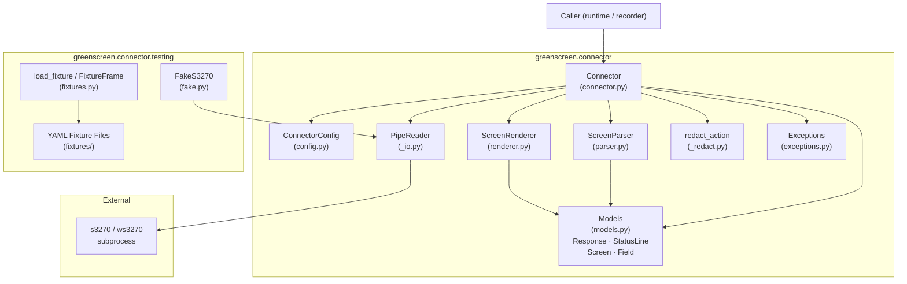
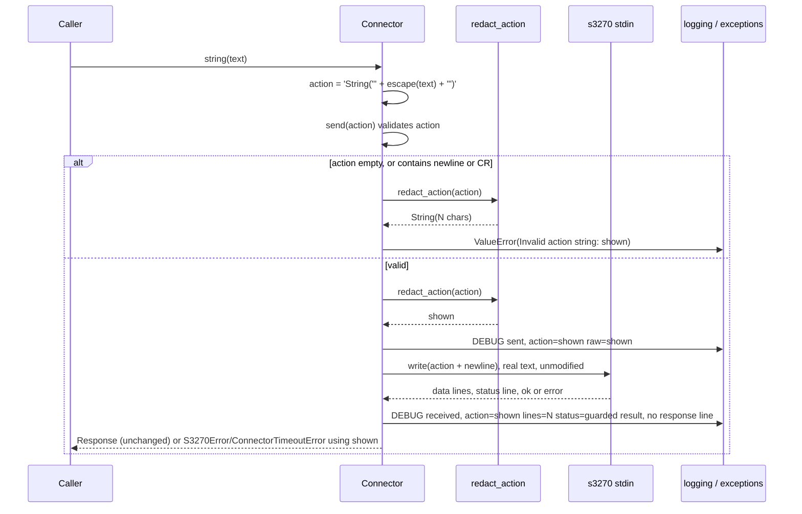

# Design Document: tn3270-connector

## Overview

The `tn3270-connector` is a Python 3.11+ library that drives an `s3270` (Linux/macOS) or `ws3270` (Windows) subprocess to maintain a headless IBM 3270 terminal session. It is Core Piece 1 of Green Screen Medium: the deterministic bridge between modern callers and legacy MVS/TK5 hosts.

The library's public surface is intentionally narrow — open a session, send actions, wait for the host, read a structured screen, close the session. All subprocess lifecycle management, response parsing, cross-platform pipe I/O, and timeout enforcement happen inside the library. Callers never touch raw s3270 protocol strings.

**Key design goals:**

- Deterministic and auditable: no LLM, no inference, every step is reproducible.
- Fully testable without a live host, using `FakeS3270` and recorded fixtures.
- Cross-platform: the same code runs on Windows (ws3270) and Linux/macOS (s3270) with no caller-visible differences.
- Typed end-to-end: all public APIs use dataclasses and typed return values; raw strings stay inside module boundaries.

---

## Architecture

### Component Diagram



### Data Flow for a Single Action

```
Caller
  │  connector.read_screen()          connector.ascii()
  │        │                                  │
  │  connector.send("ReadBuffer(Ascii)")  connector.send("Ascii()")
  ▼
Connector
  │  writes "ReadBuffer(Ascii)\n" to subprocess stdin
  ▼
s3270 subprocess  (or FakeS3270 in tests)
  │  emits: "data: ...\n"  (zero or more)
  │          "<status line>\n"
  │          "ok\n"
  ▼
PipeReader (daemon thread)
  │  readline() loop → Queue
  ▼
Connector._read_response()
  │  queue.get(timeout=N) until "ok" or "error"
  ▼
ScreenParser.parse_readbuffer() (for ReadBuffer responses)
  │  builds Screen object (cell_grid + sa_tokens; text_grid/fields are derived)
  ▼
Caller receives Response or Screen object
```

`read_screen()` sends only `ReadBuffer(Ascii)` — a single atomic round-trip. The text grid is a derived view on the resulting `Screen`. `ascii()` is available separately for callers that need the human-readable text form independently.

---

## Package Structure

```
greenscreen/
└── connector/
    ├── __init__.py          # Public exports
    ├── config.py            # ConnectorConfig dataclass
    ├── connector.py         # Connector class
    ├── models.py            # Response, StatusLine, Screen, Field
    ├── parser.py            # ScreenParser
    ├── renderer.py          # ScreenRenderer
    ├── _redact.py           # redact_action (Requirement 12)
    ├── exceptions.py        # Exception hierarchy
    ├── _io.py               # PipeReader (cross-platform thread+queue)
    └── testing/
        ├── __init__.py
        ├── fake.py          # FakeS3270
        ├── fixtures.py      # load_fixture, FixtureFrame
        └── fixtures/
            ├── tk5-logo.yaml
            └── tk5-logon.yaml

tests/
├── unit/                    # Unit tests (FakeS3270 or direct)
├── property/                # Hypothesis tests
└── integration/             # Live-host tests (auto-skip)
```

---

## Components and Interfaces

### `config.py` — ConnectorConfig

```python
from dataclasses import dataclass, field
import os

@dataclass
class ConnectorConfig:
    host: str = ""                   # falls back to GS_HOST env var
    port: int | None = None          # None = not set: GS_PORT if set, else 23; explicit range 1–65535
    binary: str = ""                 # falls back to GS_S3270_BINARY env var
    model: str = "3279-2"
    default_timeout: float = 30.0    # range 1–3600

    def __post_init__(self) -> None:
        # Resolve env-var fallbacks for binary, host, port
        if not self.binary:
            self.binary = os.environ.get("GS_S3270_BINARY", "")
        if not self.host:
            self.host = os.environ.get("GS_HOST", "")
        if self.port is None:  # sentinel: None means "not set"
            env_port = os.environ.get("GS_PORT", "")
            self.port = int(env_port) if env_port else 23
        self._validate()

    def _validate(self) -> None:
        # Raises ConfigurationError for missing required fields or out-of-range values
        ...
```

Fields requiring resolution before the first subprocess start:

| Field | Env var fallback | Default | Valid range |
|---|---|---|---|
| `binary` | `GS_S3270_BINARY` | — (required) | non-empty path |
| `host` | `GS_HOST` | — (required) | non-empty string |
| `port` | `GS_PORT` | `23` (when `None` and `GS_PORT` unset) | 1–65535 |
| `model` | — | `3279-2` | any non-empty string |
| `default_timeout` | — | `30.0` | 1–3600 |

The "port not set" sentinel is `None`. Any explicitly supplied port outside 1–65535 (including `0` and `-1`) or of a non-int type raises `ConfigurationError(parameter_name="port")`; an explicit `23` is just a value, not a request for the env override.

Credentials (`username`, `password`) are explicitly excluded from `ConnectorConfig`; they are passed as arguments at call time or read from env vars by the caller.

---

### `exceptions.py` — Exception Hierarchy

```python
class ConnectorError(Exception):
    """Base class for all tn3270-connector exceptions."""

class ConfigurationError(ConnectorError):
    """A configuration parameter is missing, wrong type, or out of range."""
    # .parameter_name: str

class S3270Error(ConnectorError):
    """s3270 returned an error response, or the subprocess exited unexpectedly."""
    # .action: str
    # .data_lines: list[str]
    # .status_line: StatusLine | None
    # .exit_code: int | None   (set when subprocess exited unexpectedly)

class ConnectorTimeoutError(ConnectorError):
    """A read or wait operation exceeded its configured deadline."""
    # .operation: str    (action name or wait type)
    # .deadline: float   (seconds)

class ParseError(ConnectorError):
    """The ScreenParser could not interpret s3270 output."""
    # .raw: str          (the offending line or token)

class SessionClosedError(ConnectorError):
    """A method was called on a Connector whose session is already closed."""
```

Hierarchy diagram:

```
Exception
└── ConnectorError
    ├── ConfigurationError
    ├── S3270Error
    ├── ConnectorTimeoutError
    ├── ParseError
    └── SessionClosedError
```

`ConnectorTimeoutError` is intentionally named to avoid shadowing Python's built-in `TimeoutError`.

---

### `models.py` — Data Models

```python
from dataclasses import dataclass, field as dc_field
from typing import Union


@dataclass(frozen=True)
class StatusLine:
    keyboard_state: str       # field 1 — exact token, e.g. "U"
    screen_formatting: str    # field 2
    field_protection: str     # field 3
    connection_state: str     # field 4 — exact token, e.g. "C(127.0.0.1)"
    emulator_mode: str        # field 5
    model_number: str         # field 6 — e.g. "2"
    rows: int                 # field 7 — decimal integer
    columns: int              # field 8 — decimal integer
    cursor_row: int           # field 9 — zero-origin
    cursor_col: int           # field 10 — zero-origin
    window_id: str            # field 11 — e.g. "0x0"
    command_time: str         # field 12 — e.g. "0.006"

    def serialize(self) -> str:
        """Reconstruct the original 12-token status line string."""
        return (
            f"{self.keyboard_state} {self.screen_formatting} "
            f"{self.field_protection} {self.connection_state} "
            f"{self.emulator_mode} {self.model_number} "
            f"{self.rows} {self.columns} "
            f"{self.cursor_row} {self.cursor_col} "
            f"{self.window_id} {self.command_time}"
        )


@dataclass(frozen=True)
class SFToken:
    """A field-attribute token occupying one cell position."""
    c0: int        # raw attribute byte, e.g. 0xc8, 0xe0

@dataclass(frozen=True)
class SAToken:
    """A color-attribute token (SA(42=xx)); does not occupy a cell (verified 2026-11-15: every row has exactly 80 non-SA tokens)."""
    value: int     # raw value byte, e.g. 0xf2

# CellValue is either an int (0x00–0xFF, the raw ASCII byte) or an SFToken.
# SAToken is recorded in a separate per-row list (not in the main cell grid).
CellValue = Union[int, SFToken]


@dataclass(frozen=True)
class Field:
    """Pure derived view computed from the raw cell grid. Not stored directly."""
    start_row: int
    start_col: int
    # end position is implicitly the cell before the next SF token (wrapping)
    protected: bool      # derived: bool(sf_token.c0 & 0x20)
    modified: bool       # derived: bool(sf_token.c0 & 0x01)
    # text and byte_length are derived from the cell_grid slice for this field


@dataclass
class Screen:
    rows: int
    columns: int
    cursor_row: int      # zero-origin, from status line
    cursor_col: int      # zero-origin, from status line
    # Primary storage: raw cell grid. Each row is exactly `columns` CellValues.
    # An int cell is the raw byte (0x00 stays 0x00, not space).
    # An SFToken cell marks the start of a 3270 field attribute at that position.
    cell_grid: list[list[CellValue]]
    # SA tokens: per-row list of (col_index, SAToken) pairs, in order of appearance.
    sa_tokens: list[list[tuple[int, SAToken]]]

    # Derived views (computed properties, not stored):
    @property
    def text_grid(self) -> list[str]:
        """One string per row; SFToken cells → ' ', int 0x00 → ' ', others → chr(byte)."""
        ...

    @property
    def fields(self) -> list[Field]:
        """Derive Field list from SFToken positions, wrapping across row boundaries."""
        ...

    def text_at(self, row: int, col: int, length: int) -> str:
        """Extract `length` chars from text_grid[row] starting at col."""
        # Raises ValueError for any out-of-bounds argument.
        ...

    def find_field(self, row: int, col: int) -> Field | None:
        """Return the Field containing (row, col), or None."""
        ...

    def __eq__(self, other: object) -> bool:
        """Equality on cell_grid and sa_tokens only (derived views are ignored)."""
        ...


@dataclass(frozen=True)
class Response:
    success: bool
    data_lines: list[str]   # "data: " prefix stripped
    status: StatusLine
```

---

### `_io.py` — Cross-Platform Pipe Reader

The challenge: `select.select()` does not support subprocess pipes on Windows. The solution is a daemon reader thread that calls `readline()` in a tight loop and puts each line into a `queue.Queue`. The main thread calls `queue.get(timeout=N)` to enforce deadlines.

```python
import queue
import threading
from typing import IO

class PipeReader:
    """Background daemon thread that drains a readable pipe into a queue."""

    def __init__(self, pipe: IO[bytes]) -> None:
        self._pipe = pipe
        self._queue: queue.Queue[bytes | None] = queue.Queue()
        self._thread = threading.Thread(
            target=self._reader_loop,
            daemon=True,     # exits when the main process exits
            name="gs-pipe-reader",
        )
        self._thread.start()

    def _reader_loop(self) -> None:
        """Run in background thread. Puts None on EOF.

        Binary pipe: strip \\r\\n explicitly after each readline() call.
        Python's binary-mode readline() on a Windows pipe returns lines ending
        with \\r\\n. The PipeReader strips \\r\\n explicitly before putting
        the line on the queue. All downstream code receives bare bytes without
        line endings.
        """
        try:
            for raw_line in self._pipe:
                line = raw_line.rstrip(b"\r\n")
                self._queue.put(line)
        finally:
            self._queue.put(None)   # sentinel: pipe closed / process exited

    def readline(self, timeout: float) -> bytes:
        """
        Block until one line is available or `timeout` seconds elapse.
        Returns bare bytes (line endings already stripped by _reader_loop).
        Raises ConnectorTimeoutError on timeout.
        Raises S3270Error (with exit_code) on EOF (process exited).
        """
        try:
            line = self._queue.get(timeout=timeout)
        except queue.Empty:
            raise ConnectorTimeoutError(...)
        if line is None:
            raise S3270Error(...)   # subprocess exited
        return line
```

**Why this is correct on both platforms:**
- `readline()` on a pipe blocks in the OS and delivers a full line atomically. No polling is needed.
- `queue.Queue` is thread-safe; no locks are needed in callers.
- The daemon flag ensures the thread is reaped when the process exits, even if `close()` is never called.
- On Windows, `readline()` over a pipe returns lines ending with `\r\n`; `rstrip(b"\r\n")` normalises them before they reach the queue. On Linux, `\n`-terminated lines are unaffected.

---

### `connector.py` — Connector

```python
import logging
import math
import subprocess
import sys
import time
from types import TracebackType

logger = logging.getLogger("greenscreen.connector")

class Connector:
    def __init__(self, config: ConnectorConfig) -> None:
        self._config = config
        self._proc: subprocess.Popen | None = None
        self._reader: PipeReader | None = None
        self._closed = False

    # ── Context manager ──────────────────────────────────────────────────
    def __enter__(self) -> "Connector":
        self.open()
        return self

    def __exit__(
        self,
        exc_type: type[BaseException] | None,
        exc_val: BaseException | None,
        tb: TracebackType | None,
    ) -> bool:
        self.close()
        return False   # always re-raise

    # ── Lifecycle ────────────────────────────────────────────────────────
    def open(self) -> None:
        """Start s3270 subprocess and send Connect(host:port)."""
        ...

    def close(self) -> None:
        """Send Disconnect() + Quit(), wait up to 5 s, then terminate."""
        ...

    # ── Actions ──────────────────────────────────────────────────────────
    def send(self, action: str) -> Response:
        """Write action to stdin, read response, return Response or raise."""
        ...

    def enter(self) -> Response:
        return self.send("Enter()")

    def pf(self, n: int) -> Response:
        if not 1 <= n <= 24:
            raise ValueError(f"PF key n must be 1–24, got {n!r}")
        return self.send(f"PF({n})")

    def pa(self, n: int) -> Response:
        if not 1 <= n <= 24:
            raise ValueError(f"PA key n must be 1–24, got {n!r}")
        return self.send(f"PA({n})")

    def clear(self) -> Response:
        return self.send("Clear()")

    def string(self, text: str) -> Response:
        """Escape text for s3270 String() and send it."""
        if len(text) > 3000:
            raise ValueError(f"text length {len(text)} exceeds 3000-character limit")
        escaped = _escape_s3270_string(text)
        return self.send(f'String("{escaped}")')

    def move_cursor(self, row: int, col: int) -> Response:
        if row < 0 or col < 0:
            raise ValueError(f"row and col must be non-negative, got ({row}, {col})")
        return self.send(f"MoveCursor({row},{col})")

    # ── Wait operations ───────────────────────────────────────────────────
    def wait_for_output(self, timeout: float | None = None) -> Response:
        t = self._resolve_timeout(timeout)
        # Read deadline = t + WAIT_GRACE_SECONDS so s3270's own Wait(t,...) always
        # fires and writes its response before the PipeReader deadline expires.
        # _format_seconds(t) is fixed-point, <= 3 decimals, trailing zeros stripped.
        return self._send_with_deadline(
            f"Wait({self._format_seconds(t)},Output)", deadline=t + WAIT_GRACE_SECONDS
        )

    def wait_for_field(self, timeout: float | None = None) -> Response:
        t = self._resolve_timeout(timeout)
        return self._send_with_deadline(
            f"Wait({self._format_seconds(t)},InputField)", deadline=t + WAIT_GRACE_SECONDS
        )

    def wait_for_unlock(self, timeout: float | None = None) -> Response:
        t = self._resolve_timeout(timeout)
        return self._send_with_deadline(
            f"Wait({self._format_seconds(t)},Unlock)", deadline=t + WAIT_GRACE_SECONDS
        )

    def wait_for_text(
        self, text: str, timeout: float | None = None, poll_interval: float = 0.25
    ) -> Screen:
        """Poll read_screen() until `text` is in the visible screen text; return that Screen.

        Raises ValueError (empty text / non-positive poll_interval) and
        ConnectorTimeoutError(operation="wait_for_text") on expiry.
        """
        ...

    def snap_save(self) -> Response:
        return self.send("Snap(Save)")

    # ── Screen capture ────────────────────────────────────────────────────
    def read_screen(self) -> Screen:
        """
        Send ReadBuffer(Ascii) only. The text grid is derived from the raw cell data.
        This makes the snapshot atomic (single round-trip to s3270).
        """
        rdbuf_resp = self.send("ReadBuffer(Ascii)")
        return ScreenParser().parse_readbuffer(rdbuf_resp)

    def ascii(self) -> Response:
        """
        Send Ascii() and return the raw Response (data lines = text rows).
        Available for callers that need the human-readable text form independently.
        """
        return self.send("Ascii()")

    # ── Internal helpers ──────────────────────────────────────────────────
    WAIT_GRACE_SECONDS: float = 5.0  # added to the s3270 Wait(N,...) timeout

    MIN_TIMEOUT: float = 0.001
    MAX_TIMEOUT: float = 3600.0

    def _resolve_timeout(self, timeout: float | None) -> float:
        """None -> default_timeout. ValueError unless 0.001 <= t <= 3600.

        Also rejects bool, non-numbers, NaN and infinity. Nothing is sent on error.
        """
        t = timeout if timeout is not None else self._config.default_timeout
        if isinstance(t, bool) or not isinstance(t, (int, float)):
            raise ValueError(f"timeout must be a number, got {t!r}")
        if math.isnan(t) or math.isinf(t):
            raise ValueError(f"timeout must be finite, got {t!r}")
        if t < self.MIN_TIMEOUT or t > self.MAX_TIMEOUT:
            raise ValueError(f"timeout must be in 0.001..3600, got {t!r}")
        return t

    @staticmethod
    def _format_seconds(t: float) -> str:
        """Fixed-point, rounded to 3 decimals, trailing zeros/dot stripped, clamped
        to 0.001..3600; never an exponent. 30.0 -> "30", 1.5 -> "1.5"."""
        t = min(max(float(t), 0.001), 3600.0)
        return format(t, ".3f").rstrip("0").rstrip(".") or "0.001"

    def _send_with_deadline(self, action: str, deadline: float) -> Response:
        """Write action to stdin; read response with the given deadline (not default_timeout).
        Used by wait_for_* so the PipeReader deadline is longer than s3270's own Wait(N,...)."""
        ...

    def _read_response(self, action: str, timeout: float) -> Response:
        """Read lines from PipeReader until ok/error; build Response."""
        ...

    def _write(self, action: str) -> None:
        logger.debug("sent action=%s", action)
        ...
```

**`open()` subprocess start sequence:**
1. Build command line: `[config.binary, "-model", config.model]`.
2. `subprocess.Popen(cmd, stdin=PIPE, stdout=PIPE, stderr=PIPE)`.
3. Wrap `proc.stdout` in `PipeReader` (stdout reader thread).
4. Wrap `proc.stderr` in a second daemon thread that drains and discards stderr output — "Stderr is drained by a dedicated daemon thread to prevent the subprocess from blocking on a full stderr pipe buffer. The drained bytes are discarded; they are not surfaced to callers." Alternatively `stderr=subprocess.DEVNULL` may be used if no stderr capture is ever needed.
5. Send `Connect(host:port)` as the very first command (never on command line).
6. If the Connect response is `error`, terminate the subprocess and raise `ConnectorError`.

**`close()` sequence:**
1. If already closed or proc is None, return silently.
2. Send `Disconnect()`.
3. Send `Quit()`.
4. `proc.wait(timeout=5)`.
5. If `TimeoutExpired`:
   a. `proc.terminate()`
   b. `proc.wait(timeout=5)` — second wait after terminate()
   c. If still `TimeoutExpired`: `proc.kill()` — unconditional kill as last resort
   d. Log a warning (regardless of whether terminate() or kill() was needed).
6. Mark `_closed = True`.

---

**Why `wait_for_text` exists:** `Wait(N,Output)` returns on the first, often partial, screen update (steering doc GOTCHA, 2026-11-15), so a single wait cannot tell the caller the expected screen has arrived. `wait_for_text` polls `read_screen()` until the expected text is visible.

Polling algorithm:
1. Validate: `text` non-empty and `poll_interval > 0`, else `ValueError`; resolve the timeout with `_resolve_timeout`.
2. Compute `end = time.monotonic() + t`.
3. Loop: `read_screen()`; if `text` is in the visible text, return that Screen. Otherwise compute `remaining = end - time.monotonic()`; if `remaining <= 0` raise `ConnectorTimeoutError(operation="wait_for_text")`; else `time.sleep(min(poll_interval, remaining))`. The loop therefore polls at least once and makes a final poll at the deadline.
4. A `ParseError` from `read_screen()` propagates.

Matching rules: the visible text is the screen's rows joined with `"\n"`, so a match cannot span rows unless `text` contains newlines. Cells belonging to `Field.hidden` fields (the cells following the SF token, `byte_length` of them, wrapping) are blanked before matching, so password content is never matched. The timeout error message contains the searched text and the timeout but never screen contents. Callers must not pass secrets as `text`.

### `parser.py` — ScreenParser

```python
class ScreenParser:
    def parse_readbuffer(self, response: Response) -> Screen:
        """Build a Screen from a single ReadBuffer(Ascii) response."""
        status = response.status
        rows   = status.rows
        cols   = status.columns
        cursor_row = status.cursor_row
        cursor_col = status.cursor_col

        cell_grid, sa_tokens = self._tokenize(response.data_lines, rows, cols)
        return Screen(rows, cols, cursor_row, cursor_col, cell_grid, sa_tokens)

    def parse_status_line(self, raw: str) -> StatusLine:
        """Parse a 12-token s3270 status line. Raises ParseError on failure."""
        tokens = raw.split()
        if len(tokens) != 12:
            raise ParseError(raw=raw)
        try:
            return StatusLine(
                keyboard_state   = tokens[0],
                screen_formatting= tokens[1],
                field_protection = tokens[2],
                connection_state = tokens[3],
                emulator_mode    = tokens[4],
                model_number     = tokens[5],
                rows             = int(tokens[6]),
                columns          = int(tokens[7]),
                cursor_row       = int(tokens[8]),
                cursor_col       = int(tokens[9]),
                window_id        = tokens[10],
                command_time     = tokens[11],
            )
        except ValueError as exc:
            raise ParseError(raw=raw) from exc

    def _tokenize(
        self, data_lines: list[str], rows: int, cols: int
    ) -> tuple[list[list[CellValue]], list[list[tuple[int, SAToken]]]]:
        """Tokenize ReadBuffer(Ascii) lines into cell_grid and sa_tokens.
        State is maintained across row boundaries so that SF fields wrap correctly."""
        ...
```

#### ReadBuffer(Ascii) Tokenizer

Each `data:` line (after stripping the `data: ` prefix) is a space-separated sequence of tokens:

| Token pattern | Meaning |
|---|---|
| `[0-9a-fA-F]{2}` | Character cell — raw ASCII byte value in hex |
| `SF(c0=xx)` | Field attribute — stored as `SFToken(c0=int(xx,16))`, occupies one cell position |
| `SA(42=xx)` | Color attribute — stored as `SAToken(value=int(xx,16))` in `sa_tokens`; does not occupy a cell (verified 2026-11-15: every row in both ReadBuffer captures has exactly 80 non-SA tokens) |

**Tokenizer algorithm (processes ALL rows as a single flat sequence):**

State is maintained across row boundaries — a 3270 field runs from its `SF` cell to the cell immediately before the next `SF` cell, wrapping from the last cell of one row to the first cell of the next row and potentially spanning many rows.

```
# State maintained across ALL rows (not reset per row):
current_sf_linear_pos: int | None = None   # linear position of the opening SF token
current_sf_token: SFToken | None = None
all_sf_positions: list[tuple[int, SFToken]] = []   # (linear_pos, sf_token)

# Process rows in order; for each row, for each token:
for row_index, row_tokens in enumerate(data_lines):
    col_index = 0
    for token in tokenize(row_tokens):
        linear_pos = row_index * columns + col_index

        if token is a hex cell (matches /^[0-9a-fA-F]{2}$/):
            cell_grid[row_index][col_index] = int(token, 16)
            col_index += 1

        elif token matches /^SF\(c0=([0-9a-fA-F]{2})\)$/:
            sf = SFToken(c0=int(capture_group_1, 16))
            cell_grid[row_index][col_index] = sf
            all_sf_positions.append((linear_pos, sf))
            col_index += 1

        elif token matches /^SA\(42=([0-9a-fA-F]{2})\)$/:
            sa_tokens[row_index].append((col_index, SAToken(value=int(capture_group_1, 16))))
            # SA tokens do NOT advance col_index (verified: every row has exactly 80 non-SA tokens)

        else:
            # message: row index, token index, token length; raw="" (Requirement 12.35)
            raise ParseError(raw="")

# After processing all rows, the Field list is derived from all_sf_positions:
# Each field spans from its SF linear position to the linear position
# of the next SF token (exclusive), wrapping modulo (rows * columns).
# Fields are ordered by their SF linear position.
# This derivation happens lazily in Screen.fields (the computed property).
```

**`c0` attribute byte decoding** (IBM 3270 Data Stream Programmer's Reference, verified 2026-11-15):

| `c0` hex value | Binary | `protected` (0x20) | `numeric` (0x10) | `hidden` (0x0C==0x0C) | `modified` (0x01) |
|---|---|---|---|---|---|
| `c8` | 1100 1000 | `False` | `False` | `False` | `False` |
| `e0` | 1110 0000 | `True` | `False` | `False` | `False` |
| `e8` | 1110 1000 | `True` | `False` | `False` | `False` |
| `f0` | 1111 0000 | `True` | `False` | `False` | `False` |
| `f8` | 1111 1000 | `True` | `False` | `False` | `False` |

`c8` is the logon input field (unprotected, not hidden); all others are protected headers. A field attribute byte of `0xFC` (1111 1100) would be protected, numeric, and hidden (password field).

Field construction is performed by a single shared `Screen._build_field(r, c, sf_tok, byte_length, cell_grid, columns)` static method. Both `Screen.fields` and `Screen.find_field` call this helper, ensuring the two code paths cannot drift.

---

### `renderer.py` — ScreenRenderer

The renderer serializes a `Screen` back to `ReadBuffer(Ascii)` format: one `data:` line per row, with character cells as two-digit hex codes and field-start positions as `SF(c0=xx)` tokens.

```python
class ScreenRenderer:
    def render(self, screen: Screen) -> list[str]:
        """
        Return a list of strings in ReadBuffer(Ascii) format,
        one element per row (without the 'data: ' prefix).
        Each element is a space-separated sequence of hex codes and SF tokens.
        """
        ...
```

**Rendering algorithm:**

1. Iterate `screen.cell_grid` row by row. For each cell value in the row:
   - If the value is an `int`, emit it as a zero-padded two-digit lowercase hex code (e.g. `0x4c` → `"4c"`, `0x00` → `"00"`).
   - If the value is an `SFToken`, emit `SF(c0=xx)` where `xx` is the raw `c0` byte formatted as zero-padded two-digit lowercase hex (e.g. `SFToken(c0=0xc8)` → `"SF(c0=c8)"`). The raw byte is used verbatim — never recomputed from `protected`/`modified` flags.
2. Before emitting each cell at column index `col_index` in the current row, check `screen.sa_tokens[row_index]` for any `SAToken` recorded at that column position. If one exists, emit `SA(42=xx)` (with `xx` as zero-padded two-digit lowercase hex of the token's value) immediately before the cell token.
3. After all cells in a row are emitted, join the token list for that row with a single space to produce the row string.

**Round-trip guarantee:**

The round-trip is defined on the `ReadBuffer(Ascii)` representation:

```
ScreenParser.parse_readbuffer(ScreenRenderer.render(screen)) == screen
```

This holds when:
- Every `SF(c0=xx)` token position in the rendered output matches the `start_col` of the corresponding `SFToken` in `cell_grid`.
- Every character cell hex value decodes to the raw byte stored in `cell_grid` at that position (including `0x00` — not silently promoted to space).
- The renderer writes back the exact raw `c0` byte from each `SFToken` and never recomputes it from the `protected`/`modified` flags.

**Property 2 must pass on every file in `/captures` (both logo and logon).** The lossless raw-byte model ensures the renderer can faithfully reproduce what s3270 actually emitted without any information loss.

---

### s3270 String Quoting Algorithm

The `string()` method on `Connector` encodes a Python string for transmission as an s3270 `String()` argument.

**Rules:**
1. Backslash (`\`) → `\\` (must be escaped first to avoid double-escaping)
2. Double-quote (`"`) → `\"`
3. Wrap the result in double quotes: `"escaped_text"`

```python
def _escape_s3270_string(text: str) -> str:
    text = text.replace("\\", "\\\\")   # step 1: backslashes first
    text = text.replace('"', '\\"')      # step 2: double-quotes
    return text

# Inverse (for testing only):
def _unescape_s3270_string(escaped: str) -> str:
    result = []
    i = 0
    while i < len(escaped):
        if escaped[i] == "\\" and i + 1 < len(escaped):
            result.append(escaped[i + 1])
            i += 2
        else:
            result.append(escaped[i])
            i += 1
    return "".join(result)
```

The key ordering invariant: backslashes must be escaped before double-quotes. If the order were reversed, a literal `\"` in the input would become `\\"` (backslash escape applied first to the already-escaped quote), breaking the round-trip.

---

### Action Redaction (Requirement 12)

**Purpose.** `Connector.string(text)` sends `String("<text>")` through `send()`, and the text can be a host password. Before Requirement 12 the full Action text reached DEBUG log records, exception messages, `S3270Error.action`, `ConnectorTimeoutError.operation` and the `ValueError` for an invalid Action. This section defines one pure helper that turns an Action into the text that may leave the Connector, and lists every place that uses it. For a String_Action this section takes precedence over the "action string" wording in Requirements 3.3, 3.4, 7.3 and 7.8. The terms String_Action, Well_Formed_String_Action, Decoded_Length, Redacted_Action and Outside_Rendering are used as defined in the requirements glossary.

**Second leak, response data (criteria 29 to 45).** A live logon showed that the typed password also stays in the hidden cells of the next screens, and the old Received_Record logged every response line, so `ReadBuffer(Ascii)` wrote those cells to the log as hex. The Connector therefore also keeps Response_Data out of every log record and exception message, by omission and not by scrubbing. The Received_Record carries only counts and the result (see "Received record and status-line guard"), `_wait` stops copying data lines into messages, and the `ParseError` for a bad ReadBuffer token no longer carries the token. Criteria 29 to 45 take precedence over Requirements 4.7 and 7.8 and over criteria 3, 16 and 17 of this requirement wherever those say that response text appears in a log record or in an exception message.

**No other connector behaviour changes.** Everything that is not covered above stays as it is: the wire protocol, timeouts, `Response` content, exception classes and their public attributes, `Response.data_lines`, `S3270Error.data_lines`, the rendering of every non-String Action, and the signatures of all public methods. Every existing test must keep passing, except the five listed in "Existing tests that change" below, which assert the old received-record format, the old `_wait` messages or the old `ParseError.raw` (Requirement 12.18 and the Scope list).

#### The redaction helper

| Item | Value |
|---|---|
| Name | `redact_action` |
| Module | `greenscreen/connector/_redact.py` (new, private, not exported from `__init__.py`) |
| Signature | `def redact_action(action: str) -> str` |
| Behaviour | Returns `action` unchanged when it is not a String_Action; otherwise returns the Redacted_Action. Pure: no logging, no state, no I/O. |
| Imports | `re`, and `_unescape_s3270_string` from `greenscreen/connector/parser.py` |

```python
import re

from greenscreen.connector.parser import _unescape_s3270_string

# "String" in any ASCII letter case, optional whitespace, "(".
# Explicit [Ss][Tt]... classes are used instead of re.IGNORECASE because
# IGNORECASE on a str pattern also folds U+017F ("long s") and U+212A
# ("Kelvin sign") onto ASCII letters, and the glossary says ASCII letter case.
# \s on a str pattern is Unicode whitespace, which is the str.isspace() set.
_STRING_NAME = re.compile(r"\s*[Ss][Tt][Rr][Ii][Nn][Gg]\s*\(")

# Whole-Action shape of a Well_Formed_String_Action. Group 1 is the body.
# [^"\\] also matches newline and carriage return; DOTALL lets "\." match a
# backslash followed by a newline. Nothing is allowed after ")" (fullmatch).
_WELL_FORMED = re.compile(
    r'\s*[Ss][Tt][Rr][Ii][Nn][Gg]\s*\(\s*"((?:[^"\\]|\\.)*)"\s*\)',
    re.DOTALL,
)

def redact_action(action: str) -> str:
    if _STRING_NAME.match(action) is None:
        return action                                  # not a String_Action
    m = _WELL_FORMED.fullmatch(action)
    if m is None:
        return "String(<? chars>)"                     # malformed: never guess
    n = len(_unescape_s3270_string(m.group(1)))        # Decoded_Length
    return f"String(<{n} chars>)"
```

**The String-name regex.** `_STRING_NAME` is applied with `match()`, so it is anchored at the start of the Action. After optional leading whitespace it needs the letters `S t r i n g` in any ASCII case, optional whitespace, then `(`. `Strings("x")` and `StringX(1)` fail because the character after `String` is neither whitespace nor `(`. `String (`, `  String(`, `STRING(`, `sTrInG(` and `string(` all match. The unit tests include a check that `re.fullmatch(r"\s", chr(c)) is not None` equals `chr(c).isspace()` for every code point up to `sys.maxunicode`, so the glossary definition ("characters for which `str.isspace()` is true") and the regex cannot drift on a different Python build.

**How N is counted.** The Decoded_Length is the number of units in the body, where a unit is one character other than `"` and `\`, or a backslash followed by exactly one character. `_unescape_s3270_string` scans left to right and turns a backslash plus the next character into that one character and copies every other character. On a Well_Formed body, which by definition has no unescaped `"`, no lone backslash and no trailing backslash, this scan pairs characters exactly as the units are defined, so `len(_unescape_s3270_string(body))` is the unit count. For `Connector.string(text)` the body is `_escape_s3270_string(text)`, which doubles every `\` and prefixes every `"`; the unescape of that body returns `text` (Property 4), so `N == len(text)` for every text, including non-ASCII text. `\"` and `\\` each count as one character. A newline or carriage return in the body is an ordinary character for counting, so `string("a\nb")` is rendered `String(<3 chars>)` even though `send()` then rejects it. The helper reuses the existing unescape function instead of a second counter so the count and the escape rules cannot diverge. The implementation task updates the docstring of `_unescape_s3270_string`, which now says "For testing only", to say it is also used by `_redact.py`.

**Malformed handling.** If the Action is a String_Action but `_WELL_FORMED` does not match the whole Action, the result is the literal `String(<? chars>)`. This covers an unterminated body, a trailing lone backslash, a second argument, an unquoted argument, and any text after the closing `)`. No length is guessed and no character of the argument is copied. The pattern has no nested quantifiers and its two alternatives start with different characters, so matching is linear in the length of the Action; there is no backtracking blow-up on hostile input.

**Properties of the output.** The result is built only from the literal characters `String(<`, the decimal digits of `N` (no leading zeros, `0` for an empty body), the literal ` chars>)`, or the literal `String(<? chars>)`. It therefore matches `^String\(<(0|[1-9][0-9]*|\?) chars>\)$` (Requirement 12.10) and contains no character taken from the argument (12.13).

**`redact_action` is not idempotent.** `redact_action("String(<5 chars>)")` returns `String(<? chars>)`, because the argument is unquoted. Every call site therefore calls `redact_action` on the original Action, never on an already rendered value.

#### Call sites that render an Action

Each site calls `redact_action(action)` on the original Action text. For a non-String Action the call returns the input, so the rendering is character-for-character what it is today (Requirement 12.14). In the tables below, `shown` means the value of `redact_action(action)`; `shown!r` is its `repr`, which for a non-String Action equals today's `action!r`.

Sites that change, all in `greenscreen/connector/connector.py` except site 9, which is in `greenscreen/connector/parser.py`:

| # | Method | Today | After |
|---|---|---|---|
| 1 | `_send_with_deadline`, the guard `if not action or "\n" in action or "\r" in action` | `ValueError(f"Invalid action string: {action!r}")` | `ValueError(f"Invalid action string: {shown!r}")`. The guard still runs before anything is written (12.8). |
| 2 | `_send_with_deadline`, `except ConnectorTimeoutError` | message `f"Timed out waiting for response to {action!r}: {exc}"` and `operation=action` | message with `{shown!r}` and `operation=shown`. `deadline=exc.deadline` is unchanged. The inner `exc` is the `PipeReader` timeout, which carries only the literals `Pipe read timed out after Ns` and `readline`. (12.7) |
| 3 | `_write`, the line `logger.debug("direction=sent action=%s raw=%s", action, action)` | both `%s` arguments are the Action | both arguments are `shown`. The format string is unchanged. (12.2) |
| 4 | `_write`, `except OSError` (includes `BrokenPipeError`) | `S3270Error(f"s3270 subprocess is not accepting input for {action!r}", action=action, exit_code=...)` | message with `{shown!r}` and `action=shown`. `exit_code` is unchanged. (12.5) |
| 5 | `_read_response`, `except S3270Error` when `exc.exit_code is None` | `S3270Error(f"s3270 subprocess exited during {action!r}", action=action, exit_code=self._exit_code())` | message with `{shown!r}` and `action=shown`. `exit_code` is unchanged. (12.6) |
| 6 | `_read_response`, the line `logger.debug("direction=received action=%s raw=%s", shown, ...)` | action argument is `shown`; `raw` joins every response line, with exact copies of the Action replaced by `shown` | Replaced by the Received_Record `direction=received action=%s lines=%d status=%s result=%s` with args `(shown, len(data_lines), _status_for_log(status_raw), line)`. No response line is logged, so the `element.replace(action, shown)` step is deleted. (12.29 to 12.33; 12.3 is superseded) |
| 7 | `_read_response`, the final `raise S3270Error(f"s3270 returned error for {action!r}", action=action, data_lines=..., status_line=...)` | Action in message and `action` | message with `{shown!r}` and `action=shown`. `data_lines` and `status_line` are passed through unchanged. (12.4) |
| 8 | `_wait`, `except S3270Error as exc` (see "Exception messages built from response data") | builds `text = " ".join(exc.data_lines)` and puts it in a `ConnectorTimeoutError` message and in a re-raised `S3270Error` message | `text` is used only to classify the error. Neither message contains it. (12.34) |
| 9 | `parser.py` `_tokenize`, the `else: raise ParseError(...)` branch | `f"Unrecognised ReadBuffer token: {token!r}"`, `raw=token` | message with row index, token index and token length; `raw=""`. (12.35) |

Sites that were audited and do not change:

| Place | Why it is unchanged |
|---|---|
| `connector.py` `open()` | Renders `Connect(host:port)` and `{exc}` of an `S3270Error` for that Connect. Never a String_Action. |
| `connector.py` `close()` | Sends `Disconnect()` and `Quit()` and swallows `ConnectorError`/`OSError`. The warning text is a fixed literal. |
| `connector.py` `string()` | The `ValueError` for text over 3000 characters names only `len(text)`. It never prints the text. |
| `connector.py` `pf`, `pa`, `move_cursor`, `_check_key_number` | Messages carry only integers. |
| `connector.py` `wait_for_text()` | Puts the searched `text` in its `ConnectorTimeoutError`. This is by design (Requirement 4.8, callers must not pass secrets) and is out of scope for Requirement 12. |
| `connector.py` `_terminate_proc()`, `_exit_code()` | Fixed literal warning text; no Action. |
| `_io.py` `PipeReader.readline()` | Raises `S3270Error(action="<pipe read>")` and `ConnectorTimeoutError(operation="readline")`. Both are fixed literals; `PipeReader` never receives the Action. Sites 2 and 5 replace what the Connector derives from these errors. |
| `_io.py` `start_stderr_drain()` | Discards stderr. |
| `parser.py` `parse_status_line` | Its two `ParseError`s keep the raw Status Line in message and `raw` (Requirements 6.6 and 6.7). The Status Line is excluded from Response_Data by the glossary (12.35). The `ParseError` of a bad ReadBuffer token does change, see site 9. |
| `parser.py` `parse_readbuffer` | Reads `response.data_lines` only to build the `Screen`; logs nothing and raises only through `_tokenize` and `parse_status_line`. |
| `connector.py` `open()` lines 59 to 90 | `ConnectorError` messages hold host, port, binary path and `{exc}` of the Connect `S3270Error`, whose message holds no data line after site 7. Grep for `data_lines` in `greenscreen/connector/*.py` finds only `_wait`, `_read_response`, `parse_readbuffer`/`_tokenize`, `models.py`, and `exceptions.py` (attribute storage), so no other message is built from response data. |

`greenscreen/connector/_io.py` therefore needs no edit. Exceptions that are chained with `from exc` (sites 2 and 5) link to `PipeReader` errors that contain no Action text, and a `BrokenPipeError` raised by the pipe carries only the OS error text, so the `__cause__` and `__context__` chains are clean without extra work. The tests check this rather than assume it.

#### Data flow: what is real and what is redacted

The real Action text is written to s3270 stdin exactly as today. Only the strings that leave the Connector are rendered through `redact_action`.



`redact_action` runs in the Connector's own call frames and returns a new string. The `action` variable, the `bytes` written to stdin, and the `Response` returned to the caller are not touched by it. Tracebacks and frame locals still hold the real Action; they are in-process state and are outside the definition of Outside_Rendering.

#### Received record and status-line guard (criteria 29 to 33, 45)

**The record.** `_read_response` emits exactly one DEBUG record per response, on every path that reaches the end of the read loop (`ok` and `error`). The old `raw` argument and the `element.replace(action, shown)` step are deleted.

```python
# connector.py, module level, private
_INT = re.compile(r"[0-9]+")

def _status_for_log(line: str) -> str:
    """Status text for the Received_Record. Never copies a character of an
    unexpected line (criterion 33)."""
    tokens = line.split()
    if len(tokens) == 12 and all(_INT.fullmatch(tokens[i]) for i in (6, 7, 8, 9)):
        return line                       # criterion 32: log as received
    return f"<unparsed status, {len(line)} chars>"
```

```python
# connector.py, _read_response, replaces the old logger.debug("... raw=%s") call
status_raw = lines[-1] if lines else ""
logger.debug(
    "direction=received action=%s lines=%d status=%s result=%s",
    shown,
    len(data_lines),            # data lines only: not the status line, not ok/error (31)
    _status_for_log(status_raw),
    line,                       # "ok" or "error"
)
status = ScreenParser().parse_status_line(status_raw)   # unchanged, after the record
```

Decisions behind this code:

- The record is logged before `parse_status_line`, as today, so a response with a bad Status Line still leaves one record, with `<unparsed status, N chars>`, and then raises the `ParseError` of 6.6 or 6.7 as today.
- `status_raw` stays the last line that is neither a `data: ` line nor `ok`/`error`, as today. Any extra lines before it are Response_Data: they are not counted in `lines` (31) and not logged (30).
- The guard accepts a token in fields 7 to 10 only if it matches ASCII `[0-9]+`. `parse_status_line` uses `int()`, which also accepts a sign, underscores and non-ASCII digits. The guard is deliberately stricter so a line that `int()` accepts but that is not plain digits is logged as `<unparsed status, N chars>`. Such a line never occurs in `/captures`. This stays inside criterion 32, which says "decimal integers".
- `N` is `len(line)`, the character count after UTF-8 decoding with `errors="replace"`. The line `U F U C(192.168.68.72) I 2 24 80 22 11 0x0 0.000` passes the guard and is logged as received; it holds the host address of the Config, mode letters and numbers (criterion 32 basis).
- Criterion 45: no other `logger.*` call in `greenscreen/connector/` takes response content. `_write` logs the Redacted_Action only, `close()` and `_terminate_proc` log fixed literals. A unit test (below) scans every record of a full session, so a later log statement that adds response text fails it.

#### Exception messages built from response data (criteria 34 to 37, 39)

Grep of `greenscreen/connector/*.py` for `data_lines`, `_wait`, `ParseError`, `raw=`, and `S3270Error(`/`ConnectorError(` shows these places that build a message from response data. Nothing else does.

| Place | Today | After |
|---|---|---|
| `_wait`, timeout branch | `ConnectorTimeoutError(f"Wait({wait_type}) timed out after {N}s: {text}", operation=..., deadline=t)` with `text = " ".join(exc.data_lines)` | `ConnectorTimeoutError(f"Wait({wait_type}) timed out after {N}s", operation=f"Wait({wait_type})", deadline=t) from exc`. Classification is unchanged: case-insensitive `"timed out"` or `"timeout"` in the joined data lines. |
| `_wait`, non-timeout branch | re-raises `S3270Error(f"{exc}: {text}", action=..., data_lines=..., status_line=..., exit_code=...)` | the branch is deleted; a bare `raise` re-raises the `S3270Error` of `_read_response`, whose message is `s3270 returned error for 'Wait(N,type)'` (12.34). |
| `parser._tokenize` | `ParseError(f"Unrecognised ReadBuffer token: {token!r}", raw=token)` | `ParseError(f"Unrecognised ReadBuffer token at row {row_i}, index {tok_i}, length {len(token)}", raw="")` where `tok_i` is the zero-origin position of the token among the whitespace-separated tokens of the row (12.35). |
| `wait_for_text` timeout | carries the caller's `text` and the timeout | unchanged (12.39). |
| `parse_status_line` errors | raw Status Line in message and `raw` | unchanged (12.35: the Status Line is not Response_Data). |

```python
# connector.py, _wait after the change
try:
    return self._send_with_deadline(action, t + self.WAIT_GRACE_SECONDS)
except S3270Error as exc:
    lowered = " ".join(exc.data_lines).lower()      # classify only; never copied
    if "timed out" in lowered or "timeout" in lowered:
        raise ConnectorTimeoutError(
            f"Wait({wait_type}) timed out after {self._format_seconds(t)}s",
            operation=f"Wait({wait_type})",
            deadline=t,
        ) from exc
    raise
```

**What stays, by design (12.36, Scope).** `S3270Error.data_lines` keeps the response lines, unchanged and uncopied, so `exc.data_lines` is the documented place to read the error text. The new `ConnectorTimeoutError` is still chained `from exc`, so `__cause__.data_lines` holds them too. A subprocess-exit or pipe-timeout `S3270Error` carries empty `data_lines`. The Connector never logs `vars(exc)`, `exc.data_lines` or `__cause__`. `exceptions.py` needs no edit: both classes already pass only the message to `Exception.__init__`, so `str()`, `repr()` and `args` hold the message and nothing else (12.37). Response.data_lines of an `ok` `ReadBuffer(Ascii)` response holds the hidden cells and is returned unchanged (12.38).

**Hidden cells in `read_screen()` (12.38).** No `Screen`, `Field.text` or cell value is passed to a logger or exception. The `Screen` returned by `read_screen()` is built exactly as before, so criterion 38 needs no code beyond the omissions above; Property 11 and the unit tests prove it.

#### Resolved item: does s3270 echo a `String(...)` action in error responses?

Checked on 2026-11-16 on the live host (`tests/integration/test_live_string_echo.py`, ws3270 4.5, non-secret sentinel `echo-probe-7q`). State used: logon screen, cursor moved to row 0 col 0 (a protected field) with `MoveCursor(0,0)`, then `String("echo-probe-7q")`. s3270 returned `error` with the data lines `Keyboard locked` and `Operator error`. Neither the sentinel nor the Action text appears in a data line or the status line. Manual checks by the user (no connection, protected field, unknown action, syntax error) found that neither s3270 4.3 nor ws3270 4.5 echoes the String argument.

Since criterion 30 no response line is logged, so a possible echo cannot reach a log record whatever s3270 prints; `data_lines` is never edited (12.17). The finding stays useful as evidence that error responses do not echo the argument. The result is not yet copied to the steering document.

#### Test design for Requirement 12

Test files. The Property 10 and Requirement 12.1 to 12.28 files exist; the files marked "extended" or "new" are the work of criteria 29 to 45:

| File | Content |
|---|---|
| `tests/connector_support.py` (extended) | Shared helpers: `ScriptedProc`, `BrokenPipeProc`, `RecordingFake`, `LogCapture`, `collect_exception_text(exc, exclude_attrs=frozenset())`, `collect_record_text(record)`, plus the new hidden-cell helpers `hidden_runs`, `forms_of_run`, `forbidden_forms` (see "Hidden-cell helpers"). `exclude_attrs` defaults to empty, so every existing caller behaves as before. |
| `tests/unit/test_redact_action.py` | Unit tests of `redact_action` alone (Requirement 12.10 to 12.14, 12.22). Unchanged. |
| `tests/unit/test_connector_redaction.py` (extended) | Unit tests through the Connector (12.19 to 12.21, 12.23, 12.15, 12.17), plus the response-redaction tests of 12.40 and 12.41 (new tests appended; two existing tests change, see "Existing tests that change"). |
| `tests/property/test_string_redaction.py` | Property 10 (12.24 to 12.28); only `_FIXED_STRINGS` changes. |
| `tests/property/test_response_redaction.py` (new) | Property 11 (12.42, 12.43). |
| `tests/integration/test_live_logon_redaction.py` (new) | Live logon with log capture (12.44). |

**Test doubles.** The unit tests reuse the two doubles that `tests/unit/test_connector.py` already defines, copied into `tests/connector_support.py` so the property test can import them (the existing file stays as it is):

- `RecordingFake(FakeS3270)` records every command, so a test can assert that the unmodified Action reached the fake host. When its script is exhausted it stays silent, which simulates a hung process. This produces the timeout without a real wait: the test sets `conn._config.default_timeout` to `0.05` after `open()`, the same trick as the existing `fast()` helper (the `1` to `3600` range check runs only at `ConnectorConfig` construction). For the `wait_for_*` tests the grace period is shortened the same way: `conn.WAIT_GRACE_SECONDS = 0.05` on the instance, so the pipe deadline is `t + 0.05` instead of `t + 5`. No example waits one second or more.
- `ScriptedProc` is a Popen-like object over `io.BytesIO` pipes. Its `stdout` holds the bytes for the Connect response and then ends, so the next read sees EOF at once. Its `wait()` returns the configured exit code immediately. The subprocess-exit test uses it with `wait_value=7`. The real `Connector._exit_code()` calls `proc.wait(timeout=1)`, which would block up to one second on a live process; the double returns at once, so no real second passes.
- `BrokenPipeProc(ScriptedProc)` is new. Its `stdin.write` succeeds for the first write (the `Connect` Action) and raises `BrokenPipeError(32, "Broken pipe")` on every later write, after appending the attempted bytes to `attempted`. The error carries no Action text. `wait()` returns at once. This produces the broken pipe case without a real process.

**Unit tests for the places in Requirement 12.19 and 12.20.** For each place, a test calls `Connector.string(sentinel)` where `sentinel` contains characters that must not appear anywhere else, for example `'pw"\\x-unlikely'` extended with non-ASCII letters, and asserts the sentinel appears nowhere in the output of that place and that `String(<len(sentinel) chars>)` appears in it. The exception tests pass the exception to `collect_exception_text`, which returns `str(exc)`, `repr(exc)`, `str(a)` and `repr(a)` for every `a` in `exc.args`, `repr` and `str` of every value in `vars(exc)` (covering `action`, `operation`, `data_lines`, `status_line`, `exit_code`, `deadline`), and the same for every exception reached through `__cause__` and `__context__`, with a visited set so cycles end.

| Place | Double | Check |
|---|---|---|
| DEBUG record for the sent Action | `RecordingFake` | `collect_record_text(record)` returns `msg`, each element of `args`, and `getMessage()`. |
| DEBUG record for the received response | `RecordingFake` | Same, and the record's `args[0]` is `String(<N chars>)`. Also a variant whose scripted response line is an exact copy of the Action: no record text contains that line (12.30) and `Response.data_lines` still holds the copy (12.17). |
| `S3270Error` for an error response | `RecordingFake` with an `error` entry | Also asserts `exc.action == "String(<N chars>)"`. |
| `S3270Error` for a broken pipe | `BrokenPipeProc` | Also asserts `exc.action` and the `exit_code`. |
| `S3270Error` for a subprocess exit | `ScriptedProc` | Also asserts `exit_code == 7`, unchanged (12.6). |
| `ConnectorTimeoutError` for a send timeout | `RecordingFake`, silent | Asserts `exc.operation == "String(<N chars>)"`, `exc.deadline` unchanged. |
| `ValueError` for an invalid Action containing a newline | `RecordingFake` | The text contains `\n`; also a CR variant. Asserts nothing was recorded after the Connect command. |

**Unit tests for 12.21.** Parametrized over `string(`, `STRING(`, `sTrInG(`, `  String(` and `String (`, each with a quoted argument that contains a sentinel. The test calls `send()` directly, once with an `ok` response and once with an `error` response. It asserts the Redacted_Action in the log records and in the `S3270Error`, and that `RecordingFake.commands[-1]` equals the original text.

**Unit tests for 12.22** (`test_redact_action.py`): a body with `\"` and `\\` counts each pair as one; an empty body gives `String(<0 chars>)`; an unterminated body, a trailing lone backslash, two arguments, an unquoted argument, and text after the closing `)` give `String(<? chars>)`; `Strings("x")`, `StringX(1)` and `Enter()` come back unchanged; every non-String Action listed in 12.14 comes back unchanged; the `isspace` equivalence check from the String-name regex above; `\u017fTRING("x")` and a Kelvin-sign variant are not String_Actions (they fail the ASCII-letter name match and are returned unchanged). Every result for a String_Action is matched against `^String\(<(0|[1-9][0-9]*|\?) chars>\)$`.

**Unit tests for 12.23.** For each of `wait_for_output`, `wait_for_field`, `wait_for_unlock`: call `string(sentinel)` successfully, then call the wait method once against an `error` entry and once against a silent fake (pipe timeout). Assert that the raised `S3270Error` or `ConnectorTimeoutError` has exactly the message, `action` and `operation` it has without the earlier `string()` call, and that the sentinel is absent. The expected values are the ones the existing wait tests in `test_connector.py` already assert.

#### Hidden-cell helpers (`tests/connector_support.py`)

The helpers compute the Hidden_Cells from the drawn `Screen.cell_grid` by their own linear scan, independent of `Screen.fields` and `Field.hidden`, so a bug in the code under test cannot hide a leak by changing the oracle.

```python
def hidden_runs(screen: Screen) -> list[tuple[list[int], list[list[int]]]]:
    """For every SFToken whose c0 has (c0 & 0x0C) == 0x0C, return
    (whole_run, per_row_runs). Linear position p = row * columns + col.
    The cells of the field are p+1, p+2, ... up to, excluding, the next
    SFToken position, wrapping modulo rows*columns; the SF cell itself and
    SA tokens are never included; a 0x00 cell is included as the value 0.
    per_row_runs splits whole_run at row boundaries, in screen order."""

def forms_of_run(run: list[int]) -> set[str]:
    """Plain_Form: "".join(chr(b) for b in run if b != 0), omitted when empty.
    Hex_Forms: for case in (lower, upper), for sep in ("", " "):
    sep.join(f"{b:02x}" or f"{b:02X}" for b in run). Up to 5 strings."""

def forbidden_forms(screen: Screen, min_len: int = 4) -> set[str]:
    """Union of forms_of_run over every whole_run and every per_row_run whose
    length is at least min_len. Runs shorter than min_len are skipped."""
```

The 4-byte floor on a per-row piece is a design decision: a field that wraps can leave 1 to 3 bytes at the end of a row, and a 1-byte hex form such as `41` is indistinguishable from fixed text. The whole run of the planted field is always at least 4 bytes (12.43), so the whole-run forms are always checked. Criterion 42 says "each run within one row"; this design applies it to row runs of 4 bytes or more. Plain_Form is built after dropping nulls, so a run of bytes whose non-null part is shorter than 4 characters is still checked when the run itself has 4 or more bytes; the `assume` filter below removes the coincidental cases.

#### Unit tests for criteria 29 to 41

New tests in `tests/unit/test_connector_redaction.py`, using `RecordingFake`, `ScriptedProc` and `LogCapture` at level `DEBUG` attached to the `greenscreen.connector` logger with the logger level set to `DEBUG` and restored afterwards (so records of every level from every Connector logger statement are captured; the handler is also attached with `NOTSET` so nothing is filtered).

| Test | Setup | Assertions (exact) |
|---|---|---|
| Received_Record shape, `ok` | `Enter()` answered with two data lines `x1`, `x2`, `STATUS`, `ok` | exactly one record whose `msg == "direction=received action=%s lines=%d status=%s result=%s"` and `args == ("Enter()", 2, STATUS, "ok")`; `getMessage()` equals `"direction=received action=Enter() lines=2 status=<STATUS> result=ok"`; the text of `x1` and `x2` is in no record text (12.29, 12.30, 12.31) |
| Received_Record shape, `error` | `Enter()` answered with one data line, `error` | `args == ("Enter()", 1, STATUS, "error")`; `S3270Error` raised; the line is absent from record text |
| Echo of the Action | scripted data line equal to `String("<sentinel>")` | `args[0] == "String(<N chars>)"`, line absent from record text, `Response.data_lines == [that line]` (12.17, 12.30) |
| Unparseable status | the status line is `Keyboard locked` followed by `ok` | the record has `args[2] == "<unparsed status, 15 chars>"`; `Keyboard locked` appears in no record text; `ParseError` is raised afterwards (6.6) |
| Status guard variants (parametrized) | 11 tokens; 13 tokens; 12 tokens with field 7 `ab`; field 9 `-1`; empty status (no line before `ok`) | each logs `<unparsed status, N chars>` with `N == len(line)` (0 for the empty case) and copies no character of the line |
| Hidden cells, `ok` (12.40) | `ScreenRenderer` output of a screen with one hidden field holding a fixed run of at least 4 bytes (for example `b"s3Cr3t!x"`), scripted as the `ReadBuffer(Ascii)` response | `read_screen()` returns a `Screen` equal to the rendered one; `forbidden_forms(screen)` strings are found in no `collect_record_text` of any record; the run's whole Plain_Form and its four Hex_Forms are named explicitly in the test so a helper bug shows |
| Hidden cells, `error` (12.41) | same lines, result `error` | `S3270Error` raised; `collect_exception_text(exc, exclude_attrs={"data_lines"})` and the same for `__cause__` and `__context__` hold none of the forms; `exc.data_lines == scripted lines`; no record holds them |
| `_wait` error (12.34) | `Wait(5,Output)`, data line `Not connected`, `error` | `str(exc) == "s3270 returned error for 'Wait(5,Output)'"`; `"Not connected"` not in `str`, `repr`, `args`; `exc.data_lines == ["Not connected"]` |
| `_wait` timeout response (12.34) | `Wait(5,Output)`, data line `Timed out waiting`, `error` | `ConnectorTimeoutError`; `str(exc) == "Wait(Output) timed out after 5s"`; `exc.operation == "Wait(Output)"`; `exc.deadline == 5`; `"Timed out waiting"` not in `str`, `repr`, `args`; `exc.__cause__.data_lines == ["Timed out waiting"]` |
| ReadBuffer token (12.35) | `ScreenParser` on `["41 zz 42"]`, 1 row 3 cols (via `read_screen()` with a scripted response and via the parser) | `str(exc) == "Unrecognised ReadBuffer token at row 0, index 1, length 2"`; `exc.raw == ""`; `"zz"` not in `str`, `repr`, `args` |
| No other log statement (12.45) | a session of `open()`, `string()`, `enter()`, `read_screen()` with a hidden field, `wait_for_text`, `close()` | every record's `collect_record_text` holds no Hidden_Bytes form and no scripted data line; guards against a later `logger.*` call that adds response text |
| Exception chain (12.37) | the `error` cases above | `str()`, `repr()` and every `args` element of the exception and of its chain hold no data line and no form |

These tests read the exception through `collect_exception_text(exc, exclude_attrs={"data_lines"})` where the criterion excludes `data_lines`, and through the plain `collect_exception_text(exc)` for the String_Action tests of 12.20, which have no response data.

#### Existing tests that change (Scope list)

Five existing tests assert the old behaviour and are edited in the implementation task. All other existing tests must pass unchanged, including `tests/unit/test_connector.py::test_debug_logging_records_sent_and_received` and `tests/integration/test_live_wait_format.py`.

| Test | Old assertion | New assertion |
|---|---|---|
| `tests/unit/test_connector.py::test_wait_other_error_raises_s3270error_with_text` (line 383). Rename to `test_wait_other_error_raises_s3270error_without_response_text` | `assert "Not connected" in str(ei.value)` | `assert str(ei.value) == "s3270 returned error for 'Wait(5,Output)'"`; `assert "Not connected" not in str(ei.value) and "Not connected" not in repr(ei.value)`; `assert ei.value.data_lines == ["Not connected"]`; `assert ei.value.action == "Wait(5,Output)"` |
| `tests/unit/test_connector_redaction.py::test_wait_error_response_after_string_is_unchanged` (line 283) | `assert str(exc) == f"s3270 returned error for {wait!r}: Not connected"` | `assert str(exc) == f"s3270 returned error for {wait!r}"`; add `assert "Not connected" not in str(exc) and "Not connected" not in repr(exc)`. `exc.action == wait`, `exc.data_lines == ["Not connected"]` and the leak checks stay. Rename to `..._has_no_response_text` |
| `tests/unit/test_connector_redaction.py::test_received_record_replaces_echo_of_action_but_data_lines_keep_it` (line 148). Rename to `test_received_record_has_no_response_line_but_data_lines_keep_echo` | asserts the logged raw line holds `String(<N chars>)` in place of the echo | keep the `Response.data_lines` assertion; replace the logged-line assertion with `assert rec.args == ("String(<N chars>)", 1, STATUS, "ok")` for the one `direction=received` record, and `assert echo_line not in text` for every string of `collect_record_text` of every record (12.30) |
| `tests/unit/test_parser.py::test_readbuffer_bad_token_raises` (line 141) | `assert exc.value.raw == bad` | `assert exc.value.raw == ""`; `assert str(exc.value) == f"Unrecognised ReadBuffer token at row 0, index 1, length {len(bad)}"` (the message holds no character of `bad`, since the token is at index 1 of row 0) |
| `tests/property/test_string_redaction.py` `_FIXED_STRINGS` (line 43) | contains `"direction=received action=%s raw=%s"` | replace that element with `"direction=received action=%s lines=%d status=%s result=%s"`; keep `"direction=sent action=%s raw=%s"`. The Greek marker alphabet stays disjoint from the new format string (it has no Greek letter), and the import-time precondition loop covers it |

#### Integration test (Requirement 12.44)

File `tests/integration/test_live_logon_redaction.py`, marked `@pytest.mark.integration`, using the existing `host_reachable` fixture and the skip rules of Requirement 10.4: skip with a message naming `TK5_USERNAME` or `TK5_PASSWORD` when either is unset, and skip with `"password too short for a meaningful absence check"` when `len(password) < 4`.

1. Attach `LogCapture(logging.DEBUG)` to the `greenscreen.connector` logger and set its level to `DEBUG`; remove both in a `finally`.
2. Run the logon of the steering document through the Connector: `wait_for_text("Logon ===>")`, `string(user)` and `enter()`, `wait_for_text("ENTER CURRENT PASSWORD")`, `string(password)` and `enter()`, then `wait_for_text("***")` and `enter()` for each of the two pauses, `wait_for_text("ISPF Primary Option Menu")`, `string("X")` and `enter()`, `wait_for_text("READY")`, `string("LOGOFF")` and `enter()`. The `wait_for_text` calls read the screens that still hold the typed password in the hidden cells, which is the leak this test guards.
3. The flow is inside `try/except BaseException as exc`: the exception texts of any raised exception (`collect_exception_text(exc)` with its chain) are added to the haystack, the absence assertions run, and the exception is re-raised so a failed logon is not hidden.
4. Forbidden strings: for `pw` in `{password, password.upper(), password.lower()}`, the Plain_Form `pw` and the four Hex_Forms of `pw.encode("ascii")` bytes (`forms_of_run(list(pw.encode("ascii")))`). The haystack is every `collect_record_text` of every captured record and every exception text. Assert none of the forbidden strings occurs in any haystack string. The test never prints the password: the assertion message names the form index and record index only.
5. The flow-runtime spec may add its own end-to-end version; this test records the connector-side expectation.

Expected result on the live host: no forbidden string in any record or exception. The test is the check that criterion 30 and 38 hold on real data, where the earlier run found the password three times.

#### Timing

All new unit tests use in-memory doubles and the `0.05`-second timeout trick above; none waits one second or more. The Received_Record is cheaper than before (a count and a short status text, instead of joining up to 1920 hex tokens per `ReadBuffer(Ascii)` response). Property 11 runs 100 examples, each building a screen of up to 24 by 80 cells, rendering it, running one fake host with a reader thread and one `read_screen()`; the budget is a few seconds, well inside the 60 seconds of Requirement 9.5. The live logon takes under 10 seconds (the steering document measured under 6 seconds for logon to logoff), plus the polling interval of `wait_for_text`.

**Regression.** The full existing suite (`pytest -m "not integration"`) runs, with the five edits above as the only changes to existing tests. In particular `test_send_hung_process_times_out_terminates_and_closes_session` (asserts `"Enter()" in str(ei.value)`), `test_send_error_raises_s3270error_with_context` and `test_debug_logging_records_sent_and_received` keep passing because non-String Actions render as before and the Received_Record still holds the action, the direction and the result.

---

## Data Models

### ConnectorConfig

| Attribute | Type | Default | Valid range | Env var fallback |
|---|---|---|---|---|
| `binary` | `str` | (required) | non-empty | `GS_S3270_BINARY` |
| `host` | `str` | (required) | non-empty | `GS_HOST` |
| `port` | `int \| None` | `None` → `GS_PORT`, else `23` | 1–65535 | `GS_PORT` |
| `model` | `str` | `"3279-2"` | non-empty | — |
| `default_timeout` | `float` | `30.0` | 1.0–3600.0 | — |

### Response

| Attribute | Type | Description |
|---|---|---|
| `success` | `bool` | `True` if s3270 said `ok` |
| `data_lines` | `list[str]` | Lines with `data: ` prefix stripped |
| `status` | `StatusLine` | Parsed status line |

### StatusLine

Twelve named attributes corresponding to the 12 space-separated fields that s3270 appends to every response (see Requirements §6). `rows`, `columns`, `cursor_row`, `cursor_col` are integers; all others are exact token strings.

### Screen

| Attribute | Type | Stored/Derived | Description |
|---|---|---|---|
| `rows` | `int` | stored | From status line |
| `columns` | `int` | stored | From status line |
| `cursor_row` | `int` | stored | Zero-origin, from status line |
| `cursor_col` | `int` | stored | Zero-origin, from status line |
| `cell_grid` | `list[list[CellValue]]` | **canonical** | `rows` × `columns` raw cell values; `int` = raw byte, `SFToken` = field-attribute cell |
| `sa_tokens` | `list[list[tuple[int, SAToken]]]` | **canonical** | Per-row list of `(col_index, SAToken)` pairs |
| `text_grid` | `list[str]` | *derived property* | One string per row; `SFToken` and `0x00` cells → `' '` |
| `fields` | `list[Field]` | *derived property* | Computed from `SFToken` positions in `cell_grid`, wrapping across rows |

### Field (pure derived view)

`Field` is not stored directly; it is computed from `SFToken` positions in `cell_grid`. `text` and `byte_length` are derived from the `cell_grid` slice covered by the field.

| Attribute | Type | Description |
|---|---|---|
| `start_row` | `int` | Zero-origin row of the SF token |
| `start_col` | `int` | Zero-origin col of the SF token |
| `byte_length` | `int` | Number of data cells following the SF token, up to (not including) the next SF token, wrapping across row boundaries |
| `protected` | `bool` | `bool(c0 & 0x20)` — field cannot be modified by the operator |
| `numeric` | `bool` | `bool(c0 & 0x10)` — only numeric input accepted |
| `hidden` | `bool` | `(c0 & 0x0C) == 0x0C` — non-display / password field |
| `modified` | `bool` | `bool(c0 & 0x01)` — field has been modified since last read |
| `c0` | `int` | Raw attribute byte from the SF token (e.g. `0xc8`) |
| `text` | `str` | Decoded field content, exactly `byte_length` characters |

> **Security — hidden fields:** A `Field` with `hidden=True` has display intensity bits 3 and 2 both set (`c0 & 0x0C == 0x0C`), which is the standard 3270 mechanism for password fields. Every component downstream of `ScreenParser` — the logger, the screen fingerprinter, the flow recorder, the MCP publisher — MUST check `field.hidden` before accessing `field.text`. Hidden field text must never be written to logs, persisted to disk, or transmitted outside the process. Source: IBM 3270 Data Stream Programmer's Reference, field attribute byte bit definitions (verified 2026-11-15).

### SFToken / SAToken

| Type | Attribute | Description |
|---|---|---|
| `SFToken` | `c0: int` | Raw attribute byte (e.g. `0xc8`, `0xe0`). The renderer writes this byte back verbatim — never recomputes it from `protected`/`modified` flags. |
| `SAToken` | `value: int` | Raw value byte from `SA(42=xx)` (e.g. `0xf2`). |

---

## Correctness Properties

*A property is a characteristic or behavior that should hold true across all valid executions of a system — essentially, a formal statement about what the system should do. Properties serve as the bridge between human-readable specifications and machine-verifiable correctness guarantees.*

### Property 1: Screen parse–render round-trip

*For any* valid `Screen` object (with arbitrary rows, columns, text grid, and fields), parsing the rendered ReadBuffer representation must produce a `Screen` that compares equal to the original under `Screen.__eq__`.

**Validates: Requirements 9.1, 5.2, 5.3**

---

### Property 2: Render is left inverse of parse

*For any* valid `ReadBuffer(Ascii)` representation (generated with arbitrary rows, columns, and a mix of two-digit hex cell tokens and `SF(c0=xx)` tokens), rendering the parsed `Screen` must recover the original `ReadBuffer(Ascii)` lines exactly. This property must pass on the actual data in every file in `/captures`.

**Validates: Requirements 9.2, 5.1**

---

### Property 3: StatusLine serialize–parse round-trip

*For any* string of exactly 12 space-separated tokens (each a non-empty sequence of printable ASCII characters excluding space), parsing into a `StatusLine` and then calling `serialize()` must reproduce the original 12-token sequence with identical values in identical order.

**Validates: Requirements 9.3, 6.1, 6.2, 6.3, 6.4, 6.5**

---

### Property 4: s3270 string escaping round-trip

*For any* printable ASCII string of length 0–3000 (characters U+0020–U+007E), applying `_escape_s3270_string` then `_unescape_s3270_string` must recover the original string exactly.

**Validates: Requirements 9.6, 3.6**

---

### Property 5: `c0` attribute byte protected-flag correctness

*For any* two-digit hexadecimal byte value `nn` (0x00–0xFF), the `protected` flag computed by the parser equals `bool(int(nn, 16) & 0x20)` and the `modified` flag equals `bool(int(nn, 16) & 0x01)`.

**Validates: Requirements 5.9**

---

### Property 6: `text_at` extracts the correct substring

*For any* `Screen` with arbitrary `text_grid` and any valid `(row, col, length)` triple (row in `[0, rows-1]`, col in `[0, cols-1]`, length ≥ 1, `col+length ≤ cols`), `screen.text_at(row, col, length)` must equal `screen.text_grid[row][col:col+length]`.

**Validates: Requirements 5.6**

---

### Property 7: `pf` / `pa` raises `ValueError` iff `n` is out of `[1, 24]`

*For any* integer `n`, calling `connector.pf(n)` or `connector.pa(n)` raises `ValueError` if and only if `n < 1` or `n > 24`.

**Validates: Requirements 3.5**

---

### Property 8: Wait timeout substitution

*For any* `ConnectorConfig` with a given `default_timeout` and any `timeout` argument in `[0.001, 3600.0]`, the number `N` in the s3270 command `Wait(N,...)` sent by `wait_for_output` / `wait_for_field` / `wait_for_unlock` equals the intended timeout rounded to 3 decimals and matches `^\d+(\.\d{1,3})?$` (never scientific notation); when `timeout=None`, `N` is the `default_timeout` value formatted the same way. Any explicit timeout below 0.001, above 3600, NaN or infinite raises `ValueError` and sends nothing.

**Validates: Requirements 4.1, 4.2, 4.3**

---

### Property 9: `data:` prefix stripping preserves content

*For any* list of strings, wrapping each with `"data: "` and then passing the result through the response parser must recover the original strings as `Response.data_lines`.

**Validates: Requirements 3.2**

---

### Property 10: String text never leaves the Connector

*For any* text of 0 to 3000 characters (a marker followed by a body) and *for any* failure mode in {success, error response, timeout, subprocess exit, broken pipe}, running `Connector.string(text)` against the test double SHALL leave the text, the marker, every marker-alphabet character that occurs in the text, and the `ascii()` escaped form of the marker absent from every log record (`msg`, every element of `args`, and `getMessage()`, at every level) and from every exception the Connector raises (`str()`, `repr()`, `args`, every attribute, and the `__cause__` and `__context__` chain); the Redacted_Action `String(<len(text) chars>)` SHALL appear in the sent-Action log record; the unmodified Action text SHALL have been written (attempted, for the broken pipe mode) to the host double; and in the success mode the returned `Response` SHALL equal the scripted response.

**Validates: Requirements 12.1, 12.2, 12.4, 12.5, 12.6, 12.7, 12.10, 12.11, 12.13, 12.15, 12.24, 12.25, 12.26, 12.27, 12.28**

(Requirement 12.3, formerly validated here, is superseded by 12.29 and 12.30; the received-record side is now Property 11 and the unit tests.)

---

### Property 11: Hidden cell data never leaves the Connector

*For any* `Screen` whose field layout contains at least one hidden field (`c0` with `(c0 & 0x0C) == 0x0C`) holding 4 to 32 Hidden_Bytes, and *for any* result mode in {ok, error}, when the screen is rendered with `ScreenRenderer` and scripted as the response to `ReadBuffer(Ascii)` and `read_screen()` is called, the Plain_Form and the four Hex_Forms of every whole Hidden_Bytes run and of every run of 4 or more bytes within one row SHALL occur in no log record (`msg`, every element of `args`, and `getMessage()`, at every level) and in no `str()`, `repr()` or element of `args` of any exception raised by `read_screen()` (including the `S3270Error` built from the `error` response, and its `__cause__` and `__context__` chain); in the `ok` mode the returned `Screen` SHALL equal the drawn `Screen`, and in the `error` mode `S3270Error.data_lines` SHALL equal the scripted lines.

**Validates: Requirements 12.29, 12.30, 12.34, 12.37, 12.38, 12.42, 12.43**

---

## Error Handling

### Decision Table

| Situation | Exception | Key attributes |
|---|---|---|
| Config field missing or invalid | `ConfigurationError` | `.parameter_name` |
| s3270 returns `error` token | `S3270Error` | `.action`, `.data_lines`, `.status_line` |
| s3270 subprocess exited unexpectedly | `S3270Error` | `.action`, `.exit_code` |
| Read/wait exceeds deadline | `ConnectorTimeoutError` | `.operation`, `.deadline` |
| s3270 binary not found | `ConnectorError` | message includes `.binary` path |
| `open()` called on already-open session | `ConnectorError` | message indicates already open |
| `Connect()` returns error | `ConnectorError` | includes host:port |
| Status line missing or malformed | `ParseError` | `.raw` (the raw Status Line) |
| Unrecognised ReadBuffer token (including an `SF` with invalid hex) | `ParseError` | `.raw == ""`; message has row index, token index and length, never the token |
| Method called after `close()` | `SessionClosedError` | — |

### Redaction in Exceptions

Wherever the table above says an exception carries the action (`S3270Error.action`, `ConnectorTimeoutError.operation`, and the messages of both, plus the `ValueError` for an invalid action string), a String_Action appears as its Redacted_Action, for example `String(<8 chars>)` or `String(<? chars>)`. All other Actions appear as before. `exit_code`, `deadline`, `data_lines` and `status_line` are unchanged. See "Action Redaction (Requirement 12)".

### Redaction of Response Data in Exceptions

No exception message holds a data line or other Response_Data (Requirement 12.34 to 12.37):

| Exception | Message after the change |
|---|---|
| `S3270Error` for an `error` response (also for a wait, no suffix) | `s3270 returned error for '<action>'`; error text only in `.data_lines` |
| `ConnectorTimeoutError` from `_wait` | `Wait(<type>) timed out after <N>s` |
| `ParseError` for a bad ReadBuffer token | `Unrecognised ReadBuffer token at row <r>, index <i>, length <n>`, `raw=""` |
| `ParseError` for a bad Status Line | unchanged, raw Status Line in message and `raw` (Requirements 6.6, 6.7) |

`S3270Error.data_lines` is the structured place for the error text. Residual paths by design: a caller that logs `exc.data_lines` or `vars(exc)`, or walks `__cause__` of the wait timeout error to the `S3270Error`, writes the lines itself; the Connector does not.

### Subprocess Exit During Active Session

When `PipeReader` sees EOF (the None sentinel), it raises `S3270Error` on the next `readline()` call, including the subprocess exit code. This propagates through `_read_response()` to the caller as a `S3270Error` whose `exit_code` is set.

### Timeout Cleanup

When `ConnectorTimeoutError` is raised from `_read_response()`:
1. The partial response is discarded.
2. `proc.terminate()` is called.
3. `proc.wait(timeout=5)` is attempted.
4. If still running: `proc.kill()`.
5. The connector is marked closed.

### Logging

All log output goes to logger `greenscreen.connector` at DEBUG level. There are two record shapes, both with the `action` field (for a String_Action, its Redacted_Action; see "Action Redaction"):
- Sent record: `direction=sent action=%s raw=%s`, where `raw` is the same rendering of the action.
- Received record: `direction=received action=%s lines=%d status=%s result=%s`. `lines` is the number of data lines, `status` is the Status Line when it has 12 tokens and integer fields 7 to 10 and otherwise `<unparsed status, N chars>`, and `result` is `ok` or `error`. No response line is logged, because the cells of hidden fields appear in `ReadBuffer(Ascii)` data lines (Requirement 12.30). This replaces the earlier `raw` field that held the full response, and changes the wording of Requirement 7.8, which asked for "the full raw s3270 response string".

No log records are emitted at INFO or above during normal operation. Warnings are emitted only when `close()` has to forcibly terminate the subprocess.

---

## Testing Strategy

### Unit Tests (`tests/unit/`)

Unit tests use `FakeS3270` to substitute for the real subprocess. No network connection required.

Coverage targets:
- `ConnectorConfig` construction, env-var fallback, `ConfigurationError` on missing fields.
- `Connector.open()` and `close()` lifecycle via `FakeS3270`.
- Context-manager protocol (`__enter__` / `__exit__`).
- `send()`: success path, `S3270Error` on `error`, `ValueError` for invalid action strings.
- `string()` escaping: specific examples with backslashes, double-quotes, mixed.
- `move_cursor()`: negative-coordinate `ValueError`.
- `pf()` / `pa()`: boundary values (n=1, n=24, n=0, n=25).
- Wait methods: timeout substitution (None → default), fixed-point formatting (30.0 → `Wait(30,Output)`, 1.5 → `Wait(1.5,Output)`), `ValueError` for < 0.001, > 3600, NaN, infinity.
- `wait_for_text`: returns the matching Screen, polls at least once and at the deadline, never matches hidden-field cells, `ConnectorTimeoutError` message holds the text and timeout but no screen contents, `ValueError` for empty text or non-positive `poll_interval`, `ParseError` propagates (covered by `tests/unit/test_connector.py`).
- `ScreenParser.parse_status_line()`: valid input, wrong token count, non-integer numeric fields.
- `ScreenParser._parse_readbuffer_lines()`: `SF` decoding, `SA` recording, `ParseError` on invalid hex.
- `Screen.text_at()`: valid range, each out-of-bounds case.
- `Screen.find_field()`: position inside a field, position between fields, `None` when no fields.
- `FakeS3270`: pattern mismatch raises `AssertionError`, exhaustion raises `AssertionError`.
- `load_fixture()`: parses `tk5-logo.yaml` and `tk5-logon.yaml` without error.
- `SA(42=xx)` cell-occupancy regression test: count non-SA tokens per row in logon fixture and assert each row has exactly 80 non-SA tokens (confirmed settled fact, steering doc 2026-11-15).
- Action redaction (Requirement 12): `redact_action` rules, the seven places of 12.19 with the exception inspection of 12.20, direct `send()` String variants, and `wait_for_*` after `string()`, in `tests/unit/test_redact_action.py` and `tests/unit/test_connector_redaction.py`. Test doubles and cases are described in "Test design for Requirement 12" above.
- Response redaction (Requirement 12.29 to 12.45): Received_Record shape, status-line guard variants, hidden cells in `ok` and `error` responses, `_wait` and `ParseError` messages, a whole-session record scan, and the five edited existing tests, all listed in "Unit tests for criteria 29 to 41" and "Existing tests that change".
- `Logon ===>` field wrap test: using the logon screen fixture from `captures/`, verify that the `Logon ===>` input field (`SF c0=c8` at its known position) spans to the end of the screen (wrapping past the last row of the visible area), and that `find_field` returns the correct `Field` for a cell position inside that span.

### Property Tests (`tests/property/`) — Hypothesis

```python
# Property 1: parse_readbuffer(render(screen)) == screen
from hypothesis import given, settings
import hypothesis.strategies as st

@given(arbitrary_screen())
@settings(max_examples=200)
def test_screen_roundtrip(screen: Screen) -> None:
    # Feature: tn3270-connector, Property 1: Screen parse-render round-trip
    rendered  = ScreenRenderer().render(screen)
    status    = StatusLine(
        keyboard_state="U", screen_formatting="F", field_protection="U",
        connection_state="C(127.0.0.1)", emulator_mode="I", model_number="2",
        rows=screen.rows, columns=screen.columns,
        cursor_row=screen.cursor_row, cursor_col=screen.cursor_col,
        window_id="0x0", command_time="0.000",
    )
    response  = Response(success=True, data_lines=rendered, status=status)
    recovered = ScreenParser().parse_readbuffer(response)
    assert recovered == screen
```

```python
# Property 2: render(parse_readbuffer(readbuffer_lines)) == readbuffer_lines
@given(arbitrary_readbuffer_lines())
@settings(max_examples=200)
def test_render_left_inverse(raw_lines: list[str], status: StatusLine) -> None:
    # Feature: tn3270-connector, Property 2: Render is left inverse of parse
    response = Response(success=True, data_lines=raw_lines, status=status)
    screen   = ScreenParser().parse_readbuffer(response)
    rendered = ScreenRenderer().render(screen)
    assert rendered == raw_lines
```

```python
# Property 3: StatusLine serialize-parse round-trip
@given(arbitrary_status_line_string())
@settings(max_examples=500)
def test_status_line_roundtrip(raw: str) -> None:
    # Feature: tn3270-connector, Property 3: StatusLine serialize-parse round-trip
    parsed = ScreenParser().parse_status_line(raw)
    assert parsed.serialize() == raw
```

```python
# Property 4: s3270 string escaping round-trip
@given(st.text(
    alphabet=st.characters(min_codepoint=0x20, max_codepoint=0x7E),
    max_size=3000,
))
@settings(max_examples=500)
def test_escape_roundtrip(text: str) -> None:
    # Feature: tn3270-connector, Property 4: s3270 string escaping round-trip
    assert _unescape_s3270_string(_escape_s3270_string(text)) == text
```

```python
# Property 10: String text never leaves the Connector
# File: tests/property/test_string_redaction.py
MARKER_ALPHABET = ("ΑΒΓΔΕΖΗΘΙΚΛΜΝΞΟΠΡΣΤΥΦΧΨΩ"      # Greek capitals
                   "αβγδεζηθικλμνξοπρστυφχψω")    # Greek small letters
MODES = ["success", "error", "timeout", "exit", "broken_pipe"]

@st.composite
def secret_text(draw) -> str:
    marker = draw(st.text(alphabet=MARKER_ALPHABET, min_size=8, max_size=16))
    body = draw(st.text(
        alphabet=st.one_of(
            st.characters(min_codepoint=0x20, max_codepoint=0x7E),   # includes " and \
            st.characters(min_codepoint=0xA1, max_codepoint=0x2FFF,
                          blacklist_categories=("Cs", "Cc", "Cn", "Co", "Zs")),
        ),
        max_size=3000 - len(marker),                                 # 0 to 2984
    ))
    return marker + body

@given(text=secret_text(), mode=st.sampled_from(MODES))
@settings(max_examples=100, deadline=None)
def test_string_text_never_leaves_connector(text: str, mode: str) -> None:
    # Feature: tn3270-connector, Property 10: String text never leaves the Connector
    ...
```

**Strategy for Property 10.**

- **Marker alphabet.** The 48 Greek letters listed in `MARKER_ALPHABET` (24 capitals, 24 small letters without final sigma). All are non-ASCII printable characters, so none occurs in a log format string, an exception message, an Action name, a decimal digit, a word of the Redacted_Action, the configured binary path (`s3270`) or host (`host.example`), or in `"`, `'` and `\`. The test asserts this precondition once at import time against the fixed strings it knows about, so a later wording change that adds a Greek letter fails loudly instead of causing a false pass.
- **Text.** `marker` has 8 to 16 characters; `body` has 0 to `3000 - len(marker)` characters, which is at most 2984. The body mixes printable ASCII (U+0020 to U+007E, including `"` and `\`, so the escape rules are exercised) with non-ASCII printable characters. Control characters, including newline and carriage return, are not generated; those are the unit tests for 12.8. The total length is at most 3000, the limit `string()` enforces.
- **Failure modes and doubles.** `success`: `RecordingFake` with a script of the Connect entry and an `ok` entry for `String\(.*\)` with one data line that does not echo the text. `error`: same with an `error` entry and the data line `Keyboard locked`. `timeout`: `RecordingFake` with only the Connect entry, and `default_timeout` set to `0.05` after `open()`. `exit`: `ScriptedProc` holding only the Connect response, so the next read sees EOF, with `wait_value=7`. `broken_pipe`: `BrokenPipeProc`. No mode waits one second or more, so 100 examples finish well inside the 60 seconds of Requirement 9.5.
- **Setup per example.** Each example builds its own double and Connector inside the test body, and closes the double in a `finally`. The test does not use pytest fixtures (a function-scoped fixture under `@given` triggers a Hypothesis health check) and does not use `caplog`; it attaches a list-collecting `logging.Handler` at level `DEBUG` to the `greenscreen.connector` logger and removes it, and restores the logger level, in the `finally`.
- **Oracle.** The forbidden strings are: `text`, `marker`, each distinct character of `text` that is in `MARKER_ALPHABET`, and `ascii(marker)[1:-1]`. The haystack is every string returned by `collect_record_text` for every captured record (any level) plus every string returned by `collect_exception_text` for every exception the Connector raised (`str`, `repr`, `args`, every attribute, `__cause__` and `__context__` chain). A forbidden string found in any haystack string fails the example. Checking the single characters means a leak of part of the marker is caught, and checking the whole text and marker first means a coincidental ASCII substring of a fixed word cannot fail the test.
- **Presence checks.** The sent-Action DEBUG record contains `String(<len(text) chars>)`, and in the four failing modes the raised exception message does too. The double recorded `'String("' + _escape_s3270_string(text) + '")'` as the last command written (for `broken_pipe`, as the last attempted write). In the `success` mode the returned `Response` equals `Response(True, [<scripted line>], StatusLine(...))`. In the failing modes `pytest.raises` confirms the expected exception class: `S3270Error` for `error`, `exit` and `broken_pipe`, `ConnectorTimeoutError` for `timeout`.

```python
# Property 11: Hidden cell data never leaves the Connector
# File: tests/property/test_response_redaction.py
PRINTABLE = st.integers(0x20, 0x7E)        # alphabet 1: printable ASCII
ANY_BYTE = st.integers(0x01, 0xFF)         # alphabet 2: arbitrary non-null bytes

@st.composite
def screen_with_hidden_field(draw) -> Screen:
    ...

@given(screen=screen_with_hidden_field(), mode=st.sampled_from(["ok", "error"]))
@settings(max_examples=100, deadline=None)
def test_hidden_cells_never_leave_connector(screen: Screen, mode: str) -> None:
    # Feature: tn3270-connector, Property 11: Hidden cell data never leaves the Connector
    ...
```

**Strategy for Property 11.**

- **Screen.** `rows` 2 to 24 and `columns` 10 to 80 as in the existing `arbitrary_screen`. A set of 1 to 6 distinct SF positions (linear, sorted) gets `c0` from `st.integers(0x00, 0xFF)`, so other fields, hidden or not, appear at random. All other cells are drawn from `0x00..0xFF`. SA tokens are drawn as in `arbitrary_screen`. The cursor is drawn inside the grid. The strategy builds the cell grid and does not draw `fields` or `text_grid`.
- **Planted hidden field.** After the layout is drawn, the strategy picks one SF position `p` and forces its `c0` to a value with `(c0 & 0x0C) == 0x0C`, drawn from the 64 values `c0 = (x & ~0x0C) | 0x0C` (so protected, numeric and modified bits vary). It then draws `n` Hidden_Bytes with `4 <= n <= 32`, from one of the two alphabets chosen per example (`PRINTABLE`, or `ANY_BYTE`, drawn with `st.one_of`), and writes them into the cells `p+1 .. p+n` (wrapping), inserting a new SF at `p+n+1` when no SF lies within `n+1` cells, so the planted field is at least `n` cells long. `n` and `p` are drawn so the run is allowed to cross a row boundary (`p`'s column is drawn near the row end in a share of examples), which gives per-row runs of 4 bytes or more in some cases and short fragments in others. Cells of other hidden fields are left as drawn.
- **Oracle.** The forbidden strings are `forbidden_forms(screen, min_len=4)`: the Plain_Form and the four Hex_Forms of the whole Hidden_Bytes run and of each per-row run of at least 4 bytes, for every hidden field of the drawn screen (not only the planted one), computed by the helper's own linear scan.
- **Assume filters (12.43).** Hidden_Bytes are at least 4 bytes, so a Hex_Form has at least 8 hex digits. `fixed_text` is the concatenation of the fixed strings of the run: `"direction=received action=%s lines=%d status=%s result=%s"`, `"direction=sent action=%s raw=%s"`, `"ReadBuffer(Ascii)"`, `"Connect(host.example:3270)"`, `STATUS` (built from the drawn screen: `rows`, `columns`, cursor), `"ok"`, `"error"`, `"s3270"`, `"host.example"`, `"s3270 returned error for 'ReadBuffer(Ascii)'"`, `"S3270Error"`, the decimal rendering of the line count and the logger name. `hypothesis.assume(not any(form in fixed_text for form in forms))` discards a drawn value whose Plain_Form or any Hex_Form occurs there, so a coincidence such as `read` or `0000` cannot cause a false failure. The test does not use `assume` to shrink the byte alphabets; it only discards matches. If the discard rate rises, the health check `filter_too_much` fails loudly instead of hiding a weak strategy.
- **Run.** Each example builds its own `RecordingFake` with the script `Connect` (ok) and an entry for `ReadBuffer\(Ascii\)` whose lines are `ScreenRenderer().render(screen)`, status `StatusLine.serialize()` built from the screen, and result `ok` or `error` by mode. It opens a `Connector` with `LogCapture` at `DEBUG` on the `greenscreen.connector` logger (level restored in a `finally`), calls `read_screen()` (inside `pytest.raises(S3270Error)` in the `error` mode), and closes. As in Property 10, there are no pytest fixtures under `@given`, no `caplog`, and no real wait.
- **Assertions.** (1) For every captured record and every string of `collect_record_text(record)`, no forbidden form occurs. (2) For every exception that escaped (and, in the `error` mode, the `S3270Error`), no forbidden form occurs in any string of `collect_exception_text(exc, exclude_attrs={"data_lines"})` over the exception and its `__cause__` and `__context__` chain. (3) In `ok` mode, `read_screen() == screen`. (4) In `error` mode, `exc.data_lines == ScreenRenderer().render(screen)`. (5) Exactly one `direction=received` record exists and its `args[1]` equals `screen.rows` (one data line per row), so the omission path, not an accidental absence, is what the test sees.
- **Where it can still miss.** Runs of 1 to 3 bytes inside a row (skipped by the 4-byte floor), and hidden text that a later change would log in a transformed form other than the five forms (for example reversed). The unit tests and the integration test cover the second case with a real password.

**Hypothesis strategy sketches:**

```python
# arbitrary_screen(): builds a Screen from the raw cell grid
#   rows = st.integers(1, 24)
#   cols = st.integers(10, 80)
#   SF token positions: st.lists(st.integers(0, rows*cols - 1), max_size=10, unique=True)
#     → sorted; each chosen linear position gets an SFToken cell with
#       c0 drawn from st.integers(0x00, 0xFF)
#   All remaining cell positions: raw byte st.integers(0x00, 0xFF)
#   SA tokens: st.lists of (col_index, SAToken) pairs per row,
#     with SAToken.value from st.integers(0x00, 0xFF)
#   cursor_row, cursor_col: st.integers within [0, rows-1] / [0, cols-1]
#   Screen.__eq__ is defined on cell_grid and sa_tokens; derived views are ignored.
#   DO NOT generate text_grid or Field objects directly — they are derived views.

# arbitrary_readbuffer_lines(): generates ReadBuffer(Ascii) lines for Property 2
#   rows = st.integers(1, 24), cols = st.integers(10, 80)
#   SF token positions: st.lists(st.integers(0, rows*cols - 1), max_size=10, unique=True)
#     → each becomes an SF(c0=xx) token in the appropriate row
#   All remaining positions: 2-digit hex codes from st.integers(0x00, 0xFF)
#   SA tokens may appear at any position within a row (not counted as cell slots)
#   The resulting list[str] is passed to ScreenParser.parse_readbuffer();
#     ScreenRenderer.render() must reproduce it exactly (Property 2)

# Note: these strategies never generate Screen objects with independently invented
# `fields` or `text_grid` — only valid Screens constructible from a cell grid are
# generated, enforcing the invariant that fields are always derived from SF positions.
```

All property tests:
- Run with `pytest tests/property/` (no live host).
- Minimum 200 iterations for parser/renderer properties, 500 for pure functions.
- Complete under 60 seconds on a dual-core 2 GHz machine.
- Each test carries a tag comment identifying the design property: `# Feature: tn3270-connector, Property N: ...`
- Property 10 and Property 11 run at `max_examples=100` with `deadline=None` and their doubles never wait a real second per example (see their strategies above).

### Integration Tests (`tests/integration/`)

```python
import pytest
import socket

GS_HOST = os.environ.get("GS_HOST", "192.168.68.72")
GS_PORT = int(os.environ.get("GS_PORT", "3270"))

@pytest.fixture(scope="session", autouse=False)
def host_reachable():
    try:
        s = socket.create_connection((GS_HOST, GS_PORT), timeout=5)
        s.close()
    except (OSError, socket.timeout):
        pytest.skip(f"Host {GS_HOST}:{GS_PORT} not reachable")

@pytest.mark.integration
def test_logo_then_logon(host_reachable):
    config = ConnectorConfig(host=GS_HOST, port=GS_PORT, binary=_find_binary())
    with Connector(config) as conn:
        logo_screen = conn.read_screen()
        # Hercules logo — no input field, all protected
        conn.enter()
        conn.wait_for_output(timeout=8)
        logon_screen = conn.read_screen()
        assert "Logon ===>" in "\n".join(logon_screen.text_grid)
```

Integration tests:
- Live under `tests/integration/`, marked `@pytest.mark.integration`.
- Excluded from default run with `-m "not integration"`.
- Auto-skip via `host_reachable` fixture (5-second TCP probe).
- Tests that submit credentials skip separately when `TK5_USERNAME` or `TK5_PASSWORD` is unset.
- `test_live_logon_redaction.py` (Requirement 12.44) runs the full TSO logon with DEBUG log capture and asserts the password, its upper and lower case, in Plain_Form and the four Hex_Forms, appears in no record and no exception text; it skips for a password under 4 characters. See "Integration test (Requirement 12.44)".

```python
@pytest.mark.integration
def test_wait_timeout_format(host_reachable):
    """
    Verify that s3270 accepts both integer and decimal timeout notation in Wait().
    Purpose: settle once whether integer or decimal notation is required by each
    binary version (s3270 4.3 / ws3270 4.5), so the connector can emit the correct format.
    If either format is rejected, the test fails and documents which format is required.
    """
    config = ConnectorConfig(host=GS_HOST, port=GS_PORT, binary=_find_binary())
    with Connector(config) as conn:
        conn.enter()
        # Integer seconds format
        resp_int = conn.send("Wait(1,Output)")
        assert resp_int is not None   # ok or error response, not a parse error
        # Decimal seconds format
        resp_dec = conn.send("Wait(1.5,Output)")
        assert resp_dec is not None
```

**Design note — Wait timeout format**: The timeout format sent to `Wait(N,...)` must be verified against both s3270 4.3 and ws3270 4.5. The connector sends fixed-point notation via `_format_seconds()` (at most 3 decimals, trailing zeros stripped, never an exponent): `30.0` → `Wait(30,Output)`, `1.5` → `Wait(1.5,Output)`. Verified on ws3270 4.5 against the live host (steering doc): both `Wait(1,Output)` and `Wait(1.5,Output)` are accepted, and on an idle screen the error text is `Wait(output): Timed out`. s3270 4.3 on Linux is still to be checked by the integration test `test_wait_timeout_format`; if it rejects a form, `_format_seconds()` is the single place to change.

---

### FakeS3270 Design (`testing/fake.py`)

`FakeS3270` replaces the subprocess in unit tests. It implements the same stdin/stdout protocol as s3270 — write an action string on its stdin, read back data lines + status line + ok/error on its stdout — but processes scripted responses in memory without touching the network.

```python
from dataclasses import dataclass
import re

@dataclass
class ScriptedResponse:
    command_pattern: str     # Python regex matched against incoming command
    response_lines: list[str]
    status_line: str
    result: str              # "ok" or "error"

class FakeS3270:
    def __init__(self, script: list[ScriptedResponse]) -> None:
        self._script = list(script)
        self._index = 0
        # Expose pipe-like stdin/stdout so Connector can wrap it in PipeReader
        self.stdin:  IO[bytes]  = ...
        self.stdout: IO[bytes]  = ...
        self.failure: AssertionError | None = None   # first mismatch/exhaustion

    def raise_if_failed(self) -> None:
        if self.failure is not None:
            raise self.failure

    def _fail(self, message: str) -> None:
        # Store the error and close the write end of stdout so the Connector's
        # PipeReader sees EOF at once (fail fast, no timeout). Test fixtures
        # call raise_if_failed() at teardown to surface the AssertionError.
        self.failure = self.failure or AssertionError(message)
        self._close_stdout_write_end()

    def _handle_command(self, command: str) -> None:
        if self._index >= len(self._script):
            self._fail(
                f"FakeS3270 exhausted: no scripted response for command {command!r}"
            )
            return
        entry = self._script[self._index]
        if not re.fullmatch(entry.command_pattern, command.strip()):
            self._fail(
                f"FakeS3270 expected pattern {entry.command_pattern!r}, "
                f"got command {command!r}"
            )
            return
        self._index += 1
        for line in entry.response_lines:
            self.stdout.write(f"data: {line}\n".encode())
        self.stdout.write(f"{entry.status_line}\n".encode())
        self.stdout.write(f"{entry.result}\n".encode())
        self.stdout.flush()
```

On a mismatch or exhaustion the fake does not raise inside the Connector's I/O path (the exception would die in a writer or reader thread and the Connector would wait for a timeout). It stores the `AssertionError` on `fake.failure`, closes its stdout write end so the reader gets EOF immediately, and the Connector fails fast with `S3270Error`. The test helper/conftest fixture that creates the fake calls `raise_if_failed()` at teardown, so the `AssertionError` (with the expected pattern or the unexpected command text) still fails the test.

### Fixture File Schema (`testing/fixtures/`)

Fixtures are YAML files. Each file contains a list of `FixtureFrame` objects:

```yaml
# tk5-logon.yaml
- data_lines:
    - "54 65 72 6d 69 6e 61 6c SF(c0=f8) ..."   # row 1 as ReadBuffer(Ascii)
    - "..."
  status_line: "U F U C(127.0.0.1) I 2 24 80 22 11 0x0 0.000"
  result: "ok"
```

```python
@dataclass
class FixtureFrame:
    data_lines:  list[str]
    status_line: str
    result:      str         # "ok" or "error"

def load_fixture(path: str) -> list[FixtureFrame]:
    """Load a YAML fixture file and return frames in file order."""
    ...
```

The two bundled fixture files reproduce the exact data lines and status lines from `d:\greenMachine\captures`:
- `tk5-logo.yaml`: built from `tk5-logo.ascii.txt` (Ascii response) and `tk5-logo.readbuffer.txt` (ReadBuffer response). The first valid status line from the readbuffer capture is `U F P C(127.0.0.1) I 2 24 80 0 0 0x0 0.006`.
- `tk5-logon.yaml`: built from `tk5-logon.ascii.txt` and `tk5-logon.readbuffer.txt`. The logon screen status line is `U F U C(127.0.0.1) I 2 24 80 22 11 0x0 0.000` (cursor at row 22, col 11, matching the `Logon ===>` input field position).

Fixture data is not invented or approximated — it is transcribed verbatim from the capture files.

---

## Design Decisions

### Why a background reader thread instead of `asyncio`?

`asyncio.subprocess` would work on Linux but requires the entire call stack to be async-aware. The connector is designed to be used from synchronous runtime code (Green Screen Medium's deterministic flow runner). A background daemon thread with a `queue.Queue` is simpler, keeps the public API synchronous, and works identically on Windows and Linux without any platform-detection code in the caller.

### Why `ConnectorTimeoutError` instead of `TimeoutError`?

Python's built-in `TimeoutError` is a subclass of `OSError`. Callers catching `OSError` would accidentally catch connector timeouts, and callers catching `ConnectorError` would miss Python's `TimeoutError`. Using a distinct name within the `ConnectorError` hierarchy keeps the exception tree unambiguous.

### Why does `open()` never pass the host on the command line?

Verified on the real TK5 host: when s3270 receives the host on the command line, it runs an implicit `Wait(InputField)` before accepting any scripted commands. The TK5 logo screen has no input fields, so it blocks forever. Starting with no host and sending `Connect(host:port)` as the first command avoids this.

### Why `ReadBuffer(Ascii)` for the round-trip, not `Ascii()`?

`Ascii()` discards field metadata (protection flags, modified flags, field boundaries). `ReadBuffer(Ascii)` preserves all of this structure. The round-trip guarantee is therefore only achievable on the `ReadBuffer(Ascii)` representation; `Ascii()` output is only used to populate `text_grid` on the `Screen` object.

### Why does the Received_Record log counts instead of scrubbing the response?

A scrubber must know which text is secret. The hidden cells are known only after parsing, and the unparsed lines are unknown by definition, so any scrub can miss a form (hex, plain, reversed) and a later log statement can bypass it. Logging only the count, the guarded status text and the result removes the leak by omission, and a single record shape (criterion 45) makes the absence testable. The cost is that DEBUG logs no longer show screen content; the recorder and call log, not the connector log, are where screens are kept, and they must blank hidden cells themselves.

### Why `frozen=True` on `StatusLine` and `Field`?

These are value objects — they represent a snapshot of host state and must never be mutated after construction. `frozen=True` enforces this at runtime and makes them hashable, which simplifies caching and comparison.

`Screen` is NOT frozen because it exposes computed properties (`text_grid`, `fields`) that cannot be declared on a frozen dataclass without additional wrappers. `SFToken`, `SAToken`, and `Field` are frozen because they are pure value objects with no derived state.
